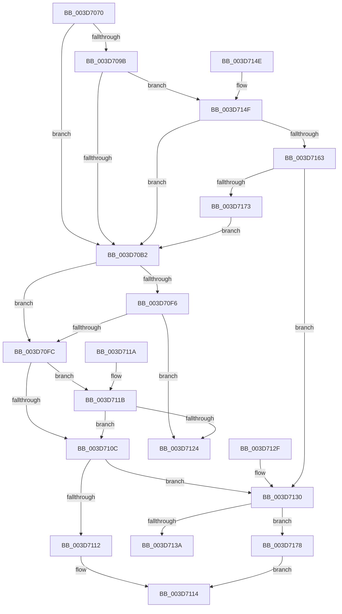

# RtlpSanitizeContextFlags

- RVA: `0x003D7070`–`0x003D717C` (길이 `268` bytes)
- VA: `0x00000001403D7070`
- 실행 섹션: `.text`
- PDB 이름 있음: `예`; PDB Function 태그: `아니요`
- unwind 정보 RVA: `0x00093BB0`
- 디코드: `69`개 명령, `268/268` bytes 표시
- 미해석 바이트: `0` (있으면 어셈블리에 `.byte`로 보존)

> 이 문서는 커널 이미지의 기계어와 PDB 기호를 분석해 생성했습니다. 4번과 5번은 함수 원형과 자료형을 바이너리 사용 방식에서 추정한 C 해석이며 원본 소스 복구 결과는 아닙니다.

## 1. Dependencies

- 직접 호출 지점: **0**; 고유 호출 대상: **0**
- 직접 호출자로 확인된 함수: **5**
- RIP 상대 이미지 참조: **1**

### Outgoing calls
- 직접 디코드된 call 명령이 없습니다.

### Direct callers
- [KyRaiseException](KyRaiseException_function_003D5E20.md) at `0x003D5EA9`
- [KiUnwindUserSspForApcContextCopyBypass](KiUnwindUserSspForApcContextCopyBypass_function_003D6F0C.md) at `0x003D6F49`
- [NtCreateThread](../../page/78/NtCreateThread_function_00780B40.md) at `0x00780D07`
- [PspSetContextThreadInternal](../../page/8D/PspSetContextThreadInternal_function_008D4420.md) at `0x008D44BC`
- [PspGetContextThreadInternal](../../page/8D/PspGetContextThreadInternal_function_008D4770.md) at `0x008D4814`

### Static image references
- `0x003D711B` → RVA `0x01201841` (`CFGRO`; read)

## 2. Other-region calls and transfers

- 다른 실행 섹션으로 향하는 call: **0**
- 별도 외부 분기/꼬리 이동을 확인하지 못했습니다.

## 3. Assembly (complete function range)

```asm
003D7070  48 89 5C 24 08                  mov qword ptr [rsp + 8], rbx
003D7075  8B 01                           mov eax, dword ptr [rcx]
003D7077  44 0F B6 DA                     movzx r11d, dl
003D707B  44 8B C0                        mov r8d, eax
003D707E  4C 8B D1                        mov r10, rcx
003D7081  41 81 E0 80 FF FF 27            and r8d, 0x27ffff80
003D7088  48 BB D8 03 00 00 80 F7 FF FF   movabs rbx, 0xfffff780000003d8
003D7092  41 81 F8 00 00 01 00            cmp r8d, 0x10000
003D7099  74 17                           je 0x1403d70b2
003D709B  44 8B C0                        mov r8d, eax
003D709E  41 81 E0 20 FF FF 07            and r8d, 0x7ffff20
003D70A5  41 81 F8 00 00 10 00            cmp r8d, 0x100000
003D70AC  0F 85 9D 00 00 00               jne 0x1403d714f
003D70B2  44 8B C8                        mov r9d, eax
003D70B5  8B C8                           mov ecx, eax
003D70B7  81 E1 40 00 10 00               and ecx, 0x100040
003D70BD  41 81 E1 20 00 40 00            and r9d, 0x400020
003D70C4  81 F9 40 00 10 00               cmp ecx, 0x100040
003D70CA  8B C8                           mov ecx, eax
003D70CC  41 0F 95 C0                     setne r8b
003D70D0  81 E1 40 00 01 00               and ecx, 0x10040
003D70D6  81 F9 40 00 01 00               cmp ecx, 0x10040
003D70DC  0F 95 C1                        setne cl
003D70DF  33 D2                           xor edx, edx
003D70E1  44 22 C1                        and r8b, cl
003D70E4  41 81 F9 20 00 40 00            cmp r9d, 0x400020
003D70EB  41 0F B6 C8                     movzx ecx, r8b
003D70EF  0F 45 D1                        cmovne edx, ecx
003D70F2  84 D2                           test dl, dl
003D70F4  75 06                           jne 0x1403d70fc
003D70F6  48 83 3B 00                     cmp qword ptr [rbx], 0
003D70FA  74 28                           je 0x1403d7124
003D70FC  8B C8                           mov ecx, eax
003D70FE  81 E1 80 00 10 00               and ecx, 0x100080
003D7104  81 F9 80 00 10 00               cmp ecx, 0x100080
003D710A  74 0F                           je 0x1403d711b
003D710C  0F BA E0 14                     bt eax, 0x14
003D7110  73 1E                           jae 0x1403d7130
003D7112  33 C0                           xor eax, eax
003D7114  48 8B 5C 24 08                  mov rbx, qword ptr [rsp + 8]
003D7119  C3                              ret
003D711A  CC                              int3
003D711B  80 3D 1F A7 E2 00 00            cmp byte ptr [rip + 0xe2a71f], 0
003D7122  75 E8                           jne 0x1403d710c
003D7124  B8 BB 00 00 C0                  mov eax, 0xc00000bb
003D7129  48 8B 5C 24 08                  mov rbx, qword ptr [rsp + 8]
003D712E  C3                              ret
003D712F  CC                              int3
003D7130  B9 0D 00 00 C0                  mov ecx, 0xc000000d
003D7135  45 84 DB                        test r11b, r11b
003D7138  74 3E                           je 0x1403d7178
003D713A  48 8B 5C 24 08                  mov rbx, qword ptr [rsp + 8]
003D713F  25 1F 00 10 F8                  and eax, 0xf810001f
003D7144  0F BA E8 14                     bts eax, 0x14
003D7148  41 89 02                        mov dword ptr [r10], eax
003D714B  33 C0                           xor eax, eax
003D714D  C3                              ret
003D714E  CC                              int3
003D714F  8B C8                           mov ecx, eax
003D7151  81 E1 F0 FF FF 07               and ecx, 0x7fffff0
003D7157  81 F9 00 00 20 00               cmp ecx, 0x200000
003D715D  0F 84 4F FF FF FF               je 0x1403d70b2
003D7163  8B C8                           mov ecx, eax
003D7165  81 E1 00 FF FF 07               and ecx, 0x7ffff00
003D716B  81 F9 00 00 40 00               cmp ecx, 0x400000
003D7171  75 BD                           jne 0x1403d7130
003D7173  E9 3A FF FF FF                  jmp 0x1403d70b2
003D7178  8B C1                           mov eax, ecx
003D717A  EB 98                           jmp 0x1403d7114
```

## 4. C-style interpretation (structured pseudocode)

```c
__int64 __fastcall RtlpSanitizeContextFlags(__int64 a1, int a2)
{
    __int64 result;
    unsigned __int64 v_stack_p8;

    v_stack_p8 = v_rbx;
    a3 = (unsigned int)(((unsigned int)((unsigned int)((unsigned int)(*(unsigned int *)(a1))))) & (0x27FFFF80ULL));
    if (((unsigned int)(a3)) == 0x10000ULL) goto loc_003D70B2;
    a3 = (unsigned int)(((unsigned int)((unsigned int)((unsigned int)(*(unsigned int *)(a1))))) & (0x7FFFF20ULL));
    if (((unsigned int)(a3)) != 0x100000ULL) goto loc_003D714F;
loc_003D70B2:
    a1 = (unsigned int)(((unsigned int)((unsigned int)((unsigned int)(*(unsigned int *)(a1))))) & (0x100040ULL));
    a4 = (unsigned int)(((unsigned int)((unsigned int)((unsigned int)(*(unsigned int *)(a1))))) & (0x400020ULL));
    a3 = (((unsigned int)(a1)) != 0x100040ULL) ? 1 : 0;
    a1 = (unsigned int)(((unsigned int)((unsigned int)((unsigned int)(*(unsigned int *)(a1))))) & (0x10040ULL));
    a1 = (((unsigned int)(a1)) != 0x10040ULL) ? 1 : 0;
    a2 = 0;
    a3 = (unsigned __int8)((a3) & ((unsigned __int8)(a1)));
    if (((unsigned int)(a4)) != 0x400020ULL) { a2 = (unsigned int)((unsigned __int8)(a3)); }
    if ((unsigned __int8)(a2) != 0) goto loc_003D70FC;
    if ((*(unsigned __int64 *)(v_rbx)) == 0) goto loc_003D7124;
loc_003D70FC:
    a1 = (unsigned int)(((unsigned int)((unsigned int)((unsigned int)(*(unsigned int *)(a1))))) & (0x100080ULL));
    if (((unsigned int)(a1)) == 0x100080ULL) goto loc_003D711B;
loc_003D710C:
    if (((unsigned int)(a1)) >= 0x100080ULL) goto loc_003D7130;
    result = 0;
loc_003D7114:
    return result;
loc_003D711B:
    if ((*(unsigned __int8 *)(v_rip + 14853919)) != 0) goto loc_003D710C;
loc_003D7124:
    return (unsigned int)(0xC00000BBULL);
loc_003D7130:
    if ((unsigned __int8)((unsigned __int8)(a2)) == 0) goto loc_003D7178;
    result = (unsigned int)(((unsigned int)(0xC00000BBULL)) & (0xF810001FULL));
    *(unsigned int *)(a1) = (unsigned int)(result);
    result = 0;
    return result;
loc_003D714F:
    a1 = (unsigned int)((0) & (0x7FFFFF0ULL));
    if (((unsigned int)(a1)) == 0x200000ULL) goto loc_003D70B2;
    a1 = (unsigned int)((0) & (0x7FFFF00ULL));
    if (((unsigned int)(a1)) != 0x400000ULL) goto loc_003D7130;
    goto loc_003D70B2;
loc_003D7178:
    goto loc_003D7114;
}
```

## 5. (Beta) C Style

```c
int64_t RtlpSanitizeContextFlags(void *Arg1, int32_t Arg2)
{
    uint8_t *arg1 = (uint8_t *)Arg1;

    int64_t result;
    uint64_t v_stack_p8;

    v_stack_p8 = local_rbx;
    a3 = (uint32_t)(((uint32_t)((uint32_t)((uint32_t)(*(uint32_t *)(arg1))))) & (0x27FFFF80ULL));
    if (((uint32_t)(a3)) == 0x10000ULL) goto loc_003D70B2;
    a3 = (uint32_t)(((uint32_t)((uint32_t)((uint32_t)(*(uint32_t *)(arg1))))) & (0x7FFFF20ULL));
    if (((uint32_t)(a3)) != 0x100000ULL) goto loc_003D714F;
loc_003D70B2:
    Arg1 = (uint32_t)(((uint32_t)((uint32_t)((uint32_t)(*(uint32_t *)(arg1))))) & (0x100040ULL));
    a4 = (uint32_t)(((uint32_t)((uint32_t)((uint32_t)(*(uint32_t *)(arg1))))) & (0x400020ULL));
    a3 = (((uint32_t)(Arg1)) != 0x100040ULL) ? 1 : 0;
    Arg1 = (uint32_t)(((uint32_t)((uint32_t)((uint32_t)(*(uint32_t *)(arg1))))) & (0x10040ULL));
    Arg1 = (((uint32_t)(Arg1)) != 0x10040ULL) ? 1 : 0;
    Arg2 = 0;
    a3 = (uint8_t)((a3) & ((uint8_t)(Arg1)));
    if (((uint32_t)(a4)) != 0x400020ULL) { Arg2 = (uint32_t)((uint8_t)(a3)); }
    if ((uint8_t)(Arg2) != 0) goto loc_003D70FC;
    if ((*(uint64_t *)(local_rbx)) == 0) goto loc_003D7124;
loc_003D70FC:
    Arg1 = (uint32_t)(((uint32_t)((uint32_t)((uint32_t)(*(uint32_t *)(arg1))))) & (0x100080ULL));
    if (((uint32_t)(Arg1)) == 0x100080ULL) goto loc_003D711B;
loc_003D710C:
    if (((uint32_t)(Arg1)) >= 0x100080ULL) goto loc_003D7130;
    result = 0;
loc_003D7114:
    return result;
loc_003D711B:
    if ((*(uint8_t *)(v_rip + 0xE2A71F)) != 0) goto loc_003D710C;
loc_003D7124:
    return (uint32_t)(0xC00000BBULL);
loc_003D7130:
    if ((uint8_t)((uint8_t)(Arg2)) == 0) goto loc_003D7178;
    result = (uint32_t)(((uint32_t)(0xC00000BBULL)) & (0xF810001FULL));
    *(uint32_t *)(arg1) = (uint32_t)(result);
    result = 0;
    return result;
loc_003D714F:
    Arg1 = (uint32_t)((0) & (0x7FFFFF0ULL));
    if (((uint32_t)(Arg1)) == 0x200000ULL) goto loc_003D70B2;
    Arg1 = (uint32_t)((0) & (0x7FFFF00ULL));
    if (((uint32_t)(Arg1)) != 0x400000ULL) goto loc_003D7130;
    goto loc_003D70B2;
loc_003D7178:
    goto loc_003D7114;
}
```

### 관측된 메모리 오프셋

구조체 형식이 확인되지 않은 접근은 인자 기준의 오프셋으로만 기록했습니다.

| 기준 인자 | 오프셋 표현 | 폭 (bit) | 접근 |
|---|---:|---:|---|
| `Arg1` | `+ 0x0` | `32` | `R` |
| `Arg1` | `+ 0x0` | `32` | `W` |

## 6. Execution-region graph

[열기: 2D/3D 그래프와 함수 탐색 컨트롤 패널](../../../control-panel.html?section=text&rva=0x003D7070&view=graph)

- 2D 그래프는 위에서 아래로 흐르고, 3D 그래프는 빈 공간을 드래그해 회전합니다. Shift+드래그는 이동, 휠은 확대·축소, 함수 노드 선택은 대상 보고서 이동입니다.

### Static fallback


