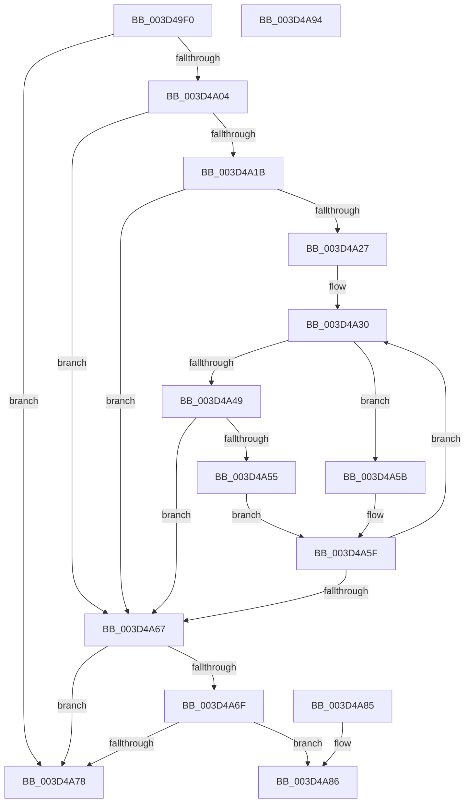

# RtlpSearchFunctionTable

- RVA: `0x003D49F0`–`0x003D4A95` (길이 `165` bytes)
- VA: `0x00000001403D49F0`
- 실행 섹션: `.text`
- PDB 이름 있음: `예`; PDB Function 태그: `아니요`
- unwind 정보 RVA: `0x0009255C`
- 디코드: `52`개 명령, `165/165` bytes 표시
- 미해석 바이트: `0` (있으면 어셈블리에 `.byte`로 보존)

> 이 문서는 커널 이미지의 기계어와 PDB 기호를 분석해 생성했습니다. 4번과 5번은 함수 원형과 자료형을 바이너리 사용 방식에서 추정한 C 해석이며 원본 소스 복구 결과는 아닙니다.

## 1. Dependencies

- 직접 호출 지점: **0**; 고유 호출 대상: **0**
- 직접 호출자로 확인된 함수: **1**
- RIP 상대 이미지 참조: **0**

### Outgoing calls
- 직접 디코드된 call 명령이 없습니다.

### Direct callers
- [RtlMarkExceptionHandlingPages](../../page/A2/RtlMarkExceptionHandlingPages_function_00A26D60.md) at `0x00A26EB5`

### Static image references
- 디코드된 RIP-relative 메모리 참조가 없습니다.

## 2. Other-region calls and transfers

- 다른 실행 섹션으로 향하는 call: **0**
- 별도 외부 분기/꼬리 이동을 확인하지 못했습니다.

## 3. Assembly (complete function range)

```asm
003D49F0  48 89 5C 24 08                  mov qword ptr [rsp + 8], rbx
003D49F5  48 89 7C 24 10                  mov qword ptr [rsp + 0x10], rdi
003D49FA  49 8B D8                        mov rbx, r8
003D49FD  48 8B F9                        mov rdi, rcx
003D4A00  85 D2                           test edx, edx
003D4A02  74 74                           je 0x1403d4a78
003D4A04  49 2B D9                        sub rbx, r9
003D4A07  8D 42 FF                        lea eax, [rdx - 1]
003D4A0A  48 8D 04 40                     lea rax, [rax + rax*2]
003D4A0E  44 8B 0C 81                     mov r9d, dword ptr [rcx + rax*4]
003D4A12  4C 8D 1C 81                     lea r11, [rcx + rax*4]
003D4A16  49 3B D9                        cmp rbx, r9
003D4A19  73 4C                           jae 0x1403d4a67
003D4A1B  45 33 D2                        xor r10d, r10d
003D4A1E  44 8D 42 FE                     lea r8d, [rdx - 2]
003D4A22  45 85 C0                        test r8d, r8d
003D4A25  78 40                           js 0x1403d4a67
003D4A27  66 0F 1F 84 00 00 00 00 00      nop word ptr [rax + rax]
003D4A30  43 8D 04 02                     lea eax, [r10 + r8]
003D4A34  D1 F8                           sar eax, 1
003D4A36  48 63 C8                        movsxd rcx, eax
003D4A39  48 8D 14 49                     lea rdx, [rcx + rcx*2]
003D4A3D  4C 8D 1C 97                     lea r11, [rdi + rdx*4]
003D4A41  8B 14 97                        mov edx, dword ptr [rdi + rdx*4]
003D4A44  48 3B DA                        cmp rbx, rdx
003D4A47  72 12                           jb 0x1403d4a5b
003D4A49  41 8B 4B 0C                     mov ecx, dword ptr [r11 + 0xc]
003D4A4D  44 8B CA                        mov r9d, edx
003D4A50  48 3B D9                        cmp rbx, rcx
003D4A53  72 12                           jb 0x1403d4a67
003D4A55  44 8D 50 01                     lea r10d, [rax + 1]
003D4A59  EB 04                           jmp 0x1403d4a5f
003D4A5B  44 8D 40 FF                     lea r8d, [rax - 1]
003D4A5F  44 8B CA                        mov r9d, edx
003D4A62  45 3B C2                        cmp r8d, r10d
003D4A65  7D C9                           jge 0x1403d4a30
003D4A67  41 8B C9                        mov ecx, r9d
003D4A6A  48 3B D9                        cmp rbx, rcx
003D4A6D  72 09                           jb 0x1403d4a78
003D4A6F  41 8B 4B 04                     mov ecx, dword ptr [r11 + 4]
003D4A73  48 3B D9                        cmp rbx, rcx
003D4A76  72 0E                           jb 0x1403d4a86
003D4A78  33 C0                           xor eax, eax
003D4A7A  48 8B 5C 24 08                  mov rbx, qword ptr [rsp + 8]
003D4A7F  48 8B 7C 24 10                  mov rdi, qword ptr [rsp + 0x10]
003D4A84  C3                              ret
003D4A85  CC                              int3
003D4A86  48 8B 5C 24 08                  mov rbx, qword ptr [rsp + 8]
003D4A8B  49 8B C3                        mov rax, r11
003D4A8E  48 8B 7C 24 10                  mov rdi, qword ptr [rsp + 0x10]
003D4A93  C3                              ret
003D4A94  CC                              int3
```

## 4. C-style interpretation (structured pseudocode)

```c
__int64 __fastcall RtlpSearchFunctionTable(__int64 a1, __int64 a2, __int64 a3, __int64 a4)
{
    __int64 result;
    __int64 v_r10;
    __int64 v_rbx;
    unsigned __int64 v_stack_p10;
    unsigned __int64 v_stack_p8;

    v_stack_p8 = v_rbx;
    v_stack_p10 = v_rdi;
    if ((unsigned int)(a2) == 0) goto loc_003D4A78;
    v_rbx = (a3) - (a4);
    if (v_rbx >= ((unsigned int)(*(unsigned int *)(a1 + a2 - 1 + a2 - 1 * 2 * 4)))) goto loc_003D4A67;
    v_r10 = 0;
    if (sign_flag) goto loc_003D4A67;
loc_003D4A30:
    result = (unsigned int)((v_r10 + a2 - 2 * 1) >> (1));
    if (v_rbx < ((unsigned int)(*(unsigned int *)(a1 + (int)((unsigned int)(result)) + (int)((unsigned int)(result)) * 2 * 4)))) goto loc_003D4A5B;
    if (v_rbx < ((unsigned int)(*(unsigned int *)(a1 + (int)((unsigned int)(result)) + (int)((unsigned int)(result)) * 2 * 4 + 12)))) goto loc_003D4A67;
    goto loc_003D4A5F;
loc_003D4A5B:
loc_003D4A5F:
    if (((unsigned int)(result - 1)) >= ((unsigned int)(result + 1))) goto loc_003D4A30;
loc_003D4A67:
    if (v_rbx < ((unsigned int)((unsigned int)((unsigned int)((unsigned int)((unsigned int)(*(unsigned int *)(a1 + (int)((unsigned int)(result)) + (int)((unsigned int)(result)) * 2 * 4)))))))) goto loc_003D4A78;
    if (v_rbx < ((unsigned int)(*(unsigned int *)(a1 + (int)((unsigned int)(result)) + (int)((unsigned int)(result)) * 2 * 4 + 4)))) goto loc_003D4A86;
loc_003D4A78:
    result = 0;
    return result;
loc_003D4A86:
    return a1 + (int)((unsigned int)(result)) + (int)((unsigned int)(result)) * 2 * 4;
}
```

## 5. (Beta) C Style

```c
int64_t RtlpSearchFunctionTable(void *Arg1, int64_t Arg2, int64_t Arg3, int64_t Arg4)
{
    uint8_t *arg1 = (uint8_t *)Arg1;

    int64_t result;
    int64_t local_r10;
    int64_t local_rbx;
    uint64_t v_stack_p10;
    uint64_t v_stack_p8;

    v_stack_p8 = local_rbx;
    v_stack_p10 = local_rdi;
    if ((uint32_t)(Arg2) == 0) goto loc_003D4A78;
    local_rbx = (Arg3) - (Arg4);
    if (local_rbx >= ((uint32_t)(*(uint32_t *)(arg1 + Arg2 - 0x1 + Arg2 - 0x1 * 2 * 4)))) goto loc_003D4A67;
    local_r10 = 0;
    if (sign_flag) goto loc_003D4A67;
loc_003D4A30:
    result = (uint32_t)((local_r10 + Arg2 - 2 * 1) >> (1));
    if (local_rbx < ((uint32_t)(*(uint32_t *)(arg1 + (int32_t)((uint32_t)(result)) + (int32_t)((uint32_t)(result)) * 2 * 4)))) goto loc_003D4A5B;
    if (local_rbx < ((uint32_t)(*(uint32_t *)(arg1 + (int32_t)((uint32_t)(result)) + (int32_t)((uint32_t)(result)) * 2 * 4 + 0xC)))) goto loc_003D4A67;
    goto loc_003D4A5F;
loc_003D4A5B:
loc_003D4A5F:
    if (((uint32_t)(result - 1)) >= ((uint32_t)(result + 1))) goto loc_003D4A30;
loc_003D4A67:
    if (local_rbx < ((uint32_t)((uint32_t)((uint32_t)((uint32_t)((uint32_t)(*(uint32_t *)(arg1 + (int32_t)((uint32_t)(result)) + (int32_t)((uint32_t)(result)) * 2 * 4)))))))) goto loc_003D4A78;
    if (local_rbx < ((uint32_t)(*(uint32_t *)(arg1 + (int32_t)((uint32_t)(result)) + (int32_t)((uint32_t)(result)) * 2 * 4 + 0x4)))) goto loc_003D4A86;
loc_003D4A78:
    result = 0;
    return result;
loc_003D4A86:
    return Arg1 + (int32_t)((uint32_t)(result)) + (int32_t)((uint32_t)(result)) * 2 * 4;
}
```

### 관측된 메모리 오프셋

구조체 형식이 확인되지 않은 접근은 인자 기준의 오프셋으로만 기록했습니다.

| 기준 인자 | 오프셋 표현 | 폭 (bit) | 접근 |
|---|---:|---:|---|
| `Arg1` | `+ 0x0 + rax*4` | `32` | `R` |
| `Arg1` | `+ 0x0 + rax*4` | `64` | `R` |
| `Arg1` | `+ 0x0 + rdx*4` | `32` | `R` |
| `Arg1` | `+ 0x0 + rdx*4` | `64` | `R` |
| `Arg1` | `+ 0x4` | `32` | `R` |
| `Arg1` | `+ 0xC` | `32` | `R` |

## 6. Execution-region graph

[열기: 2D/3D 그래프와 함수 탐색 컨트롤 패널](../../../control-panel.html?section=text&rva=0x003D49F0&view=graph)

- 2D 그래프는 위에서 아래로 흐르고, 3D 그래프는 빈 공간을 드래그해 회전합니다. Shift+드래그는 이동, 휠은 확대·축소, 함수 노드 선택은 대상 보고서 이동입니다.

### Static fallback


