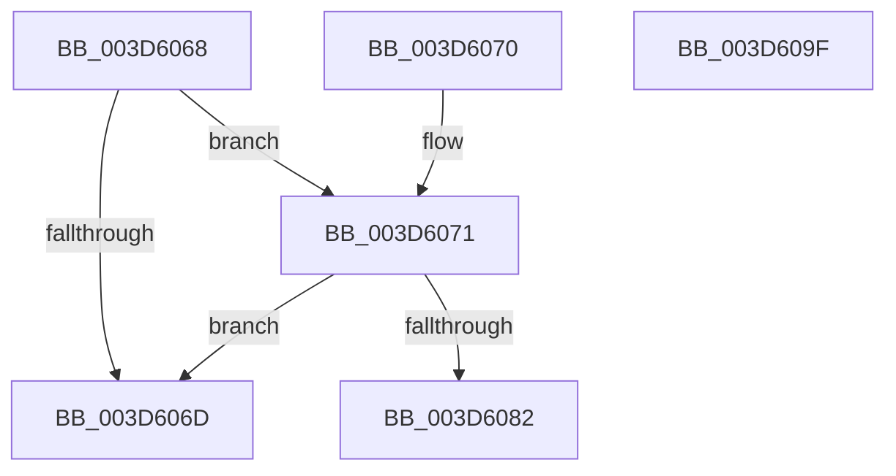

# RtlpValidateContextXStateDisabledFeatures

- RVA: `0x003D6068`–`0x003D60A0` (길이 `56` bytes)
- VA: `0x00000001403D6068`
- 실행 섹션: `.text`
- PDB 이름 있음: `예`; PDB Function 태그: `아니요`
- unwind 정보 RVA: `0x000DB714`
- 디코드: `18`개 명령, `56/56` bytes 표시
- 미해석 바이트: `0` (있으면 어셈블리에 `.byte`로 보존)

> 이 문서는 커널 이미지의 기계어와 PDB 기호를 분석해 생성했습니다. 4번과 5번은 함수 원형과 자료형을 바이너리 사용 방식에서 추정한 C 해석이며 원본 소스 복구 결과는 아닙니다.

## 1. Dependencies

- 직접 호출 지점: **0**; 고유 호출 대상: **0**
- 직접 호출자로 확인된 함수: **2**
- RIP 상대 이미지 참조: **0**

### Outgoing calls
- 직접 디코드된 call 명령이 없습니다.

### Direct callers
- [KyRaiseException](KyRaiseException_function_003D5E20.md) at `0x003D5F7F`
- [sub_009A6520](../../page/9A/Unknown_function_009A6520.md) at `0x009A6585`

### Static image references
- 디코드된 RIP-relative 메모리 참조가 없습니다.

## 2. Other-region calls and transfers

- 다른 실행 섹션으로 향하는 call: **0**
- 별도 외부 분기/꼬리 이동을 확인하지 못했습니다.

## 3. Assembly (complete function range)

```asm
003D6068  48 85 D2                        test rdx, rdx
003D606B  75 04                           jne 0x1403d6071
003D606D  33 C0                           xor eax, eax
003D606F  C3                              ret
003D6070  CC                              int3
003D6071  8B 41 30                        mov eax, dword ptr [rcx + 0x30]
003D6074  41 B8 40 00 10 00               mov r8d, 0x100040
003D607A  41 23 C0                        and eax, r8d
003D607D  41 3B C0                        cmp eax, r8d
003D6080  75 EB                           jne 0x1403d606d
003D6082  48 63 81 E0 04 00 00            movsxd rax, dword ptr [rcx + 0x4e0]
003D6089  48 8B 8C 08 D0 04 00 00         mov rcx, qword ptr [rax + rcx + 0x4d0]
003D6091  48 23 CA                        and rcx, rdx
003D6094  48 F7 D9                        neg rcx
003D6097  1B C0                           sbb eax, eax
003D6099  25 0D 00 00 C0                  and eax, 0xc000000d
003D609E  C3                              ret
003D609F  CC                              int3
```

## 4. C-style interpretation (structured pseudocode)

```c
__int64 __fastcall RtlpValidateContextXStateDisabledFeatures(__int64 a1, __int64 a2)
{
    __int64 result;

    if (a2 != 0) goto loc_003D6071;
loc_003D606D:
    result = 0;
    return result;
loc_003D6071:
    result = (unsigned int)(((unsigned int)(*(unsigned int *)(a1 + 48))) & ((unsigned int)((unsigned int)(0x100040ULL))));
    if (((unsigned int)(result)) != ((unsigned int)((unsigned int)(0x100040ULL)))) goto loc_003D606D;
    a1 = (*(unsigned __int64 *)((int)(*(unsigned int *)(a1 + 1248)) + a1 * 1 + 1232)) & (a2);
    a1 = -(a1);
    result = (unsigned int)(((int)(*(unsigned int *)(a1 + 1248))) & (0xC000000DULL));
    return result;
}
```

## 5. (Beta) C Style

```c
int64_t RtlpValidateContextXStateDisabledFeatures(void *Arg1, int64_t Arg2)
{
    uint8_t *arg1 = (uint8_t *)Arg1;

    int64_t result;

    if (Arg2 != 0) goto loc_003D6071;
loc_003D606D:
    result = 0;
    return result;
loc_003D6071:
    result = (uint32_t)(((uint32_t)(*(uint32_t *)(arg1 + 0x30))) & ((uint32_t)((uint32_t)(0x100040ULL))));
    if (((uint32_t)(result)) != ((uint32_t)((uint32_t)(0x100040ULL)))) goto loc_003D606D;
    Arg1 = (*(uint64_t *)((int32_t)(*(uint32_t *)(arg1 + 0x4E0)) + arg1 * 1 + 0x4D0)) & (Arg2);
    Arg1 = -(Arg1);
    result = (uint32_t)(((int32_t)(*(uint32_t *)(arg1 + 0x4E0))) & (0xC000000DULL));
    return result;
}
```

### 관측된 메모리 오프셋

구조체 형식이 확인되지 않은 접근은 인자 기준의 오프셋으로만 기록했습니다.

| 기준 인자 | 오프셋 표현 | 폭 (bit) | 접근 |
|---|---:|---:|---|
| `Arg1` | `+ 0x30` | `32` | `R` |
| `Arg1` | `+ 0x4E0` | `32` | `R` |

## 6. Execution-region graph

[열기: 2D/3D 그래프와 함수 탐색 컨트롤 패널](../../../control-panel.html?section=text&rva=0x003D6068&view=graph)

- 2D 그래프는 위에서 아래로 흐르고, 3D 그래프는 빈 공간을 드래그해 회전합니다. Shift+드래그는 이동, 휠은 확대·축소, 함수 노드 선택은 대상 보고서 이동입니다.

### Static fallback


