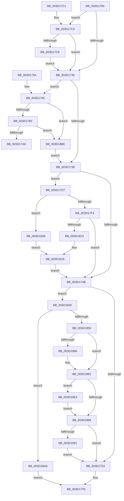

# SePrivilegePolicyCheck

- RVA: `0x003D1700`–`0x003D1913` (길이 `531` bytes)
- VA: `0x00000001403D1700`
- 실행 섹션: `.text`
- PDB 이름 있음: `예`; PDB Function 태그: `아니요`
- unwind 정보 RVA: `0x00091194`
- 디코드: `135`개 명령, `531/531` bytes 표시
- 미해석 바이트: `0` (있으면 어셈블리에 `.byte`로 보존)

> 이 문서는 커널 이미지의 기계어와 PDB 기호를 분석해 생성했습니다. 4번과 5번은 함수 원형과 자료형을 바이너리 사용 방식에서 추정한 C 해석이며 원본 소스 복구 결과는 아닙니다.

## 1. Dependencies

- 직접 호출 지점: **3**; 고유 호출 대상: **2**
- 직접 호출자로 확인된 함수: **2**
- RIP 상대 이미지 참조: **3**

### Outgoing calls
- `0x003D17EA` → [SepSinglePrivilegeCheck](SepSinglePrivilegeCheck_function_003D191C.md) (function, `0x003D191C`)
- `0x003D1806` → [SepSinglePrivilegeCheck](SepSinglePrivilegeCheck_function_003D191C.md) (function, `0x003D191C`)
- `0x003D1848` → [ExAllocatePool2](../../poolcode/B8/ExAllocatePool2_function_00B820F0.md) (function, `0x00B820F0`)

### Direct callers
- [SeAccessCheckByType](../44/SeAccessCheckByType_function_00440BC8.md) at `0x00441422`
- [SepAccessCheckAndAuditAlarm](../../page/A1/SepAccessCheckAndAuditAlarm_function_00A1AF4C.md) at `0x00A1BA23`

### Static image references
- `0x003D1765` → RVA `0x00FD9B00` (`PAGEDATA`; read)
- `0x003D17E3` → RVA `0x00FD9B38` (`PAGEDATA`; read)
- `0x003D17FF` → RVA `0x00FD9B28` (`PAGEDATA`; read)

## 2. Other-region calls and transfers

- 다른 실행 섹션으로 향하는 call: **1**
  - `0x003D1848` → [ExAllocatePool2](../../poolcode/B8/ExAllocatePool2_function_00B820F0.md) (`.text` → `POOLCODE`)
- 별도 외부 분기/꼬리 이동을 확인하지 못했습니다.

## 3. Assembly (complete function range)

```asm
003D1700  40 53                           push rbx
003D1702  55                              push rbp
003D1703  56                              push rsi
003D1704  57                              push rdi
003D1705  41 54                           push r12
003D1707  41 56                           push r14
003D1709  41 57                           push r15
003D170B  48 83 EC 30                     sub rsp, 0x30
003D170F  4C 8B BC 24 90 00 00 00         mov r15, qword ptr [rsp + 0x90]
003D1717  33 DB                           xor ebx, ebx
003D1719  45 32 E4                        xor r12b, r12b
003D171C  45 32 F6                        xor r14b, r14b
003D171F  40 32 F6                        xor sil, sil
003D1722  4D 8B D9                        mov r11, r9
003D1725  48 8B EA                        mov rbp, rdx
003D1728  4C 8B D1                        mov r10, rcx
003D172B  8B FB                           mov edi, ebx
003D172D  4D 85 C0                        test r8, r8
003D1730  0F 85 8C 00 00 00               jne 0x1403d17c2
003D1736  F7 01 00 00 00 01               test dword ptr [rcx], 0x1000000
003D173C  75 27                           jne 0x1403d1765
003D173E  41 F7 02 00 00 08 00            test dword ptr [r10], 0x80000
003D1745  0F 85 8C 00 00 00               jne 0x1403d17d7
003D174B  85 FF                           test edi, edi
003D174D  0F 85 DD 00 00 00               jne 0x1403d1830
003D1753  33 C0                           xor eax, eax
003D1755  48 83 C4 30                     add rsp, 0x30
003D1759  41 5F                           pop r15
003D175B  41 5E                           pop r14
003D175D  41 5C                           pop r12
003D175F  5F                              pop rdi
003D1760  5E                              pop rsi
003D1761  5D                              pop rbp
003D1762  5B                              pop rbx
003D1763  C3                              ret
003D1764  CC                              int3
003D1765  44 8B 05 94 83 C0 00            mov r8d, dword ptr [rip + 0xc08394]
003D176C  48 89 5C 24 28                  mov qword ptr [rsp + 0x28], rbx
003D1771  48 89 5C 24 20                  mov qword ptr [rsp + 0x20], rbx
003D1776  38 9C 24 98 00 00 00            cmp byte ptr [rsp + 0x98], bl
003D177D  0F 84 3B 01 00 00               je 0x1403d18be
003D1783  49 8B 43 48                     mov rax, qword ptr [r11 + 0x48]
003D1787  48 87 44 24 28                  xchg qword ptr [rsp + 0x28], rax
003D178C  49 8B 4B 40                     mov rcx, qword ptr [r11 + 0x40]
003D1790  48 87 4C 24 20                  xchg qword ptr [rsp + 0x20], rcx
003D1795  48 8B 54 24 20                  mov rdx, qword ptr [rsp + 0x20]
003D179A  48 23 54 24 28                  and rdx, qword ptr [rsp + 0x28]
003D179F  F0 09 1C 24                     lock or dword ptr [rsp], ebx
003D17A3  4C 0F A3 C2                     bt rdx, r8
003D17A7  0F 82 11 01 00 00               jb 0x1403d18be
003D17AD  B8 61 00 00 C0                  mov eax, 0xc0000061
003D17B2  48 83 C4 30                     add rsp, 0x30
003D17B6  41 5F                           pop r15
003D17B8  41 5E                           pop r14
003D17BA  41 5C                           pop r12
003D17BC  5F                              pop rdi
003D17BD  5E                              pop rsi
003D17BE  5D                              pop rbp
003D17BF  5B                              pop rbx
003D17C0  C3                              ret
003D17C1  CC                              int3
003D17C2  4D 8B 18                        mov r11, qword ptr [r8]
003D17C5  4D 85 DB                        test r11, r11
003D17C8  0F 85 68 FF FF FF               jne 0x1403d1736
003D17CE  4D 8B 58 10                     mov r11, qword ptr [r8 + 0x10]
003D17D2  E9 5F FF FF FF                  jmp 0x1403d1736
003D17D7  44 0F B6 84 24 98 00 00 00      movzx r8d, byte ptr [rsp + 0x98]
003D17E0  49 8B D3                        mov rdx, r11
003D17E3  48 8B 0D 4E 83 C0 00            mov rcx, qword ptr [rip + 0xc0834e]
003D17EA  E8 2D 01 00 00                  call 0x1403d191c
003D17EF  84 C0                           test al, al
003D17F1  75 38                           jne 0x1403d182b
003D17F3  44 0F B6 84 24 98 00 00 00      movzx r8d, byte ptr [rsp + 0x98]
003D17FC  49 8B D3                        mov rdx, r11
003D17FF  48 8B 0D 22 83 C0 00            mov rcx, qword ptr [rip + 0xc08322]
003D1806  E8 11 01 00 00                  call 0x1403d191c
003D180B  84 C0                           test al, al
003D180D  0F 84 38 FF FF FF               je 0x1403d174b
003D1813  41 B6 01                        mov r14b, 1
003D1816  41 81 22 FF FF F7 FF            and dword ptr [r10], 0xfff7ffff
003D181D  FF C7                           inc edi
003D181F  81 4D 00 00 00 08 00            or dword ptr [rbp], 0x80000
003D1826  E9 20 FF FF FF                  jmp 0x1403d174b
003D182B  41 B4 01                        mov r12b, 1
003D182E  EB E6                           jmp 0x1403d1816
003D1830  8D 47 FF                        lea eax, [rdi - 1]
003D1833  41 B8 53 65 50 72               mov r8d, 0x72506553
003D1839  8D 0C 40                        lea ecx, [rax + rax*2]
003D183C  8D 14 8D 14 00 00 00            lea edx, [rcx*4 + 0x14]
003D1843  B9 00 01 00 00                  mov ecx, 0x100
003D1848  E8 A3 08 7B 00                  call 0x140b820f0
003D184D  49 89 07                        mov qword ptr [r15], rax
003D1850  48 85 C0                        test rax, rax
003D1853  0F 84 81 00 00 00               je 0x1403d18da
003D1859  89 38                           mov dword ptr [rax], edi
003D185B  49 8B 07                        mov rax, qword ptr [r15]
003D185E  89 58 04                        mov dword ptr [rax + 4], ebx
003D1861  45 84 E4                        test r12b, r12b
003D1864  74 1D                           je 0x1403d1883
003D1866  48 8B 05 CB 82 C0 00            mov rax, qword ptr [rip + 0xc082cb]
003D186D  BB 01 00 00 00                  mov ebx, 1
003D1872  49 8B 0F                        mov rcx, qword ptr [r15]
003D1875  48 89 41 08                     mov qword ptr [rcx + 8], rax
003D1879  49 8B 07                        mov rax, qword ptr [r15]
003D187C  C7 40 10 00 00 00 80            mov dword ptr [rax + 0x10], 0x80000000
003D1883  40 84 F6                        test sil, sil
003D1886  75 5C                           jne 0x1403d18e4
003D1888  45 84 F6                        test r14b, r14b
003D188B  0F 84 C2 FE FF FF               je 0x1403d1753
003D1891  8B C3                           mov eax, ebx
003D1893  48 8D 0C 40                     lea rcx, [rax + rax*2]
003D1897  48 8B 05 8A 82 C0 00            mov rax, qword ptr [rip + 0xc0828a]
003D189E  48 8D 14 8D 00 00 00 00         lea rdx, [rcx*4]
003D18A6  49 8B 0F                        mov rcx, qword ptr [r15]
003D18A9  48 89 44 0A 08                  mov qword ptr [rdx + rcx + 8], rax
003D18AE  49 8B 07                        mov rax, qword ptr [r15]
003D18B1  C7 44 02 10 00 00 00 80         mov dword ptr [rdx + rax + 0x10], 0x80000000
003D18B9  E9 95 FE FF FF                  jmp 0x1403d1753
003D18BE  41 81 22 FF FF FF FE            and dword ptr [r10], 0xfeffffff
003D18C5  BF 01 00 00 00                  mov edi, 1
003D18CA  81 4D 00 00 00 00 01            or dword ptr [rbp], 0x1000000
003D18D1  40 0F B6 F7                     movzx esi, dil
003D18D5  E9 64 FE FF FF                  jmp 0x1403d173e
003D18DA  B8 9A 00 00 C0                  mov eax, 0xc000009a
003D18DF  E9 71 FE FF FF                  jmp 0x1403d1755
003D18E4  8B C3                           mov eax, ebx
003D18E6  FF C3                           inc ebx
003D18E8  48 8D 0C 40                     lea rcx, [rax + rax*2]
003D18EC  48 8B 05 0D 82 C0 00            mov rax, qword ptr [rip + 0xc0820d]
003D18F3  48 8D 14 8D 00 00 00 00         lea rdx, [rcx*4]
003D18FB  49 8B 0F                        mov rcx, qword ptr [r15]
003D18FE  48 89 44 0A 08                  mov qword ptr [rdx + rcx + 8], rax
003D1903  49 8B 07                        mov rax, qword ptr [r15]
003D1906  C7 44 02 10 00 00 00 80         mov dword ptr [rdx + rax + 0x10], 0x80000000
003D190E  E9 75 FF FF FF                  jmp 0x1403d1888
```

## 4. C-style interpretation (structured pseudocode)

```c
__int64 __fastcall SePrivilegePolicyCheck(__int64 a1, __int64 a2, __int64 a3, __int64 a4, __int64 a5, unsigned __int8 a6)
{
    __int64 result;
    __int64 v_r12;
    __int64 v_r14;
    __int64 v_rbx;
    __int64 v_rdi;
    __int64 v_rsi;
    __int64 v_rsp;
    unsigned int v_stack_p0;
    unsigned __int64 v_stack_p20;
    unsigned __int64 v_stack_p28;

    v_rsp = (v_rsp) - (48);
    v_rbx = 0;
    v_r12 = 0;
    v_r14 = 0;
    v_rsi = 0;
    if (a3 != 0) goto loc_003D17C2;
loc_003D1736:
    if (((*(unsigned int *)(a1)) & (0x1000000ULL)) != 0) goto loc_003D1765;
loc_003D173E:
    if (((*(unsigned int *)(a1)) & (0x80000ULL)) != 0) goto loc_003D17D7;
loc_003D174B:
    if (0 != 0) goto loc_003D1830;
loc_003D1753:
    result = 0;
loc_003D1755:
    v_rsp = (v_rsp) + (48);
    return result;
loc_003D1765:
    v_stack_p28 = 0;
    v_stack_p20 = 0;
    if (a6 == 0) goto loc_003D18BE;
    a2 = (v_stack_p20) & (v_stack_p28);
    if (condition_is_below) goto loc_003D18BE;
    v_rsp = (v_rsp) + (48);
    return (unsigned int)(0xC0000061ULL);
loc_003D17C2:
    if (*(unsigned __int64 *)((unsigned int)(*(unsigned int *)(v_rip + 12616596))) != 0) goto loc_003D1736;
    goto loc_003D1736;
loc_003D17D7:
    result = SepSinglePrivilegeCheck(*(unsigned __int64 *)(v_rip + 12616526), *(unsigned __int64 *)((unsigned int)(*(unsigned int *)(v_rip + 12616596)) + 16), a6, a4);
    if ((unsigned __int8)(result) != 0) goto loc_003D182B;
    result = SepSinglePrivilegeCheck(*(unsigned __int64 *)(v_rip + 12616482), *(unsigned __int64 *)((unsigned int)(*(unsigned int *)(v_rip + 12616596)) + 16), a6, a4);
    if ((unsigned __int8)(result) == 0) goto loc_003D174B;
loc_003D1816:
    v_rdi = (unsigned int)((0) + 1);
    goto loc_003D174B;
loc_003D182B:
    goto loc_003D1816;
loc_003D1830:
    result = ExAllocatePool2(256, v_rdi - 1 + v_rdi - 1 * 2 * 4 + 20, (unsigned int)(0x72506553ULL), a4);
    *(unsigned __int64 *)(a5) = result;
    if (result == 0) goto loc_003D18DA;
    *(unsigned int *)(result) = (unsigned int)(v_rdi);
    *(unsigned int *)(*(unsigned __int64 *)(a5) + 4) = 0;
    result = *(unsigned __int64 *)(a5);
    if (1 != 0) {
        result = *(unsigned __int64 *)(v_rip + 12616395);
        v_rbx = 1;
        a1 = *(unsigned __int64 *)(a5);
        *(unsigned __int64 *)(a1 + 8) = result;
        result = *(unsigned __int64 *)(a5);
        *(unsigned int *)(result + 16) = 0x80000000ULL;
    }
    if (0 != 0) goto loc_003D18E4;
loc_003D1888:
    if (1 == 0) goto loc_003D1753;
    *(unsigned __int64 *)((unsigned int)((unsigned int)(v_rbx)) + (unsigned int)((unsigned int)(v_rbx)) * 2 * 4 + *(unsigned __int64 *)(a5) * 1 + 8) = *(unsigned __int64 *)(v_rip + 12616330);
    *(unsigned int *)((unsigned int)((unsigned int)(v_rbx)) + (unsigned int)((unsigned int)(v_rbx)) * 2 * 4 + *(unsigned __int64 *)(a5) * 1 + 16) = 0x80000000ULL;
    goto loc_003D1753;
loc_003D18BE:
    goto loc_003D173E;
loc_003D18DA:
    goto loc_003D1755;
loc_003D18E4:
    v_rbx = (unsigned int)((v_rbx) + 1);
    *(unsigned __int64 *)((unsigned int)((unsigned int)(v_rbx)) + (unsigned int)((unsigned int)(v_rbx)) * 2 * 4 + *(unsigned __int64 *)(a5) * 1 + 8) = *(unsigned __int64 *)(v_rip + 12616205);
    *(unsigned int *)((unsigned int)((unsigned int)(v_rbx)) + (unsigned int)((unsigned int)(v_rbx)) * 2 * 4 + *(unsigned __int64 *)(a5) * 1 + 16) = 0x80000000ULL;
    goto loc_003D1888;
}
```

## 5. (Beta) C Style

```c
int64_t SePrivilegePolicyCheck(void *Arg1, void *Arg2, int64_t Arg3, int64_t Arg4, void *Arg5, uint8_t Arg6)
{
    uint8_t *arg1 = (uint8_t *)Arg1;
    uint8_t *arg2 = (uint8_t *)Arg2;
    uint8_t *arg5 = (uint8_t *)Arg5;

    int64_t result;
    int64_t local_r12;
    int64_t local_r14;
    int64_t local_rbx;
    int64_t local_rdi;
    int64_t local_rsi;
    int64_t local_rsp;
    uint32_t v_stack_p0;
    uint64_t v_stack_p20;
    uint64_t v_stack_p28;

    local_rsp = (local_rsp) - (48);
    local_rbx = 0;
    local_r12 = 0;
    local_r14 = 0;
    local_rsi = 0;
    if (Arg3 != 0) goto loc_003D17C2;
loc_003D1736:
    if (((*(uint32_t *)(arg1)) & (0x1000000ULL)) != 0) goto loc_003D1765;
loc_003D173E:
    if (((*(uint32_t *)(arg1)) & (0x80000ULL)) != 0) goto loc_003D17D7;
loc_003D174B:
    if (0 != 0) goto loc_003D1830;
loc_003D1753:
    result = 0;
loc_003D1755:
    local_rsp = (local_rsp) + (48);
    return result;
loc_003D1765:
    v_stack_p28 = 0;
    v_stack_p20 = 0;
    if (Arg6 == 0) goto loc_003D18BE;
    Arg2 = (v_stack_p20) & (v_stack_p28);
    if (condition_is_below) goto loc_003D18BE;
    local_rsp = (local_rsp) + (48);
    return (uint32_t)(0xC0000061ULL);
loc_003D17C2:
    if (*(uint64_t *)((uint32_t)(*(uint32_t *)(v_rip + 0xC08394))) != 0) goto loc_003D1736;
    goto loc_003D1736;
loc_003D17D7:
    result = SepSinglePrivilegeCheck(*(uint64_t *)(v_rip + 0xC0834E), *(uint64_t *)((uint32_t)(*(uint32_t *)(v_rip + 0xC08394)) + 0x10), Arg6, Arg4);
    if ((uint8_t)(result) != 0) goto loc_003D182B;
    result = SepSinglePrivilegeCheck(*(uint64_t *)(v_rip + 0xC08322), *(uint64_t *)((uint32_t)(*(uint32_t *)(v_rip + 0xC08394)) + 0x10), Arg6, Arg4);
    if ((uint8_t)(result) == 0) goto loc_003D174B;
loc_003D1816:
    local_rdi = (uint32_t)((0) + 1);
    goto loc_003D174B;
loc_003D182B:
    goto loc_003D1816;
loc_003D1830:
    result = ExAllocatePool2(256, local_rdi - 1 + local_rdi - 1 * 2 * 4 + 20, (uint32_t)(0x72506553ULL), Arg4);
    *(uint64_t *)(arg5) = result;
    if (result == 0) goto loc_003D18DA;
    *(uint32_t *)(result) = (uint32_t)(local_rdi);
    *(uint32_t *)(*(uint64_t *)(arg5) + 0x4) = 0;
    result = *(uint64_t *)(arg5);
    if (1 != 0) {
        result = *(uint64_t *)(v_rip + 0xC082CB);
        local_rbx = 1;
        Arg1 = *(uint64_t *)(arg5);
        *(uint64_t *)(arg1 + 0x8) = result;
        result = *(uint64_t *)(arg5);
        *(uint32_t *)(result + 0x10) = 0x80000000ULL;
    }
    if (0 != 0) goto loc_003D18E4;
loc_003D1888:
    if (1 == 0) goto loc_003D1753;
    *(uint64_t *)((uint32_t)((uint32_t)(local_rbx)) + (uint32_t)((uint32_t)(local_rbx)) * 2 * 4 + *(uint64_t *)(arg5) * 1 + 0x8) = *(uint64_t *)(v_rip + 0xC0828A);
    *(uint32_t *)((uint32_t)((uint32_t)(local_rbx)) + (uint32_t)((uint32_t)(local_rbx)) * 2 * 4 + *(uint64_t *)(arg5) * 1 + 0x10) = 0x80000000ULL;
    goto loc_003D1753;
loc_003D18BE:
    goto loc_003D173E;
loc_003D18DA:
    goto loc_003D1755;
loc_003D18E4:
    local_rbx = (uint32_t)((local_rbx) + 1);
    *(uint64_t *)((uint32_t)((uint32_t)(local_rbx)) + (uint32_t)((uint32_t)(local_rbx)) * 2 * 4 + *(uint64_t *)(arg5) * 1 + 0x8) = *(uint64_t *)(v_rip + 0xC0820D);
    *(uint32_t *)((uint32_t)((uint32_t)(local_rbx)) + (uint32_t)((uint32_t)(local_rbx)) * 2 * 4 + *(uint64_t *)(arg5) * 1 + 0x10) = 0x80000000ULL;
    goto loc_003D1888;
}
```

### 관측된 메모리 오프셋

구조체 형식이 확인되지 않은 접근은 인자 기준의 오프셋으로만 기록했습니다.

| 기준 인자 | 오프셋 표현 | 폭 (bit) | 접근 |
|---|---:|---:|---|
| `Arg1` | `+ 0x0` | `32` | `R` |
| `Arg1` | `+ 0x0` | `32` | `R/W` |
| `Arg2` | `+ 0x0` | `32` | `R/W` |
| `Arg5` | `+ 0x0` | `64` | `R` |
| `Arg5` | `+ 0x0` | `64` | `W` |

## 6. Execution-region graph

[열기: 2D/3D 그래프와 함수 탐색 컨트롤 패널](../../../control-panel.html?section=text&rva=0x003D1700&view=graph)

- 2D 그래프는 위에서 아래로 흐르고, 3D 그래프는 빈 공간을 드래그해 회전합니다. Shift+드래그는 이동, 휠은 확대·축소, 함수 노드 선택은 대상 보고서 이동입니다.

### Static fallback


