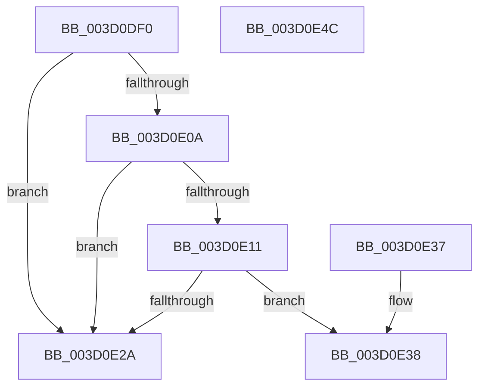

# SepIsCapabilitySid

- RVA: `0x003D0DF0`–`0x003D0E4D` (길이 `93` bytes)
- VA: `0x00000001403D0DF0`
- 실행 섹션: `.text`
- PDB 이름 있음: `예`; PDB Function 태그: `아니요`
- unwind 정보 RVA: `0x000730EC`
- 디코드: `30`개 명령, `93/93` bytes 표시
- 미해석 바이트: `0` (있으면 어셈블리에 `.byte`로 보존)

> 이 문서는 커널 이미지의 기계어와 PDB 기호를 분석해 생성했습니다. 4번과 5번은 함수 원형과 자료형을 바이너리 사용 방식에서 추정한 C 해석이며 원본 소스 복구 결과는 아닙니다.

## 1. Dependencies

- 직접 호출 지점: **1**; 고유 호출 대상: **1**
- 직접 호출자로 확인된 함수: **5**
- RIP 상대 이미지 참조: **1**

### Outgoing calls
- `0x003D0E1F` → [RtlCompareMemory](../6B/RtlCompareMemory_function_006BA670.md) (function, `0x006BA670`)

### Direct callers
- [SepMaximumAccessCheck](../30/SepMaximumAccessCheck_function_00300BF0.md) at `0x00300FAE`
- [SepMaximumAccessCheck](../30/SepMaximumAccessCheck_function_00300BF0.md) at `0x00301035`
- [SepMaximumAccessCheck](../30/SepMaximumAccessCheck_function_00300BF0.md) at `0x0030108C`
- [SepNormalAccessCheckEx](../3C/SepNormalAccessCheckEx_function_003CFD8C.md) at `0x003D014A`
- [SepNormalAccessCheckEx](../3C/SepNormalAccessCheckEx_function_003CFD8C.md) at `0x003D018A`
- [SepNormalAccessCheckEx](../3C/SepNormalAccessCheckEx_function_003CFD8C.md) at `0x003D039F`
- [SepNormalAccessCheck](SepNormalAccessCheck_function_003D0688.md) at `0x003D08CD`
- [SepNormalAccessCheck](SepNormalAccessCheck_function_003D0688.md) at `0x003D09EB`
- [SepNormalAccessCheck](SepNormalAccessCheck_function_003D0688.md) at `0x003D0ADA`
- [SepNormalAccessCheck](SepNormalAccessCheck_function_003D0688.md) at `0x003D0C41`
- [SepMaximumAccessCheckEx](../60/SepMaximumAccessCheckEx_function_00606D78.md) at `0x00606EDA`
- [SepMaximumAccessCheckEx](../60/SepMaximumAccessCheckEx_function_00606D78.md) at `0x00607349`
- [sub_006E0188](../6E/Unknown_function_006E0188.md) at `0x006E03D0`

### Static image references
- `0x003D0E01` → RVA `0x00E67D08` (`.data`; read)

## 2. Other-region calls and transfers

- 다른 실행 섹션으로 향하는 call: **0**
- 별도 외부 분기/꼬리 이동을 확인하지 못했습니다.

## 3. Assembly (complete function range)

```asm
003D0DF0  48 89 5C 24 08                  mov qword ptr [rsp + 8], rbx
003D0DF5  57                              push rdi
003D0DF6  48 83 EC 20                     sub rsp, 0x20
003D0DFA  80 79 01 02                     cmp byte ptr [rcx + 1], 2
003D0DFE  48 8B D9                        mov rbx, rcx
003D0E01  48 8B 3D 00 6F A9 00            mov rdi, qword ptr [rip + 0xa96f00]
003D0E08  72 20                           jb 0x1403d0e2a
003D0E0A  0F B6 07                        movzx eax, byte ptr [rdi]
003D0E0D  38 01                           cmp byte ptr [rcx], al
003D0E0F  75 19                           jne 0x1403d0e2a
003D0E11  48 8D 57 02                     lea rdx, [rdi + 2]
003D0E15  48 83 C1 02                     add rcx, 2
003D0E19  41 B8 06 00 00 00               mov r8d, 6
003D0E1F  E8 4C 98 2E 00                  call 0x1406ba670
003D0E24  48 83 F8 06                     cmp rax, 6
003D0E28  74 0E                           je 0x1403d0e38
003D0E2A  32 C0                           xor al, al
003D0E2C  48 8B 5C 24 30                  mov rbx, qword ptr [rsp + 0x30]
003D0E31  48 83 C4 20                     add rsp, 0x20
003D0E35  5F                              pop rdi
003D0E36  C3                              ret
003D0E37  CC                              int3
003D0E38  8B 47 08                        mov eax, dword ptr [rdi + 8]
003D0E3B  39 43 08                        cmp dword ptr [rbx + 8], eax
003D0E3E  48 8B 5C 24 30                  mov rbx, qword ptr [rsp + 0x30]
003D0E43  0F 94 C0                        sete al
003D0E46  48 83 C4 20                     add rsp, 0x20
003D0E4A  5F                              pop rdi
003D0E4B  C3                              ret
003D0E4C  CC                              int3
```

## 4. C-style interpretation (structured pseudocode)

```c
__int64 __fastcall SepIsCapabilitySid(__int64 a1)
{
    __int64 result;
    __int64 v_rsp;
    unsigned __int64 v_stack_p30;
    unsigned __int64 v_stack_p8;

    v_stack_p8 = v_rbx;
    v_rsp = (v_rsp) - (32);
    if ((*(unsigned __int8 *)(a1 + 1)) < 2) goto loc_003D0E2A;
    if ((*(unsigned __int8 *)(a1)) != ((unsigned __int8)(*(unsigned __int8 *)(*(unsigned __int64 *)(v_rip + 11104000))))) goto loc_003D0E2A;
    a1 = (a1) + (2);
    result = RtlCompareMemory(a1, *(unsigned __int64 *)(v_rip + 11104000) + 2, 6, a4);
    if (result == 6) goto loc_003D0E38;
loc_003D0E2A:
    result = 0;
    v_rsp = (v_rsp) + (32);
    return result;
loc_003D0E38:
    result = ((*(unsigned int *)(v_stack_p8 + 8)) == ((unsigned int)((unsigned int)(*(unsigned int *)(*(unsigned __int64 *)(v_rip + 11104000) + 8))))) ? 1 : 0;
    v_rsp = (v_rsp) + (32);
    return result;
}
```

## 5. (Beta) C Style

```c
int64_t SepIsCapabilitySid(void *Arg1)
{
    uint8_t *arg1 = (uint8_t *)Arg1;

    int64_t result;
    int64_t local_rsp;
    uint64_t v_stack_p30;
    uint64_t v_stack_p8;

    v_stack_p8 = local_rbx;
    local_rsp = (local_rsp) - (32);
    if ((*(uint8_t *)(arg1 + 0x1)) < 2) goto loc_003D0E2A;
    if ((*(uint8_t *)(arg1)) != ((uint8_t)(*(uint8_t *)(*(uint64_t *)(v_rip + 0xA96F00))))) goto loc_003D0E2A;
    Arg1 = (Arg1) + (2);
    result = RtlCompareMemory(Arg1, *(uint64_t *)(v_rip + 0xA96F00) + 2, 6, a4);
    if (result == 6) goto loc_003D0E38;
loc_003D0E2A:
    result = 0;
    local_rsp = (local_rsp) + (32);
    return result;
loc_003D0E38:
    result = ((*(uint32_t *)(v_stack_p8 + 0x8)) == ((uint32_t)((uint32_t)(*(uint32_t *)(*(uint64_t *)(v_rip + 0xA96F00) + 0x8))))) ? 1 : 0;
    local_rsp = (local_rsp) + (32);
    return result;
}
```

### 관측된 메모리 오프셋

구조체 형식이 확인되지 않은 접근은 인자 기준의 오프셋으로만 기록했습니다.

| 기준 인자 | 오프셋 표현 | 폭 (bit) | 접근 |
|---|---:|---:|---|
| `Arg1` | `+ 0x0` | `8` | `R` |
| `Arg1` | `+ 0x1` | `8` | `R` |
| `Arg1` | `+ 0x8` | `32` | `R` |

## 6. Execution-region graph

[열기: 2D/3D 그래프와 함수 탐색 컨트롤 패널](../../../control-panel.html?section=text&rva=0x003D0DF0&view=graph)

- 2D 그래프는 위에서 아래로 흐르고, 3D 그래프는 빈 공간을 드래그해 회전합니다. Shift+드래그는 이동, 휠은 확대·축소, 함수 노드 선택은 대상 보고서 이동입니다.

### Static fallback


