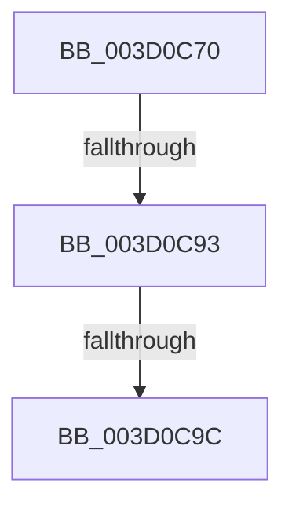

# SepMatchCapability

- RVA: `0x003D0C70`–`0x003D0CA5` (길이 `53` bytes)
- VA: `0x00000001403D0C70`
- 실행 섹션: `.text`
- PDB 이름 있음: `예`; PDB Function 태그: `아니요`
- unwind 정보 RVA: `0x000910F8`
- 디코드: `14`개 명령, `53/53` bytes 표시
- 미해석 바이트: `0` (있으면 어셈블리에 `.byte`로 보존)

> 이 문서는 커널 이미지의 기계어와 PDB 기호를 분석해 생성했습니다. 4번과 5번은 함수 원형과 자료형을 바이너리 사용 방식에서 추정한 C 해석이며 원본 소스 복구 결과는 아닙니다.

## 1. Dependencies

- 직접 호출 지점: **0**; 고유 호출 대상: **0**
- 직접 호출자로 확인된 함수: **4**
- RIP 상대 이미지 참조: **0**

### Outgoing calls
- 직접 디코드된 call 명령이 없습니다.

### Direct callers
- [SepMaximumAccessCheck](../30/SepMaximumAccessCheck_function_00300BF0.md) at `0x00301062`
- [SepNormalAccessCheckEx](../3C/SepNormalAccessCheckEx_function_003CFD8C.md) at `0x003D01BB`
- [SepNormalAccessCheck](SepNormalAccessCheck_function_003D0688.md) at `0x003D0A1C`
- [SepMaximumAccessCheckEx](../60/SepMaximumAccessCheckEx_function_00606D78.md) at `0x00606F06`

### Static image references
- 디코드된 RIP-relative 메모리 참조가 없습니다.

## 2. Other-region calls and transfers

- 다른 실행 섹션으로 향하는 call: **0**
- call이 아닌 외부 분기/꼬리 이동: **2**
  - `0x003D0C8D` → [sub_003D0DBB](Unknown_function_003D0DBB.md) (`tail-transfer`)
  - `0x003D0C96` → [sub_003D0DBB](Unknown_function_003D0DBB.md) (`tail-transfer`)

## 3. Assembly (complete function range)

```asm
003D0C70  44 89 4C 24 20                  mov dword ptr [rsp + 0x20], r9d
003D0C75  55                              push rbp
003D0C76  41 56                           push r14
003D0C78  41 57                           push r15
003D0C7A  48 83 EC 40                     sub rsp, 0x40
003D0C7E  4C 8D B1 28 03 00 00            lea r14, [rcx + 0x328]
003D0C85  4D 8B F8                        mov r15, r8
003D0C88  8B EA                           mov ebp, edx
003D0C8A  4D 85 F6                        test r14, r14
003D0C8D  0F 84 28 01 00 00               je 0x1403d0dbb
003D0C93  4D 85 C0                        test r8, r8
003D0C96  0F 84 1F 01 00 00               je 0x1403d0dbb
003D0C9C  41 0F B6 40 01                  movzx eax, byte ptr [r8 + 1]
003D0CA1  45 0F B7 00                     movzx r8d, word ptr [r8]
```

## 4. C-style interpretation (structured pseudocode)

```c
__int64 __fastcall SepMatchCapability(__int64 a1, int a2, __int64 a3, int a4)
{
    __int64 v_rsp;
    unsigned int v_stack_p20;

    v_stack_p20 = a4;
    v_rsp = (v_rsp) - (64);
    return *(unsigned __int8 *)(a3 + 1);
}
```

## 5. (Beta) C Style

```c
int64_t SepMatchCapability(void *Arg1, int32_t Arg2, int64_t Arg3, int32_t Arg4)
{
    uint8_t *arg1 = (uint8_t *)Arg1;

    int64_t local_rsp;
    uint32_t v_stack_p20;

    v_stack_p20 = Arg4;
    local_rsp = (local_rsp) - (64);
    return *(uint8_t *)(Arg3 + 0x1);
}
```

### 관측된 메모리 오프셋

구조체 형식이 확인되지 않은 접근은 인자 기준의 오프셋으로만 기록했습니다.

| 기준 인자 | 오프셋 표현 | 폭 (bit) | 접근 |
|---|---:|---:|---|
| `Arg1` | `+ 0x328` | `64` | `R` |

## 6. Execution-region graph

[열기: 2D/3D 그래프와 함수 탐색 컨트롤 패널](../../../control-panel.html?section=text&rva=0x003D0C70&view=graph)

- 2D 그래프는 위에서 아래로 흐르고, 3D 그래프는 빈 공간을 드래그해 회전합니다. Shift+드래그는 이동, 휠은 확대·축소, 함수 노드 선택은 대상 보고서 이동입니다.

### Static fallback


