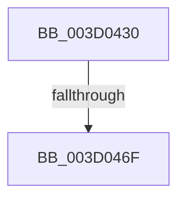

# SepSidInToken

- RVA: `0x003D0430`–`0x003D047D` (길이 `77` bytes)
- VA: `0x00000001403D0430`
- 실행 섹션: `.text`
- PDB 이름 있음: `예`; PDB Function 태그: `아니요`
- unwind 정보 RVA: `0x00091018`
- 디코드: `19`개 명령, `77/77` bytes 표시
- 미해석 바이트: `0` (있으면 어셈블리에 `.byte`로 보존)

> 이 문서는 커널 이미지의 기계어와 PDB 기호를 분석해 생성했습니다. 4번과 5번은 함수 원형과 자료형을 바이너리 사용 방식에서 추정한 C 해석이며 원본 소스 복구 결과는 아닙니다.

## 1. Dependencies

- 직접 호출 지점: **0**; 고유 호출 대상: **0**
- 직접 호출자로 확인된 함수: **17**
- RIP 상대 이미지 참조: **0**

### Outgoing calls
- 직접 디코드된 call 명령이 없습니다.

### Direct callers
- [SepMaximumAccessCheck](../30/SepMaximumAccessCheck_function_00300BF0.md) at `0x00300D7D`
- [SepMaximumAccessCheck](../30/SepMaximumAccessCheck_function_00300BF0.md) at `0x00300DC6`
- [SepMaximumAccessCheck](../30/SepMaximumAccessCheck_function_00300BF0.md) at `0x00300E24`
- [SepMaximumAccessCheck](../30/SepMaximumAccessCheck_function_00300BF0.md) at `0x00300ECC`
- [SepNormalAccessCheckEx](../3C/SepNormalAccessCheckEx_function_003CFD8C.md) at `0x003CFECA`
- [SepNormalAccessCheckEx](../3C/SepNormalAccessCheckEx_function_003CFD8C.md) at `0x003D02F7`
- [SepNormalAccessCheckEx](../3C/SepNormalAccessCheckEx_function_003CFD8C.md) at `0x003D03F0`
- [SepNormalAccessCheck](SepNormalAccessCheck_function_003D0688.md) at `0x003D07C3`
- [SepNormalAccessCheck](SepNormalAccessCheck_function_003D0688.md) at `0x003D0941`
- [SepNormalAccessCheck](SepNormalAccessCheck_function_003D0688.md) at `0x003D0B1F`
- [SepNormalAccessCheck](SepNormalAccessCheck_function_003D0688.md) at `0x003D0BF1`
- [AuthzBasepMemberOf](../4E/AuthzBasepMemberOf_function_004E3584.md) at `0x004E363A`
- [SepMaximumAccessCheckEx](../60/SepMaximumAccessCheckEx_function_00606D78.md) at `0x00606F90`
- [SepMaximumAccessCheckEx](../60/SepMaximumAccessCheckEx_function_00606D78.md) at `0x00607010`
- [SepMaximumAccessCheckEx](../60/SepMaximumAccessCheckEx_function_00606D78.md) at `0x00607081`
- [SepMaximumAccessCheckEx](../60/SepMaximumAccessCheckEx_function_00606D78.md) at `0x006070C4`
- [SepMaximumAccessCheckEx](../60/SepMaximumAccessCheckEx_function_00606D78.md) at `0x00607112`
- [SepMaximumAccessCheckEx](../60/SepMaximumAccessCheckEx_function_00606D78.md) at `0x0060716F`
- [SepMaximumAccessCheckEx](../60/SepMaximumAccessCheckEx_function_00606D78.md) at `0x006072F9`
- [SepMaximumAccessCheckEx](../60/SepMaximumAccessCheckEx_function_00606D78.md) at `0x0060746C`
- [SepApplyMandatoryAccess](../60/SepApplyMandatoryAccess_function_00607FF4.md) at `0x00608025`
- [SepApplyMandatoryAccess](../60/SepApplyMandatoryAccess_function_00607FF4.md) at `0x0060804D`
- [SepApplyMandatoryAppAccess](../60/SepApplyMandatoryAppAccess_function_006080D4.md) at `0x0060810C`
- [sub_006E0188](../6E/Unknown_function_006E0188.md) at `0x006E0235`
- [sub_006E0188](../6E/Unknown_function_006E0188.md) at `0x006E0308`
- [sub_006E0188](../6E/Unknown_function_006E0188.md) at `0x006E0389`
- [sub_006E0188](../6E/Unknown_function_006E0188.md) at `0x006E03FF`
- [sub_006E8E06](../6E/Unknown_function_006E8E06.md) at `0x006E8E71`
- [sub_006E8E06](../6E/Unknown_function_006E8E06.md) at `0x006E8F0B`
- [sub_006E8E06](../6E/Unknown_function_006E8E06.md) at `0x006E8F9A`
- [sub_006E9020](../6E/Unknown_function_006E9020.md) at `0x006E90BD`
- [sub_006E9020](../6E/Unknown_function_006E9020.md) at `0x006E915C`
- [sub_006F9FB6](../6F/Unknown_function_006F9FB6.md) at `0x006F9FD2`
- [SeExamineSacl](../../page/97/SeExamineSacl_function_00973A30.md) at `0x00973B1D`
- [SeTokenIsAdmin](../../page/9F/SeTokenIsAdmin_function_009FE650.md) at `0x009FE690`
- [SeTokenIsAdmin](../../page/9F/SeTokenIsAdmin_function_009FE650.md) at `0x009FE6D1`
- [SepExamineSaclEx](../../page/A2/SepExamineSaclEx_function_00A2F39C.md) at `0x00A2F4C9`
- [SepExamineSaclEx](../../page/A2/SepExamineSaclEx_function_00A2F39C.md) at `0x00A2F6D7`
- [sub_00B2940C](../../page/B2/Unknown_function_00B2940C.md) at `0x00B294D0`
- [sub_00B375D4](../../page/B3/Unknown_function_00B375D4.md) at `0x00B375F0`
- [sub_00B375D4](../../page/B3/Unknown_function_00B375D4.md) at `0x00B3761D`
- [sub_00B375D4](../../page/B3/Unknown_function_00B375D4.md) at `0x00B37656`
- [sub_00B375D4](../../page/B3/Unknown_function_00B375D4.md) at `0x00B37684`
- [sub_00B375D4](../../page/B3/Unknown_function_00B375D4.md) at `0x00B376BE`
- [sub_00B375D4](../../page/B3/Unknown_function_00B375D4.md) at `0x00B376E8`
- [sub_00B397DE](../../page/B3/Unknown_function_00B397DE.md) at `0x00B39879`

### Static image references
- 디코드된 RIP-relative 메모리 참조가 없습니다.

## 2. Other-region calls and transfers

- 다른 실행 섹션으로 향하는 call: **0**
- call이 아닌 외부 분기/꼬리 이동: **2**
  - `0x003D0469` → [sub_003D063D](Unknown_function_003D063D.md) (`tail-transfer`)
  - `0x003D0477` → [sub_003D05E0](Unknown_function_003D05E0.md) (`tail-transfer`)

## 3. Assembly (complete function range)

```asm
003D0430  44 88 4C 24 20                  mov byte ptr [rsp + 0x20], r9b
003D0435  53                              push rbx
003D0436  41 54                           push r12
003D0438  41 55                           push r13
003D043A  41 56                           push r14
003D043C  41 57                           push r15
003D043E  48 83 EC 30                     sub rsp, 0x30
003D0442  44 0F B6 AC 24 80 00 00 00      movzx r13d, byte ptr [rsp + 0x80]
003D044B  48 8B DA                        mov rbx, rdx
003D044E  45 84 ED                        test r13b, r13b
003D0451  BA E8 00 00 00                  mov edx, 0xe8
003D0456  41 BE F8 01 00 00               mov r14d, 0x1f8
003D045C  4D 8B F8                        mov r15, r8
003D045F  44 0F 44 F2                     cmove r14d, edx
003D0463  4C 03 F1                        add r14, rcx
003D0466  48 85 DB                        test rbx, rbx
003D0469  0F 85 CE 01 00 00               jne 0x1403d063d
003D046F  80 BC 24 88 00 00 00 00         cmp byte ptr [rsp + 0x88], 0
003D0477  0F 85 63 01 00 00               jne 0x1403d05e0
```

## 4. C-style interpretation (structured pseudocode)

```c
void __fastcall SepSidInToken(__int64 a1, __int64 a2, __int64 a3, unsigned __int8 a4, unsigned __int8 a5, unsigned __int8 a6)
{
    __int64 v_r14;
    __int64 v_rsp;
    unsigned __int8 v_stack_p20;

    v_stack_p20 = a4;
    v_rsp = (v_rsp) - (48);
    v_r14 = 504;
    if (a5 == 0) { v_r14 = 232; }
    v_r14 = (v_r14) + (a1);
}
```

## 5. (Beta) C Style

```c
void SepSidInToken(int64_t Arg1, int64_t Arg2, int64_t Arg3, uint8_t Arg4, uint8_t Arg5, uint8_t Arg6)
{
    int64_t local_r14;
    int64_t local_rsp;
    uint8_t v_stack_p20;

    v_stack_p20 = Arg4;
    local_rsp = (local_rsp) - (48);
    local_r14 = 504;
    if (Arg5 == 0) { local_r14 = 232; }
    local_r14 = (local_r14) + (Arg1);
}
```

## 6. Execution-region graph

[열기: 2D/3D 그래프와 함수 탐색 컨트롤 패널](../../../control-panel.html?section=text&rva=0x003D0430&view=graph)

- 2D 그래프는 위에서 아래로 흐르고, 3D 그래프는 빈 공간을 드래그해 회전합니다. Shift+드래그는 이동, 휠은 확대·축소, 함수 노드 선택은 대상 보고서 이동입니다.

### Static fallback


