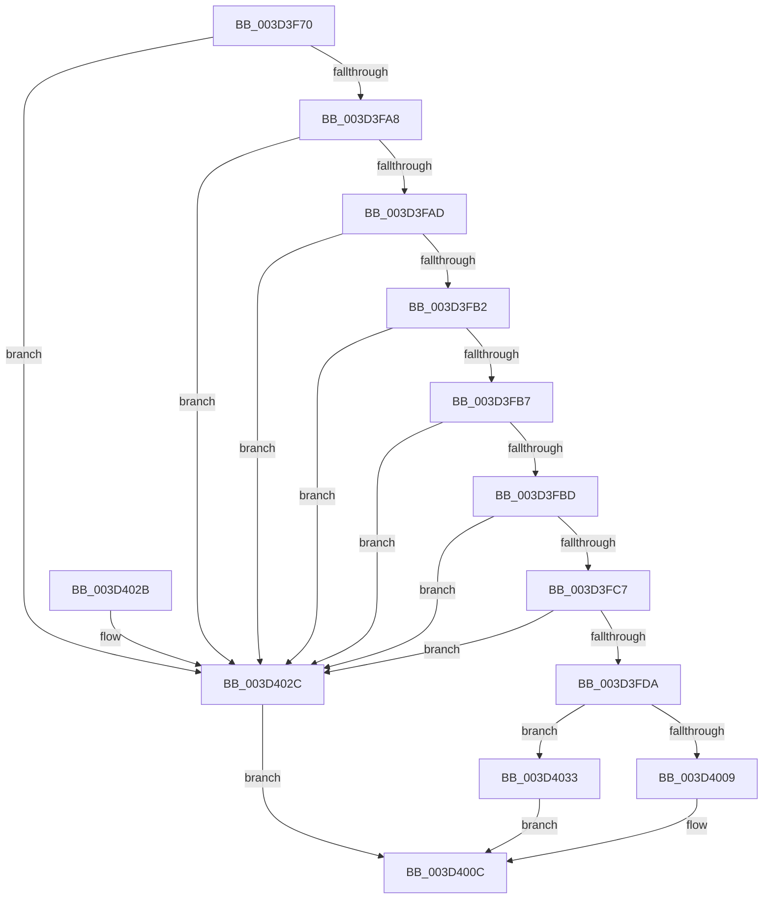

# SleepstudyHelperCreateBlockerFromGuid

- RVA: `0x003D3F70`–`0x003D403F` (길이 `207` bytes)
- VA: `0x00000001403D3F70`
- 실행 섹션: `.text`
- PDB 이름 있음: `예`; PDB Function 태그: `아니요`
- unwind 정보 RVA: `0x000923D4`
- 디코드: `66`개 명령, `207/207` bytes 표시
- 미해석 바이트: `0` (있으면 어셈블리에 `.byte`로 보존)

> 이 문서는 커널 이미지의 기계어와 PDB 기호를 분석해 생성했습니다. 4번과 5번은 함수 원형과 자료형을 바이너리 사용 방식에서 추정한 C 해석이며 원본 소스 복구 결과는 아닙니다.

## 1. Dependencies

- 직접 호출 지점: **3**; 고유 호출 대상: **3**
- 직접 호출자로 확인된 함수: **3**
- RIP 상대 이미지 참조: **0**

### Outgoing calls
- `0x003D3FCD` → [SSHSupportAllocatePaged](../../page/A6/SSHSupportAllocatePaged_function_00A624FC.md) (function, `0x00A624FC`)
- `0x003D3FFE` → [SleepstudyHelperSetBlockerFriendlyName](SleepstudyHelperSetBlockerFriendlyName_function_003D4050.md) (function, `0x003D4050`)
- `0x003D4036` → [SleepstudyHelperDestroyBlockerBuilder](../../page/A2/SleepstudyHelperDestroyBlockerBuilder_function_00A2DE80.md) (function, `0x00A2DE80`)

### Direct callers
- [SleepstudyHelper_RegisterComponentEx](../../page/77/SleepstudyHelper_RegisterComponentEx_function_00774A50.md) at `0x00774AAA`
- [PopPowerRequestStatsCreateSleepstudyBlocker](../../page/A2/PopPowerRequestStatsCreateSleepstudyBlocker_function_00A2D9B0.md) at `0x00A2DA38`
- [PopUserShutdownInitializeSleepstudyDiagnostics](../../init/C3/PopUserShutdownInitializeSleepstudyDiagnostics_function_00C3EF88.md) at `0x00C3F069`

### Static image references
- 디코드된 RIP-relative 메모리 참조가 없습니다.

## 2. Other-region calls and transfers

- 다른 실행 섹션으로 향하는 call: **2**
  - `0x003D3FCD` → [SSHSupportAllocatePaged](../../page/A6/SSHSupportAllocatePaged_function_00A624FC.md) (`.text` → `PAGE`)
  - `0x003D4036` → [SleepstudyHelperDestroyBlockerBuilder](../../page/A2/SleepstudyHelperDestroyBlockerBuilder_function_00A2DE80.md) (`.text` → `PAGE`)
- 별도 외부 분기/꼬리 이동을 확인하지 못했습니다.

## 3. Assembly (complete function range)

```asm
003D3F70  48 89 5C 24 08                  mov qword ptr [rsp + 8], rbx
003D3F75  48 89 6C 24 10                  mov qword ptr [rsp + 0x10], rbp
003D3F7A  48 89 74 24 18                  mov qword ptr [rsp + 0x18], rsi
003D3F7F  57                              push rdi
003D3F80  41 54                           push r12
003D3F82  41 55                           push r13
003D3F84  41 56                           push r14
003D3F86  41 57                           push r15
003D3F88  48 83 EC 20                     sub rsp, 0x20
003D3F8C  44 8B 6C 24 70                  mov r13d, dword ptr [rsp + 0x70]
003D3F91  33 DB                           xor ebx, ebx
003D3F93  4D 8B F1                        mov r14, r9
003D3F96  4D 8B F8                        mov r15, r8
003D3F99  4C 8B E2                        mov r12, rdx
003D3F9C  48 8B E9                        mov rbp, rcx
003D3F9F  48 85 C9                        test rcx, rcx
003D3FA2  0F 84 84 00 00 00               je 0x1403d402c
003D3FA8  48 85 D2                        test rdx, rdx
003D3FAB  74 7F                           je 0x1403d402c
003D3FAD  4D 85 C0                        test r8, r8
003D3FB0  74 7A                           je 0x1403d402c
003D3FB2  4D 85 C9                        test r9, r9
003D3FB5  74 75                           je 0x1403d402c
003D3FB7  41 83 FD 08                     cmp r13d, 8
003D3FBB  77 6F                           ja 0x1403d402c
003D3FBD  48 8B 74 24 78                  mov rsi, qword ptr [rsp + 0x78]
003D3FC2  48 85 F6                        test rsi, rsi
003D3FC5  74 65                           je 0x1403d402c
003D3FC7  8B 51 18                        mov edx, dword ptr [rcx + 0x18]
003D3FCA  8D 4B 60                        lea ecx, [rbx + 0x60]
003D3FCD  E8 2A E5 68 00                  call 0x140a624fc
003D3FD2  48 8B F8                        mov rdi, rax
003D3FD5  48 85 C0                        test rax, rax
003D3FD8  74 52                           je 0x1403d402c
003D3FDA  48 89 28                        mov qword ptr [rax], rbp
003D3FDD  49 8B D6                        mov rdx, r14
003D3FE0  44 89 68 08                     mov dword ptr [rax + 8], r13d
003D3FE4  48 8B C8                        mov rcx, rax
003D3FE7  41 0F 10 04 24                  movups xmm0, xmmword ptr [r12]
003D3FEC  F3 0F 7F 40 10                  movdqu xmmword ptr [rax + 0x10], xmm0
003D3FF1  41 0F 10 0F                     movups xmm1, xmmword ptr [r15]
003D3FF5  C6 40 58 01                     mov byte ptr [rax + 0x58], 1
003D3FF9  F3 0F 7F 48 20                  movdqu xmmword ptr [rax + 0x20], xmm1
003D3FFE  E8 4D 00 00 00                  call 0x1403d4050
003D4003  8B E8                           mov ebp, eax
003D4005  85 C0                           test eax, eax
003D4007  78 2A                           js 0x1403d4033
003D4009  48 89 3E                        mov qword ptr [rsi], rdi
003D400C  48 8B 6C 24 58                  mov rbp, qword ptr [rsp + 0x58]
003D4011  8B C3                           mov eax, ebx
003D4013  48 8B 5C 24 50                  mov rbx, qword ptr [rsp + 0x50]
003D4018  48 8B 74 24 60                  mov rsi, qword ptr [rsp + 0x60]
003D401D  48 83 C4 20                     add rsp, 0x20
003D4021  41 5F                           pop r15
003D4023  41 5E                           pop r14
003D4025  41 5D                           pop r13
003D4027  41 5C                           pop r12
003D4029  5F                              pop rdi
003D402A  C3                              ret
003D402B  CC                              int3
003D402C  BB 0D 00 00 C0                  mov ebx, 0xc000000d
003D4031  EB D9                           jmp 0x1403d400c
003D4033  48 8B CF                        mov rcx, rdi
003D4036  E8 45 9E 65 00                  call 0x140a2de80
003D403B  8B DD                           mov ebx, ebp
003D403D  EB CD                           jmp 0x1403d400c
```

## 4. C-style interpretation (structured pseudocode)

```c
__int64 __fastcall SleepstudyHelperCreateBlockerFromGuid(__int64 a1, __int64 a2, __int64 a3, __int64 a4, unsigned int a5, __int64 a6)
{
    __int64 result;
    __int64 v_rbx;
    __int64 v_rsp;
    unsigned __int64 v_stack_p10;
    unsigned __int64 v_stack_p18;
    unsigned __int64 v_stack_p8;

    v_stack_p8 = v_rbx;
    v_stack_p10 = v_rbp;
    v_stack_p18 = v_rsi;
    v_rsp = (v_rsp) - (32);
    v_rbx = 0;
    if (a1 == 0) goto loc_003D402C;
    if (a2 == 0) goto loc_003D402C;
    if (a3 == 0) goto loc_003D402C;
    if (a4 == 0) goto loc_003D402C;
    if (((unsigned int)((unsigned int)(a5))) > 8) goto loc_003D402C;
    if (a6 == 0) goto loc_003D402C;
    result = SSHSupportAllocatePaged(v_rbx + 96, (unsigned int)(*(unsigned int *)(a1 + 24)), a3, a4);
    if (result == 0) goto loc_003D402C;
    *(unsigned __int64 *)(result) = a1;
    *(unsigned int *)(result + 8) = (unsigned int)((unsigned int)(a5));
    *(unsigned __int64 *)(result + 16) = v_xmm0;
    *(unsigned __int8 *)(result + 88) = 1;
    *(unsigned __int64 *)(result + 32) = v_xmm1;
    result = SleepstudyHelperSetBlockerFriendlyName(result, a4, a3, a4);
    if (sign_flag) goto loc_003D4033;
    *(unsigned __int64 *)(a6) = result;
loc_003D400C:
    v_rsp = (v_rsp) + (32);
    return 0;
loc_003D402C:
    goto loc_003D400C;
loc_003D4033:
    result = SleepstudyHelperDestroyBlockerBuilder(result, a4, a3, a4);
    goto loc_003D400C;
}
```

## 5. (Beta) C Style

```c
int64_t SleepstudyHelperCreateBlockerFromGuid(int64_t Arg1, void *Arg2, void *Arg3, int64_t Arg4, uint32_t Arg5, int64_t Arg6)
{
    uint8_t *arg2 = (uint8_t *)Arg2;
    uint8_t *arg3 = (uint8_t *)Arg3;

    int64_t result;
    int64_t local_rbx;
    int64_t local_rsp;
    uint64_t v_stack_p10;
    uint64_t v_stack_p18;
    uint64_t v_stack_p8;

    v_stack_p8 = local_rbx;
    v_stack_p10 = local_rbp;
    v_stack_p18 = local_rsi;
    local_rsp = (local_rsp) - (32);
    local_rbx = 0;
    if (Arg1 == 0) goto loc_003D402C;
    if (Arg2 == NULL) goto loc_003D402C;
    if (Arg3 == NULL) goto loc_003D402C;
    if (Arg4 == 0) goto loc_003D402C;
    if (((uint32_t)((uint32_t)(Arg5))) > 8) goto loc_003D402C;
    if (Arg6 == 0) goto loc_003D402C;
    result = SSHSupportAllocatePaged(local_rbx + 96, (uint32_t)(*(uint32_t *)(Arg1 + 0x18)), Arg3, Arg4);
    if (result == 0) goto loc_003D402C;
    *(uint64_t *)(result) = Arg1;
    *(uint32_t *)(result + 0x8) = (uint32_t)((uint32_t)(Arg5));
    *(uint64_t *)(result + 0x10) = v_xmm0;
    *(uint8_t *)(result + 0x58) = 1;
    *(uint64_t *)(result + 0x20) = v_xmm1;
    result = SleepstudyHelperSetBlockerFriendlyName(result, Arg4, Arg3, Arg4);
    if (sign_flag) goto loc_003D4033;
    *(uint64_t *)(Arg6) = result;
loc_003D400C:
    local_rsp = (local_rsp) + (32);
    return 0;
loc_003D402C:
    goto loc_003D400C;
loc_003D4033:
    result = SleepstudyHelperDestroyBlockerBuilder(result, Arg4, Arg3, Arg4);
    goto loc_003D400C;
}
```

### 관측된 메모리 오프셋

구조체 형식이 확인되지 않은 접근은 인자 기준의 오프셋으로만 기록했습니다.

| 기준 인자 | 오프셋 표현 | 폭 (bit) | 접근 |
|---|---:|---:|---|
| `Arg2` | `+ 0x0` | `128` | `R` |
| `Arg3` | `+ 0x0` | `128` | `R` |

## 6. Execution-region graph

[열기: 2D/3D 그래프와 함수 탐색 컨트롤 패널](../../../control-panel.html?section=text&rva=0x003D3F70&view=graph)

- 2D 그래프는 위에서 아래로 흐르고, 3D 그래프는 빈 공간을 드래그해 회전합니다. Shift+드래그는 이동, 휠은 확대·축소, 함수 노드 선택은 대상 보고서 이동입니다.

### Static fallback


