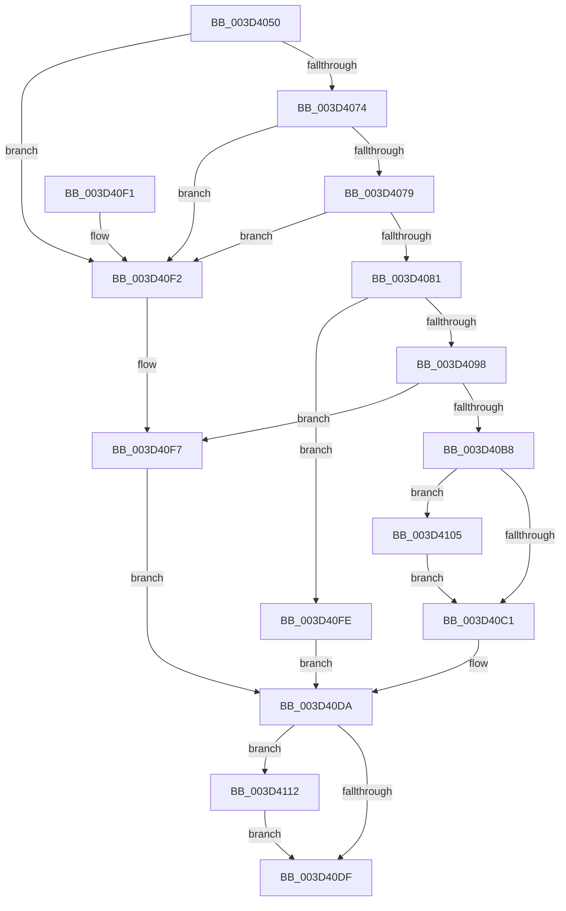

# SleepstudyHelperSetBlockerFriendlyName

- RVA: `0x003D4050`–`0x003D4122` (길이 `210` bytes)
- VA: `0x00000001403D4050`
- 실행 섹션: `.text`
- PDB 이름 있음: `예`; PDB Function 태그: `아니요`
- unwind 정보 RVA: `0x000923F4`
- 디코드: `64`개 명령, `210/210` bytes 표시
- 미해석 바이트: `0` (있으면 어셈블리에 `.byte`로 보존)

> 이 문서는 커널 이미지의 기계어와 PDB 기호를 분석해 생성했습니다. 4번과 5번은 함수 원형과 자료형을 바이너리 사용 방식에서 추정한 C 해석이며 원본 소스 복구 결과는 아닙니다.

## 1. Dependencies

- 직접 호출 지점: **4**; 고유 호출 대상: **3**
- 직접 호출자로 확인된 함수: **1**
- RIP 상대 이미지 참조: **0**

### Outgoing calls
- `0x003D4089` → [SSHSupportAllocatePaged](../../page/A6/SSHSupportAllocatePaged_function_00A624FC.md) (function, `0x00A624FC`)
- `0x003D40AD` → [RtlUnicodeStringCopy](RtlUnicodeStringCopy_function_003D4130.md) (function, `0x003D4130`)
- `0x003D410B` → [ExFreePoolWithTag](../../poolcode/B8/ExFreePoolWithTag_function_00B82870.md) (function, `0x00B82870`)
- `0x003D411B` → [ExFreePoolWithTag](../../poolcode/B8/ExFreePoolWithTag_function_00B82870.md) (function, `0x00B82870`)

### Direct callers
- [SleepstudyHelperCreateBlockerFromGuid](SleepstudyHelperCreateBlockerFromGuid_function_003D3F70.md) at `0x003D3FFE`

### Static image references
- 디코드된 RIP-relative 메모리 참조가 없습니다.

## 2. Other-region calls and transfers

- 다른 실행 섹션으로 향하는 call: **3**
  - `0x003D4089` → [SSHSupportAllocatePaged](../../page/A6/SSHSupportAllocatePaged_function_00A624FC.md) (`.text` → `PAGE`)
  - `0x003D410B` → [ExFreePoolWithTag](../../poolcode/B8/ExFreePoolWithTag_function_00B82870.md) (`.text` → `POOLCODE`)
  - `0x003D411B` → [ExFreePoolWithTag](../../poolcode/B8/ExFreePoolWithTag_function_00B82870.md) (`.text` → `POOLCODE`)
- 별도 외부 분기/꼬리 이동을 확인하지 못했습니다.

## 3. Assembly (complete function range)

```asm
003D4050  48 89 5C 24 08                  mov qword ptr [rsp + 8], rbx
003D4055  48 89 74 24 10                  mov qword ptr [rsp + 0x10], rsi
003D405A  57                              push rdi
003D405B  48 83 EC 30                     sub rsp, 0x30
003D405F  33 F6                           xor esi, esi
003D4061  0F 57 C0                        xorps xmm0, xmm0
003D4064  48 8B FA                        mov rdi, rdx
003D4067  48 8B D9                        mov rbx, rcx
003D406A  0F 11 44 24 20                  movups xmmword ptr [rsp + 0x20], xmm0
003D406F  48 85 C9                        test rcx, rcx
003D4072  74 7E                           je 0x1403d40f2
003D4074  48 85 D2                        test rdx, rdx
003D4077  74 79                           je 0x1403d40f2
003D4079  0F B7 02                        movzx eax, word ptr [rdx]
003D407C  66 85 C0                        test ax, ax
003D407F  74 71                           je 0x1403d40f2
003D4081  48 8B 11                        mov rdx, qword ptr [rcx]
003D4084  8B C8                           mov ecx, eax
003D4086  8B 52 18                        mov edx, dword ptr [rdx + 0x18]
003D4089  E8 6E E4 68 00                  call 0x140a624fc
003D408E  48 89 44 24 28                  mov qword ptr [rsp + 0x28], rax
003D4093  48 85 C0                        test rax, rax
003D4096  74 66                           je 0x1403d40fe
003D4098  0F B7 07                        movzx eax, word ptr [rdi]
003D409B  48 8D 4C 24 20                  lea rcx, [rsp + 0x20]
003D40A0  48 8B D7                        mov rdx, rdi
003D40A3  66 89 44 24 22                  mov word ptr [rsp + 0x22], ax
003D40A8  66 89 74 24 20                  mov word ptr [rsp + 0x20], si
003D40AD  E8 7E 00 00 00                  call 0x1403d4130
003D40B2  8B F8                           mov edi, eax
003D40B4  85 C0                           test eax, eax
003D40B6  78 3F                           js 0x1403d40f7
003D40B8  48 8B 4B 38                     mov rcx, qword ptr [rbx + 0x38]
003D40BC  48 85 C9                        test rcx, rcx
003D40BF  75 44                           jne 0x1403d4105
003D40C1  0F 10 44 24 20                  movups xmm0, xmmword ptr [rsp + 0x20]
003D40C6  8B FE                           mov edi, esi
003D40C8  0F 57 C9                        xorps xmm1, xmm1
003D40CB  66 0F 73 D9 08                  psrldq xmm1, 8
003D40D0  F3 0F 7F 43 30                  movdqu xmmword ptr [rbx + 0x30], xmm0
003D40D5  66 48 0F 7E C8                  movq rax, xmm1
003D40DA  48 85 C0                        test rax, rax
003D40DD  75 33                           jne 0x1403d4112
003D40DF  48 8B 5C 24 40                  mov rbx, qword ptr [rsp + 0x40]
003D40E4  8B C7                           mov eax, edi
003D40E6  48 8B 74 24 48                  mov rsi, qword ptr [rsp + 0x48]
003D40EB  48 83 C4 30                     add rsp, 0x30
003D40EF  5F                              pop rdi
003D40F0  C3                              ret
003D40F1  CC                              int3
003D40F2  BF 0D 00 00 C0                  mov edi, 0xc000000d
003D40F7  48 8B 44 24 28                  mov rax, qword ptr [rsp + 0x28]
003D40FC  EB DC                           jmp 0x1403d40da
003D40FE  BF 9A 00 00 C0                  mov edi, 0xc000009a
003D4103  EB D5                           jmp 0x1403d40da
003D4105  48 8B 13                        mov rdx, qword ptr [rbx]
003D4108  8B 52 18                        mov edx, dword ptr [rdx + 0x18]
003D410B  E8 60 E7 7A 00                  call 0x140b82870
003D4110  EB AF                           jmp 0x1403d40c1
003D4112  48 8B 13                        mov rdx, qword ptr [rbx]
003D4115  48 8B C8                        mov rcx, rax
003D4118  8B 52 18                        mov edx, dword ptr [rdx + 0x18]
003D411B  E8 50 E7 7A 00                  call 0x140b82870
003D4120  EB BD                           jmp 0x1403d40df
```

## 4. C-style interpretation (structured pseudocode)

```c
__int64 __fastcall SleepstudyHelperSetBlockerFriendlyName(__int64 a1, __int64 a2)
{
    __int64 result;
    __int64 v_rsi;
    __int64 v_rsp;
    unsigned __int64 v_stack_m10;
    unsigned __int16 v_stack_m16;
    unsigned __int64 v_stack_m18;
    unsigned __int64 v_stack_p10;
    unsigned __int64 v_stack_p28;
    unsigned __int64 v_stack_p8;

    v_stack_p8 = v_rbx;
    v_stack_p10 = v_rsi;
    v_rsp = (v_rsp) - (48);
    v_rsi = 0;
    v_stack_m18 = v_xmm0;
    if (a1 == 0) goto loc_003D40F2;
    if (a2 == 0) goto loc_003D40F2;
    if ((unsigned __int16)(*(unsigned __int16 *)(a2)) == 0) goto loc_003D40F2;
    result = SSHSupportAllocatePaged((unsigned int)((unsigned int)(*(unsigned __int16 *)(a2))), (unsigned int)(*(unsigned int *)(*(unsigned __int64 *)(a1) + 24)), a3, a4);
    v_stack_m10 = result;
    if (result == 0) goto loc_003D40FE;
    v_stack_m16 = (unsigned __int16)(*(unsigned __int16 *)(a2));
    v_stack_m18 = 0;
    result = RtlUnicodeStringCopy(v_stack_m18, a2, a3, a4);
    if (sign_flag) goto loc_003D40F7;
    if (*(unsigned __int64 *)(a1 + 56) != 0) goto loc_003D4105;
loc_003D40C1:
    *(unsigned __int64 *)(a1 + 48) = v_xmm0;
loc_003D40DA:
    if (result != 0) goto loc_003D4112;
loc_003D40DF:
    v_rsp = (v_rsp) + (48);
    return 0;
loc_003D40F2:
loc_003D40F7:
    goto loc_003D40DA;
loc_003D40FE:
    goto loc_003D40DA;
loc_003D4105:
    result = ExFreePoolWithTag(*(unsigned __int64 *)(a1 + 56), (unsigned int)(*(unsigned int *)(*(unsigned __int64 *)(v_stack_p8) + 24)), a3, a4);
    goto loc_003D40C1;
loc_003D4112:
    result = ExFreePoolWithTag(result, (unsigned int)(*(unsigned int *)(*(unsigned __int64 *)(v_stack_p8) + 24)), a3, a4);
    goto loc_003D40DF;
}
```

## 5. (Beta) C Style

```c
int64_t SleepstudyHelperSetBlockerFriendlyName(void *Arg1, void *Arg2)
{
    uint8_t *arg1 = (uint8_t *)Arg1;
    uint8_t *arg2 = (uint8_t *)Arg2;

    int64_t result;
    int64_t local_rsi;
    int64_t local_rsp;
    uint64_t v_stack_m10;
    uint16_t v_stack_m16;
    uint64_t v_stack_m18;
    uint64_t v_stack_p10;
    uint64_t v_stack_p28;
    uint64_t v_stack_p8;

    v_stack_p8 = local_rbx;
    v_stack_p10 = local_rsi;
    local_rsp = (local_rsp) - (48);
    local_rsi = 0;
    v_stack_m18 = v_xmm0;
    if (Arg1 == NULL) goto loc_003D40F2;
    if (Arg2 == NULL) goto loc_003D40F2;
    if ((uint16_t)(*(uint16_t *)(arg2)) == 0) goto loc_003D40F2;
    result = SSHSupportAllocatePaged((uint32_t)((uint32_t)(*(uint16_t *)(arg2))), (uint32_t)(*(uint32_t *)(*(uint64_t *)(arg1) + 0x18)), a3, a4);
    v_stack_m10 = result;
    if (result == 0) goto loc_003D40FE;
    v_stack_m16 = (uint16_t)(*(uint16_t *)(arg2));
    v_stack_m18 = 0;
    result = RtlUnicodeStringCopy(v_stack_m18, Arg2, a3, a4);
    if (sign_flag) goto loc_003D40F7;
    if (*(uint64_t *)(arg1 + 0x38) != 0) goto loc_003D4105;
loc_003D40C1:
    *(uint64_t *)(arg1 + 0x30) = v_xmm0;
loc_003D40DA:
    if (result != 0) goto loc_003D4112;
loc_003D40DF:
    local_rsp = (local_rsp) + (48);
    return 0;
loc_003D40F2:
loc_003D40F7:
    goto loc_003D40DA;
loc_003D40FE:
    goto loc_003D40DA;
loc_003D4105:
    result = ExFreePoolWithTag(*(uint64_t *)(arg1 + 0x38), (uint32_t)(*(uint32_t *)(*(uint64_t *)(v_stack_p8) + 0x18)), a3, a4);
    goto loc_003D40C1;
loc_003D4112:
    result = ExFreePoolWithTag(result, (uint32_t)(*(uint32_t *)(*(uint64_t *)(v_stack_p8) + 0x18)), a3, a4);
    goto loc_003D40DF;
}
```

### 관측된 메모리 오프셋

구조체 형식이 확인되지 않은 접근은 인자 기준의 오프셋으로만 기록했습니다.

| 기준 인자 | 오프셋 표현 | 폭 (bit) | 접근 |
|---|---:|---:|---|
| `Arg1` | `+ 0x0` | `64` | `R` |
| `Arg1` | `+ 0x30` | `128` | `W` |
| `Arg1` | `+ 0x38` | `64` | `R` |
| `Arg2` | `+ 0x0` | `16` | `R` |

## 6. Execution-region graph

[열기: 2D/3D 그래프와 함수 탐색 컨트롤 패널](../../../control-panel.html?section=text&rva=0x003D4050&view=graph)

- 2D 그래프는 위에서 아래로 흐르고, 3D 그래프는 빈 공간을 드래그해 회전합니다. Shift+드래그는 이동, 휠은 확대·축소, 함수 노드 선택은 대상 보고서 이동입니다.

### Static fallback


