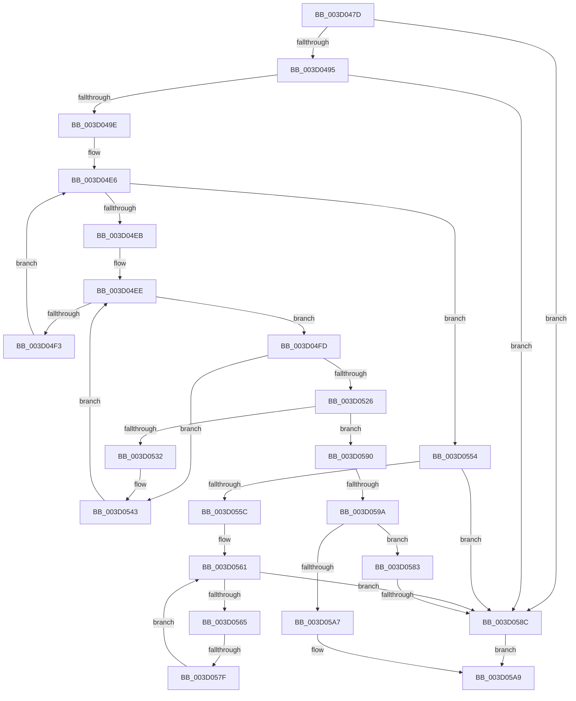

# sub_003D047D

- RVA: `0x003D047D`–`0x003D05B8` (길이 `315` bytes)
- VA: `0x00000001403D047D`
- 실행 섹션: `.text`
- PDB 이름 있음: `아니요`; PDB Function 태그: `아니요`
- unwind 정보 RVA: `0x00091028`
- 디코드: `79`개 명령, `315/315` bytes 표시
- 미해석 바이트: `0` (있으면 어셈블리에 `.byte`로 보존)

> 이 문서는 커널 이미지의 기계어와 PDB 기호를 분석해 생성했습니다. 4번과 5번은 함수 원형과 자료형을 바이너리 사용 방식에서 추정한 C 해석이며 원본 소스 복구 결과는 아닙니다.

## 1. Dependencies

- 직접 호출 지점: **1**; 고유 호출 대상: **1**
- 직접 호출자로 확인된 함수: **0**
- RIP 상대 이미지 참조: **1**

### Outgoing calls
- `0x003D0529` → [memcmp](../6C/memcmp_function_006C6B10.md) (function, `0x006C6B10`)

### Direct callers
- 이 함수 시작 RVA로 연결되는 직접 call은 확인되지 않았습니다. 간접 호출은 완전히 역산할 수 없습니다.

### Static image references
- `0x003D04DC` → RVA `0x00011DE0` (`.rdata`; read)

## 2. Other-region calls and transfers

- 다른 실행 섹션으로 향하는 call: **0**
- call이 아닌 외부 분기/꼬리 이동: **3**
  - `0x003D0579` → [sub_003D0617](Unknown_function_003D0617.md) (`tail-transfer`)
  - `0x003D0586` → [sub_003D0673](Unknown_function_003D0673.md) (`tail-transfer`)
  - `0x003D0598` → [sub_003D05C7](Unknown_function_003D05C7.md) (`tail-transfer`)

## 3. Assembly (complete function range)

```asm
003D047D  48 89 6C 24 60                  mov qword ptr [rsp + 0x60], rbp
003D0482  48 89 74 24 28                  mov qword ptr [rsp + 0x28], rsi
003D0487  48 89 7C 24 20                  mov qword ptr [rsp + 0x20], rdi
003D048C  4D 85 F6                        test r14, r14
003D048F  0F 84 F7 00 00 00               je 0x1403d058c
003D0495  4D 85 FF                        test r15, r15
003D0498  0F 84 EE 00 00 00               je 0x1403d058c
003D049E  41 0F B6 47 01                  movzx eax, byte ptr [r15 + 1]
003D04A3  45 0F B7 0F                     movzx r9d, word ptr [r15]
003D04A7  66 44 89 8C 24 80 00 00 00      mov word ptr [rsp + 0x80], r9w
003D04B0  41 0F B6 4C 87 04               movzx ecx, byte ptr [r15 + rax*4 + 4]
003D04B6  44 8D 04 85 08 00 00 00         lea r8d, [rax*4 + 8]
003D04BE  8B D9                           mov ebx, ecx
003D04C0  44 89 84 24 88 00 00 00         mov dword ptr [rsp + 0x88], r8d
003D04C8  48 C1 EB 04                     shr rbx, 4
003D04CC  83 E1 0F                        and ecx, 0xf
003D04CF  49 8B 9C DE 90 00 00 00         mov rbx, qword ptr [r14 + rbx*8 + 0x90]
003D04D7  49 23 5C CE 10                  and rbx, qword ptr [r14 + rcx*8 + 0x10]
003D04DC  48 8D 0D FD 18 C4 FF            lea rcx, [rip - 0x3be703]
003D04E3  40 32 ED                        xor bpl, bpl
003D04E6  48 85 DB                        test rbx, rbx
003D04E9  74 69                           je 0x1403d0554
003D04EB  0F B6 FB                        movzx edi, bl
003D04EE  40 84 FF                        test dil, dil
003D04F1  75 0A                           jne 0x1403d04fd
003D04F3  40 80 C5 08                     add bpl, 8
003D04F7  48 C1 EB 08                     shr rbx, 8
003D04FB  EB E9                           jmp 0x1403d04e6
003D04FD  40 0F B6 F5                     movzx esi, bpl
003D0501  40 0F B6 C7                     movzx eax, dil
003D0505  44 0F B6 24 08                  movzx r12d, byte ptr [rax + rcx]
003D050A  49 8B 4E 08                     mov rcx, qword ptr [r14 + 8]
003D050E  41 03 F4                        add esi, r12d
003D0511  48 C1 E6 04                     shl rsi, 4
003D0515  48 03 F1                        add rsi, rcx
003D0518  48 89 4C 24 68                  mov qword ptr [rsp + 0x68], rcx
003D051D  48 8B 16                        mov rdx, qword ptr [rsi]
003D0520  66 44 39 0A                     cmp word ptr [rdx], r9w
003D0524  75 1D                           jne 0x1403d0543
003D0526  49 8B CF                        mov rcx, r15
003D0529  E8 E2 65 2F 00                  call 0x1406c6b10
003D052E  85 C0                           test eax, eax
003D0530  74 5E                           je 0x1403d0590
003D0532  44 8B 84 24 88 00 00 00         mov r8d, dword ptr [rsp + 0x88]
003D053A  44 0F B7 8C 24 80 00 00 00      movzx r9d, word ptr [rsp + 0x80]
003D0543  40 0F B6 FF                     movzx edi, dil
003D0547  48 8D 0D 92 18 C4 FF            lea rcx, [rip - 0x3be76e]
003D054E  44 0F BB E7                     btc edi, r12d
003D0552  EB 9A                           jmp 0x1403d04ee
003D0554  41 8B 1E                        mov ebx, dword ptr [r14]
003D0557  83 FB 40                        cmp ebx, 0x40
003D055A  76 30                           jbe 0x1403d058c
003D055C  BF 40 00 00 00                  mov edi, 0x40
003D0561  3B FB                           cmp edi, ebx
003D0563  73 27                           jae 0x1403d058c
003D0565  49 8B 6E 08                     mov rbp, qword ptr [r14 + 8]
003D0569  8B F7                           mov esi, edi
003D056B  48 C1 E6 04                     shl rsi, 4
003D056F  48 03 F5                        add rsi, rbp
003D0572  48 8B 16                        mov rdx, qword ptr [rsi]
003D0575  66 44 39 0A                     cmp word ptr [rdx], r9w
003D0579  0F 84 98 00 00 00               je 0x1403d0617
003D057F  FF C7                           inc edi
003D0581  EB DE                           jmp 0x1403d0561
003D0583  45 84 E4                        test r12b, r12b
003D0586  0F 85 E7 00 00 00               jne 0x1403d0673
003D058C  32 C0                           xor al, al
003D058E  EB 19                           jmp 0x1403d05a9
003D0590  48 8B 6C 24 68                  mov rbp, qword ptr [rsp + 0x68]
003D0595  45 84 ED                        test r13b, r13b
003D0598  74 2D                           je 0x1403d05c7
003D059A  44 0F B6 64 24 78               movzx r12d, byte ptr [rsp + 0x78]
003D05A0  8B 46 08                        mov eax, dword ptr [rsi + 8]
003D05A3  A8 04                           test al, 4
003D05A5  74 DC                           je 0x1403d0583
003D05A7  B0 01                           mov al, 1
003D05A9  48 8B 74 24 28                  mov rsi, qword ptr [rsp + 0x28]
003D05AE  48 8B 6C 24 60                  mov rbp, qword ptr [rsp + 0x60]
003D05B3  48 8B 7C 24 20                  mov rdi, qword ptr [rsp + 0x20]
```

## 4. C-style interpretation (structured pseudocode)

```c
__int64 __fastcall sub_003D047D(__int64 a1, __int64 a2, __int64 a3, __int64 a4, __int64 a5, __int64 a6, __int64 a7, __int64 a8, __int64 a9, __int64 a10, __int64 a11, __int64 a12, __int64 a13, __int64 a14, unsigned __int8 a15, unsigned __int16 a16, unsigned int a17)
{
    __int64 result;
    __int64 v_rbp;
    __int64 v_rbx;
    __int64 v_rdi;
    __int64 v_rsi;
    unsigned __int64 v_stack_p20;
    unsigned __int64 v_stack_p28;
    unsigned __int64 v_stack_p60;
    unsigned __int64 v_stack_p68;
    unsigned __int16 v_stack_p80;
    unsigned int v_stack_p88;

    v_stack_p60 = v_rbp;
    v_stack_p28 = v_rsi;
    v_stack_p20 = v_rdi;
    if (v_r14 == 0) goto loc_003D058C;
    if (v_r15 == 0) goto loc_003D058C;
    v_stack_p80 = (unsigned __int16)(*(unsigned __int16 *)(v_r15));
    v_stack_p88 = (unsigned int)(*(unsigned __int8 *)(v_r15 + 1) * 4 + 8);
    v_rbx = ((unsigned int)((unsigned int)(*(unsigned __int8 *)(v_r15 + *(unsigned __int8 *)(v_r15 + 1) * 4 + 4)))) >> (4);
    a1 = (unsigned int)((*(unsigned __int8 *)(v_r15 + *(unsigned __int8 *)(v_r15 + 1) * 4 + 4)) & (15));
    v_rbx = (*(unsigned __int64 *)(v_r14 + v_rbx * 8 + 144)) & (*(unsigned __int64 *)(v_r14 + a1 * 8 + 16));
    v_rbp = 0;
loc_003D04E6:
    if (v_rbx == 0) goto loc_003D0554;
loc_003D04EE:
    if ((unsigned __int8)((unsigned __int8)(v_rbx)) != 0) goto loc_003D04FD;
    v_rbp = (unsigned __int8)((v_rbp) + (8));
    v_rbx = (v_rbx) >> (8);
    goto loc_003D04E6;
loc_003D04FD:
    v_rsi = (unsigned int)(((unsigned __int8)(v_rbp)) + ((unsigned int)(*(unsigned __int8 *)((unsigned __int8)((unsigned __int8)(v_rbx)) + v_rip - 3925763 * 1))));
    v_rsi = (v_rsi) << (4);
    v_rsi = (v_rsi) + (*(unsigned __int64 *)(v_r14 + 8));
    v_stack_p68 = *(unsigned __int64 *)(v_r14 + 8);
    if ((*(unsigned __int16 *)(*(unsigned __int64 *)(v_rsi))) != ((unsigned __int16)(*(unsigned __int16 *)(v_r15)))) goto loc_003D0543;
    result = memcmp(v_r15, *(unsigned __int64 *)(v_rsi), *(unsigned __int8 *)(v_r15 + 1) * 4 + 8, *(unsigned __int16 *)(v_r15));
    if ((unsigned int)(result) == 0) goto loc_003D0590;
loc_003D0543:
    goto loc_003D04EE;
loc_003D0554:
    if (((unsigned int)((unsigned int)(*(unsigned int *)(v_r14)))) <= 64) goto loc_003D058C;
loc_003D0561:
    if (64 >= ((unsigned int)((unsigned int)(*(unsigned int *)(v_r14))))) goto loc_003D058C;
    v_rsi = (64) << (4);
    v_rsi = (v_rsi) + (*(unsigned __int64 *)(v_r14 + 8));
    v_rdi = (unsigned int)((64) + 1);
    goto loc_003D0561;
loc_003D0583:
loc_003D058C:
    result = 0;
    goto loc_003D05A9;
loc_003D0590:
    if ((((unsigned __int8)((unsigned int)(*(unsigned int *)(v_rsi + 8)))) & (4)) == 0) goto loc_003D0583;
loc_003D05A9:
    return 1;
}
```

## 5. (Beta) C Style

```c
int64_t sub_003D047D(int64_t Arg1, int64_t Arg2, int64_t Arg3, int64_t Arg4, int64_t Arg5, uint64_t Arg6, uint64_t Arg7, uint64_t Arg8, uint64_t Arg9, uint64_t Arg10, uint64_t Arg11, int64_t Arg12, int64_t Arg13, uint64_t Arg14, uint8_t Arg15, uint16_t Arg16, uint32_t Arg17)
{
    int64_t result;
    int64_t local_rbp;
    int64_t local_rbx;
    int64_t local_rdi;
    int64_t local_rsi;
    uint64_t v_stack_p20;
    uint64_t v_stack_p28;
    uint64_t v_stack_p60;
    uint64_t v_stack_p68;
    uint16_t v_stack_p80;
    uint32_t v_stack_p88;

    v_stack_p60 = local_rbp;
    v_stack_p28 = local_rsi;
    v_stack_p20 = local_rdi;
    if (local_r14 == 0) goto loc_003D058C;
    if (local_r15 == 0) goto loc_003D058C;
    v_stack_p80 = (uint16_t)(*(uint16_t *)(local_r15));
    v_stack_p88 = (uint32_t)(*(uint8_t *)(local_r15 + 0x1) * 4 + 8);
    local_rbx = ((uint32_t)((uint32_t)(*(uint8_t *)(local_r15 + *(uint8_t *)(local_r15 + 0x1) * 4 + 0x4)))) >> (4);
    Arg1 = (uint32_t)((*(uint8_t *)(local_r15 + *(uint8_t *)(local_r15 + 0x1) * 4 + 0x4)) & (15));
    local_rbx = (*(uint64_t *)(local_r14 + local_rbx * 8 + 0x90)) & (*(uint64_t *)(local_r14 + Arg1 * 8 + 0x10));
    local_rbp = 0;
loc_003D04E6:
    if (local_rbx == 0) goto loc_003D0554;
loc_003D04EE:
    if ((uint8_t)((uint8_t)(local_rbx)) != 0) goto loc_003D04FD;
    local_rbp = (uint8_t)((local_rbp) + (8));
    local_rbx = (local_rbx) >> (8);
    goto loc_003D04E6;
loc_003D04FD:
    local_rsi = (uint32_t)(((uint8_t)(local_rbp)) + ((uint32_t)(*(uint8_t *)((uint8_t)((uint8_t)(local_rbx)) + v_rip - 0x3BE703 * 1))));
    local_rsi = (local_rsi) << (4);
    local_rsi = (local_rsi) + (*(uint64_t *)(local_r14 + 0x8));
    v_stack_p68 = *(uint64_t *)(local_r14 + 0x8);
    if ((*(uint16_t *)(*(uint64_t *)(local_rsi))) != ((uint16_t)(*(uint16_t *)(local_r15)))) goto loc_003D0543;
    result = memcmp(local_r15, *(uint64_t *)(local_rsi), *(uint8_t *)(local_r15 + 0x1) * 4 + 8, *(uint16_t *)(local_r15));
    if ((uint32_t)(result) == 0) goto loc_003D0590;
loc_003D0543:
    goto loc_003D04EE;
loc_003D0554:
    if (((uint32_t)((uint32_t)(*(uint32_t *)(local_r14)))) <= 64) goto loc_003D058C;
loc_003D0561:
    if (64 >= ((uint32_t)((uint32_t)(*(uint32_t *)(local_r14))))) goto loc_003D058C;
    local_rsi = (64) << (4);
    local_rsi = (local_rsi) + (*(uint64_t *)(local_r14 + 0x8));
    local_rdi = (uint32_t)((64) + 1);
    goto loc_003D0561;
loc_003D0583:
loc_003D058C:
    result = 0;
    goto loc_003D05A9;
loc_003D0590:
    if ((((uint8_t)((uint32_t)(*(uint32_t *)(local_rsi + 0x8)))) & (4)) == 0) goto loc_003D0583;
loc_003D05A9:
    return 1;
}
```

## 6. Execution-region graph

[열기: 2D/3D 그래프와 함수 탐색 컨트롤 패널](../../../control-panel.html?section=text&rva=0x003D047D&view=graph)

- 2D 그래프는 위에서 아래로 흐르고, 3D 그래프는 빈 공간을 드래그해 회전합니다. Shift+드래그는 이동, 휠은 확대·축소, 함수 노드 선택은 대상 보고서 이동입니다.

### Static fallback


