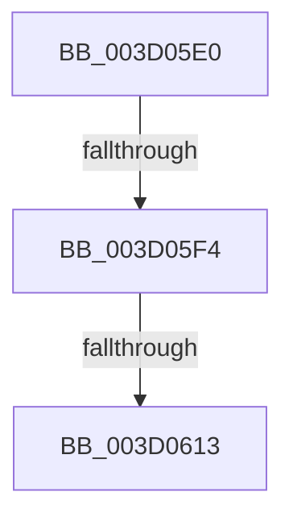

# sub_003D05E0

- RVA: `0x003D05E0`–`0x003D0617` (길이 `55` bytes)
- VA: `0x00000001403D05E0`
- 실행 섹션: `.text`
- PDB 이름 있음: `아니요`; PDB Function 태그: `아니요`
- unwind 정보 RVA: `0x00091074`
- 디코드: `13`개 명령, `55/55` bytes 표시
- 미해석 바이트: `0` (있으면 어셈블리에 `.byte`로 보존)

> 이 문서는 커널 이미지의 기계어와 PDB 기호를 분석해 생성했습니다. 4번과 5번은 함수 원형과 자료형을 바이너리 사용 방식에서 추정한 C 해석이며 원본 소스 복구 결과는 아닙니다.

## 1. Dependencies

- 직접 호출 지점: **1**; 고유 호출 대상: **1**
- 직접 호출자로 확인된 함수: **0**
- RIP 상대 이미지 참조: **1**

### Outgoing calls
- `0x003D0606` → [memcmp](../6C/memcmp_function_006C6B10.md) (function, `0x006C6B10`)

### Direct callers
- 이 함수 시작 RVA로 연결되는 직접 call은 확인되지 않았습니다. 간접 호출은 완전히 역산할 수 없습니다.

### Static image references
- `0x003D05E0` → RVA `0x00E67CF0` (`.data`; read)

## 2. Other-region calls and transfers

- 다른 실행 섹션으로 향하는 call: **0**
- call이 아닌 외부 분기/꼬리 이동: **3**
  - `0x003D05EE` → [sub_003D047D](Unknown_function_003D047D.md) (`tail-transfer`)
  - `0x003D060D` → [sub_003D047D](Unknown_function_003D047D.md) (`tail-transfer`)
  - `0x003D0615` → [sub_003D05B8](Unknown_function_003D05B8.md) (`tail-transfer`)

## 3. Assembly (complete function range)

```asm
003D05E0  48 8B 0D 09 77 A9 00            mov rcx, qword ptr [rip + 0xa97709]
003D05E7  0F B7 01                        movzx eax, word ptr [rcx]
003D05EA  66 41 3B 07                     cmp ax, word ptr [r15]
003D05EE  0F 85 89 FE FF FF               jne 0x1403d047d
003D05F4  44 8B C0                        mov r8d, eax
003D05F7  49 8B D7                        mov rdx, r15
003D05FA  49 C1 E8 08                     shr r8, 8
003D05FE  4E 8D 04 85 08 00 00 00         lea r8, [r8*4 + 8]
003D0606  E8 05 65 2F 00                  call 0x1406c6b10
003D060B  85 C0                           test eax, eax
003D060D  0F 85 6A FE FF FF               jne 0x1403d047d
003D0613  B0 01                           mov al, 1
003D0615  EB A1                           jmp 0x1403d05b8
```

## 4. C-style interpretation (structured pseudocode)

```c
__int64 __fastcall sub_003D05E0(void)
{
    __int64 result;

    a3 = ((unsigned int)((unsigned int)(*(unsigned __int16 *)(*(unsigned __int64 *)(v_rip + 11106057))))) >> (8);
    result = memcmp(*(unsigned __int64 *)(v_rip + 11106057), v_r15, a3 * 4 + 8, a4);
}
```

## 5. (Beta) C Style

```c
void sub_003D05E0(void)
{
    int64_t result;

    a3 = ((uint32_t)((uint32_t)(*(uint16_t *)(*(uint64_t *)(v_rip + 0xA97709))))) >> (8);
    result = memcmp(*(uint64_t *)(v_rip + 0xA97709), local_r15, a3 * 4 + 8, a4);
}
```

## 6. Execution-region graph

[열기: 2D/3D 그래프와 함수 탐색 컨트롤 패널](../../../control-panel.html?section=text&rva=0x003D05E0&view=graph)

- 2D 그래프는 위에서 아래로 흐르고, 3D 그래프는 빈 공간을 드래그해 회전합니다. Shift+드래그는 이동, 휠은 확대·축소, 함수 노드 선택은 대상 보고서 이동입니다.

### Static fallback


