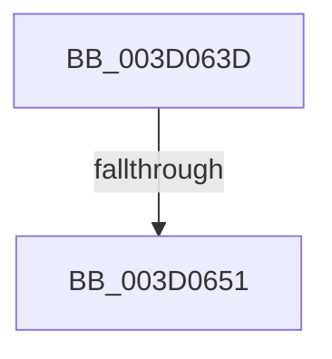

# sub_003D063D

- RVA: `0x003D063D`–`0x003D0673` (길이 `54` bytes)
- VA: `0x00000001403D063D`
- 실행 섹션: `.text`
- PDB 이름 있음: `아니요`; PDB Function 태그: `아니요`
- unwind 정보 RVA: `0x000910A0`
- 디코드: `12`개 명령, `54/54` bytes 표시
- 미해석 바이트: `0` (있으면 어셈블리에 `.byte`로 보존)

> 이 문서는 커널 이미지의 기계어와 PDB 기호를 분석해 생성했습니다. 4번과 5번은 함수 원형과 자료형을 바이너리 사용 방식에서 추정한 C 해석이며 원본 소스 복구 결과는 아닙니다.

## 1. Dependencies

- 직접 호출 지점: **1**; 고유 호출 대상: **1**
- 직접 호출자로 확인된 함수: **0**
- RIP 상대 이미지 참조: **1**

### Outgoing calls
- `0x003D0663` → [memcmp](../6C/memcmp_function_006C6B10.md) (function, `0x006C6B10`)

### Direct callers
- 이 함수 시작 RVA로 연결되는 직접 call은 확인되지 않았습니다. 간접 호출은 완전히 역산할 수 없습니다.

### Static image references
- `0x003D063D` → RVA `0x00E67CF8` (`.data`; read)

## 2. Other-region calls and transfers

- 다른 실행 섹션으로 향하는 call: **0**
- call이 아닌 외부 분기/꼬리 이동: **2**
  - `0x003D064B` → [SepSidInToken + 0x3F](SepSidInToken_function_003D0430.md) (`tail-transfer`)
  - `0x003D066E` → [SepSidInToken + 0x3F](SepSidInToken_function_003D0430.md) (`tail-transfer`)

## 3. Assembly (complete function range)

```asm
003D063D  48 8B 0D B4 76 A9 00            mov rcx, qword ptr [rip + 0xa976b4]
003D0644  0F B7 01                        movzx eax, word ptr [rcx]
003D0647  66 41 3B 00                     cmp ax, word ptr [r8]
003D064B  0F 85 1E FE FF FF               jne 0x1403d046f
003D0651  44 8B C0                        mov r8d, eax
003D0654  49 8B D7                        mov rdx, r15
003D0657  49 C1 E8 08                     shr r8, 8
003D065B  4E 8D 04 85 08 00 00 00         lea r8, [r8*4 + 8]
003D0663  E8 A8 64 2F 00                  call 0x1406c6b10
003D0668  85 C0                           test eax, eax
003D066A  4C 0F 44 FB                     cmove r15, rbx
003D066E  E9 FC FD FF FF                  jmp 0x1403d046f
```

## 4. C-style interpretation (structured pseudocode)

```c
__int64 __fastcall sub_003D063D(__int64 a1, __int64 a2, __int64 a3)
{
    __int64 result;
    __int64 v_r15;

    a3 = ((unsigned int)((unsigned int)(*(unsigned __int16 *)(*(unsigned __int64 *)(v_rip + 11105972))))) >> (8);
    result = memcmp(*(unsigned __int64 *)(v_rip + 11105972), v_r15, a3 * 4 + 8, a4);
    if ((unsigned int)(result) == 0) { v_r15 = v_rbx; }
}
```

## 5. (Beta) C Style

```c
int64_t sub_003D063D(int64_t Arg1, int64_t Arg2, void *Arg3)
{
    uint8_t *arg3 = (uint8_t *)Arg3;

    int64_t result;
    int64_t local_r15;

    Arg3 = ((uint32_t)((uint32_t)(*(uint16_t *)(*(uint64_t *)(v_rip + 0xA976B4))))) >> (8);
    result = memcmp(*(uint64_t *)(v_rip + 0xA976B4), local_r15, Arg3 * 4 + 8, a4);
    if ((uint32_t)(result) == 0) { local_r15 = local_rbx; }
}
```

### 관측된 메모리 오프셋

구조체 형식이 확인되지 않은 접근은 인자 기준의 오프셋으로만 기록했습니다.

| 기준 인자 | 오프셋 표현 | 폭 (bit) | 접근 |
|---|---:|---:|---|
| `Arg3` | `+ 0x0` | `16` | `R` |

## 6. Execution-region graph

[열기: 2D/3D 그래프와 함수 탐색 컨트롤 패널](../../../control-panel.html?section=text&rva=0x003D063D&view=graph)

- 2D 그래프는 위에서 아래로 흐르고, 3D 그래프는 빈 공간을 드래그해 회전합니다. Shift+드래그는 이동, 휠은 확대·축소, 함수 노드 선택은 대상 보고서 이동입니다.

### Static fallback


