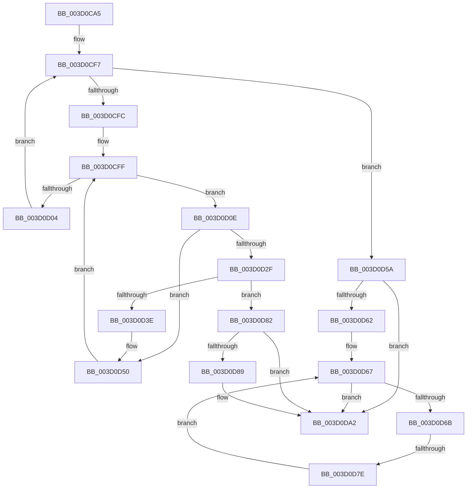

# sub_003D0CA5

- RVA: `0x003D0CA5`–`0x003D0DBB` (길이 `278` bytes)
- VA: `0x00000001403D0CA5`
- 실행 섹션: `.text`
- PDB 이름 있음: `아니요`; PDB Function 태그: `아니요`
- unwind 정보 RVA: `0x00091104`
- 디코드: `71`개 명령, `278/278` bytes 표시
- 미해석 바이트: `0` (있으면 어셈블리에 `.byte`로 보존)

> 이 문서는 커널 이미지의 기계어와 PDB 기호를 분석해 생성했습니다. 4번과 5번은 함수 원형과 자료형을 바이너리 사용 방식에서 추정한 C 해석이며 원본 소스 복구 결과는 아닙니다.

## 1. Dependencies

- 직접 호출 지점: **1**; 고유 호출 대상: **1**
- 직접 호출자로 확인된 함수: **0**
- RIP 상대 이미지 참조: **1**

### Outgoing calls
- `0x003D0D35` → [memcmp](../6C/memcmp_function_006C6B10.md) (function, `0x006C6B10`)

### Direct callers
- 이 함수 시작 RVA로 연결되는 직접 call은 확인되지 않았습니다. 간접 호출은 완전히 역산할 수 없습니다.

### Static image references
- `0x003D0CE7` → RVA `0x00011DE0` (`.rdata`; read)

## 2. Other-region calls and transfers

- 다른 실행 섹션으로 향하는 call: **0**
- call이 아닌 외부 분기/꼬리 이동: **1**
  - `0x003D0D7C` → [sub_003D0DC6](Unknown_function_003D0DC6.md) (`tail-transfer`)

## 3. Assembly (complete function range)

```asm
003D0CA5  48 89 5C 24 68                  mov qword ptr [rsp + 0x68], rbx
003D0CAA  48 89 74 24 38                  mov qword ptr [rsp + 0x38], rsi
003D0CAF  41 0F B6 4C 87 04               movzx ecx, byte ptr [r15 + rax*4 + 4]
003D0CB5  44 8D 0C 85 08 00 00 00         lea r9d, [rax*4 + 8]
003D0CBD  8B D9                           mov ebx, ecx
003D0CBF  48 89 7C 24 30                  mov qword ptr [rsp + 0x30], rdi
003D0CC4  48 C1 EB 04                     shr rbx, 4
003D0CC8  83 E1 0F                        and ecx, 0xf
003D0CCB  4C 89 64 24 28                  mov qword ptr [rsp + 0x28], r12
003D0CD0  4C 89 6C 24 20                  mov qword ptr [rsp + 0x20], r13
003D0CD5  44 89 4C 24 70                  mov dword ptr [rsp + 0x70], r9d
003D0CDA  49 8B 9C DE 90 00 00 00         mov rbx, qword ptr [r14 + rbx*8 + 0x90]
003D0CE2  49 23 5C CE 10                  and rbx, qword ptr [r14 + rcx*8 + 0x10]
003D0CE7  48 8D 0D F2 10 C4 FF            lea rcx, [rip - 0x3bef0e]
003D0CEE  45 32 E4                        xor r12b, r12b
003D0CF1  66 44 89 44 24 60               mov word ptr [rsp + 0x60], r8w
003D0CF7  48 85 DB                        test rbx, rbx
003D0CFA  74 5E                           je 0x1403d0d5a
003D0CFC  0F B6 FB                        movzx edi, bl
003D0CFF  40 84 FF                        test dil, dil
003D0D02  75 0A                           jne 0x1403d0d0e
003D0D04  41 80 C4 08                     add r12b, 8
003D0D08  48 C1 EB 08                     shr rbx, 8
003D0D0C  EB E9                           jmp 0x1403d0cf7
003D0D0E  41 0F B6 F4                     movzx esi, r12b
003D0D12  40 0F B6 C7                     movzx eax, dil
003D0D16  44 0F B6 2C 08                  movzx r13d, byte ptr [rax + rcx]
003D0D1B  41 03 F5                        add esi, r13d
003D0D1E  48 C1 E6 04                     shl rsi, 4
003D0D22  49 03 76 08                     add rsi, qword ptr [r14 + 8]
003D0D26  48 8B 16                        mov rdx, qword ptr [rsi]
003D0D29  66 44 39 02                     cmp word ptr [rdx], r8w
003D0D2D  75 21                           jne 0x1403d0d50
003D0D2F  45 8B C1                        mov r8d, r9d
003D0D32  49 8B CF                        mov rcx, r15
003D0D35  E8 D6 5D 2F 00                  call 0x1406c6b10
003D0D3A  85 C0                           test eax, eax
003D0D3C  74 44                           je 0x1403d0d82
003D0D3E  44 0F B7 44 24 60               movzx r8d, word ptr [rsp + 0x60]
003D0D44  48 8D 0D 95 10 C4 FF            lea rcx, [rip - 0x3bef6b]
003D0D4B  44 8B 4C 24 70                  mov r9d, dword ptr [rsp + 0x70]
003D0D50  40 0F B6 FF                     movzx edi, dil
003D0D54  44 0F BB EF                     btc edi, r13d
003D0D58  EB A5                           jmp 0x1403d0cff
003D0D5A  41 8B 1E                        mov ebx, dword ptr [r14]
003D0D5D  83 FB 40                        cmp ebx, 0x40
003D0D60  76 40                           jbe 0x1403d0da2
003D0D62  BF 40 00 00 00                  mov edi, 0x40
003D0D67  3B FB                           cmp edi, ebx
003D0D69  73 37                           jae 0x1403d0da2
003D0D6B  8B F7                           mov esi, edi
003D0D6D  48 C1 E6 04                     shl rsi, 4
003D0D71  49 03 76 08                     add rsi, qword ptr [r14 + 8]
003D0D75  48 8B 16                        mov rdx, qword ptr [rsi]
003D0D78  66 44 39 02                     cmp word ptr [rdx], r8w
003D0D7C  74 48                           je 0x1403d0dc6
003D0D7E  FF C7                           inc edi
003D0D80  EB E5                           jmp 0x1403d0d67
003D0D82  8B 46 08                        mov eax, dword ptr [rsi + 8]
003D0D85  A8 04                           test al, 4
003D0D87  74 19                           je 0x1403d0da2
003D0D89  48 8B 84 24 88 00 00 00         mov rax, qword ptr [rsp + 0x88]
003D0D91  23 6C 24 78                     and ebp, dword ptr [rsp + 0x78]
003D0D95  09 28                           or dword ptr [rax], ebp
003D0D97  48 8B 84 24 80 00 00 00         mov rax, qword ptr [rsp + 0x80]
003D0D9F  C6 00 01                        mov byte ptr [rax], 1
003D0DA2  4C 8B 64 24 28                  mov r12, qword ptr [rsp + 0x28]
003D0DA7  48 8B 7C 24 30                  mov rdi, qword ptr [rsp + 0x30]
003D0DAC  48 8B 74 24 38                  mov rsi, qword ptr [rsp + 0x38]
003D0DB1  48 8B 5C 24 68                  mov rbx, qword ptr [rsp + 0x68]
003D0DB6  4C 8B 6C 24 20                  mov r13, qword ptr [rsp + 0x20]
```

## 4. C-style interpretation (structured pseudocode)

```c
__int64 __fastcall sub_003D0CA5(__int64 a1, __int64 a2, unsigned __int16 a3, __int64 a4, __int64 a5, __int64 a6, __int64 a7, __int64 a8, __int64 a9, __int64 a10, __int64 a11, unsigned __int16 a12, __int64 a13, unsigned int a14, unsigned int a15, __int64 a16, __int64 a17)
{
    __int64 result;
    __int64 v_r12;
    __int64 v_rbp;
    __int64 v_rbx;
    __int64 v_rdi;
    __int64 v_rsi;
    unsigned __int64 v_stack_p20;
    unsigned __int64 v_stack_p28;
    unsigned __int64 v_stack_p30;
    unsigned __int64 v_stack_p38;
    unsigned __int16 v_stack_p60;
    unsigned __int64 v_stack_p68;
    unsigned int v_stack_p70;

    v_stack_p68 = v_rbx;
    v_stack_p38 = v_rsi;
    v_stack_p30 = v_rdi;
    v_rbx = ((unsigned int)((unsigned int)(*(unsigned __int8 *)(v_r15 + result * 4 + 4)))) >> (4);
    a1 = (unsigned int)((*(unsigned __int8 *)(v_r15 + result * 4 + 4)) & (15));
    v_stack_p28 = v_r12;
    v_stack_p20 = v_r13;
    v_stack_p70 = (unsigned int)(result * 4 + 8);
    v_rbx = (*(unsigned __int64 *)(v_r14 + v_rbx * 8 + 144)) & (*(unsigned __int64 *)(v_r14 + a1 * 8 + 16));
    v_r12 = 0;
    v_stack_p60 = a3;
loc_003D0CF7:
    if (v_rbx == 0) goto loc_003D0D5A;
loc_003D0CFF:
    if ((unsigned __int8)((unsigned __int8)(v_rbx)) != 0) goto loc_003D0D0E;
    v_r12 = (unsigned __int8)((v_r12) + (8));
    v_rbx = (v_rbx) >> (8);
    goto loc_003D0CF7;
loc_003D0D0E:
    v_rsi = (unsigned int)(((unsigned __int8)(v_r12)) + ((unsigned int)(*(unsigned __int8 *)((unsigned __int8)((unsigned __int8)(v_rbx)) + v_rip - 3927822 * 1))));
    v_rsi = (v_rsi) << (4);
    v_rsi = (v_rsi) + (*(unsigned __int64 *)(v_r14 + 8));
    if ((*(unsigned __int16 *)(*(unsigned __int64 *)(v_rsi))) != a3) goto loc_003D0D50;
    result = memcmp(v_r15, *(unsigned __int64 *)(v_rsi), (unsigned int)((unsigned int)(result * 4 + 8)), result * 4 + 8);
    if ((unsigned int)(result) == 0) goto loc_003D0D82;
loc_003D0D50:
    goto loc_003D0CFF;
loc_003D0D5A:
    if (((unsigned int)((unsigned int)(*(unsigned int *)(v_r14)))) <= 64) goto loc_003D0DA2;
loc_003D0D67:
    if (64 >= ((unsigned int)((unsigned int)(*(unsigned int *)(v_r14))))) goto loc_003D0DA2;
    v_rsi = (64) << (4);
    v_rsi = (v_rsi) + (*(unsigned __int64 *)(v_r14 + 8));
    v_rdi = (unsigned int)((64) + 1);
    goto loc_003D0D67;
loc_003D0D82:
    result = (unsigned int)(*(unsigned int *)(v_rsi + 8));
    if ((((unsigned __int8)((unsigned int)(*(unsigned int *)(v_rsi + 8)))) & (4)) != 0) {
        result = a17;
        v_rbp = (unsigned int)((v_rbp) & (a15));
        result = a16;
        *(unsigned __int8 *)(result) = 1;
    }
    return result;
}
```

## 5. (Beta) C Style

```c
int64_t sub_003D0CA5(int64_t Arg1, int64_t Arg2, uint16_t Arg3, int64_t Arg4, int64_t Arg5, int64_t Arg6, int64_t Arg7, uint64_t Arg8, uint64_t Arg9, uint64_t Arg10, uint64_t Arg11, uint16_t Arg12, int64_t Arg13, uint32_t Arg14, uint32_t Arg15, void *Arg16, void *Arg17)
{
    uint8_t *arg16 = (uint8_t *)Arg16;
    uint8_t *arg17 = (uint8_t *)Arg17;

    int64_t result;
    int64_t local_r12;
    int64_t local_rbp;
    int64_t local_rbx;
    int64_t local_rdi;
    int64_t local_rsi;
    uint64_t v_stack_p20;
    uint64_t v_stack_p28;
    uint64_t v_stack_p30;
    uint64_t v_stack_p38;
    uint16_t v_stack_p60;
    uint64_t v_stack_p68;
    uint32_t v_stack_p70;

    v_stack_p68 = local_rbx;
    v_stack_p38 = local_rsi;
    v_stack_p30 = local_rdi;
    local_rbx = ((uint32_t)((uint32_t)(*(uint8_t *)(local_r15 + result * 4 + 0x4)))) >> (4);
    Arg1 = (uint32_t)((*(uint8_t *)(local_r15 + result * 4 + 0x4)) & (15));
    v_stack_p28 = local_r12;
    v_stack_p20 = local_r13;
    v_stack_p70 = (uint32_t)(result * 4 + 8);
    local_rbx = (*(uint64_t *)(local_r14 + local_rbx * 8 + 0x90)) & (*(uint64_t *)(local_r14 + Arg1 * 8 + 0x10));
    local_r12 = 0;
    v_stack_p60 = Arg3;
loc_003D0CF7:
    if (local_rbx == 0) goto loc_003D0D5A;
loc_003D0CFF:
    if ((uint8_t)((uint8_t)(local_rbx)) != 0) goto loc_003D0D0E;
    local_r12 = (uint8_t)((local_r12) + (8));
    local_rbx = (local_rbx) >> (8);
    goto loc_003D0CF7;
loc_003D0D0E:
    local_rsi = (uint32_t)(((uint8_t)(local_r12)) + ((uint32_t)(*(uint8_t *)((uint8_t)((uint8_t)(local_rbx)) + v_rip - 0x3BEF0E * 1))));
    local_rsi = (local_rsi) << (4);
    local_rsi = (local_rsi) + (*(uint64_t *)(local_r14 + 0x8));
    if ((*(uint16_t *)(*(uint64_t *)(local_rsi))) != Arg3) goto loc_003D0D50;
    result = memcmp(local_r15, *(uint64_t *)(local_rsi), (uint32_t)((uint32_t)(result * 4 + 8)), result * 4 + 8);
    if ((uint32_t)(result) == 0) goto loc_003D0D82;
loc_003D0D50:
    goto loc_003D0CFF;
loc_003D0D5A:
    if (((uint32_t)((uint32_t)(*(uint32_t *)(local_r14)))) <= 64) goto loc_003D0DA2;
loc_003D0D67:
    if (64 >= ((uint32_t)((uint32_t)(*(uint32_t *)(local_r14))))) goto loc_003D0DA2;
    local_rsi = (64) << (4);
    local_rsi = (local_rsi) + (*(uint64_t *)(local_r14 + 0x8));
    local_rdi = (uint32_t)((64) + 1);
    goto loc_003D0D67;
loc_003D0D82:
    result = (uint32_t)(*(uint32_t *)(local_rsi + 0x8));
    if ((((uint8_t)((uint32_t)(*(uint32_t *)(local_rsi + 0x8)))) & (4)) != 0) {
        result = Arg17;
        local_rbp = (uint32_t)((local_rbp) & (Arg15));
        result = Arg16;
        *(uint8_t *)(result) = 1;
    }
    return result;
}
```

### 관측된 메모리 오프셋

구조체 형식이 확인되지 않은 접근은 인자 기준의 오프셋으로만 기록했습니다.

| 기준 인자 | 오프셋 표현 | 폭 (bit) | 접근 |
|---|---:|---:|---|
| `Arg16` | `+ 0x0` | `8` | `W` |
| `Arg17` | `+ 0x0` | `32` | `R/W` |

## 6. Execution-region graph

[열기: 2D/3D 그래프와 함수 탐색 컨트롤 패널](../../../control-panel.html?section=text&rva=0x003D0CA5&view=graph)

- 2D 그래프는 위에서 아래로 흐르고, 3D 그래프는 빈 공간을 드래그해 회전합니다. Shift+드래그는 이동, 휠은 확대·축소, 함수 노드 선택은 대상 보고서 이동입니다.

### Static fallback


