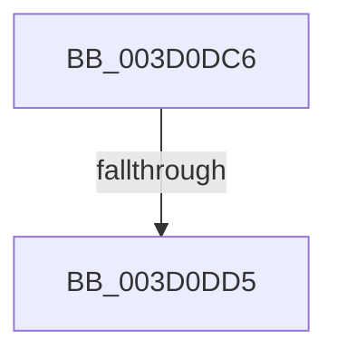

# sub_003D0DC6

- RVA: `0x003D0DC6`–`0x003D0DE2` (길이 `28` bytes)
- VA: `0x00000001403D0DC6`
- 실행 섹션: `.text`
- PDB 이름 있음: `아니요`; PDB Function 태그: `아니요`
- unwind 정보 RVA: `0x0009113C`
- 디코드: `8`개 명령, `28/28` bytes 표시
- 미해석 바이트: `0` (있으면 어셈블리에 `.byte`로 보존)

> 이 문서는 커널 이미지의 기계어와 PDB 기호를 분석해 생성했습니다. 4번과 5번은 함수 원형과 자료형을 바이너리 사용 방식에서 추정한 C 해석이며 원본 소스 복구 결과는 아닙니다.

## 1. Dependencies

- 직접 호출 지점: **1**; 고유 호출 대상: **1**
- 직접 호출자로 확인된 함수: **0**
- RIP 상대 이미지 참조: **0**

### Outgoing calls
- `0x003D0DCC` → [memcmp](../6C/memcmp_function_006C6B10.md) (function, `0x006C6B10`)

### Direct callers
- 이 함수 시작 RVA로 연결되는 직접 call은 확인되지 않았습니다. 간접 호출은 완전히 역산할 수 없습니다.

### Static image references
- 디코드된 RIP-relative 메모리 참조가 없습니다.

## 2. Other-region calls and transfers

- 다른 실행 섹션으로 향하는 call: **0**
- call이 아닌 외부 분기/꼬리 이동: **2**
  - `0x003D0DD3` → [sub_003D0CA5 + 0xDD](Unknown_function_003D0CA5.md) (`tail-transfer`)
  - `0x003D0DE0` → [sub_003D0CA5 + 0xD9](Unknown_function_003D0CA5.md) (`tail-transfer`)

## 3. Assembly (complete function range)

```asm
003D0DC6  45 8B C1                        mov r8d, r9d
003D0DC9  49 8B CF                        mov rcx, r15
003D0DCC  E8 3F 5D 2F 00                  call 0x1406c6b10
003D0DD1  85 C0                           test eax, eax
003D0DD3  74 AD                           je 0x1403d0d82
003D0DD5  44 0F B7 44 24 60               movzx r8d, word ptr [rsp + 0x60]
003D0DDB  44 8B 4C 24 70                  mov r9d, dword ptr [rsp + 0x70]
003D0DE0  EB 9C                           jmp 0x1403d0d7e
```

## 4. C-style interpretation (structured pseudocode)

```c
__int64 __fastcall sub_003D0DC6(__int64 a1, __int64 a2, __int64 a3, int a4, __int64 a5, __int64 a6, __int64 a7, __int64 a8, __int64 a9, __int64 a10, __int64 a11, unsigned __int16 a12, __int64 a13, unsigned int a14)
{
    __int64 result;

    result = memcmp(v_r15, a2, (unsigned int)(a4), a4);
}
```

## 5. (Beta) C Style

```c
int64_t sub_003D0DC6(int64_t Arg1, int64_t Arg2, int64_t Arg3, int32_t Arg4, uint64_t Arg5, uint64_t Arg6, uint64_t Arg7, uint64_t Arg8, uint64_t Arg9, uint64_t Arg10, uint64_t Arg11, uint16_t Arg12, uint64_t Arg13, uint32_t Arg14)
{
    int64_t result;

    result = memcmp(local_r15, Arg2, (uint32_t)(Arg4), Arg4);
}
```

## 6. Execution-region graph

[열기: 2D/3D 그래프와 함수 탐색 컨트롤 패널](../../../control-panel.html?section=text&rva=0x003D0DC6&view=graph)

- 2D 그래프는 위에서 아래로 흐르고, 3D 그래프는 빈 공간을 드래그해 회전합니다. Shift+드래그는 이동, 휠은 확대·축소, 함수 노드 선택은 대상 보고서 이동입니다.

### Static fallback


