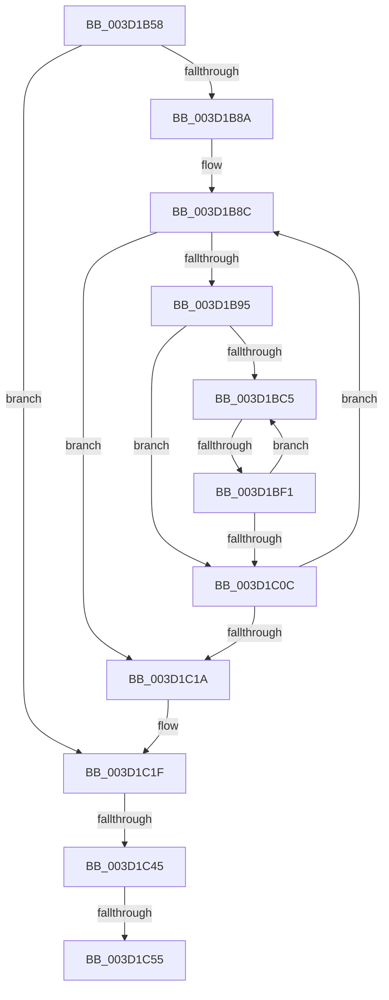

# sub_003D1B58

- RVA: `0x003D1B58`–`0x003D1C93` (길이 `315` bytes)
- VA: `0x00000001403D1B58`
- 실행 섹션: `.text`
- PDB 이름 있음: `아니요`; PDB Function 태그: `아니요`
- unwind 정보 RVA: `0x000911F8`
- 디코드: `78`개 명령, `315/315` bytes 표시
- 미해석 바이트: `0` (있으면 어셈블리에 `.byte`로 보존)

> 이 문서는 커널 이미지의 기계어와 PDB 기호를 분석해 생성했습니다. 4번과 5번은 함수 원형과 자료형을 바이너리 사용 방식에서 추정한 C 해석이며 원본 소스 복구 결과는 아닙니다.

## 1. Dependencies

- 직접 호출 지점: **0**; 고유 호출 대상: **0**
- 직접 호출자로 확인된 함수: **0**
- RIP 상대 이미지 참조: **0**

### Outgoing calls
- 직접 디코드된 call 명령이 없습니다.

### Direct callers
- 이 함수 시작 RVA로 연결되는 직접 call은 확인되지 않았습니다. 간접 호출은 완전히 역산할 수 없습니다.

### Static image references
- 디코드된 RIP-relative 메모리 참조가 없습니다.

## 2. Other-region calls and transfers

- 다른 실행 섹션으로 향하는 call: **0**
- call이 아닌 외부 분기/꼬리 이동: **3**
  - `0x003D1BEB` → [sub_003D1DCA](Unknown_function_003D1DCA.md) (`tail-transfer`)
  - `0x003D1C3F` → [sub_003D1DE5 + 0x7](Unknown_function_003D1DE5.md) (`tail-transfer`)
  - `0x003D1C4F` → [sub_003D1DE5](Unknown_function_003D1DE5.md) (`tail-transfer`)

## 3. Assembly (complete function range)

```asm
003D1B58  48 89 AC 24 80 00 00 00         mov qword ptr [rsp + 0x80], rbp
003D1B60  48 8B CF                        mov rcx, rdi
003D1B63  48 89 74 24 50                  mov qword ptr [rsp + 0x50], rsi
003D1B68  48 8B D3                        mov rdx, rbx
003D1B6B  8B B4 24 90 00 00 00            mov esi, dword ptr [rsp + 0x90]
003D1B72  44 8B CE                        mov r9d, esi
003D1B75  4C 89 64 24 48                  mov qword ptr [rsp + 0x48], r12
003D1B7A  45 33 E4                        xor r12d, r12d
003D1B7D  4C 89 74 24 38                  mov qword ptr [rsp + 0x38], r14
003D1B82  85 F6                           test esi, esi
003D1B84  0F 84 95 00 00 00               je 0x1403d1c1f
003D1B8A  33 ED                           xor ebp, ebp
003D1B8C  48 85 D2                        test rdx, rdx
003D1B8F  0F 84 85 00 00 00               je 0x1403d1c1a
003D1B95  8B 42 28                        mov eax, dword ptr [rdx + 0x28]
003D1B98  45 8B C1                        mov r8d, r9d
003D1B9B  2B C1                           sub eax, ecx
003D1B9D  41 3B C1                        cmp eax, r9d
003D1BA0  44 0F 46 C0                     cmovbe r8d, eax
003D1BA4  03 4A 2C                        add ecx, dword ptr [rdx + 0x2c]
003D1BA7  44 8B D1                        mov r10d, ecx
003D1BAA  45 2B C8                        sub r9d, r8d
003D1BAD  48 C1 E9 0C                     shr rcx, 0xc
003D1BB1  41 81 E2 FF 0F 00 00            and r10d, 0xfff
003D1BB8  48 83 C1 06                     add rcx, 6
003D1BBC  48 8D 0C CA                     lea rcx, [rdx + rcx*8]
003D1BC0  45 85 C0                        test r8d, r8d
003D1BC3  74 47                           je 0x1403d1c0c
003D1BC5  4C 8B 19                        mov r11, qword ptr [rcx]
003D1BC8  41 8B C2                        mov eax, r10d
003D1BCB  49 C1 E3 0C                     shl r11, 0xc
003D1BCF  4C 03 D8                        add r11, rax
003D1BD2  B8 00 10 00 00                  mov eax, 0x1000
003D1BD7  41 2B C2                        sub eax, r10d
003D1BDA  45 8B D0                        mov r10d, r8d
003D1BDD  41 3B C0                        cmp eax, r8d
003D1BE0  44 0F 46 D0                     cmovbe r10d, eax
003D1BE4  48 8D 45 01                     lea rax, [rbp + 1]
003D1BE8  4C 3B D8                        cmp r11, rax
003D1BEB  0F 84 D9 01 00 00               je 0x1403d1dca
003D1BF1  41 FF C4                        inc r12d
003D1BF4  41 8B EA                        mov ebp, r10d
003D1BF7  45 2B C2                        sub r8d, r10d
003D1BFA  48 FF CD                        dec rbp
003D1BFD  48 83 C1 08                     add rcx, 8
003D1C01  49 03 EB                        add rbp, r11
003D1C04  45 33 D2                        xor r10d, r10d
003D1C07  45 85 C0                        test r8d, r8d
003D1C0A  75 B9                           jne 0x1403d1bc5
003D1C0C  48 8B 12                        mov rdx, qword ptr [rdx]
003D1C0F  33 C9                           xor ecx, ecx
003D1C11  45 85 C9                        test r9d, r9d
003D1C14  0F 85 72 FF FF FF               jne 0x1403d1b8c
003D1C1A  4C 8B 44 24 78                  mov r8, qword ptr [rsp + 0x78]
003D1C1F  48 8B AC 24 B0 00 00 00         mov rbp, qword ptr [rsp + 0xb0]
003D1C27  4B 8D 0C 64                     lea rcx, [r12 + r12*2]
003D1C2B  4C 89 7C 24 30                  mov qword ptr [rsp + 0x30], r15
003D1C30  4C 8D 34 CD 10 00 00 00         lea r14, [rcx*8 + 0x10]
003D1C38  49 8D 56 68                     lea rdx, [r14 + 0x68]
003D1C3C  48 85 ED                        test rbp, rbp
003D1C3F  0F 84 A7 01 00 00               je 0x1403d1dec
003D1C45  8B 84 24 B8 00 00 00            mov eax, dword ptr [rsp + 0xb8]
003D1C4C  48 3B C2                        cmp rax, rdx
003D1C4F  0F 82 90 01 00 00               jb 0x1403d1de5
003D1C55  4C 8B FD                        mov r15, rbp
003D1C58  45 89 27                        mov dword ptr [r15], r12d
003D1C5B  48 85 ED                        test rbp, rbp
003D1C5E  48 8B AC 24 98 00 00 00         mov rbp, qword ptr [rsp + 0x98]
003D1C66  0F 94 C0                        sete al
003D1C69  4F 89 44 3E 20                  mov qword ptr [r14 + r15 + 0x20], r8
003D1C6E  43 88 44 3E 61                  mov byte ptr [r14 + r15 + 0x61], al
003D1C73  45 33 E4                        xor r12d, r12d
003D1C76  48 8B 44 24 70                  mov rax, qword ptr [rsp + 0x70]
003D1C7B  33 D2                           xor edx, edx
003D1C7D  4B 89 44 3E 18                  mov qword ptr [r14 + r15 + 0x18], rax
003D1C82  49 8B 40 20                     mov rax, qword ptr [r8 + 0x20]
003D1C86  4B 89 44 3E 28                  mov qword ptr [r14 + r15 + 0x28], rax
003D1C8B  48 8B 84 24 A0 00 00 00         mov rax, qword ptr [rsp + 0xa0]
```

## 4. C-style interpretation (structured pseudocode)

```c
__int64 __fastcall sub_003D1B58(__int64 a1, __int64 a2, __int64 a3, __int64 a4, __int64 a5, __int64 a6, __int64 a7, __int64 a8, __int64 a9, __int64 a10, __int64 a11, __int64 a12, __int64 a13, __int64 a14, __int64 a15, __int64 a16, __int64 a17, unsigned int a18, __int64 a19, __int64 a20, __int64 a21, __int64 a22, unsigned int a23)
{
    __int64 result;
    __int64 v_r10;
    __int64 v_r11;
    __int64 v_r12;
    __int64 v_rbp;
    unsigned __int64 v_stack_p30;
    unsigned __int64 v_stack_p38;
    unsigned __int64 v_stack_p48;
    unsigned __int64 v_stack_p50;
    unsigned __int64 v_stack_p80;

    v_stack_p80 = v_rbp;
    v_stack_p50 = v_rsi;
    v_stack_p48 = v_r12;
    v_r12 = 0;
    v_stack_p38 = v_r14;
    if ((unsigned int)((unsigned int)(a18)) == 0) goto loc_003D1C1F;
    v_rbp = 0;
loc_003D1B8C:
    if (v_rbx == 0) goto loc_003D1C1A;
    result = (unsigned int)(((unsigned int)(*(unsigned int *)(v_rbx + 40))) - ((unsigned int)(v_rdi)));
    a3 = (unsigned int)((unsigned int)((unsigned int)((unsigned int)((unsigned int)(a18)))));
    if (((unsigned int)(result)) <= ((unsigned int)((unsigned int)((unsigned int)((unsigned int)(a18)))))) { a3 = (unsigned int)(result); }
    a1 = (unsigned int)((v_rdi) + (*(unsigned int *)(v_rbx + 44)));
    a4 = (unsigned int)(((unsigned int)((unsigned int)((unsigned int)(a18)))) - ((unsigned int)(a3)));
    a1 = (a1) >> (12);
    v_r10 = (unsigned int)(((unsigned int)((unsigned int)(a1))) & (0xFFFULL));
    a1 = (a1) + (6);
    if ((unsigned int)(a3) == 0) goto loc_003D1C0C;
loc_003D1BC5:
    v_r11 = (*(unsigned __int64 *)(v_rbx + a1 * 8)) << (12);
    v_r11 = (v_r11) + ((unsigned int)((unsigned int)(v_r10)));
    result = (unsigned int)(((unsigned int)(0x1000ULL)) - ((unsigned int)(v_r10)));
    v_r10 = (unsigned int)((unsigned int)(a3));
    if (((unsigned int)(result)) <= ((unsigned int)(a3))) { v_r10 = (unsigned int)(result); }
    v_r12 = (unsigned int)((v_r12) + 1);
    a3 = (unsigned int)((a3) - ((unsigned int)(v_r10)));
    v_rbp = ((unsigned int)((unsigned int)(v_r10))) - 1;
    a1 = (v_rbx + a1 * 8) + (8);
    v_rbp = (v_rbp) + (v_r11);
    v_r10 = 0;
    if ((unsigned int)(a3) != 0) goto loc_003D1BC5;
loc_003D1C0C:
    a1 = 0;
    if ((unsigned int)(a4) != 0) goto loc_003D1B8C;
loc_003D1C1A:
loc_003D1C1F:
    v_stack_p30 = v_r15;
    *(unsigned int *)(a22) = (unsigned int)(v_r12);
    result = (a22 == 0) ? 1 : 0;
    *(unsigned __int64 *)(v_r12 + v_r12 * 2 * 8 + 16 + a22 * 1 + 32) = a15;
    *(unsigned __int8 *)(v_r12 + v_r12 * 2 * 8 + 16 + a22 * 1 + 97) = (unsigned __int8)(result);
    v_r12 = 0;
    a2 = 0;
    *(unsigned __int64 *)(v_r12 + v_r12 * 2 * 8 + 16 + a22 * 1 + 24) = a14;
    *(unsigned __int64 *)(v_r12 + v_r12 * 2 * 8 + 16 + a22 * 1 + 40) = *(unsigned __int64 *)(a15 + 32);
    return a20;
}
```

## 5. (Beta) C Style

```c
int64_t sub_003D1B58(int64_t Arg1, int64_t Arg2, int64_t Arg3, int64_t Arg4, uint64_t Arg5, uint64_t Arg6, uint64_t Arg7, uint64_t Arg8, uint64_t Arg9, uint64_t Arg10, uint64_t Arg11, uint64_t Arg12, uint64_t Arg13, int64_t Arg14, int64_t Arg15, uint64_t Arg16, uint64_t Arg17, uint32_t Arg18, int64_t Arg19, int64_t Arg20, uint64_t Arg21, int64_t Arg22, uint32_t Arg23)
{
    int64_t result;
    int64_t local_r10;
    int64_t local_r11;
    int64_t local_r12;
    int64_t local_rbp;
    uint64_t v_stack_p30;
    uint64_t v_stack_p38;
    uint64_t v_stack_p48;
    uint64_t v_stack_p50;
    uint64_t v_stack_p80;

    v_stack_p80 = local_rbp;
    v_stack_p50 = local_rsi;
    v_stack_p48 = local_r12;
    local_r12 = 0;
    v_stack_p38 = local_r14;
    if ((uint32_t)((uint32_t)(Arg18)) == 0) goto loc_003D1C1F;
    local_rbp = 0;
loc_003D1B8C:
    if (local_rbx == 0) goto loc_003D1C1A;
    result = (uint32_t)(((uint32_t)(*(uint32_t *)(local_rbx + 0x28))) - ((uint32_t)(local_rdi)));
    Arg3 = (uint32_t)((uint32_t)((uint32_t)((uint32_t)((uint32_t)(Arg18)))));
    if (((uint32_t)(result)) <= ((uint32_t)((uint32_t)((uint32_t)((uint32_t)(Arg18)))))) { Arg3 = (uint32_t)(result); }
    Arg1 = (uint32_t)((local_rdi) + (*(uint32_t *)(local_rbx + 0x2C)));
    Arg4 = (uint32_t)(((uint32_t)((uint32_t)((uint32_t)(Arg18)))) - ((uint32_t)(Arg3)));
    Arg1 = (Arg1) >> (12);
    local_r10 = (uint32_t)(((uint32_t)((uint32_t)(Arg1))) & (0xFFFULL));
    Arg1 = (Arg1) + (6);
    if ((uint32_t)(Arg3) == 0) goto loc_003D1C0C;
loc_003D1BC5:
    local_r11 = (*(uint64_t *)(local_rbx + Arg1 * 8)) << (12);
    local_r11 = (local_r11) + ((uint32_t)((uint32_t)(local_r10)));
    result = (uint32_t)(((uint32_t)(0x1000ULL)) - ((uint32_t)(local_r10)));
    local_r10 = (uint32_t)((uint32_t)(Arg3));
    if (((uint32_t)(result)) <= ((uint32_t)(Arg3))) { local_r10 = (uint32_t)(result); }
    local_r12 = (uint32_t)((local_r12) + 1);
    Arg3 = (uint32_t)((Arg3) - ((uint32_t)(local_r10)));
    local_rbp = ((uint32_t)((uint32_t)(local_r10))) - 1;
    Arg1 = (local_rbx + Arg1 * 8) + (8);
    local_rbp = (local_rbp) + (local_r11);
    local_r10 = 0;
    if ((uint32_t)(Arg3) != 0) goto loc_003D1BC5;
loc_003D1C0C:
    Arg1 = 0;
    if ((uint32_t)(Arg4) != 0) goto loc_003D1B8C;
loc_003D1C1A:
loc_003D1C1F:
    v_stack_p30 = local_r15;
    *(uint32_t *)(Arg22) = (uint32_t)(local_r12);
    result = (Arg22 == 0) ? 1 : 0;
    *(uint64_t *)(local_r12 + local_r12 * 2 * 8 + 0x10 + Arg22 * 1 + 0x20) = Arg15;
    *(uint8_t *)(local_r12 + local_r12 * 2 * 8 + 0x10 + Arg22 * 1 + 0x61) = (uint8_t)(result);
    local_r12 = 0;
    Arg2 = 0;
    *(uint64_t *)(local_r12 + local_r12 * 2 * 8 + 0x10 + Arg22 * 1 + 0x18) = Arg14;
    *(uint64_t *)(local_r12 + local_r12 * 2 * 8 + 0x10 + Arg22 * 1 + 0x28) = *(uint64_t *)(Arg15 + 0x20);
    return Arg20;
}
```

## 6. Execution-region graph

[열기: 2D/3D 그래프와 함수 탐색 컨트롤 패널](../../../control-panel.html?section=text&rva=0x003D1B58&view=graph)

- 2D 그래프는 위에서 아래로 흐르고, 3D 그래프는 빈 공간을 드래그해 회전합니다. Shift+드래그는 이동, 휠은 확대·축소, 함수 노드 선택은 대상 보고서 이동입니다.

### Static fallback


