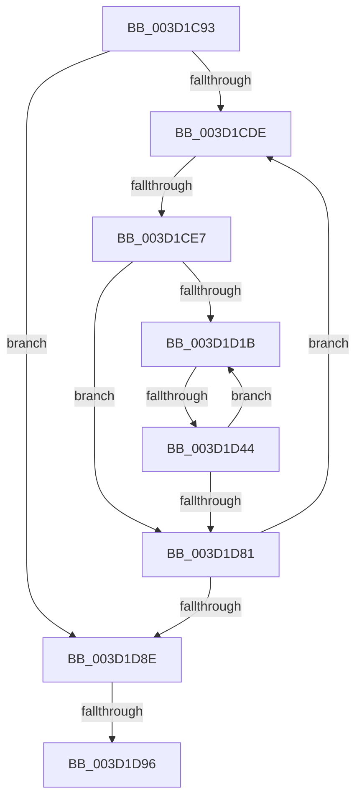

# sub_003D1C93

- RVA: `0x003D1C93`–`0x003D1D9D` (길이 `266` bytes)
- VA: `0x00000001403D1C93`
- 실행 섹션: `.text`
- PDB 이름 있음: `아니요`; PDB Function 태그: `아니요`
- unwind 정보 RVA: `0x0009121C`
- 디코드: `71`개 명령, `266/266` bytes 표시
- 미해석 바이트: `0` (있으면 어셈블리에 `.byte`로 보존)

> 이 문서는 커널 이미지의 기계어와 PDB 기호를 분석해 생성했습니다. 4번과 5번은 함수 원형과 자료형을 바이너리 사용 방식에서 추정한 C 해석이며 원본 소스 복구 결과는 아닙니다.

## 1. Dependencies

- 직접 호출 지점: **0**; 고유 호출 대상: **0**
- 직접 호출자로 확인된 함수: **0**
- RIP 상대 이미지 참조: **0**

### Outgoing calls
- 직접 디코드된 call 명령이 없습니다.

### Direct callers
- 이 함수 시작 RVA로 연결되는 직접 call은 확인되지 않았습니다. 간접 호출은 완전히 역산할 수 없습니다.

### Static image references
- 디코드된 RIP-relative 메모리 참조가 없습니다.

## 2. Other-region calls and transfers

- 다른 실행 섹션으로 향하는 call: **0**
- call이 아닌 외부 분기/꼬리 이동: **3**
  - `0x003D1CE1` → [sub_003D1E45](Unknown_function_003D1E45.md) (`tail-transfer`)
  - `0x003D1D42` → [sub_003D1DC1](Unknown_function_003D1DC1.md) (`tail-transfer`)
  - `0x003D1D94` → [sub_003D1E0B](Unknown_function_003D1E0B.md) (`tail-transfer`)

## 3. Assembly (complete function range)

```asm
003D1C93  4C 89 6C 24 40                  mov qword ptr [rsp + 0x40], r13
003D1C98  4F 8D 2C 3E                     lea r13, [r14 + r15]
003D1C9C  49 89 45 48                     mov qword ptr [r13 + 0x48], rax
003D1CA0  4D 8D 77 10                     lea r14, [r15 + 0x10]
003D1CA4  49 89 6D 40                     mov qword ptr [r13 + 0x40], rbp
003D1CA8  41 89 75 38                     mov dword ptr [r13 + 0x38], esi
003D1CAC  49 89 5D 30                     mov qword ptr [r13 + 0x30], rbx
003D1CB0  41 89 7D 3C                     mov dword ptr [r13 + 0x3c], edi
003D1CB4  4D 89 7D 50                     mov qword ptr [r13 + 0x50], r15
003D1CB8  41 C6 45 60 00                  mov byte ptr [r13 + 0x60], 0
003D1CBD  41 C7 45 10 02 00 00 00         mov dword ptr [r13 + 0x10], 2
003D1CC5  41 C6 45 62 00                  mov byte ptr [r13 + 0x62], 0
003D1CCA  49 C7 45 58 00 00 00 00         mov qword ptr [r13 + 0x58], 0
003D1CD2  4D 89 6F 08                     mov qword ptr [r15 + 8], r13
003D1CD6  85 F6                           test esi, esi
003D1CD8  0F 84 B0 00 00 00               je 0x1403d1d8e
003D1CDE  48 85 DB                        test rbx, rbx
003D1CE1  0F 84 5E 01 00 00               je 0x1403d1e45
003D1CE7  8B 43 28                        mov eax, dword ptr [rbx + 0x28]
003D1CEA  44 8B C6                        mov r8d, esi
003D1CED  8B 4B 2C                        mov ecx, dword ptr [rbx + 0x2c]
003D1CF0  2B C7                           sub eax, edi
003D1CF2  3B C6                           cmp eax, esi
003D1CF4  44 0F 46 C0                     cmovbe r8d, eax
003D1CF8  03 CF                           add ecx, edi
003D1CFA  44 8B D9                        mov r11d, ecx
003D1CFD  44 8B C9                        mov r9d, ecx
003D1D00  49 C1 EB 0C                     shr r11, 0xc
003D1D04  41 2B F0                        sub esi, r8d
003D1D07  49 83 C3 06                     add r11, 6
003D1D0B  41 81 E1 FF 0F 00 00            and r9d, 0xfff
003D1D12  4E 8D 1C DB                     lea r11, [rbx + r11*8]
003D1D16  45 85 C0                        test r8d, r8d
003D1D19  74 66                           je 0x1403d1d81
003D1D1B  4D 8B 13                        mov r10, qword ptr [r11]
003D1D1E  41 8B C1                        mov eax, r9d
003D1D21  49 C1 E2 0C                     shl r10, 0xc
003D1D25  4C 03 D0                        add r10, rax
003D1D28  B8 00 10 00 00                  mov eax, 0x1000
003D1D2D  41 2B C1                        sub eax, r9d
003D1D30  45 8B C8                        mov r9d, r8d
003D1D33  41 3B C0                        cmp eax, r8d
003D1D36  44 0F 46 C8                     cmovbe r9d, eax
003D1D3A  49 8D 44 24 01                  lea rax, [r12 + 1]
003D1D3F  4C 3B D0                        cmp r10, rax
003D1D42  74 7D                           je 0x1403d1dc1
003D1D44  4C 8D 72 01                     lea r14, [rdx + 1]
003D1D48  4E 8D 34 72                     lea r14, [rdx + r14*2]
003D1D4C  FF C2                           inc edx
003D1D4E  4F 8D 34 F7                     lea r14, [r15 + r14*8]
003D1D52  4D 89 16                        mov qword ptr [r14], r10
003D1D55  41 C7 46 08 00 00 00 00         mov dword ptr [r14 + 8], 0
003D1D5D  49 C7 46 10 00 00 00 00         mov qword ptr [r14 + 0x10], 0
003D1D65  45 01 4E 08                     add dword ptr [r14 + 8], r9d
003D1D69  45 2B C1                        sub r8d, r9d
003D1D6C  45 8B E1                        mov r12d, r9d
003D1D6F  49 83 C3 08                     add r11, 8
003D1D73  49 FF CC                        dec r12
003D1D76  45 33 C9                        xor r9d, r9d
003D1D79  4D 03 E2                        add r12, r10
003D1D7C  45 85 C0                        test r8d, r8d
003D1D7F  75 9A                           jne 0x1403d1d1b
003D1D81  48 8B 1B                        mov rbx, qword ptr [rbx]
003D1D84  33 FF                           xor edi, edi
003D1D86  85 F6                           test esi, esi
003D1D88  0F 85 50 FF FF FF               jne 0x1403d1cde
003D1D8E  41 89 17                        mov dword ptr [r15], edx
003D1D91  48 85 ED                        test rbp, rbp
003D1D94  75 75                           jne 0x1403d1e0b
003D1D96  4C 8B 6C 24 40                  mov r13, qword ptr [rsp + 0x40]
003D1D9B  33 C0                           xor eax, eax
```

## 4. C-style interpretation (structured pseudocode)

```c
__int64 __fastcall sub_003D1C93(__int64 a1, __int64 a2, __int64 a3, __int64 a4, __int64 a5, __int64 a6, __int64 a7, __int64 a8)
{
    __int64 result;
    __int64 v_r10;
    __int64 v_r11;
    __int64 v_r12;
    __int64 v_rdi;
    __int64 v_rsi;
    unsigned __int64 v_stack_p40;

    v_stack_p40 = v_r13;
    *(unsigned __int64 *)(v_r14 + v_r15 * 1 + 72) = result;
    *(unsigned __int64 *)(v_r14 + v_r15 * 1 + 64) = v_rbp;
    *(unsigned int *)(v_r14 + v_r15 * 1 + 56) = (unsigned int)(v_rsi);
    *(unsigned __int64 *)(v_r14 + v_r15 * 1 + 48) = v_rbx;
    *(unsigned int *)(v_r14 + v_r15 * 1 + 60) = (unsigned int)(v_rdi);
    *(unsigned __int64 *)(v_r14 + v_r15 * 1 + 80) = v_r15;
    *(unsigned __int8 *)(v_r14 + v_r15 * 1 + 96) = 0;
    *(unsigned int *)(v_r14 + v_r15 * 1 + 16) = 2;
    *(unsigned __int8 *)(v_r14 + v_r15 * 1 + 98) = 0;
    *(unsigned __int64 *)(v_r14 + v_r15 * 1 + 88) = 0;
    *(unsigned __int64 *)(v_r15 + 8) = v_r14 + v_r15 * 1;
    if ((unsigned int)(v_rsi) == 0) goto loc_003D1D8E;
loc_003D1CDE:
    result = (unsigned int)(((unsigned int)(*(unsigned int *)(v_rbx + 40))) - ((unsigned int)(v_rdi)));
    a3 = (unsigned int)((unsigned int)(v_rsi));
    if (((unsigned int)(result)) <= ((unsigned int)(v_rsi))) { a3 = (unsigned int)(result); }
    a1 = (unsigned int)(((unsigned int)(*(unsigned int *)(v_rbx + 44))) + ((unsigned int)(v_rdi)));
    v_r11 = ((unsigned int)((unsigned int)(a1))) >> (12);
    v_rsi = (unsigned int)((v_rsi) - ((unsigned int)(a3)));
    v_r11 = (v_r11) + (6);
    a4 = (unsigned int)(((unsigned int)((unsigned int)(a1))) & (0xFFFULL));
    if ((unsigned int)(a3) == 0) goto loc_003D1D81;
loc_003D1D1B:
    v_r10 = (*(unsigned __int64 *)(v_rbx + v_r11 * 8)) << (12);
    v_r10 = (v_r10) + ((unsigned int)((unsigned int)(a4)));
    result = (unsigned int)(((unsigned int)(0x1000ULL)) - ((unsigned int)(a4)));
    a4 = (unsigned int)((unsigned int)(a3));
    if (((unsigned int)(result)) <= ((unsigned int)(a3))) { a4 = (unsigned int)(result); }
    a2 = (unsigned int)((a2) + 1);
    *(unsigned __int64 *)(v_r15 + a2 + a2 + 1 * 2 * 8) = v_r10;
    *(unsigned int *)(v_r15 + a2 + a2 + 1 * 2 * 8 + 8) = 0;
    *(unsigned __int64 *)(v_r15 + a2 + a2 + 1 * 2 * 8 + 16) = 0;
    a3 = (unsigned int)((a3) - ((unsigned int)(a4)));
    v_r11 = (v_rbx + v_r11 * 8) + (8);
    v_r12 = ((unsigned int)((unsigned int)(a4))) - 1;
    a4 = 0;
    v_r12 = (v_r12) + (v_r10);
    if ((unsigned int)(a3) != 0) goto loc_003D1D1B;
loc_003D1D81:
    v_rdi = 0;
    if ((unsigned int)(v_rsi) != 0) goto loc_003D1CDE;
loc_003D1D8E:
    *(unsigned int *)(v_r15) = (unsigned int)(a2);
    result = 0;
    return result;
}
```

## 5. (Beta) C Style

```c
int64_t sub_003D1C93(int64_t Arg1, int64_t Arg2, int64_t Arg3, int64_t Arg4, uint64_t Arg5, uint64_t Arg6, uint64_t Arg7, int64_t Arg8)
{
    int64_t result;
    int64_t local_r10;
    int64_t local_r11;
    int64_t local_r12;
    int64_t local_rdi;
    int64_t local_rsi;
    uint64_t v_stack_p40;

    v_stack_p40 = local_r13;
    *(uint64_t *)(local_r14 + local_r15 * 1 + 0x48) = result;
    *(uint64_t *)(local_r14 + local_r15 * 1 + 0x40) = local_rbp;
    *(uint32_t *)(local_r14 + local_r15 * 1 + 0x38) = (uint32_t)(local_rsi);
    *(uint64_t *)(local_r14 + local_r15 * 1 + 0x30) = local_rbx;
    *(uint32_t *)(local_r14 + local_r15 * 1 + 0x3C) = (uint32_t)(local_rdi);
    *(uint64_t *)(local_r14 + local_r15 * 1 + 0x50) = local_r15;
    *(uint8_t *)(local_r14 + local_r15 * 1 + 0x60) = 0;
    *(uint32_t *)(local_r14 + local_r15 * 1 + 0x10) = 2;
    *(uint8_t *)(local_r14 + local_r15 * 1 + 0x62) = 0;
    *(uint64_t *)(local_r14 + local_r15 * 1 + 0x58) = 0;
    *(uint64_t *)(local_r15 + 0x8) = local_r14 + local_r15 * 1;
    if ((uint32_t)(local_rsi) == 0) goto loc_003D1D8E;
loc_003D1CDE:
    result = (uint32_t)(((uint32_t)(*(uint32_t *)(local_rbx + 0x28))) - ((uint32_t)(local_rdi)));
    Arg3 = (uint32_t)((uint32_t)(local_rsi));
    if (((uint32_t)(result)) <= ((uint32_t)(local_rsi))) { Arg3 = (uint32_t)(result); }
    Arg1 = (uint32_t)(((uint32_t)(*(uint32_t *)(local_rbx + 0x2C))) + ((uint32_t)(local_rdi)));
    local_r11 = ((uint32_t)((uint32_t)(Arg1))) >> (12);
    local_rsi = (uint32_t)((local_rsi) - ((uint32_t)(Arg3)));
    local_r11 = (local_r11) + (6);
    Arg4 = (uint32_t)(((uint32_t)((uint32_t)(Arg1))) & (0xFFFULL));
    if ((uint32_t)(Arg3) == 0) goto loc_003D1D81;
loc_003D1D1B:
    local_r10 = (*(uint64_t *)(local_rbx + local_r11 * 8)) << (12);
    local_r10 = (local_r10) + ((uint32_t)((uint32_t)(Arg4)));
    result = (uint32_t)(((uint32_t)(0x1000ULL)) - ((uint32_t)(Arg4)));
    Arg4 = (uint32_t)((uint32_t)(Arg3));
    if (((uint32_t)(result)) <= ((uint32_t)(Arg3))) { Arg4 = (uint32_t)(result); }
    Arg2 = (uint32_t)((Arg2) + 1);
    *(uint64_t *)(local_r15 + Arg2 + Arg2 + 0x1 * 2 * 8) = local_r10;
    *(uint32_t *)(local_r15 + Arg2 + Arg2 + 0x1 * 2 * 8 + 0x8) = 0;
    *(uint64_t *)(local_r15 + Arg2 + Arg2 + 0x1 * 2 * 8 + 0x10) = 0;
    Arg3 = (uint32_t)((Arg3) - ((uint32_t)(Arg4)));
    local_r11 = (local_rbx + local_r11 * 8) + (8);
    local_r12 = ((uint32_t)((uint32_t)(Arg4))) - 1;
    Arg4 = 0;
    local_r12 = (local_r12) + (local_r10);
    if ((uint32_t)(Arg3) != 0) goto loc_003D1D1B;
loc_003D1D81:
    local_rdi = 0;
    if ((uint32_t)(local_rsi) != 0) goto loc_003D1CDE;
loc_003D1D8E:
    *(uint32_t *)(local_r15) = (uint32_t)(Arg2);
    result = 0;
    return result;
}
```

## 6. Execution-region graph

[열기: 2D/3D 그래프와 함수 탐색 컨트롤 패널](../../../control-panel.html?section=text&rva=0x003D1C93&view=graph)

- 2D 그래프는 위에서 아래로 흐르고, 3D 그래프는 빈 공간을 드래그해 회전합니다. Shift+드래그는 이동, 휠은 확대·축소, 함수 노드 선택은 대상 보고서 이동입니다.

### Static fallback


