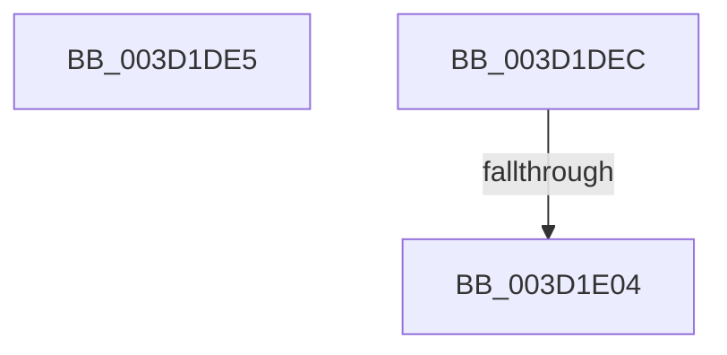

# sub_003D1DE5

- RVA: `0x003D1DE5`–`0x003D1E0B` (길이 `38` bytes)
- VA: `0x00000001403D1DE5`
- 실행 섹션: `.text`
- PDB 이름 있음: `아니요`; PDB Function 태그: `아니요`
- unwind 정보 RVA: `0x000912B0`
- 디코드: `10`개 명령, `38/38` bytes 표시
- 미해석 바이트: `0` (있으면 어셈블리에 `.byte`로 보존)

> 이 문서는 커널 이미지의 기계어와 PDB 기호를 분석해 생성했습니다. 4번과 5번은 함수 원형과 자료형을 바이너리 사용 방식에서 추정한 C 해석이며 원본 소스 복구 결과는 아닙니다.

## 1. Dependencies

- 직접 호출 지점: **1**; 고유 호출 대상: **1**
- 직접 호출자로 확인된 함수: **0**
- RIP 상대 이미지 참조: **0**

### Outgoing calls
- `0x003D1DF7` → [ExAllocatePool2](../../poolcode/B8/ExAllocatePool2_function_00B820F0.md) (function, `0x00B820F0`)

### Direct callers
- 이 함수 시작 RVA로 연결되는 직접 call은 확인되지 않았습니다. 간접 호출은 완전히 역산할 수 없습니다.

### Static image references
- 디코드된 RIP-relative 메모리 참조가 없습니다.

## 2. Other-region calls and transfers

- 다른 실행 섹션으로 향하는 call: **1**
  - `0x003D1DF7` → [ExAllocatePool2](../../poolcode/B8/ExAllocatePool2_function_00B820F0.md) (`.text` → `POOLCODE`)
- call이 아닌 외부 분기/꼬리 이동: **3**
  - `0x003D1DEA` → [sub_003D1D9D](Unknown_function_003D1D9D.md) (`tail-transfer`)
  - `0x003D1E02` → [sub_003D1E27](Unknown_function_003D1E27.md) (`tail-transfer`)
  - `0x003D1E09` → [sub_003D1D9D](Unknown_function_003D1D9D.md) (`tail-transfer`)

## 3. Assembly (complete function range)

```asm
003D1DE5  B8 23 00 00 C0                  mov eax, 0xc0000023
003D1DEA  EB B1                           jmp 0x1403d1d9d
003D1DEC  B9 42 00 00 00                  mov ecx, 0x42
003D1DF1  41 B8 48 61 6C 44               mov r8d, 0x446c6148
003D1DF7  E8 F4 02 7B 00                  call 0x140b820f0
003D1DFC  4C 8B F8                        mov r15, rax
003D1DFF  48 85 C0                        test rax, rax
003D1E02  75 23                           jne 0x1403d1e27
003D1E04  B8 9A 00 00 C0                  mov eax, 0xc000009a
003D1E09  EB 92                           jmp 0x1403d1d9d
```

## 4. C-style interpretation (structured pseudocode)

```c
__int64 __fastcall sub_003D1DE5(void)
{
}
```

## 5. (Beta) C Style

```c
void sub_003D1DE5(void)
{
}
```

## 6. Execution-region graph

[열기: 2D/3D 그래프와 함수 탐색 컨트롤 패널](../../../control-panel.html?section=text&rva=0x003D1DE5&view=graph)

- 2D 그래프는 위에서 아래로 흐르고, 3D 그래프는 빈 공간을 드래그해 회전합니다. Shift+드래그는 이동, 휠은 확대·축소, 함수 노드 선택은 대상 보고서 이동입니다.

### Static fallback


