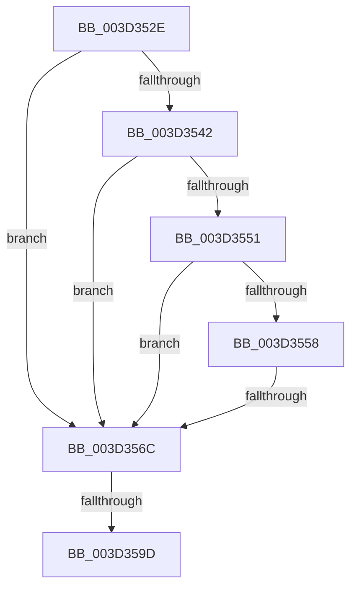

# sub_003D352E

- RVA: `0x003D352E`–`0x003D35AF` (길이 `129` bytes)
- VA: `0x00000001403D352E`
- 실행 섹션: `.text`
- PDB 이름 있음: `아니요`; PDB Function 태그: `아니요`
- unwind 정보 RVA: `0x00091800`
- 디코드: `30`개 명령, `129/129` bytes 표시
- 미해석 바이트: `0` (있으면 어셈블리에 `.byte`로 보존)

> 이 문서는 커널 이미지의 기계어와 PDB 기호를 분석해 생성했습니다. 4번과 5번은 함수 원형과 자료형을 바이너리 사용 방식에서 추정한 C 해석이며 원본 소스 복구 결과는 아닙니다.

## 1. Dependencies

- 직접 호출 지점: **0**; 고유 호출 대상: **0**
- 직접 호출자로 확인된 함수: **0**
- RIP 상대 이미지 참조: **0**

### Outgoing calls
- 직접 디코드된 call 명령이 없습니다.

### Direct callers
- 이 함수 시작 RVA로 연결되는 직접 call은 확인되지 않았습니다. 간접 호출은 완전히 역산할 수 없습니다.

### Static image references
- 디코드된 RIP-relative 메모리 참조가 없습니다.

## 2. Other-region calls and transfers

- 다른 실행 섹션으로 향하는 call: **0**
- call이 아닌 외부 분기/꼬리 이동: **3**
  - `0x003D3566` → [sub_003D363D](Unknown_function_003D363D.md) (`tail-transfer`)
  - `0x003D359B` → [sub_003D3600](Unknown_function_003D3600.md) (`tail-transfer`)
  - `0x003D35A9` → [sub_003D36A7](Unknown_function_003D36A7.md) (`tail-transfer`)

## 3. Assembly (complete function range)

```asm
003D352E  48 89 7C 24 38                  mov qword ptr [rsp + 0x38], rdi
003D3533  48 B9 00 D0 BE 7D FB F6 FF FF   movabs rcx, 0xfffff6fb7dbed000
003D353D  4C 3B C9                        cmp r9, rcx
003D3540  72 2A                           jb 0x1403d356c
003D3542  48 B9 F8 D7 BE 7D FB F6 FF FF   movabs rcx, 0xfffff6fb7dbed7f8
003D354C  4C 3B C9                        cmp r9, rcx
003D354F  77 1B                           ja 0x1403d356c
003D3551  48 8B C8                        mov rcx, rax
003D3554  A8 01                           test al, 1
003D3556  74 14                           je 0x1403d356c
003D3558  A8 42                           test al, 0x42
003D355A  41 0F 95 C0                     setne r8b
003D355E  A8 20                           test al, 0x20
003D3560  0F 95 C2                        setne dl
003D3563  44 84 C2                        test dl, r8b
003D3566  0F 84 D1 00 00 00               je 0x1403d363d
003D356C  48 C1 E8 0C                     shr rax, 0xc
003D3570  48 B9 FF FF FF FF FF 00 00 00   movabs rcx, 0xffffffffff
003D357A  48 23 C1                        and rax, rcx
003D357D  48 8D 1C 40                     lea rbx, [rax + rax*2]
003D3581  48 C1 E3 04                     shl rbx, 4
003D3585  48 B8 00 00 00 00 00 DE FF FF   movabs rax, 0xffffde0000000000
003D358F  48 03 D8                        add rbx, rax
003D3592  33 FF                           xor edi, edi
003D3594  F0 48 0F BA 6B 18 3F            lock bts qword ptr [rbx + 0x18], 0x3f
003D359B  72 63                           jb 0x1403d3600
003D359D  8B 43 24                        mov eax, dword ptr [rbx + 0x24]
003D35A0  48 8B 7C 24 38                  mov rdi, qword ptr [rsp + 0x38]
003D35A5  0F BA E0 1A                     bt eax, 0x1a
003D35A9  0F 83 F8 00 00 00               jae 0x1403d36a7
```

## 4. C-style interpretation (structured pseudocode)

```c
__int64 __fastcall sub_003D352E(__int64 a1, __int64 a2, __int64 a3, __int64 a4, __int64 a5, __int64 a6, __int64 a7)
{
    __int64 result;
    __int64 v_rbx;
    __int64 v_rdi;
    unsigned __int64 v_stack_p38;

    v_stack_p38 = v_rdi;
    if (a4 < a1) goto loc_003D356C;
    if (a4 > a1) goto loc_003D356C;
    if ((((unsigned __int8)(result)) & (1)) == 0) goto loc_003D356C;
    a3 = ((((unsigned __int8)(result)) & (66)) != 0) ? 1 : 0;
    a2 = ((((unsigned __int8)(result)) & (32)) != 0) ? 1 : 0;
loc_003D356C:
    result = (result) >> (12);
    result = (result) & (result);
    v_rbx = (result + result * 2) << (4);
    v_rbx = (v_rbx) + (result);
    v_rdi = 0;
}
```

## 5. (Beta) C Style

```c
int64_t sub_003D352E(int64_t Arg1, int64_t Arg2, int64_t Arg3, int64_t Arg4, uint64_t Arg5, uint64_t Arg6, int64_t Arg7)
{
    int64_t result;
    int64_t local_rbx;
    int64_t local_rdi;
    uint64_t v_stack_p38;

    v_stack_p38 = local_rdi;
    if (Arg4 < Arg1) goto loc_003D356C;
    if (Arg4 > Arg1) goto loc_003D356C;
    if ((((uint8_t)(result)) & (1)) == 0) goto loc_003D356C;
    Arg3 = ((((uint8_t)(result)) & (66)) != 0) ? 1 : 0;
    Arg2 = ((((uint8_t)(result)) & (32)) != 0) ? 1 : 0;
loc_003D356C:
    result = (result) >> (12);
    result = (result) & (result);
    local_rbx = (result + result * 2) << (4);
    local_rbx = (local_rbx) + (result);
    local_rdi = 0;
}
```

## 6. Execution-region graph

[열기: 2D/3D 그래프와 함수 탐색 컨트롤 패널](../../../control-panel.html?section=text&rva=0x003D352E&view=graph)

- 2D 그래프는 위에서 아래로 흐르고, 3D 그래프는 빈 공간을 드래그해 회전합니다. Shift+드래그는 이동, 휠은 확대·축소, 함수 노드 선택은 대상 보고서 이동입니다.

### Static fallback


