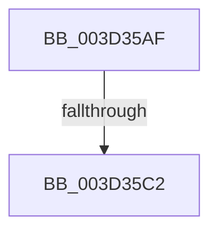

# sub_003D35AF

- RVA: `0x003D35AF`–`0x003D35F6` (길이 `71` bytes)
- VA: `0x00000001403D35AF`
- 실행 섹션: `.text`
- PDB 이름 있음: `아니요`; PDB Function 태그: `아니요`
- unwind 정보 RVA: `0x00091814`
- 디코드: `17`개 명령, `71/71` bytes 표시
- 미해석 바이트: `0` (있으면 어셈블리에 `.byte`로 보존)

> 이 문서는 커널 이미지의 기계어와 PDB 기호를 분석해 생성했습니다. 4번과 5번은 함수 원형과 자료형을 바이너리 사용 방식에서 추정한 C 해석이며 원본 소스 복구 결과는 아닙니다.

## 1. Dependencies

- 직접 호출 지점: **0**; 고유 호출 대상: **0**
- 직접 호출자로 확인된 함수: **0**
- RIP 상대 이미지 참조: **0**

### Outgoing calls
- 직접 디코드된 call 명령이 없습니다.

### Direct callers
- 이 함수 시작 RVA로 연결되는 직접 call은 확인되지 않았습니다. 간접 호출은 완전히 역산할 수 없습니다.

### Static image references
- 디코드된 RIP-relative 메모리 참조가 없습니다.

## 2. Other-region calls and transfers

- 다른 실행 섹션으로 향하는 call: **0**
- call이 아닌 외부 분기/꼬리 이동: **1**
  - `0x003D35C0` → [sub_003D361F](Unknown_function_003D361F.md) (`tail-transfer`)

## 3. Assembly (complete function range)

```asm
003D35AF  48 8B 0B                        mov rcx, qword ptr [rbx]
003D35B2  48 C1 E9 20                     shr rcx, 0x20
003D35B6  8B 43 24                        mov eax, dword ptr [rbx + 0x24]
003D35B9  8D 14 0E                        lea edx, [rsi + rcx]
003D35BC  0F BA E0 1A                     bt eax, 0x1a
003D35C0  73 5D                           jae 0x1403d361f
003D35C2  48 8B 03                        mov rax, qword ptr [rbx]
003D35C5  48 C1 E2 20                     shl rdx, 0x20
003D35C9  48 8B CA                        mov rcx, rdx
003D35CC  48 33 C8                        xor rcx, rax
003D35CF  48 B8 FF FF FF FF 00 FC FF FF   movabs rax, 0xfffffc00ffffffff
003D35D9  48 23 C8                        and rcx, rax
003D35DC  48 33 CA                        xor rcx, rdx
003D35DF  48 89 0B                        mov qword ptr [rbx], rcx
003D35E2  48 B8 FF FF FF FF FF FF FF 7F   movabs rax, 0x7fffffffffffffff
003D35EC  F0 48 21 43 18                  lock and qword ptr [rbx + 0x18], rax
003D35F1  48 8B 5C 24 30                  mov rbx, qword ptr [rsp + 0x30]
```

## 4. C-style interpretation (structured pseudocode)

```c
__int64 __fastcall sub_003D35AF(__int64 a1, __int64 a2, __int64 a3, __int64 a4, __int64 a5, __int64 a6)
{
    a1 = (*(unsigned __int64 *)(v_rbx)) >> (32);
    a2 = (v_rsi + a1 * 1) << (32);
    a1 = (a2) ^ (*(unsigned __int64 *)(v_rbx));
    a1 = (a1) & (*(unsigned __int64 *)(v_rbx));
    a1 = (a1) ^ (a2);
    *(unsigned __int64 *)(v_rbx) = a1;
    return *(unsigned __int64 *)(v_rbx);
}
```

## 5. (Beta) C Style

```c
int64_t sub_003D35AF(int64_t Arg1, int64_t Arg2, int64_t Arg3, int64_t Arg4, uint64_t Arg5, int64_t Arg6)
{
    Arg1 = (*(uint64_t *)(local_rbx)) >> (32);
    Arg2 = (local_rsi + Arg1 * 1) << (32);
    Arg1 = (Arg2) ^ (*(uint64_t *)(local_rbx));
    Arg1 = (Arg1) & (*(uint64_t *)(local_rbx));
    Arg1 = (Arg1) ^ (Arg2);
    *(uint64_t *)(local_rbx) = Arg1;
    return *(uint64_t *)(local_rbx);
}
```

## 6. Execution-region graph

[열기: 2D/3D 그래프와 함수 탐색 컨트롤 패널](../../../control-panel.html?section=text&rva=0x003D35AF&view=graph)

- 2D 그래프는 위에서 아래로 흐르고, 3D 그래프는 빈 공간을 드래그해 회전합니다. Shift+드래그는 이동, 휠은 확대·축소, 함수 노드 선택은 대상 보고서 이동입니다.

### Static fallback


