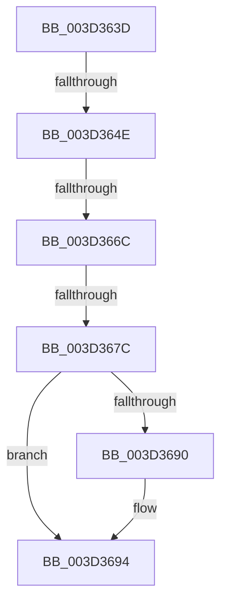

# sub_003D363D

- RVA: `0x003D363D`–`0x003D36A7` (길이 `106` bytes)
- VA: `0x00000001403D363D`
- 실행 섹션: `.text`
- PDB 이름 있음: `아니요`; PDB Function 태그: `아니요`
- unwind 정보 RVA: `0x00091864`
- 디코드: `20`개 명령, `106/106` bytes 표시
- 미해석 바이트: `0` (있으면 어셈블리에 `.byte`로 보존)

> 이 문서는 커널 이미지의 기계어와 PDB 기호를 분석해 생성했습니다. 4번과 5번은 함수 원형과 자료형을 바이너리 사용 방식에서 추정한 C 해석이며 원본 소스 복구 결과는 아닙니다.

## 1. Dependencies

- 직접 호출 지점: **0**; 고유 호출 대상: **0**
- 직접 호출자로 확인된 함수: **0**
- RIP 상대 이미지 참조: **1**

### Outgoing calls
- 직접 디코드된 call 명령이 없습니다.

### Direct callers
- 이 함수 시작 RVA로 연결되는 직접 call은 확인되지 않았습니다. 간접 호출은 완전히 역산할 수 없습니다.

### Static image references
- `0x003D363D` → RVA `0x00FC6A88` (`ALMOSTRO`; read)

## 2. Other-region calls and transfers

- 다른 실행 섹션으로 향하는 call: **0**
- call이 아닌 외부 분기/꼬리 이동: **4**
  - `0x003D3648` → [sub_003D352E + 0x3E](Unknown_function_003D352E.md) (`tail-transfer`)
  - `0x003D3666` → [sub_003D352E + 0x3E](Unknown_function_003D352E.md) (`tail-transfer`)
  - `0x003D3676` → [sub_003D352E + 0x3E](Unknown_function_003D352E.md) (`tail-transfer`)
  - `0x003D36A2` → [sub_003D352E + 0x3E](Unknown_function_003D352E.md) (`tail-transfer`)

## 3. Assembly (complete function range)

```asm
003D363D  48 F7 05 40 34 BF 00 00 00 60 00  test qword ptr [rip + 0xbf3440], 0x600000
003D3648  0F 84 1E FF FF FF               je 0x1403d356c
003D364E  65 48 8B 14 25 88 01 00 00      mov rdx, qword ptr gs:[0x188]
003D3657  4C 8B 82 B8 00 00 00            mov r8, qword ptr [rdx + 0xb8]
003D365E  41 80 B8 60 01 00 00 01         cmp byte ptr [r8 + 0x160], 1
003D3666  0F 84 00 FF FF FF               je 0x1403d356c
003D366C  49 8B 90 08 05 00 00            mov rdx, qword ptr [r8 + 0x508]
003D3673  48 85 D2                        test rdx, rdx
003D3676  0F 84 F0 FE FF FF               je 0x1403d356c
003D367C  49 C1 E9 03                     shr r9, 3
003D3680  41 81 E1 FF 01 00 00            and r9d, 0x1ff
003D3687  4A 8B 14 CA                     mov rdx, qword ptr [rdx + r9*8]
003D368B  F6 C2 20                        test dl, 0x20
003D368E  74 04                           je 0x1403d3694
003D3690  48 83 C9 20                     or rcx, 0x20
003D3694  48 8B C1                        mov rax, rcx
003D3697  48 83 C8 42                     or rax, 0x42
003D369B  F6 C2 42                        test dl, 0x42
003D369E  48 0F 44 C1                     cmove rax, rcx
003D36A2  E9 C5 FE FF FF                  jmp 0x1403d356c
```

## 4. C-style interpretation (structured pseudocode)

```c
__int64 __fastcall sub_003D363D(__int64 a1, __int64 a2, __int64 a3, __int64 a4)
{
    __int64 result;

    a4 = (a4) >> (3);
    a4 = (unsigned int)((a4) & (511));
    if ((((unsigned __int8)(*(unsigned __int64 *)(*(unsigned __int64 *)(*(unsigned __int64 *)(*(unsigned __int64 *)(gs_base + (0 + 392)) + 184) + 1288) + a4 * 8))) & (32)) != 0) {
        a1 = (a1) | (32);
    }
    result = (a1) | (66);
    if ((((unsigned __int8)(*(unsigned __int64 *)(*(unsigned __int64 *)(*(unsigned __int64 *)(*(unsigned __int64 *)(gs_base + (0 + 392)) + 184) + 1288) + a4 * 8))) & (66)) == 0) { result = a1; }
}
```

## 5. (Beta) C Style

```c
int64_t sub_003D363D(int64_t Arg1, int64_t Arg2, int64_t Arg3, int64_t Arg4)
{
    int64_t result;

    Arg4 = (Arg4) >> (3);
    Arg4 = (uint32_t)((Arg4) & (511));
    if ((((uint8_t)(*(uint64_t *)(*(uint64_t *)(*(uint64_t *)(*(uint64_t *)(gs_base + (0 + 0x188)) + 0xB8) + 0x508) + Arg4 * 8))) & (32)) != 0) {
        Arg1 = (Arg1) | (32);
    }
    result = (Arg1) | (66);
    if ((((uint8_t)(*(uint64_t *)(*(uint64_t *)(*(uint64_t *)(*(uint64_t *)(gs_base + (0 + 0x188)) + 0xB8) + 0x508) + Arg4 * 8))) & (66)) == 0) { result = Arg1; }
}
```

## 6. Execution-region graph

[열기: 2D/3D 그래프와 함수 탐색 컨트롤 패널](../../../control-panel.html?section=text&rva=0x003D363D&view=graph)

- 2D 그래프는 위에서 아래로 흐르고, 3D 그래프는 빈 공간을 드래그해 회전합니다. Shift+드래그는 이동, 휠은 확대·축소, 함수 노드 선택은 대상 보고서 이동입니다.

### Static fallback


