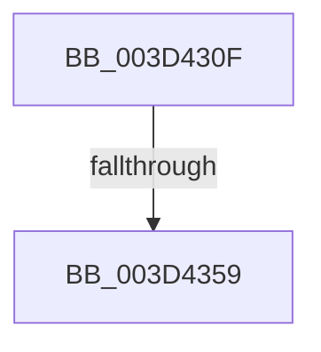

# sub_003D430F

- RVA: `0x003D430F`–`0x003D4363` (길이 `84` bytes)
- VA: `0x00000001403D430F`
- 실행 섹션: `.text`
- PDB 이름 있음: `아니요`; PDB Function 태그: `아니요`
- unwind 정보 RVA: `0x00092418`
- 디코드: `21`개 명령, `84/84` bytes 표시
- 미해석 바이트: `0` (있으면 어셈블리에 `.byte`로 보존)

> 이 문서는 커널 이미지의 기계어와 PDB 기호를 분석해 생성했습니다. 4번과 5번은 함수 원형과 자료형을 바이너리 사용 방식에서 추정한 C 해석이며 원본 소스 복구 결과는 아닙니다.

## 1. Dependencies

- 직접 호출 지점: **0**; 고유 호출 대상: **0**
- 직접 호출자로 확인된 함수: **0**
- RIP 상대 이미지 참조: **1**

### Outgoing calls
- 직접 디코드된 call 명령이 없습니다.

### Direct callers
- 이 함수 시작 RVA로 연결되는 직접 call은 확인되지 않았습니다. 간접 호출은 완전히 역산할 수 없습니다.

### Static image references
- `0x003D4343` → RVA `0x00FC6ED8` (`ALMOSTRO`; read)

## 2. Other-region calls and transfers

- 다른 실행 섹션으로 향하는 call: **0**
- call이 아닌 외부 분기/꼬리 이동: **2**
  - `0x003D4357` → [sub_003D4384](Unknown_function_003D4384.md) (`tail-transfer`)
  - `0x003D4361` → [sub_003D4363 + 0x9](Unknown_function_003D4363.md) (`tail-transfer`)

## 3. Assembly (complete function range)

```asm
003D430F  48 89 6C 24 40                  mov qword ptr [rsp + 0x40], rbp
003D4314  49 8D 40 FF                     lea rax, [r8 - 1]
003D4318  48 89 74 24 48                  mov qword ptr [rsp + 0x48], rsi
003D431D  83 E0 07                        and eax, 7
003D4320  4C 89 74 24 50                  mov qword ptr [rsp + 0x50], r14
003D4325  48 8D 72 FF                     lea rsi, [rdx - 1]
003D4329  83 E6 07                        and esi, 7
003D432C  49 BE 00 00 00 00 00 80 00 00   movabs r14, 0x800000000000
003D4336  48 2B F0                        sub rsi, rax
003D4339  4C 03 F1                        add r14, rcx
003D433C  48 2B F3                        sub rsi, rbx
003D433F  49 C1 EE 03                     shr r14, 3
003D4343  4C 03 35 8E 2B BF 00            add r14, qword ptr [rip + 0xbf2b8e]
003D434A  48 8B EB                        mov rbp, rbx
003D434D  49 03 F0                        add rsi, r8
003D4350  48 C1 ED 03                     shr rbp, 3
003D4354  48 85 ED                        test rbp, rbp
003D4357  75 2B                           jne 0x1403d4384
003D4359  48 8B 6C 24 40                  mov rbp, qword ptr [rsp + 0x40]
003D435E  F6 C3 07                        test bl, 7
003D4361  74 09                           je 0x1403d436c
```

## 4. C-style interpretation (structured pseudocode)

```c
__int64 __fastcall sub_003D430F(__int64 a1, __int64 a2, __int64 a3, __int64 a4, __int64 a5, __int64 a6, __int64 a7, __int64 a8)
{
    __int64 result;
    __int64 v_r14;
    __int64 v_rbp;
    __int64 v_rsi;
    unsigned __int64 v_stack_p40;
    unsigned __int64 v_stack_p48;
    unsigned __int64 v_stack_p50;

    v_stack_p40 = v_rbp;
    v_stack_p48 = v_rsi;
    result = (unsigned int)((a3 - 1) & (7));
    v_stack_p50 = v_r14;
    v_rsi = (unsigned int)((a2 - 1) & (7));
    v_rsi = (v_rsi) - (result);
    v_r14 = (v_r14) + (a1);
    v_rsi = (v_rsi) - (v_rbx);
    v_r14 = (v_r14) >> (3);
    v_r14 = (v_r14) + (*(unsigned __int64 *)(v_rip + 12528526));
    v_rsi = (v_rsi) + (a3);
    v_rbp = (v_rbx) >> (3);
}
```

## 5. (Beta) C Style

```c
int64_t sub_003D430F(int64_t Arg1, void *Arg2, void *Arg3, int64_t Arg4, uint64_t Arg5, uint64_t Arg6, uint64_t Arg7, int64_t Arg8)
{
    uint8_t *arg2 = (uint8_t *)Arg2;
    uint8_t *arg3 = (uint8_t *)Arg3;

    int64_t result;
    int64_t local_r14;
    int64_t local_rbp;
    int64_t local_rsi;
    uint64_t v_stack_p40;
    uint64_t v_stack_p48;
    uint64_t v_stack_p50;

    v_stack_p40 = local_rbp;
    v_stack_p48 = local_rsi;
    result = (uint32_t)((Arg3 - 1) & (7));
    v_stack_p50 = local_r14;
    local_rsi = (uint32_t)((Arg2 - 1) & (7));
    local_rsi = (local_rsi) - (result);
    local_r14 = (local_r14) + (Arg1);
    local_rsi = (local_rsi) - (local_rbx);
    local_r14 = (local_r14) >> (3);
    local_r14 = (local_r14) + (*(uint64_t *)(v_rip + 0xBF2B8E));
    local_rsi = (local_rsi) + (Arg3);
    local_rbp = (local_rbx) >> (3);
}
```

### 관측된 메모리 오프셋

구조체 형식이 확인되지 않은 접근은 인자 기준의 오프셋으로만 기록했습니다.

| 기준 인자 | 오프셋 표현 | 폭 (bit) | 접근 |
|---|---:|---:|---|
| `Arg2` | `- 0x1` | `64` | `R` |
| `Arg3` | `- 0x1` | `64` | `R` |

## 6. Execution-region graph

[열기: 2D/3D 그래프와 함수 탐색 컨트롤 패널](../../../control-panel.html?section=text&rva=0x003D430F&view=graph)

- 2D 그래프는 위에서 아래로 흐르고, 3D 그래프는 빈 공간을 드래그해 회전합니다. Shift+드래그는 이동, 휠은 확대·축소, 함수 노드 선택은 대상 보고서 이동입니다.

### Static fallback


