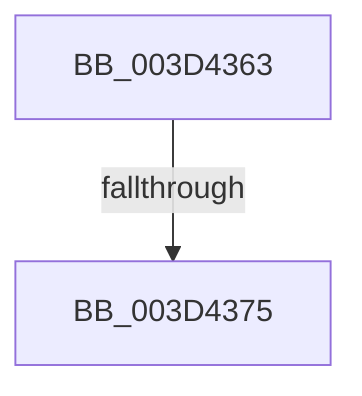

# sub_003D4363

- RVA: `0x003D4363`–`0x003D4384` (길이 `33` bytes)
- VA: `0x00000001403D4363`
- 실행 섹션: `.text`
- PDB 이름 있음: `아니요`; PDB Function 태그: `아니요`
- unwind 정보 RVA: `0x00092434`
- 디코드: `9`개 명령, `33/33` bytes 표시
- 미해석 바이트: `0` (있으면 어셈블리에 `.byte`로 보존)

> 이 문서는 커널 이미지의 기계어와 PDB 기호를 분석해 생성했습니다. 4번과 5번은 함수 원형과 자료형을 바이너리 사용 방식에서 추정한 C 해석이며 원본 소스 복구 결과는 아닙니다.

## 1. Dependencies

- 직접 호출 지점: **0**; 고유 호출 대상: **0**
- 직접 호출자로 확인된 함수: **0**
- RIP 상대 이미지 참조: **0**

### Outgoing calls
- 직접 디코드된 call 명령이 없습니다.

### Direct callers
- 이 함수 시작 RVA로 연결되는 직접 call은 확인되지 않았습니다. 간접 호출은 완전히 역산할 수 없습니다.

### Static image references
- 디코드된 RIP-relative 메모리 참조가 없습니다.

## 2. Other-region calls and transfers

- 다른 실행 섹션으로 향하는 call: **0**
- call이 아닌 외부 분기/꼬리 이동: **2**
  - `0x003D4373` → [sub_003D4396](Unknown_function_003D4396.md) (`tail-transfer`)
  - `0x003D437F` → [KasanMarkAddressRedZone + 0x1A](KasanMarkAddressRedZone_function_003D4250.md) (`tail-transfer`)

## 3. Assembly (complete function range)

```asm
003D4363  80 E3 07                        and bl, 7
003D4366  41 88 1E                        mov byte ptr [r14], bl
003D4369  49 FF C6                        inc r14
003D436C  48 C1 EE 03                     shr rsi, 3
003D4370  48 85 F6                        test rsi, rsi
003D4373  75 21                           jne 0x1403d4396
003D4375  48 8B 74 24 48                  mov rsi, qword ptr [rsp + 0x48]
003D437A  4C 8B 74 24 50                  mov r14, qword ptr [rsp + 0x50]
003D437F  E9 E6 FE FF FF                  jmp 0x1403d426a
```

## 4. C-style interpretation (structured pseudocode)

```c
void __fastcall sub_003D4363(__int64 a1, __int64 a2, __int64 a3, __int64 a4, __int64 a5, __int64 a6, __int64 a7, __int64 a8, __int64 a9, __int64 a10)
{
    __int64 v_r14;
    __int64 v_rbx;
    __int64 v_rsi;

    v_rbx = (unsigned __int8)((v_rbx) & (7));
    *(unsigned __int8 *)(v_r14) = (unsigned __int8)(v_rbx);
    v_r14 = (v_r14) + 1;
    v_rsi = (v_rsi) >> (3);
}
```

## 5. (Beta) C Style

```c
void sub_003D4363(int64_t Arg1, int64_t Arg2, int64_t Arg3, int64_t Arg4, uint64_t Arg5, uint64_t Arg6, uint64_t Arg7, uint64_t Arg8, int64_t Arg9, int64_t Arg10)
{
    int64_t local_r14;
    int64_t local_rbx;
    int64_t local_rsi;

    local_rbx = (uint8_t)((local_rbx) & (7));
    *(uint8_t *)(local_r14) = (uint8_t)(local_rbx);
    local_r14 = (local_r14) + 1;
    local_rsi = (local_rsi) >> (3);
}
```

## 6. Execution-region graph

[열기: 2D/3D 그래프와 함수 탐색 컨트롤 패널](../../../control-panel.html?section=text&rva=0x003D4363&view=graph)

- 2D 그래프는 위에서 아래로 흐르고, 3D 그래프는 빈 공간을 드래그해 회전합니다. Shift+드래그는 이동, 휠은 확대·축소, 함수 노드 선택은 대상 보고서 이동입니다.

### Static fallback


