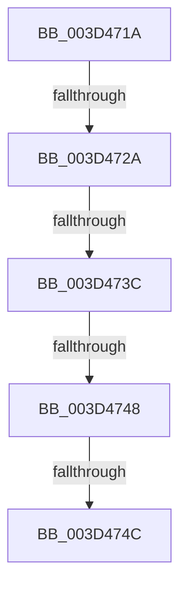

# sub_003D471A

- RVA: `0x003D471A`–`0x003D4753` (길이 `57` bytes)
- VA: `0x00000001403D471A`
- 실행 섹션: `.text`
- PDB 이름 있음: `아니요`; PDB Function 태그: `아니요`
- unwind 정보 RVA: `0x00092500`
- 디코드: `18`개 명령, `57/57` bytes 표시
- 미해석 바이트: `0` (있으면 어셈블리에 `.byte`로 보존)

> 이 문서는 커널 이미지의 기계어와 PDB 기호를 분석해 생성했습니다. 4번과 5번은 함수 원형과 자료형을 바이너리 사용 방식에서 추정한 C 해석이며 원본 소스 복구 결과는 아닙니다.

## 1. Dependencies

- 직접 호출 지점: **0**; 고유 호출 대상: **0**
- 직접 호출자로 확인된 함수: **0**
- RIP 상대 이미지 참조: **0**

### Outgoing calls
- 직접 디코드된 call 명령이 없습니다.

### Direct callers
- 이 함수 시작 RVA로 연결되는 직접 call은 확인되지 않았습니다. 간접 호출은 완전히 역산할 수 없습니다.

### Static image references
- 디코드된 RIP-relative 메모리 참조가 없습니다.

## 2. Other-region calls and transfers

- 다른 실행 섹션으로 향하는 call: **0**
- call이 아닌 외부 분기/꼬리 이동: **4**
  - `0x003D4724` → [sub_003D4764 + 0x9D](Unknown_function_003D4764.md) (`tail-transfer`)
  - `0x003D473A` → [sub_003D4764](Unknown_function_003D4764.md) (`tail-transfer`)
  - `0x003D4746` → [sub_003D4764 + 0x1C](Unknown_function_003D4764.md) (`tail-transfer`)
  - `0x003D474A` → [sub_003D4764 + 0x5B](Unknown_function_003D4764.md) (`tail-transfer`)

## 3. Assembly (complete function range)

```asm
003D471A  48 89 74 24 30                  mov qword ptr [rsp + 0x30], rsi
003D471F  8B F2                           mov esi, edx
003D4721  4D 85 D2                        test r10, r10
003D4724  0F 84 D7 00 00 00               je 0x1403d4801
003D472A  8B 44 24 58                     mov eax, dword ptr [rsp + 0x58]
003D472E  4D 85 D2                        test r10, r10
003D4731  4C 8B C2                        mov r8, rdx
003D4734  41 0F 95 C0                     setne r8b
003D4738  85 C0                           test eax, eax
003D473A  75 28                           jne 0x1403d4764
003D473C  4D 8B 4B 10                     mov r9, qword ptr [r11 + 0x10]
003D4740  49 8B C1                        mov rax, r9
003D4743  4D 85 C9                        test r9, r9
003D4746  75 38                           jne 0x1403d4780
003D4748  85 DB                           test ebx, ebx
003D474A  75 73                           jne 0x1403d47bf
003D474C  33 C0                           xor eax, eax
003D474E  48 8B 74 24 30                  mov rsi, qword ptr [rsp + 0x30]
```

## 4. C-style interpretation (structured pseudocode)

```c
__int64 __fastcall sub_003D471A(__int64 a1, __int64 a2, __int64 a3, __int64 a4, __int64 a5, __int64 a6, __int64 a7, __int64 a8, __int64 a9, __int64 a10, unsigned int a11)
{
    __int64 result;
    unsigned __int64 v_stack_p30;

    v_stack_p30 = v_rsi;
    a3 = (v_r10 != 0) ? 1 : 0;
    result = 0;
    return result;
}
```

## 5. (Beta) C Style

```c
int64_t sub_003D471A(int64_t Arg1, int64_t Arg2, int64_t Arg3, int64_t Arg4, uint64_t Arg5, int64_t Arg6, uint64_t Arg7, uint64_t Arg8, uint64_t Arg9, uint64_t Arg10, uint32_t Arg11)
{
    int64_t result;
    uint64_t v_stack_p30;

    v_stack_p30 = local_rsi;
    Arg3 = (local_r10 != 0) ? 1 : 0;
    result = 0;
    return result;
}
```

## 6. Execution-region graph

[열기: 2D/3D 그래프와 함수 탐색 컨트롤 패널](../../../control-panel.html?section=text&rva=0x003D471A&view=graph)

- 2D 그래프는 위에서 아래로 흐르고, 3D 그래프는 빈 공간을 드래그해 회전합니다. Shift+드래그는 이동, 휠은 확대·축소, 함수 노드 선택은 대상 보고서 이동입니다.

### Static fallback


