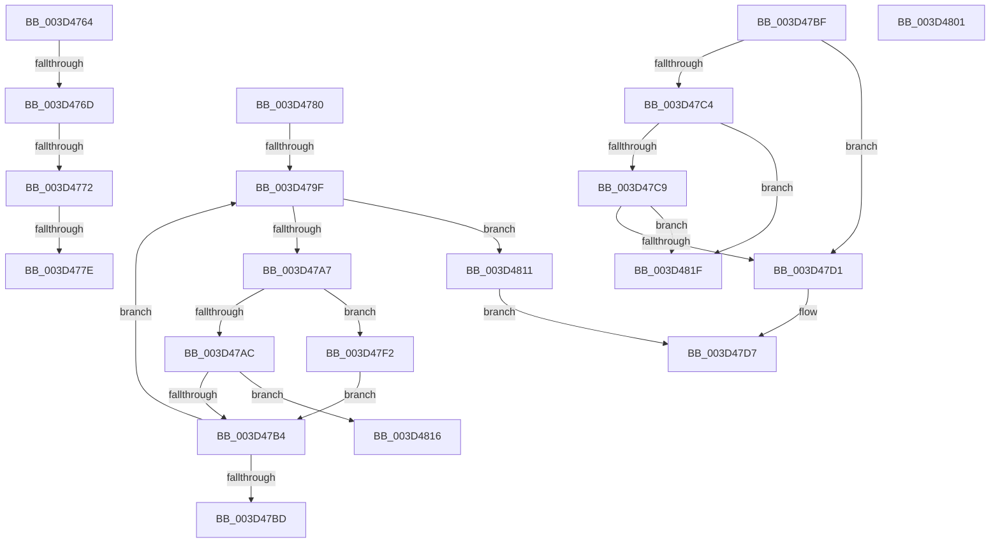

# sub_003D4764

- RVA: `0x003D4764`–`0x003D482F` (길이 `203` bytes)
- VA: `0x00000001403D4764`
- 실행 섹션: `.text`
- PDB 이름 있음: `아니요`; PDB Function 태그: `아니요`
- unwind 정보 RVA: `0x00092528`
- 디코드: `62`개 명령, `203/203` bytes 표시
- 미해석 바이트: `0` (있으면 어셈블리에 `.byte`로 보존)

> 이 문서는 커널 이미지의 기계어와 PDB 기호를 분석해 생성했습니다. 4번과 5번은 함수 원형과 자료형을 바이너리 사용 방식에서 추정한 C 해석이며 원본 소스 복구 결과는 아닙니다.

## 1. Dependencies

- 직접 호출 지점: **1**; 고유 호출 대상: **1**
- 직접 호출자로 확인된 함수: **0**
- RIP 상대 이미지 참조: **0**

### Outgoing calls
- `0x003D4825` → [ExpExpandResourceOwnerTable](ExpExpandResourceOwnerTable_function_003D489C.md) (function, `0x003D489C`)

### Direct callers
- 이 함수 시작 RVA로 연결되는 직접 call은 확인되지 않았습니다. 간접 호출은 완전히 역산할 수 없습니다.

### Static image references
- 디코드된 RIP-relative 메모리 참조가 없습니다.

## 2. Other-region calls and transfers

- 다른 실행 섹션으로 향하는 call: **0**
- call이 아닌 외부 분기/꼬리 이동: **10**
  - `0x003D476B` → [sub_003D471A + 0x22](Unknown_function_003D471A.md) (`tail-transfer`)
  - `0x003D4770` → [sub_003D471A + 0x22](Unknown_function_003D471A.md) (`tail-transfer`)
  - `0x003D477C` → [sub_003D471A + 0x22](Unknown_function_003D471A.md) (`tail-transfer`)
  - `0x003D477E` → [sub_003D471A + 0x34](Unknown_function_003D471A.md) (`tail-transfer`)
  - `0x003D479D` → [sub_003D471A + 0x2E](Unknown_function_003D471A.md) (`tail-transfer`)
  - `0x003D47BD` → [sub_003D471A + 0x2E](Unknown_function_003D471A.md) (`tail-transfer`)
  - `0x003D47ED` → [sub_003D471A + 0x34](Unknown_function_003D471A.md) (`tail-transfer`)
  - `0x003D480C` → [sub_003D471A + 0x10](Unknown_function_003D471A.md) (`tail-transfer`)
  - `0x003D481A` → [sub_003D471A + 0x2E](Unknown_function_003D471A.md) (`tail-transfer`)
  - `0x003D482A` → [sub_003D471A + 0x32](Unknown_function_003D471A.md) (`tail-transfer`)

## 3. Assembly (complete function range)

```asm
003D4764  48 8B 49 10                     mov rcx, qword ptr [rcx + 0x10]
003D4768  48 85 C9                        test rcx, rcx
003D476B  74 CF                           je 0x1403d473c
003D476D  3B 41 08                        cmp eax, dword ptr [rcx + 8]
003D4770  73 CA                           jae 0x1403d473c
003D4772  48 C1 E0 04                     shl rax, 4
003D4776  48 03 C1                        add rax, rcx
003D4779  48 39 38                        cmp qword ptr [rax], rdi
003D477C  75 BE                           jne 0x1403d473c
003D477E  EB CE                           jmp 0x1403d474e
003D4780  41 8B 51 08                     mov edx, dword ptr [r9 + 8]
003D4784  45 8B 53 48                     mov r10d, dword ptr [r11 + 0x48]
003D4788  41 8B 4B 40                     mov ecx, dword ptr [r11 + 0x40]
003D478C  48 C1 E2 04                     shl rdx, 4
003D4790  4C 03 D1                        add r10, rcx
003D4793  48 03 D0                        add rdx, rax
003D4796  48 83 C0 10                     add rax, 0x10
003D479A  4D 3B C2                        cmp r8, r10
003D479D  73 A9                           jae 0x1403d4748
003D479F  48 8B 08                        mov rcx, qword ptr [rax]
003D47A2  48 3B CF                        cmp rcx, rdi
003D47A5  74 6A                           je 0x1403d4811
003D47A7  48 85 C9                        test rcx, rcx
003D47AA  74 46                           je 0x1403d47f2
003D47AC  49 FF C0                        inc r8
003D47AF  4D 3B C2                        cmp r8, r10
003D47B2  74 62                           je 0x1403d4816
003D47B4  48 83 C0 10                     add rax, 0x10
003D47B8  48 3B C2                        cmp rax, rdx
003D47BB  75 E2                           jne 0x1403d479f
003D47BD  EB 89                           jmp 0x1403d4748
003D47BF  48 85 F6                        test rsi, rsi
003D47C2  75 0D                           jne 0x1403d47d1
003D47C4  48 3B C2                        cmp rax, rdx
003D47C7  73 56                           jae 0x1403d481f
003D47C9  48 8B F0                        mov rsi, rax
003D47CC  48 85 C0                        test rax, rax
003D47CF  74 4E                           je 0x1403d481f
003D47D1  48 8B D6                        mov rdx, rsi
003D47D4  48 8B C6                        mov rax, rsi
003D47D7  65 48 8B 0C 25 88 01 00 00      mov rcx, qword ptr gs:[0x188]
003D47E0  49 2B D1                        sub rdx, r9
003D47E3  48 C1 FA 04                     sar rdx, 4
003D47E7  88 91 60 04 00 00               mov byte ptr [rcx + 0x460], dl
003D47ED  E9 5C FF FF FF                  jmp 0x1403d474e
003D47F2  48 85 F6                        test rsi, rsi
003D47F5  48 8B C8                        mov rcx, rax
003D47F8  48 0F 45 CE                     cmovne rcx, rsi
003D47FC  48 8B F1                        mov rsi, rcx
003D47FF  EB B3                           jmp 0x1403d47b4
003D4801  39 54 24 50                     cmp dword ptr [rsp + 0x50], edx
003D4805  48 8B F0                        mov rsi, rax
003D4808  48 0F 45 F2                     cmovne rsi, rdx
003D480C  E9 19 FF FF FF                  jmp 0x1403d472a
003D4811  48 8B D0                        mov rdx, rax
003D4814  EB C1                           jmp 0x1403d47d7
003D4816  48 83 C0 10                     add rax, 0x10
003D481A  E9 29 FF FF FF                  jmp 0x1403d4748
003D481F  48 8B D5                        mov rdx, rbp
003D4822  49 8B CB                        mov rcx, r11
003D4825  E8 72 00 00 00                  call 0x1403d489c
003D482A  E9 1D FF FF FF                  jmp 0x1403d474c
```

## 4. C-style interpretation (structured pseudocode)

```c
__int64 __fastcall sub_003D4764(__int64 a1, __int64 a2, __int64 a3, __int64 a4)
{
    __int64 result;
    unsigned int v_stack_p50;

    result = (result) << (4);
    result = (result) + (*(unsigned __int64 *)(a1 + 16));
}
```

## 5. (Beta) C Style

```c
int64_t sub_003D4764(void *Arg1, int64_t Arg2, int64_t Arg3, int64_t Arg4)
{
    uint8_t *arg1 = (uint8_t *)Arg1;

    int64_t result;
    uint32_t v_stack_p50;

    result = (result) << (4);
    result = (result) + (*(uint64_t *)(arg1 + 0x10));
}
```

### 관측된 메모리 오프셋

구조체 형식이 확인되지 않은 접근은 인자 기준의 오프셋으로만 기록했습니다.

| 기준 인자 | 오프셋 표현 | 폭 (bit) | 접근 |
|---|---:|---:|---|
| `Arg1` | `+ 0x10` | `64` | `R` |

## 6. Execution-region graph

[열기: 2D/3D 그래프와 함수 탐색 컨트롤 패널](../../../control-panel.html?section=text&rva=0x003D4764&view=graph)

- 2D 그래프는 위에서 아래로 흐르고, 3D 그래프는 빈 공간을 드래그해 회전합니다. Shift+드래그는 이동, 휠은 확대·축소, 함수 노드 선택은 대상 보고서 이동입니다.

### Static fallback


