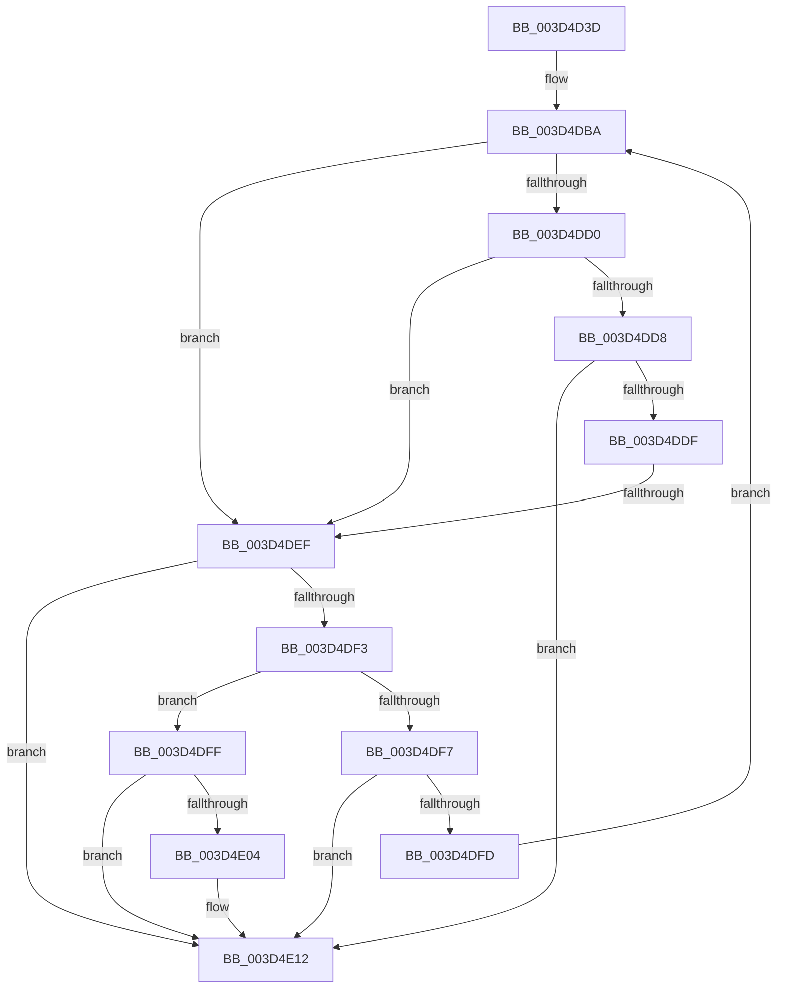

# sub_003D4D3D

- RVA: `0x003D4D3D`–`0x003D4E29` (길이 `236` bytes)
- VA: `0x00000001403D4D3D`
- 실행 섹션: `.text`
- PDB 이름 있음: `아니요`; PDB Function 태그: `아니요`
- unwind 정보 RVA: `0x000925E0`
- 디코드: `64`개 명령, `236/236` bytes 표시
- 미해석 바이트: `0` (있으면 어셈블리에 `.byte`로 보존)

> 이 문서는 커널 이미지의 기계어와 PDB 기호를 분석해 생성했습니다. 4번과 5번은 함수 원형과 자료형을 바이너리 사용 방식에서 추정한 C 해석이며 원본 소스 복구 결과는 아닙니다.

## 1. Dependencies

- 직접 호출 지점: **0**; 고유 호출 대상: **0**
- 직접 호출자로 확인된 함수: **0**
- RIP 상대 이미지 참조: **0**

### Outgoing calls
- 직접 디코드된 call 명령이 없습니다.

### Direct callers
- 이 함수 시작 RVA로 연결되는 직접 call은 확인되지 않았습니다. 간접 호출은 완전히 역산할 수 없습니다.

### Static image references
- 디코드된 RIP-relative 메모리 참조가 없습니다.

## 2. Other-region calls and transfers

- 다른 실행 섹션으로 향하는 call: **0**
- call이 아닌 외부 분기/꼬리 이동: **1**
  - `0x003D4DED` → [sub_003D4E2A](Unknown_function_003D4E2A.md) (`tail-transfer`)

## 3. Assembly (complete function range)

```asm
003D4D3D  48 89 5C 24 30                  mov qword ptr [rsp + 0x30], rbx
003D4D42  49 C1 E9 09                     shr r9, 9
003D4D46  41 BB 04 00 00 00               mov r11d, 4
003D4D4C  48 89 74 24 38                  mov qword ptr [rsp + 0x38], rsi
003D4D51  4C 23 CA                        and r9, rdx
003D4D54  48 89 7C 24 20                  mov qword ptr [rsp + 0x20], rdi
003D4D59  48 B9 00 00 00 00 80 F6 FF FF   movabs rcx, 0xfffff68000000000
003D4D63  48 8B C1                        mov rax, rcx
003D4D66  4C 03 C8                        add r9, rax
003D4D69  4C 89 0C 24                     mov qword ptr [rsp], r9
003D4D6D  49 C1 E9 09                     shr r9, 9
003D4D71  4C 23 CA                        and r9, rdx
003D4D74  48 8B C1                        mov rax, rcx
003D4D77  4C 03 C8                        add r9, rax
003D4D7A  4C 89 4C 24 08                  mov qword ptr [rsp + 8], r9
003D4D7F  49 C1 E9 09                     shr r9, 9
003D4D83  4C 23 CA                        and r9, rdx
003D4D86  48 8B C1                        mov rax, rcx
003D4D89  4C 03 C8                        add r9, rax
003D4D8C  4C 89 4C 24 10                  mov qword ptr [rsp + 0x10], r9
003D4D91  49 C1 E9 09                     shr r9, 9
003D4D95  4C 23 CA                        and r9, rdx
003D4D98  48 8B C1                        mov rax, rcx
003D4D9B  4C 03 C8                        add r9, rax
003D4D9E  48 BE 00 D0 BE 7D FB F6 FF FF   movabs rsi, 0xfffff6fb7dbed000
003D4DA8  4C 89 4C 24 18                  mov qword ptr [rsp + 0x18], r9
003D4DAD  41 8B DB                        mov ebx, r11d
003D4DB0  48 BF F8 D7 BE 7D FB F6 FF FF   movabs rdi, 0xfffff6fb7dbed7f8
003D4DBA  4C 8B 54 DC F8                  mov r10, qword ptr [rsp + rbx*8 - 8]
003D4DBF  48 FF CB                        dec rbx
003D4DC2  41 FF CB                        dec r11d
003D4DC5  49 8B 02                        mov rax, qword ptr [r10]
003D4DC8  48 8B CE                        mov rcx, rsi
003D4DCB  4C 3B D1                        cmp r10, rcx
003D4DCE  72 1F                           jb 0x1403d4def
003D4DD0  48 8B CF                        mov rcx, rdi
003D4DD3  4C 3B D1                        cmp r10, rcx
003D4DD6  77 17                           ja 0x1403d4def
003D4DD8  48 8B C8                        mov rcx, rax
003D4DDB  A8 01                           test al, 1
003D4DDD  74 33                           je 0x1403d4e12
003D4DDF  A8 42                           test al, 0x42
003D4DE1  41 0F 95 C1                     setne r9b
003D4DE5  A8 20                           test al, 0x20
003D4DE7  0F 95 C2                        setne dl
003D4DEA  44 84 CA                        test dl, r9b
003D4DED  74 3B                           je 0x1403d4e2a
003D4DEF  A8 01                           test al, 1
003D4DF1  74 1F                           je 0x1403d4e12
003D4DF3  84 C0                           test al, al
003D4DF5  78 08                           js 0x1403d4dff
003D4DF7  48 83 FB 01                     cmp rbx, 1
003D4DFB  74 15                           je 0x1403d4e12
003D4DFD  EB BB                           jmp 0x1403d4dba
003D4DFF  45 85 DB                        test r11d, r11d
003D4E02  74 0E                           je 0x1403d4e12
003D4E04  49 81 C0 FF FF 1F 00            add r8, 0x1fffff
003D4E0B  49 81 E0 00 00 E0 FF            and r8, 0xffffffffffe00000
003D4E12  48 8B 7C 24 20                  mov rdi, qword ptr [rsp + 0x20]
003D4E17  49 8B C0                        mov rax, r8
003D4E1A  48 8B 74 24 38                  mov rsi, qword ptr [rsp + 0x38]
003D4E1F  48 8B 5C 24 30                  mov rbx, qword ptr [rsp + 0x30]
003D4E24  48 83 C4 28                     add rsp, 0x28
003D4E28  C3                              ret
```

## 4. C-style interpretation (structured pseudocode)

```c
__int64 __fastcall sub_003D4D3D(__int64 a1, __int64 a2, __int64 a3, __int64 a4, __int64 a5, __int64 a6, __int64 a7)
{
    __int64 v_r11;
    __int64 v_rbx;
    __int64 v_rsp;
    unsigned __int64 v_stack_p0;
    unsigned __int64 v_stack_p10;
    unsigned __int64 v_stack_p18;
    unsigned __int64 v_stack_p20;
    unsigned __int64 v_stack_p30;
    unsigned __int64 v_stack_p38;
    unsigned __int64 v_stack_p8;

    v_stack_p30 = v_rbx;
    a4 = (a4) >> (9);
    v_stack_p38 = v_rsi;
    a4 = (a4) & (a2);
    v_stack_p20 = v_rdi;
    a4 = (a4) + (a1);
    v_stack_p0 = a4;
    a4 = (a4) >> (9);
    a4 = (a4) & (a2);
    a4 = (a4) + (a1);
    v_stack_p8 = a4;
    a4 = (a4) >> (9);
    a4 = (a4) & (a2);
    a4 = (a4) + (a1);
    v_stack_p10 = a4;
    a4 = (a4) >> (9);
    a4 = (a4) & (a2);
    a4 = (a4) + (a1);
    v_stack_p18 = a4;
loc_003D4DBA:
    v_rbx = (4) - 1;
    v_r11 = (unsigned int)((4) - 1);
    if ((*(unsigned __int64 *)(v_rsp + 4 * 8 - 8)) < v_rsi) goto loc_003D4DEF;
    if ((*(unsigned __int64 *)(v_rsp + 4 * 8 - 8)) > v_rdi) goto loc_003D4DEF;
    if ((((unsigned __int8)(*(unsigned __int64 *)(*(unsigned __int64 *)(v_rsp + 4 * 8 - 8)))) & (1)) == 0) goto loc_003D4E12;
    a4 = ((((unsigned __int8)(*(unsigned __int64 *)(*(unsigned __int64 *)(v_rsp + 4 * 8 - 8)))) & (66)) != 0) ? 1 : 0;
    a2 = ((((unsigned __int8)(*(unsigned __int64 *)(*(unsigned __int64 *)(v_rsp + 4 * 8 - 8)))) & (32)) != 0) ? 1 : 0;
loc_003D4DEF:
    if ((((unsigned __int8)(*(unsigned __int64 *)(*(unsigned __int64 *)(v_rsp + 4 * 8 - 8)))) & (1)) == 0) goto loc_003D4E12;
    if (sign_flag) goto loc_003D4DFF;
    if (v_rbx == 1) goto loc_003D4E12;
    goto loc_003D4DBA;
loc_003D4DFF:
    if ((unsigned int)(v_r11) != 0) {
        a3 = (a3) + (0x1FFFFFULL);
        a3 = (a3) & (0xFFFFFFFFFFE00000ULL);
    }
    v_rsp = (v_rsp) + (40);
    return a3;
}
```

## 5. (Beta) C Style

```c
int64_t sub_003D4D3D(int64_t Arg1, int64_t Arg2, int64_t Arg3, int64_t Arg4, uint64_t Arg5, int64_t Arg6, int64_t Arg7)
{
    int64_t local_r11;
    int64_t local_rbx;
    int64_t local_rsp;
    uint64_t v_stack_p0;
    uint64_t v_stack_p10;
    uint64_t v_stack_p18;
    uint64_t v_stack_p20;
    uint64_t v_stack_p30;
    uint64_t v_stack_p38;
    uint64_t v_stack_p8;

    v_stack_p30 = local_rbx;
    Arg4 = (Arg4) >> (9);
    v_stack_p38 = local_rsi;
    Arg4 = (Arg4) & (Arg2);
    v_stack_p20 = local_rdi;
    Arg4 = (Arg4) + (Arg1);
    v_stack_p0 = Arg4;
    Arg4 = (Arg4) >> (9);
    Arg4 = (Arg4) & (Arg2);
    Arg4 = (Arg4) + (Arg1);
    v_stack_p8 = Arg4;
    Arg4 = (Arg4) >> (9);
    Arg4 = (Arg4) & (Arg2);
    Arg4 = (Arg4) + (Arg1);
    v_stack_p10 = Arg4;
    Arg4 = (Arg4) >> (9);
    Arg4 = (Arg4) & (Arg2);
    Arg4 = (Arg4) + (Arg1);
    v_stack_p18 = Arg4;
loc_003D4DBA:
    local_rbx = (4) - 1;
    local_r11 = (uint32_t)((4) - 1);
    if ((*(uint64_t *)(local_rsp + 0x4 * 8 - 0x8)) < local_rsi) goto loc_003D4DEF;
    if ((*(uint64_t *)(local_rsp + 0x4 * 8 - 0x8)) > local_rdi) goto loc_003D4DEF;
    if ((((uint8_t)(*(uint64_t *)(*(uint64_t *)(local_rsp + 0x4 * 8 - 0x8)))) & (1)) == 0) goto loc_003D4E12;
    Arg4 = ((((uint8_t)(*(uint64_t *)(*(uint64_t *)(local_rsp + 0x4 * 8 - 0x8)))) & (66)) != 0) ? 1 : 0;
    Arg2 = ((((uint8_t)(*(uint64_t *)(*(uint64_t *)(local_rsp + 0x4 * 8 - 0x8)))) & (32)) != 0) ? 1 : 0;
loc_003D4DEF:
    if ((((uint8_t)(*(uint64_t *)(*(uint64_t *)(local_rsp + 0x4 * 8 - 0x8)))) & (1)) == 0) goto loc_003D4E12;
    if (sign_flag) goto loc_003D4DFF;
    if (local_rbx == 1) goto loc_003D4E12;
    goto loc_003D4DBA;
loc_003D4DFF:
    if ((uint32_t)(local_r11) != 0) {
        Arg3 = (Arg3) + (0x1FFFFFULL);
        Arg3 = (Arg3) & (0xFFFFFFFFFFE00000ULL);
    }
    local_rsp = (local_rsp) + (40);
    return Arg3;
}
```

## 6. Execution-region graph

[열기: 2D/3D 그래프와 함수 탐색 컨트롤 패널](../../../control-panel.html?section=text&rva=0x003D4D3D&view=graph)

- 2D 그래프는 위에서 아래로 흐르고, 3D 그래프는 빈 공간을 드래그해 회전합니다. Shift+드래그는 이동, 휠은 확대·축소, 함수 노드 선택은 대상 보고서 이동입니다.

### Static fallback


