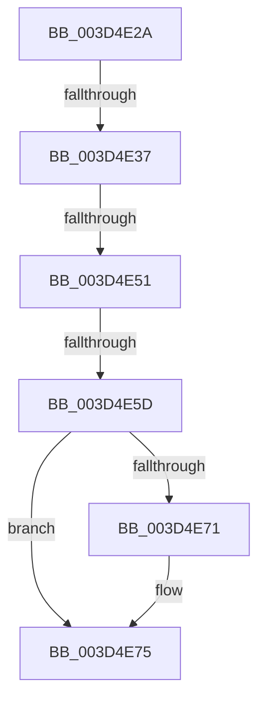

# sub_003D4E2A

- RVA: `0x003D4E2A`–`0x003D4E88` (길이 `94` bytes)
- VA: `0x00000001403D4E2A`
- 실행 섹션: `.text`
- PDB 이름 있음: `아니요`; PDB Function 태그: `아니요`
- unwind 정보 RVA: `0x00092610`
- 디코드: `20`개 명령, `94/94` bytes 표시
- 미해석 바이트: `0` (있으면 어셈블리에 `.byte`로 보존)

> 이 문서는 커널 이미지의 기계어와 PDB 기호를 분석해 생성했습니다. 4번과 5번은 함수 원형과 자료형을 바이너리 사용 방식에서 추정한 C 해석이며 원본 소스 복구 결과는 아닙니다.

## 1. Dependencies

- 직접 호출 지점: **0**; 고유 호출 대상: **0**
- 직접 호출자로 확인된 함수: **0**
- RIP 상대 이미지 참조: **1**

### Outgoing calls
- 직접 디코드된 call 명령이 없습니다.

### Direct callers
- 이 함수 시작 RVA로 연결되는 직접 call은 확인되지 않았습니다. 간접 호출은 완전히 역산할 수 없습니다.

### Static image references
- `0x003D4E2A` → RVA `0x00FC6A88` (`ALMOSTRO`; read)

## 2. Other-region calls and transfers

- 다른 실행 섹션으로 향하는 call: **0**
- call이 아닌 외부 분기/꼬리 이동: **4**
  - `0x003D4E35` → [sub_003D4D3D + 0xB2](Unknown_function_003D4D3D.md) (`tail-transfer`)
  - `0x003D4E4F` → [sub_003D4D3D + 0xB2](Unknown_function_003D4D3D.md) (`tail-transfer`)
  - `0x003D4E5B` → [sub_003D4D3D + 0xB2](Unknown_function_003D4D3D.md) (`tail-transfer`)
  - `0x003D4E83` → [sub_003D4D3D + 0xB2](Unknown_function_003D4D3D.md) (`tail-transfer`)

## 3. Assembly (complete function range)

```asm
003D4E2A  48 F7 05 53 1C BF 00 00 00 60 00  test qword ptr [rip + 0xbf1c53], 0x600000
003D4E35  74 B8                           je 0x1403d4def
003D4E37  65 48 8B 14 25 88 01 00 00      mov rdx, qword ptr gs:[0x188]
003D4E40  4C 8B 8A B8 00 00 00            mov r9, qword ptr [rdx + 0xb8]
003D4E47  41 80 B9 60 01 00 00 01         cmp byte ptr [r9 + 0x160], 1
003D4E4F  74 9E                           je 0x1403d4def
003D4E51  49 8B 91 08 05 00 00            mov rdx, qword ptr [r9 + 0x508]
003D4E58  48 85 D2                        test rdx, rdx
003D4E5B  74 92                           je 0x1403d4def
003D4E5D  49 C1 EA 03                     shr r10, 3
003D4E61  41 81 E2 FF 01 00 00            and r10d, 0x1ff
003D4E68  4A 8B 14 D2                     mov rdx, qword ptr [rdx + r10*8]
003D4E6C  F6 C2 20                        test dl, 0x20
003D4E6F  74 04                           je 0x1403d4e75
003D4E71  48 83 C9 20                     or rcx, 0x20
003D4E75  48 8B C1                        mov rax, rcx
003D4E78  48 83 C8 42                     or rax, 0x42
003D4E7C  F6 C2 42                        test dl, 0x42
003D4E7F  48 0F 44 C1                     cmove rax, rcx
003D4E83  E9 67 FF FF FF                  jmp 0x1403d4def
```

## 4. C-style interpretation (structured pseudocode)

```c
__int64 __fastcall sub_003D4E2A(__int64 a1)
{
    __int64 result;
    __int64 v_r10;

    v_r10 = (v_r10) >> (3);
    v_r10 = (unsigned int)((v_r10) & (511));
    if ((((unsigned __int8)(*(unsigned __int64 *)(*(unsigned __int64 *)(*(unsigned __int64 *)(*(unsigned __int64 *)(gs_base + (0 + 392)) + 184) + 1288) + v_r10 * 8))) & (32)) != 0) {
        a1 = (a1) | (32);
    }
    result = (a1) | (66);
    if ((((unsigned __int8)(*(unsigned __int64 *)(*(unsigned __int64 *)(*(unsigned __int64 *)(*(unsigned __int64 *)(gs_base + (0 + 392)) + 184) + 1288) + v_r10 * 8))) & (66)) == 0) { result = a1; }
}
```

## 5. (Beta) C Style

```c
int64_t sub_003D4E2A(int64_t Arg1)
{
    int64_t result;
    int64_t local_r10;

    local_r10 = (local_r10) >> (3);
    local_r10 = (uint32_t)((local_r10) & (511));
    if ((((uint8_t)(*(uint64_t *)(*(uint64_t *)(*(uint64_t *)(*(uint64_t *)(gs_base + (0 + 0x188)) + 0xB8) + 0x508) + local_r10 * 8))) & (32)) != 0) {
        Arg1 = (Arg1) | (32);
    }
    result = (Arg1) | (66);
    if ((((uint8_t)(*(uint64_t *)(*(uint64_t *)(*(uint64_t *)(*(uint64_t *)(gs_base + (0 + 0x188)) + 0xB8) + 0x508) + local_r10 * 8))) & (66)) == 0) { result = Arg1; }
}
```

## 6. Execution-region graph

[열기: 2D/3D 그래프와 함수 탐색 컨트롤 패널](../../../control-panel.html?section=text&rva=0x003D4E2A&view=graph)

- 2D 그래프는 위에서 아래로 흐르고, 3D 그래프는 빈 공간을 드래그해 회전합니다. Shift+드래그는 이동, 휠은 확대·축소, 함수 노드 선택은 대상 보고서 이동입니다.

### Static fallback


