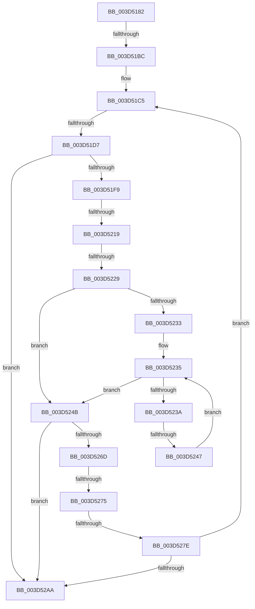

# sub_003D5182

- RVA: `0x003D5182`–`0x003D52C7` (길이 `325` bytes)
- VA: `0x00000001403D5182`
- 실행 섹션: `.text`
- PDB 이름 있음: `아니요`; PDB Function 태그: `아니요`
- unwind 정보 RVA: `0x000938DC`
- 디코드: `70`개 명령, `325/325` bytes 표시
- 미해석 바이트: `0` (있으면 어셈블리에 `.byte`로 보존)

> 이 문서는 커널 이미지의 기계어와 PDB 기호를 분석해 생성했습니다. 4번과 5번은 함수 원형과 자료형을 바이너리 사용 방식에서 추정한 C 해석이며 원본 소스 복구 결과는 아닙니다.

## 1. Dependencies

- 직접 호출 지점: **3**; 고유 호출 대상: **3**
- 직접 호출자로 확인된 함수: **0**
- RIP 상대 이미지 참조: **0**

### Outgoing calls
- `0x003D51A5` → [MiClearEntireStandbyLookasideList](MiClearEntireStandbyLookasideList_function_003D56C8.md) (function, `0x003D56C8`)
- `0x003D51E8` → [MiSkipStandbyEntries](MiSkipStandbyEntries_function_003D53A0.md) (function, `0x003D53A0`)
- `0x003D5253` → [MiWriteStandbyLookasideEntry](../33/MiWriteStandbyLookasideEntry_function_0033B530.md) (function, `0x0033B530`)

### Direct callers
- 이 함수 시작 RVA로 연결되는 직접 call은 확인되지 않았습니다. 간접 호출은 완전히 역산할 수 없습니다.

### Static image references
- 디코드된 RIP-relative 메모리 참조가 없습니다.

## 2. Other-region calls and transfers

- 다른 실행 섹션으로 향하는 call: **0**
- call이 아닌 외부 분기/꼬리 이동: **7**
  - `0x003D51B6` → [sub_003D52D1 + 0x6B](Unknown_function_003D52D1.md) (`tail-transfer`)
  - `0x003D51D1` → [sub_003D5366](Unknown_function_003D5366.md) (`tail-transfer`)
  - `0x003D5213` → [sub_003D52D1 + 0x1E](Unknown_function_003D52D1.md) (`tail-transfer`)
  - `0x003D5223` → [sub_003D52D1 + 0xF](Unknown_function_003D52D1.md) (`tail-transfer`)
  - `0x003D5241` → [sub_003D52D1](Unknown_function_003D52D1.md) (`tail-transfer`)
  - `0x003D526F` → [sub_003D52D1 + 0x50](Unknown_function_003D52D1.md) (`tail-transfer`)
  - `0x003D5278` → [sub_003D52D1 + 0x2E](Unknown_function_003D52D1.md) (`tail-transfer`)

## 3. Assembly (complete function range)

```asm
003D5182  4C 89 AC 24 98 00 00 00         mov qword ptr [rsp + 0x98], r13
003D518A  44 8B C5                        mov r8d, ebp
003D518D  4C 89 B4 24 A8 00 00 00         mov qword ptr [rsp + 0xa8], r14
003D5195  48 8B D7                        mov rdx, rdi
003D5198  4C 89 7C 24 60                  mov qword ptr [rsp + 0x60], r15
003D519D  4C 89 A4 24 90 00 00 00         mov qword ptr [rsp + 0x90], r12
003D51A5  E8 1E 05 00 00                  call 0x1403d56c8
003D51AA  45 33 F6                        xor r14d, r14d
003D51AD  89 84 24 A0 00 00 00            mov dword ptr [rsp + 0xa0], eax
003D51B4  85 ED                           test ebp, ebp
003D51B6  0F 84 80 01 00 00               je 0x1403d533c
003D51BC  45 33 E4                        xor r12d, r12d
003D51BF  41 BD 01 00 00 00               mov r13d, 1
003D51C5  4A 8B 04 F7                     mov rax, qword ptr [rdi + r14*8]
003D51C9  4E 8D 3C F7                     lea r15, [rdi + r14*8]
003D51CD  48 83 F8 FF                     cmp rax, -1
003D51D1  0F 85 8F 01 00 00               jne 0x1403d5366
003D51D7  41 8B C5                        mov eax, r13d
003D51DA  44 8B CD                        mov r9d, ebp
003D51DD  45 8B C4                        mov r8d, r12d
003D51E0  48 89 44 24 20                  mov qword ptr [rsp + 0x20], rax
003D51E5  48 8B D3                        mov rdx, rbx
003D51E8  E8 B3 01 00 00                  call 0x1403d53a0
003D51ED  48 8B D8                        mov rbx, rax
003D51F0  48 3B C6                        cmp rax, rsi
003D51F3  0F 84 B1 00 00 00               je 0x1403d52aa
003D51F9  48 8D 34 40                     lea rsi, [rax + rax*2]
003D51FD  48 B8 00 00 00 00 00 DE FF FF   movabs rax, 0xffffde0000000000
003D5207  48 C1 E6 04                     shl rsi, 4
003D520B  48 8B C0                        mov rax, rax
003D520E  48 03 F0                        add rsi, rax
003D5211  85 ED                           test ebp, ebp
003D5213  0F 84 D6 00 00 00               je 0x1403d52ef
003D5219  45 33 E4                        xor r12d, r12d
003D521C  F0 48 0F BA 6E 18 3F            lock bts qword ptr [rsi + 0x18], 0x3f
003D5223  0F 82 B7 00 00 00               jb 0x1403d52e0
003D5229  83 BC 24 A0 00 00 00 00         cmp dword ptr [rsp + 0xa0], 0
003D5231  75 18                           jne 0x1403d524b
003D5233  33 C0                           xor eax, eax
003D5235  83 F8 40                        cmp eax, 0x40
003D5238  73 11                           jae 0x1403d524b
003D523A  48 8B 14 C7                     mov rdx, qword ptr [rdi + rax*8]
003D523E  48 3B D3                        cmp rdx, rbx
003D5241  0F 84 8A 00 00 00               je 0x1403d52d1
003D5247  FF C0                           inc eax
003D5249  EB EA                           jmp 0x1403d5235
003D524B  4C 8B C3                        mov r8, rbx
003D524E  8B D5                           mov edx, ebp
003D5250  49 8B CF                        mov rcx, r15
003D5253  E8 D8 62 F6 FF                  call 0x14033b530
003D5258  48 B8 FF FF FF FF FF FF FF 7F   movabs rax, 0x7fffffffffffffff
003D5262  F0 48 21 46 18                  lock and qword ptr [rsi + 0x18], rax
003D5267  41 83 FE 3F                     cmp r14d, 0x3f
003D526B  74 3D                           je 0x1403d52aa
003D526D  85 ED                           test ebp, ebp
003D526F  0F 84 AC 00 00 00               je 0x1403d5321
003D5275  83 FD 01                        cmp ebp, 1
003D5278  0F 85 81 00 00 00               jne 0x1403d52ff
003D527E  48 8B 5E 18                     mov rbx, qword ptr [rsi + 0x18]
003D5282  48 B8 FF FF FF FF FF 00 00 00   movabs rax, 0xffffffffff
003D528C  48 23 D8                        and rbx, rax
003D528F  B8 01 00 00 00                  mov eax, 1
003D5294  48 BE FF FF FF FF 3F 00 00 00   movabs rsi, 0x3fffffffff
003D529E  44 03 F0                        add r14d, eax
003D52A1  48 3B DE                        cmp rbx, rsi
003D52A4  0F 85 1B FF FF FF               jne 0x1403d51c5
003D52AA  4C 8B A4 24 90 00 00 00         mov r12, qword ptr [rsp + 0x90]
003D52B2  4C 8B AC 24 98 00 00 00         mov r13, qword ptr [rsp + 0x98]
003D52BA  4C 8B B4 24 A8 00 00 00         mov r14, qword ptr [rsp + 0xa8]
003D52C2  4C 8B 7C 24 60                  mov r15, qword ptr [rsp + 0x60]
```

## 4. C-style interpretation (structured pseudocode)

```c
__int64 __fastcall sub_003D5182(__int64 a1, __int64 a2, __int64 a3, __int64 a4, __int64 a5, __int64 a6, __int64 a7, __int64 a8, __int64 a9, __int64 a10, __int64 a11, __int64 a12, __int64 a13, __int64 a14, __int64 a15, __int64 a16, __int64 a17, __int64 a18, __int64 a19, unsigned int a20, __int64 a21)
{
    __int64 result;
    __int64 v_r12;
    __int64 v_r14;
    __int64 v_rbx;
    __int64 v_rsi;
    unsigned __int64 v_stack_p20;
    unsigned __int64 v_stack_p60;
    unsigned __int64 v_stack_p90;
    unsigned __int64 v_stack_p98;
    unsigned int v_stack_pA0;
    unsigned __int64 v_stack_pA8;

    v_stack_p98 = v_r13;
    v_stack_pA8 = v_r14;
    v_stack_p60 = v_r15;
    v_stack_p90 = v_r12;
    result = MiClearEntireStandbyLookasideList(a1, v_rdi, (unsigned int)((unsigned int)(v_rbp)), a4);
    v_r14 = 0;
    v_stack_pA0 = (unsigned int)(result);
    v_r12 = 0;
loc_003D51C5:
    v_stack_p20 = 1;
    result = MiSkipStandbyEntries(a1, v_rbx, 0, (unsigned int)((unsigned int)(v_rbp)));
    if (result == v_rsi) goto loc_003D52AA;
    v_rsi = (result + result * 2) << (4);
    v_rsi = (v_rsi) + (result);
    v_r12 = 0;
    if (a20 != 0) goto loc_003D524B;
    result = 0;
loc_003D5235:
    if (0 >= 64) goto loc_003D524B;
    result = (unsigned int)((result) + 1);
    goto loc_003D5235;
loc_003D524B:
    result = MiWriteStandbyLookasideEntry(v_rdi + v_r14 * 8, (unsigned int)((unsigned int)(v_rbp)), result, (unsigned int)((unsigned int)(v_rbp)));
    if (0 == 63) goto loc_003D52AA;
    v_rbx = (*(unsigned __int64 *)(v_rsi + 24)) & (result);
    v_r14 = (unsigned int)((v_r14) + (1));
    if (v_rbx != v_rsi) goto loc_003D51C5;
loc_003D52AA:
    return 1;
}
```

## 5. (Beta) C Style

```c
int64_t sub_003D5182(int64_t Arg1, int64_t Arg2, int64_t Arg3, int64_t Arg4, uint64_t Arg5, uint64_t Arg6, uint64_t Arg7, uint64_t Arg8, uint64_t Arg9, uint64_t Arg10, uint64_t Arg11, int64_t Arg12, uint64_t Arg13, uint64_t Arg14, uint64_t Arg15, uint64_t Arg16, uint64_t Arg17, int64_t Arg18, int64_t Arg19, uint32_t Arg20, int64_t Arg21)
{
    int64_t result;
    int64_t local_r12;
    int64_t local_r14;
    int64_t local_rbx;
    int64_t local_rsi;
    uint64_t v_stack_p20;
    uint64_t v_stack_p60;
    uint64_t v_stack_p90;
    uint64_t v_stack_p98;
    uint32_t v_stack_pA0;
    uint64_t v_stack_pA8;

    v_stack_p98 = local_r13;
    v_stack_pA8 = local_r14;
    v_stack_p60 = local_r15;
    v_stack_p90 = local_r12;
    result = MiClearEntireStandbyLookasideList(Arg1, local_rdi, (uint32_t)((uint32_t)(local_rbp)), Arg4);
    local_r14 = 0;
    v_stack_pA0 = (uint32_t)(result);
    local_r12 = 0;
loc_003D51C5:
    v_stack_p20 = 1;
    result = MiSkipStandbyEntries(Arg1, local_rbx, 0, (uint32_t)((uint32_t)(local_rbp)));
    if (result == local_rsi) goto loc_003D52AA;
    local_rsi = (result + result * 2) << (4);
    local_rsi = (local_rsi) + (result);
    local_r12 = 0;
    if (Arg20 != 0) goto loc_003D524B;
    result = 0;
loc_003D5235:
    if (0 >= 64) goto loc_003D524B;
    result = (uint32_t)((result) + 1);
    goto loc_003D5235;
loc_003D524B:
    result = MiWriteStandbyLookasideEntry(local_rdi + local_r14 * 8, (uint32_t)((uint32_t)(local_rbp)), result, (uint32_t)((uint32_t)(local_rbp)));
    if (0 == 63) goto loc_003D52AA;
    local_rbx = (*(uint64_t *)(local_rsi + 0x18)) & (result);
    local_r14 = (uint32_t)((local_r14) + (1));
    if (local_rbx != local_rsi) goto loc_003D51C5;
loc_003D52AA:
    return 1;
}
```

## 6. Execution-region graph

[열기: 2D/3D 그래프와 함수 탐색 컨트롤 패널](../../../control-panel.html?section=text&rva=0x003D5182&view=graph)

- 2D 그래프는 위에서 아래로 흐르고, 3D 그래프는 빈 공간을 드래그해 회전합니다. Shift+드래그는 이동, 휠은 확대·축소, 함수 노드 선택은 대상 보고서 이동입니다.

### Static fallback


