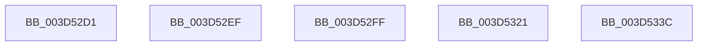

# sub_003D52D1

- RVA: `0x003D52D1`–`0x003D534C` (길이 `123` bytes)
- VA: `0x00000001403D52D1`
- 실행 섹션: `.text`
- PDB 이름 있음: `아니요`; PDB Function 태그: `아니요`
- unwind 정보 RVA: `0x00093910`
- 디코드: `25`개 명령, `123/123` bytes 표시
- 미해석 바이트: `0` (있으면 어셈블리에 `.byte`로 보존)

> 이 문서는 커널 이미지의 기계어와 PDB 기호를 분석해 생성했습니다. 4번과 5번은 함수 원형과 자료형을 바이너리 사용 방식에서 추정한 C 해석이며 원본 소스 복구 결과는 아닙니다.

## 1. Dependencies

- 직접 호출 지점: **2**; 고유 호출 대상: **1**
- 직접 호출자로 확인된 함수: **0**
- RIP 상대 이미지 참조: **0**

### Outgoing calls
- `0x003D52F2` → [MiGetStandbyPageType](MiGetStandbyPageType_function_003D55B0.md) (function, `0x003D55B0`)
- `0x003D533F` → [MiGetStandbyPageType](MiGetStandbyPageType_function_003D55B0.md) (function, `0x003D55B0`)

### Direct callers
- 이 함수 시작 RVA로 연결되는 직접 call은 확인되지 않았습니다. 간접 호출은 완전히 역산할 수 없습니다.

### Static image references
- 디코드된 RIP-relative 메모리 참조가 없습니다.

## 2. Other-region calls and transfers

- 다른 실행 섹션으로 향하는 call: **0**
- call이 아닌 외부 분기/꼬리 이동: **5**
  - `0x003D52EA` → [sub_003D5182 + 0x3D](Unknown_function_003D5182.md) (`tail-transfer`)
  - `0x003D52FA` → [sub_003D5182 + 0x9A](Unknown_function_003D5182.md) (`tail-transfer`)
  - `0x003D531C` → [sub_003D5182 + 0x10D](Unknown_function_003D5182.md) (`tail-transfer`)
  - `0x003D5337` → [sub_003D5182 + 0x10D](Unknown_function_003D5182.md) (`tail-transfer`)
  - `0x003D5347` → [sub_003D5182 + 0x3D](Unknown_function_003D5182.md) (`tail-transfer`)

## 3. Assembly (complete function range)

```asm
003D52D1  48 B8 FF FF FF FF FF FF FF 7F   movabs rax, 0x7fffffffffffffff
003D52DB  F0 48 21 46 18                  lock and qword ptr [rsi + 0x18], rax
003D52E0  48 BE FF FF FF FF 3F 00 00 00   movabs rsi, 0x3fffffffff
003D52EA  E9 D0 FE FF FF                  jmp 0x1403d51bf
003D52EF  48 8B CB                        mov rcx, rbx
003D52F2  E8 B9 02 00 00                  call 0x1403d55b0
003D52F7  44 8B E0                        mov r12d, eax
003D52FA  E9 1D FF FF FF                  jmp 0x1403d521c
003D52FF  48 8B 46 18                     mov rax, qword ptr [rsi + 0x18]
003D5303  8B 5E 24                        mov ebx, dword ptr [rsi + 0x24]
003D5306  81 E3 FF FF 1F 00               and ebx, 0x1fffff
003D530C  48 C1 E8 28                     shr rax, 0x28
003D5310  48 C1 E3 13                     shl rbx, 0x13
003D5314  25 FF FF 07 00                  and eax, 0x7ffff
003D5319  48 0B D8                        or rbx, rax
003D531C  E9 6E FF FF FF                  jmp 0x1403d528f
003D5321  48 8B 1E                        mov rbx, qword ptr [rsi]
003D5324  48 B8 FF FF FF FF FF 00 00 00   movabs rax, 0xffffffffff
003D532E  48 23 D8                        and rbx, rax
003D5331  41 BD 10 00 00 00               mov r13d, 0x10
003D5337  E9 53 FF FF FF                  jmp 0x1403d528f
003D533C  48 8B CB                        mov rcx, rbx
003D533F  E8 6C 02 00 00                  call 0x1403d55b0
003D5344  44 8B E0                        mov r12d, eax
003D5347  E9 73 FE FF FF                  jmp 0x1403d51bf
```

## 4. C-style interpretation (structured pseudocode)

```c
__int64 __fastcall sub_003D52D1(void)
{
}
```

## 5. (Beta) C Style

```c
void sub_003D52D1(void)
{
}
```

## 6. Execution-region graph

[열기: 2D/3D 그래프와 함수 탐색 컨트롤 패널](../../../control-panel.html?section=text&rva=0x003D52D1&view=graph)

- 2D 그래프는 위에서 아래로 흐르고, 3D 그래프는 빈 공간을 드래그해 회전합니다. Shift+드래그는 이동, 휠은 확대·축소, 함수 노드 선택은 대상 보고서 이동입니다.

### Static fallback


