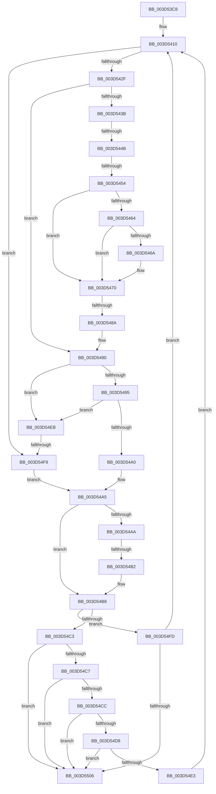

# sub_003D53C8

- RVA: `0x003D53C8`–`0x003D5526` (길이 `350` bytes)
- VA: `0x00000001403D53C8`
- 실행 섹션: `.text`
- PDB 이름 있음: `아니요`; PDB Function 태그: `아니요`
- unwind 정보 RVA: `0x0009397C`
- 디코드: `91`개 명령, `350/350` bytes 표시
- 미해석 바이트: `0` (있으면 어셈블리에 `.byte`로 보존)

> 이 문서는 커널 이미지의 기계어와 PDB 기호를 분석해 생성했습니다. 4번과 5번은 함수 원형과 자료형을 바이너리 사용 방식에서 추정한 C 해석이며 원본 소스 복구 결과는 아닙니다.

## 1. Dependencies

- 직접 호출 지점: **1**; 고유 호출 대상: **1**
- 직접 호출자로 확인된 함수: **0**
- RIP 상대 이미지 참조: **2**

### Outgoing calls
- `0x003D53F4` → [MiGetPfnPriority](../32/MiGetPfnPriority_function_003226F0.md) (function, `0x003226F0`)

### Direct callers
- 이 함수 시작 RVA로 연결되는 직접 call은 확인되지 않았습니다. 간접 호출은 완전히 역산할 수 없습니다.

### Static image references
- `0x003D542F` → RVA `0x00E35C00` (`.data`; read)
- `0x003D5454` → RVA `0x00E2DC80` (`.data`; read)

## 2. Other-region calls and transfers

- 다른 실행 섹션으로 향하는 call: **0**
- call이 아닌 외부 분기/꼬리 이동: **5**
  - `0x003D5445` → [sub_003D5527](Unknown_function_003D5527.md) (`tail-transfer`)
  - `0x003D544E` → [sub_003D5527](Unknown_function_003D5527.md) (`tail-transfer`)
  - `0x003D5484` → [sub_003D5527 + 0xF](Unknown_function_003D5527.md) (`tail-transfer`)
  - `0x003D54AC` → [sub_003D5527 + 0x1D](Unknown_function_003D5527.md) (`tail-transfer`)
  - `0x003D54F3` → [sub_003D5527 + 0x52](Unknown_function_003D5527.md) (`tail-transfer`)

## 3. Assembly (complete function range)

```asm
003D53C8  48 89 5C 24 40                  mov qword ptr [rsp + 0x40], rbx
003D53CD  48 8D 0C 52                     lea rcx, [rdx + rdx*2]
003D53D1  4C 89 6C 24 48                  mov qword ptr [rsp + 0x48], r13
003D53D6  4C 89 74 24 50                  mov qword ptr [rsp + 0x50], r14
003D53DB  4C 89 7C 24 58                  mov qword ptr [rsp + 0x58], r15
003D53E0  48 C1 E1 04                     shl rcx, 4
003D53E4  49 BD 00 00 00 00 00 DE FF FF   movabs r13, 0xffffde0000000000
003D53EE  49 8B C5                        mov rax, r13
003D53F1  48 03 C8                        add rcx, rax
003D53F4  E8 F7 D2 F4 FF                  call 0x1403226f0
003D53F9  4C 8B 74 24 60                  mov r14, qword ptr [rsp + 0x60]
003D53FE  49 B9 FF FF FF FF FF 00 00 00   movabs r9, 0xffffffffff
003D5408  0F 1F 84 00 00 00 00 00         nop dword ptr [rax + rax]
003D5410  4B 8D 1C 52                     lea rbx, [r10 + r10*2]
003D5414  45 8B FB                        mov r15d, r11d
003D5417  48 C1 E3 04                     shl rbx, 4
003D541B  49 8B D2                        mov rdx, r10
003D541E  49 8B C5                        mov rax, r13
003D5421  48 03 D8                        add rbx, rax
003D5424  4C 8B C3                        mov r8, rbx
003D5427  85 F6                           test esi, esi
003D5429  0F 85 CA 00 00 00               jne 0x1403d54f9
003D542F  48 8B 05 CA 07 A6 00            mov rax, qword ptr [rip + 0xa607ca]
003D5436  4C 3B D0                        cmp r10, rax
003D5439  72 55                           jb 0x1403d5490
003D543B  4C 8D 88 00 08 00 00            lea r9, [rax + 0x800]
003D5442  83 FF 02                        cmp edi, 2
003D5445  0F 84 DC 00 00 00               je 0x1403d5527
003D544B  4D 3B D1                        cmp r10, r9
003D544E  0F 83 D3 00 00 00               jae 0x1403d5527
003D5454  48 8B 0D 25 88 A5 00            mov rcx, qword ptr [rip + 0xa58825]
003D545B  4C 8B 53 10                     mov r10, qword ptr [rbx + 0x10]
003D545F  48 85 C9                        test rcx, rcx
003D5462  74 0C                           je 0x1403d5470
003D5464  41 F6 C2 10                     test r10b, 0x10
003D5468  75 06                           jne 0x1403d5470
003D546A  48 F7 D1                        not rcx
003D546D  4C 23 D1                        and r10, rcx
003D5470  49 C1 EA 0C                     shr r10, 0xc
003D5474  48 B9 FF FF FF FF FF 00 00 00   movabs rcx, 0xffffffffff
003D547E  4C 23 D1                        and r10, rcx
003D5481  4D 3B D1                        cmp r10, r9
003D5484  0F 82 AC 00 00 00               jb 0x1403d5536
003D548A  45 33 C0                        xor r8d, r8d
003D548D  4C 8B C9                        mov r9, rcx
003D5490  48 3B D0                        cmp rdx, rax
003D5493  72 56                           jb 0x1403d54eb
003D5495  48 05 00 08 00 00               add rax, 0x800
003D549B  48 3B D0                        cmp rdx, rax
003D549E  73 4B                           jae 0x1403d54eb
003D54A0  BF 01 00 00 00                  mov edi, 1
003D54A5  4D 85 C0                        test r8, r8
003D54A8  74 0E                           je 0x1403d54b8
003D54AA  85 F6                           test esi, esi
003D54AC  0F 85 92 00 00 00               jne 0x1403d5544
003D54B2  4D 8B 10                        mov r10, qword ptr [r8]
003D54B5  4D 23 D1                        and r10, r9
003D54B8  41 FF C3                        inc r11d
003D54BB  41 8B C3                        mov eax, r11d
003D54BE  49 3B C6                        cmp rax, r14
003D54C1  72 3A                           jb 0x1403d54fd
003D54C3  85 F6                           test esi, esi
003D54C5  75 3F                           jne 0x1403d5506
003D54C7  4D 3B D4                        cmp r10, r12
003D54CA  74 3A                           je 0x1403d5506
003D54CC  48 8B 05 2D 07 A6 00            mov rax, qword ptr [rip + 0xa6072d]
003D54D3  4C 3B D0                        cmp r10, rax
003D54D6  72 2E                           jb 0x1403d5506
003D54D8  48 05 00 08 00 00               add rax, 0x800
003D54DE  4C 3B D0                        cmp r10, rax
003D54E1  73 23                           jae 0x1403d5506
003D54E3  45 8B DF                        mov r11d, r15d
003D54E6  E9 25 FF FF FF                  jmp 0x1403d5410
003D54EB  8B 43 20                        mov eax, dword ptr [rbx + 0x20]
003D54EE  C1 E8 18                        shr eax, 0x18
003D54F1  A8 08                           test al, 8
003D54F3  0F 85 80 00 00 00               jne 0x1403d5579
003D54F9  33 FF                           xor edi, edi
003D54FB  EB A8                           jmp 0x1403d54a5
003D54FD  4D 3B D4                        cmp r10, r12
003D5500  0F 85 0A FF FF FF               jne 0x1403d5410
003D5506  4C 8B 74 24 50                  mov r14, qword ptr [rsp + 0x50]
003D550B  49 8B C2                        mov rax, r10
003D550E  4C 8B 6C 24 48                  mov r13, qword ptr [rsp + 0x48]
003D5513  48 8B 5C 24 40                  mov rbx, qword ptr [rsp + 0x40]
003D5518  4C 8B 7C 24 58                  mov r15, qword ptr [rsp + 0x58]
003D551D  48 83 C4 20                     add rsp, 0x20
003D5521  41 5C                           pop r12
003D5523  5F                              pop rdi
003D5524  5E                              pop rsi
003D5525  C3                              ret
```

## 4. C-style interpretation (structured pseudocode)

```c
__int64 __fastcall sub_003D53C8(__int64 a1, __int64 a2, __int64 a3, __int64 a4, __int64 a5, __int64 a6, __int64 a7, __int64 a8, __int64 a9, __int64 a10, __int64 a11, __int64 a12)
{
    __int64 result;
    __int64 v_r10;
    __int64 v_r11;
    __int64 v_rbx;
    __int64 v_rdi;
    __int64 v_rsp;
    unsigned __int64 v_stack_p40;
    unsigned __int64 v_stack_p48;
    unsigned __int64 v_stack_p50;
    unsigned __int64 v_stack_p58;

    v_stack_p40 = v_rbx;
    v_stack_p48 = v_r13;
    v_stack_p50 = v_r14;
    v_stack_p58 = v_r15;
    a1 = (a2 + a2 * 2) << (4);
    a1 = (a1) + (v_r13);
    result = MiGetPfnPriority(a1, a2, a3, a4);
loc_003D5410:
    v_rbx = (v_r10 + v_r10 * 2) << (4);
    v_rbx = (v_rbx) + (v_r13);
    if ((unsigned int)(v_rsi) != 0) goto loc_003D54F9;
    if (v_r10 < (*(unsigned __int64 *)(v_rip + 10880970))) goto loc_003D5490;
    if (*(unsigned __int64 *)(v_rip + 10848293) == 0) goto loc_003D5470;
    v_r10 = *(unsigned __int64 *)(v_rbx + 16);
    if ((((unsigned __int8)(*(unsigned __int64 *)(v_rbx + 16))) & (16)) == 0) {
        a1 = ~(*(unsigned __int64 *)(v_rip + 10848293));
        v_r10 = (*(unsigned __int64 *)(v_rbx + 16)) & (a1);
    }
    v_r10 = (v_r10) >> (12);
    v_r10 = (v_r10) & (a1);
    a3 = 0;
loc_003D5490:
    if (v_r10 < (*(unsigned __int64 *)(v_rip + 10880970))) goto loc_003D54EB;
    result = (*(unsigned __int64 *)(v_rip + 10880970)) + (0x800ULL);
    if (v_r10 >= result) goto loc_003D54EB;
loc_003D54A5:
    if (0 == 0) goto loc_003D54B8;
    v_r10 = (*(unsigned __int64 *)(a3)) & (a1);
loc_003D54B8:
    v_r11 = (unsigned int)((v_r11) + 1);
    if (((unsigned int)((unsigned int)(v_r11))) < a12) goto loc_003D54FD;
    if ((unsigned int)(v_rsi) != 0) goto loc_003D5506;
    if (v_r10 == v_r12) goto loc_003D5506;
    if (v_r10 < (*(unsigned __int64 *)(v_rip + 10880813))) goto loc_003D5506;
    result = (*(unsigned __int64 *)(v_rip + 10880813)) + (0x800ULL);
    if (v_r10 >= result) goto loc_003D5506;
    goto loc_003D5410;
loc_003D54EB:
    result = (unsigned int)(((unsigned int)(*(unsigned int *)(v_rbx + 32))) >> (24));
loc_003D54F9:
    v_rdi = 0;
    goto loc_003D54A5;
loc_003D54FD:
    if (v_r10 != v_r12) goto loc_003D5410;
loc_003D5506:
    v_rsp = (v_rsp) + (32);
    return v_r10;
}
```

## 5. (Beta) C Style

```c
int64_t sub_003D53C8(int64_t Arg1, void *Arg2, int64_t Arg3, int64_t Arg4, uint64_t Arg5, uint64_t Arg6, uint64_t Arg7, int64_t Arg8, int64_t Arg9, int64_t Arg10, int64_t Arg11, int64_t Arg12)
{
    uint8_t *arg2 = (uint8_t *)Arg2;

    int64_t result;
    int64_t local_r10;
    int64_t local_r11;
    int64_t local_rbx;
    int64_t local_rdi;
    int64_t local_rsp;
    uint64_t v_stack_p40;
    uint64_t v_stack_p48;
    uint64_t v_stack_p50;
    uint64_t v_stack_p58;

    v_stack_p40 = local_rbx;
    v_stack_p48 = local_r13;
    v_stack_p50 = local_r14;
    v_stack_p58 = local_r15;
    Arg1 = (Arg2 + Arg2 * 2) << (4);
    Arg1 = (Arg1) + (local_r13);
    result = MiGetPfnPriority(Arg1, Arg2, Arg3, Arg4);
loc_003D5410:
    local_rbx = (local_r10 + local_r10 * 2) << (4);
    local_rbx = (local_rbx) + (local_r13);
    if ((uint32_t)(local_rsi) != 0) goto loc_003D54F9;
    if (local_r10 < (*(uint64_t *)(v_rip + 0xA607CA))) goto loc_003D5490;
    if (*(uint64_t *)(v_rip + 0xA58825) == 0) goto loc_003D5470;
    local_r10 = *(uint64_t *)(local_rbx + 0x10);
    if ((((uint8_t)(*(uint64_t *)(local_rbx + 0x10))) & (16)) == 0) {
        Arg1 = ~(*(uint64_t *)(v_rip + 0xA58825));
        local_r10 = (*(uint64_t *)(local_rbx + 0x10)) & (Arg1);
    }
    local_r10 = (local_r10) >> (12);
    local_r10 = (local_r10) & (Arg1);
    Arg3 = 0;
loc_003D5490:
    if (local_r10 < (*(uint64_t *)(v_rip + 0xA607CA))) goto loc_003D54EB;
    result = (*(uint64_t *)(v_rip + 0xA607CA)) + (0x800ULL);
    if (local_r10 >= result) goto loc_003D54EB;
loc_003D54A5:
    if (0 == 0) goto loc_003D54B8;
    local_r10 = (*(uint64_t *)(Arg3)) & (Arg1);
loc_003D54B8:
    local_r11 = (uint32_t)((local_r11) + 1);
    if (((uint32_t)((uint32_t)(local_r11))) < Arg12) goto loc_003D54FD;
    if ((uint32_t)(local_rsi) != 0) goto loc_003D5506;
    if (local_r10 == local_r12) goto loc_003D5506;
    if (local_r10 < (*(uint64_t *)(v_rip + 0xA6072D))) goto loc_003D5506;
    result = (*(uint64_t *)(v_rip + 0xA6072D)) + (0x800ULL);
    if (local_r10 >= result) goto loc_003D5506;
    goto loc_003D5410;
loc_003D54EB:
    result = (uint32_t)(((uint32_t)(*(uint32_t *)(local_rbx + 0x20))) >> (24));
loc_003D54F9:
    local_rdi = 0;
    goto loc_003D54A5;
loc_003D54FD:
    if (local_r10 != local_r12) goto loc_003D5410;
loc_003D5506:
    local_rsp = (local_rsp) + (32);
    return local_r10;
}
```

### 관측된 메모리 오프셋

구조체 형식이 확인되지 않은 접근은 인자 기준의 오프셋으로만 기록했습니다.

| 기준 인자 | 오프셋 표현 | 폭 (bit) | 접근 |
|---|---:|---:|---|
| `Arg2` | `+ 0x0 + rdx*2` | `64` | `R` |

## 6. Execution-region graph

[열기: 2D/3D 그래프와 함수 탐색 컨트롤 패널](../../../control-panel.html?section=text&rva=0x003D53C8&view=graph)

- 2D 그래프는 위에서 아래로 흐르고, 3D 그래프는 빈 공간을 드래그해 회전합니다. Shift+드래그는 이동, 휠은 확대·축소, 함수 노드 선택은 대상 보고서 이동입니다.

### Static fallback


