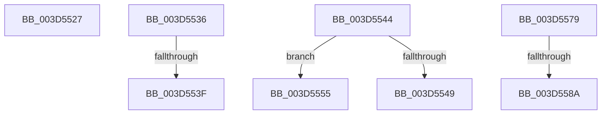

# sub_003D5527

- RVA: `0x003D5527`–`0x003D5592` (길이 `107` bytes)
- VA: `0x00000001403D5527`
- 실행 섹션: `.text`
- PDB 이름 있음: `아니요`; PDB Function 태그: `아니요`
- unwind 정보 RVA: `0x000939B0`
- 디코드: `24`개 명령, `107/107` bytes 표시
- 미해석 바이트: `0` (있으면 어셈블리에 `.byte`로 보존)

> 이 문서는 커널 이미지의 기계어와 PDB 기호를 분석해 생성했습니다. 4번과 5번은 함수 원형과 자료형을 바이너리 사용 방식에서 추정한 C 해석이며 원본 소스 복구 결과는 아닙니다.

## 1. Dependencies

- 직접 호출 지점: **1**; 고유 호출 대상: **1**
- 직접 호출자로 확인된 함수: **0**
- RIP 상대 이미지 참조: **0**

### Outgoing calls
- `0x003D557C` → [MiGetPfnSlabType](../28/MiGetPfnSlabType_function_0028E2D0.md) (function, `0x0028E2D0`)

### Direct callers
- 이 함수 시작 RVA로 연결되는 직접 call은 확인되지 않았습니다. 간접 호출은 완전히 역산할 수 없습니다.

### Static image references
- 디코드된 RIP-relative 메모리 참조가 없습니다.

## 2. Other-region calls and transfers

- 다른 실행 섹션으로 향하는 call: **0**
- call이 아닌 외부 분기/꼬리 이동: **7**
  - `0x003D5531` → [sub_003D53C8 + 0xC8](Unknown_function_003D53C8.md) (`tail-transfer`)
  - `0x003D5539` → [sub_003D53C8 + 0xC2](Unknown_function_003D53C8.md) (`tail-transfer`)
  - `0x003D553F` → [sub_003D53C8 + 0xC5](Unknown_function_003D53C8.md) (`tail-transfer`)
  - `0x003D5550` → [sub_003D53C8 + 0xF0](Unknown_function_003D53C8.md) (`tail-transfer`)
  - `0x003D5574` → [sub_003D53C8 + 0xF0](Unknown_function_003D53C8.md) (`tail-transfer`)
  - `0x003D5584` → [sub_003D53C8 + 0x131](Unknown_function_003D53C8.md) (`tail-transfer`)
  - `0x003D558D` → [sub_003D53C8 + 0xDD](Unknown_function_003D53C8.md) (`tail-transfer`)

## 3. Assembly (complete function range)

```asm
003D5527  49 B9 FF FF FF FF FF 00 00 00   movabs r9, 0xffffffffff
003D5531  E9 5A FF FF FF                  jmp 0x1403d5490
003D5536  4C 3B D0                        cmp r10, rax
003D5539  0F 82 4B FF FF FF               jb 0x1403d548a
003D553F  E9 49 FF FF FF                  jmp 0x1403d548d
003D5544  83 FE 01                        cmp esi, 1
003D5547  75 0C                           jne 0x1403d5555
003D5549  4D 8B 50 18                     mov r10, qword ptr [r8 + 0x18]
003D554D  4D 23 D1                        and r10, r9
003D5550  E9 63 FF FF FF                  jmp 0x1403d54b8
003D5555  49 8B 40 18                     mov rax, qword ptr [r8 + 0x18]
003D5559  45 8B 50 24                     mov r10d, dword ptr [r8 + 0x24]
003D555D  41 81 E2 FF FF 1F 00            and r10d, 0x1fffff
003D5564  48 C1 E8 28                     shr rax, 0x28
003D5568  49 C1 E2 13                     shl r10, 0x13
003D556C  25 FF FF 07 00                  and eax, 0x7ffff
003D5571  4C 0B D0                        or r10, rax
003D5574  E9 3F FF FF FF                  jmp 0x1403d54b8
003D5579  48 8B CB                        mov rcx, rbx
003D557C  E8 4F 8D EB FF                  call 0x14028e2d0
003D5581  83 F8 09                        cmp eax, 9
003D5584  0F 85 6F FF FF FF               jne 0x1403d54f9
003D558A  8D 78 F9                        lea edi, [rax - 7]
003D558D  E9 13 FF FF FF                  jmp 0x1403d54a5
```

## 4. C-style interpretation (structured pseudocode)

```c
__int64 __fastcall sub_003D5527(__int64 a1, __int64 a2, __int64 a3)
{
}
```

## 5. (Beta) C Style

```c
int64_t sub_003D5527(int64_t Arg1, int64_t Arg2, int64_t Arg3)
{
}
```

## 6. Execution-region graph

[열기: 2D/3D 그래프와 함수 탐색 컨트롤 패널](../../../control-panel.html?section=text&rva=0x003D5527&view=graph)

- 2D 그래프는 위에서 아래로 흐르고, 3D 그래프는 빈 공간을 드래그해 회전합니다. Shift+드래그는 이동, 휠은 확대·축소, 함수 노드 선택은 대상 보고서 이동입니다.

### Static fallback


