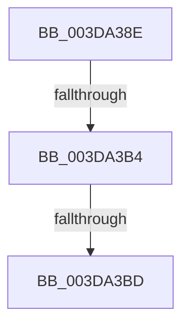

# sub_003DA38E

- RVA: `0x003DA38E`–`0x003DA3C2` (길이 `52` bytes)
- VA: `0x00000001403DA38E`
- 실행 섹션: `.text`
- PDB 이름 있음: `아니요`; PDB Function 태그: `아니요`
- unwind 정보 RVA: `0x00093E78`
- 디코드: `11`개 명령, `52/52` bytes 표시
- 미해석 바이트: `0` (있으면 어셈블리에 `.byte`로 보존)

> 이 문서는 커널 이미지의 기계어와 PDB 기호를 분석해 생성했습니다. 4번과 5번은 함수 원형과 자료형을 바이너리 사용 방식에서 추정한 C 해석이며 원본 소스 복구 결과는 아닙니다.

## 1. Dependencies

- 직접 호출 지점: **0**; 고유 호출 대상: **0**
- 직접 호출자로 확인된 함수: **0**
- RIP 상대 이미지 참조: **0**

### Outgoing calls
- 직접 디코드된 call 명령이 없습니다.

### Direct callers
- 이 함수 시작 RVA로 연결되는 직접 call은 확인되지 않았습니다. 간접 호출은 완전히 역산할 수 없습니다.

### Static image references
- 디코드된 RIP-relative 메모리 참조가 없습니다.

## 2. Other-region calls and transfers

- 다른 실행 섹션으로 향하는 call: **0**
- call이 아닌 외부 분기/꼬리 이동: **3**
  - `0x003DA3AE` → [sub_006E9A06](../6E/Unknown_function_006E9A06.md) (`tail-transfer`)
  - `0x003DA3B7` → [sub_006E9A06](../6E/Unknown_function_006E9A06.md) (`tail-transfer`)
  - `0x003DA3BD` → [sub_006E9AD8](../6E/Unknown_function_006E9AD8.md) (`tail-transfer`)

## 3. Assembly (complete function range)

```asm
003DA38E  4C 89 A4 24 A0 00 00 00         mov qword ptr [rsp + 0xa0], r12
003DA396  4C 89 74 24 68                  mov qword ptr [rsp + 0x68], r14
003DA39B  4C 89 7C 24 60                  mov qword ptr [rsp + 0x60], r15
003DA3A0  45 0F 20 C6                     mov r14, cr8
003DA3A4  44 8B 61 28                     mov r12d, dword ptr [rcx + 0x28]
003DA3A8  41 B7 01                        mov r15b, 1
003DA3AB  40 84 FF                        test dil, dil
003DA3AE  0F 85 52 F6 30 00               jne 0x1406e9a06
003DA3B4  40 84 F6                        test sil, sil
003DA3B7  0F 85 49 F6 30 00               jne 0x1406e9a06
003DA3BD  E9 16 F7 30 00                  jmp 0x1406e9ad8
```

## 4. C-style interpretation (structured pseudocode)

```c
void __fastcall sub_003DA38E(__int64 a1)
{
    unsigned __int64 v_stack_p60;
    unsigned __int64 v_stack_p68;
    unsigned __int64 v_stack_pA0;

    v_stack_pA0 = v_r12;
    v_stack_p68 = v_r14;
    v_stack_p60 = v_r15;
}
```

## 5. (Beta) C Style

```c
void sub_003DA38E(void *Arg1)
{
    uint8_t *arg1 = (uint8_t *)Arg1;

    uint64_t v_stack_p60;
    uint64_t v_stack_p68;
    uint64_t v_stack_pA0;

    v_stack_pA0 = local_r12;
    v_stack_p68 = local_r14;
    v_stack_p60 = local_r15;
}
```

### 관측된 메모리 오프셋

구조체 형식이 확인되지 않은 접근은 인자 기준의 오프셋으로만 기록했습니다.

| 기준 인자 | 오프셋 표현 | 폭 (bit) | 접근 |
|---|---:|---:|---|
| `Arg1` | `+ 0x28` | `32` | `R` |

## 6. Execution-region graph

[열기: 2D/3D 그래프와 함수 탐색 컨트롤 패널](../../../control-panel.html?section=text&rva=0x003DA38E&view=graph)

- 2D 그래프는 위에서 아래로 흐르고, 3D 그래프는 빈 공간을 드래그해 회전합니다. Shift+드래그는 이동, 휠은 확대·축소, 함수 노드 선택은 대상 보고서 이동입니다.

### Static fallback


