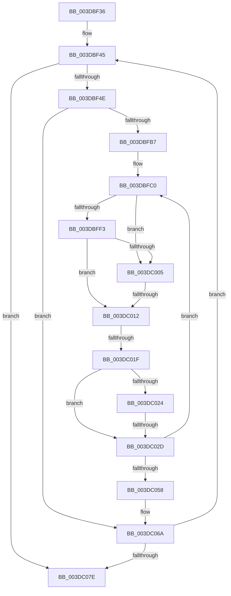

# sub_003DBF36

- RVA: `0x003DBF36`–`0x003DC09E` (길이 `360` bytes)
- VA: `0x00000001403DBF36`
- 실행 섹션: `.text`
- PDB 이름 있음: `아니요`; PDB Function 태그: `아니요`
- unwind 정보 RVA: `0x00094124`
- 디코드: `88`개 명령, `360/360` bytes 표시
- 미해석 바이트: `0` (있으면 어셈블리에 `.byte`로 보존)

> 이 문서는 커널 이미지의 기계어와 PDB 기호를 분석해 생성했습니다. 4번과 5번은 함수 원형과 자료형을 바이너리 사용 방식에서 추정한 C 해석이며 원본 소스 복구 결과는 아닙니다.

## 1. Dependencies

- 직접 호출 지점: **0**; 고유 호출 대상: **0**
- 직접 호출자로 확인된 함수: **0**
- RIP 상대 이미지 참조: **1**

### Outgoing calls
- 직접 디코드된 call 명령이 없습니다.

### Direct callers
- 이 함수 시작 RVA로 연결되는 직접 call은 확인되지 않았습니다. 간접 호출은 완전히 역산할 수 없습니다.

### Static image references
- `0x003DBFE8` → RVA `0x00FC18A0` (`.data`; read)

## 2. Other-region calls and transfers

- 다른 실행 섹션으로 향하는 call: **0**
- call이 아닌 외부 분기/꼬리 이동: **4**
  - `0x003DC00C` → [sub_003DC0D3 + 0x16](Unknown_function_003DC0D3.md) (`tail-transfer`)
  - `0x003DC019` → [sub_003DC0D3](Unknown_function_003DC0D3.md) (`tail-transfer`)
  - `0x003DC02B` → [sub_003DC09E](Unknown_function_003DC09E.md) (`tail-transfer`)
  - `0x003DC099` → [HalGetDmaTransferInfoInternal + 0x87](HalGetDmaTransferInfoInternal_function_003DBE60.md) (`tail-transfer`)

## 3. Assembly (complete function range)

```asm
003DBF36  48 89 5C 24 70                  mov qword ptr [rsp + 0x70], rbx
003DBF3B  48 89 7C 24 38                  mov qword ptr [rsp + 0x38], rdi
003DBF40  4C 89 74 24 30                  mov qword ptr [rsp + 0x30], r14
003DBF45  4D 85 D2                        test r10, r10
003DBF48  0F 84 30 01 00 00               je 0x1403dc07e
003DBF4E  41 8B 4A 28                     mov ecx, dword ptr [r10 + 0x28]
003DBF52  32 D2                           xor dl, dl
003DBF54  41 2B C8                        sub ecx, r8d
003DBF57  88 94 24 90 00 00 00            mov byte ptr [rsp + 0x90], dl
003DBF5E  33 DB                           xor ebx, ebx
003DBF60  41 8B C7                        mov eax, r15d
003DBF63  41 3B CF                        cmp ecx, r15d
003DBF66  0F 46 C1                        cmovbe eax, ecx
003DBF69  41 8B 4A 2C                     mov ecx, dword ptr [r10 + 0x2c]
003DBF6D  41 03 C8                        add ecx, r8d
003DBF70  8B F8                           mov edi, eax
003DBF72  44 8B C9                        mov r9d, ecx
003DBF75  44 8B F1                        mov r14d, ecx
003DBF78  49 C1 EE 0C                     shr r14, 0xc
003DBF7C  41 81 E1 FF 0F 00 00            and r9d, 0xfff
003DBF83  49 83 C6 06                     add r14, 6
003DBF87  41 8B C9                        mov ecx, r9d
003DBF8A  48 81 C1 FF 0F 00 00            add rcx, 0xfff
003DBF91  44 2B F8                        sub r15d, eax
003DBF94  48 03 CF                        add rcx, rdi
003DBF97  44 89 BC 24 88 00 00 00         mov dword ptr [rsp + 0x88], r15d
003DBF9F  48 C1 E9 0C                     shr rcx, 0xc
003DBFA3  44 03 E9                        add r13d, ecx
003DBFA6  4F 8D 34 F2                     lea r14, [r10 + r14*8]
003DBFAA  44 89 6C 24 20                  mov dword ptr [rsp + 0x20], r13d
003DBFAF  85 C0                           test eax, eax
003DBFB1  0F 84 B3 00 00 00               je 0x1403dc06a
003DBFB7  44 0F B6 BE BA 01 00 00         movzx r15d, byte ptr [rsi + 0x1ba]
003DBFBF  90                              nop
003DBFC0  4D 8B 06                        mov r8, qword ptr [r14]
003DBFC3  B8 00 10 00 00                  mov eax, 0x1000
003DBFC8  41 2B C1                        sub eax, r9d
003DBFCB  45 8B E9                        mov r13d, r9d
003DBFCE  3B C7                           cmp eax, edi
003DBFD0  44 8B D7                        mov r10d, edi
003DBFD3  44 0F 46 D0                     cmovbe r10d, eax
003DBFD7  8D 45 01                        lea eax, [rbp + 1]
003DBFDA  45 84 FF                        test r15b, r15b
003DBFDD  49 8D 4D FF                     lea rcx, [r13 - 1]
003DBFE1  0F 45 C5                        cmovne eax, ebp
003DBFE4  49 C1 E0 0C                     shl r8, 0xc
003DBFE8  80 3D B1 58 BE 00 00            cmp byte ptr [rip + 0xbe58b1], 0
003DBFEF  8B E8                           mov ebp, eax
003DBFF1  75 12                           jne 0x1403dc005
003DBFF3  49 03 C8                        add rcx, r8
003DBFF6  41 8B C2                        mov eax, r10d
003DBFF9  48 03 C8                        add rcx, rax
003DBFFC  48 39 8E 90 00 00 00            cmp qword ptr [rsi + 0x90], rcx
003DC003  73 0D                           jae 0x1403dc012
003DC005  83 BE 08 02 00 00 03            cmp dword ptr [rsi + 0x208], 3
003DC00C  0F 85 D7 00 00 00               jne 0x1403dc0e9
003DC012  80 BE BD 01 00 00 00            cmp byte ptr [rsi + 0x1bd], 0
003DC019  0F 84 B4 00 00 00               je 0x1403dc0d3
003DC01F  45 85 C9                        test r9d, r9d
003DC022  75 09                           jne 0x1403dc02d
003DC024  48 8D 43 01                     lea rax, [rbx + 1]
003DC028  4C 3B C0                        cmp r8, rax
003DC02B  74 71                           je 0x1403dc09e
003DC02D  41 FF C4                        inc r12d
003DC030  32 D2                           xor dl, dl
003DC032  88 94 24 90 00 00 00            mov byte ptr [rsp + 0x90], dl
003DC039  41 8B DA                        mov ebx, r10d
003DC03C  49 83 C6 08                     add r14, 8
003DC040  48 FF CB                        dec rbx
003DC043  41 B9 00 00 00 00               mov r9d, 0
003DC049  49 03 DD                        add rbx, r13
003DC04C  49 03 D8                        add rbx, r8
003DC04F  41 2B FA                        sub edi, r10d
003DC052  0F 85 68 FF FF FF               jne 0x1403dbfc0
003DC058  4C 8B 54 24 78                  mov r10, qword ptr [rsp + 0x78]
003DC05D  44 8B BC 24 88 00 00 00         mov r15d, dword ptr [rsp + 0x88]
003DC065  44 8B 6C 24 20                  mov r13d, dword ptr [rsp + 0x20]
003DC06A  4D 8B 12                        mov r10, qword ptr [r10]
003DC06D  45 33 C0                        xor r8d, r8d
003DC070  4C 89 54 24 78                  mov qword ptr [rsp + 0x78], r10
003DC075  45 85 FF                        test r15d, r15d
003DC078  0F 85 C7 FE FF FF               jne 0x1403dbf45
003DC07E  4C 8B BC 24 98 00 00 00         mov r15, qword ptr [rsp + 0x98]
003DC086  8B 54 24 24                     mov edx, dword ptr [rsp + 0x24]
003DC08A  4C 8B 74 24 30                  mov r14, qword ptr [rsp + 0x30]
003DC08F  48 8B 7C 24 38                  mov rdi, qword ptr [rsp + 0x38]
003DC094  48 8B 5C 24 70                  mov rbx, qword ptr [rsp + 0x70]
003DC099  E9 49 FE FF FF                  jmp 0x1403dbee7
```

## 4. C-style interpretation (structured pseudocode)

```c
__int64 __fastcall sub_003DBF36(__int64 a1, unsigned __int8 a2, int a3, __int64 a4, __int64 a5, __int64 a6, __int64 a7, __int64 a8, __int64 a9, __int64 a10, __int64 a11, __int64 a12, __int64 a13, __int64 a14, __int64 a15, __int64 a16, unsigned int a17, __int64 a18, __int64 a19)
{
    __int64 result;
    __int64 v_r10;
    __int64 v_r12;
    __int64 v_r13;
    __int64 v_r14;
    __int64 v_r15;
    __int64 v_rbx;
    __int64 v_rdi;
    unsigned int v_stack_p20;
    unsigned int v_stack_p24;
    unsigned __int64 v_stack_p30;
    unsigned __int64 v_stack_p38;
    unsigned __int64 v_stack_p70;
    unsigned __int64 v_stack_p78;
    unsigned int v_stack_p88;
    unsigned __int8 v_stack_p90;

    v_stack_p70 = v_rbx;
    v_stack_p38 = v_rdi;
    v_stack_p30 = v_r14;
loc_003DBF45:
    if (v_r10 == 0) goto loc_003DC07E;
    a2 = 0;
    a1 = (unsigned int)(((unsigned int)(*(unsigned int *)(v_r10 + 40))) - (a3));
    v_stack_p90 = 0;
    v_rbx = 0;
    result = (unsigned int)((unsigned int)(v_r15));
    if (((unsigned int)(a1)) <= ((unsigned int)(v_r15))) { result = (unsigned int)(a1); }
    a1 = (unsigned int)(((unsigned int)(*(unsigned int *)(v_r10 + 44))) + (a3));
    v_r14 = ((unsigned int)((unsigned int)(a1))) >> (12);
    a4 = (unsigned int)(((unsigned int)((unsigned int)(a1))) & (0xFFFULL));
    v_r14 = (v_r14) + (6);
    a1 = ((unsigned int)((unsigned int)(a4))) + (0xFFFULL);
    v_r15 = (unsigned int)((v_r15) - ((unsigned int)(result)));
    a1 = (a1) + ((unsigned int)((unsigned int)(result)));
    v_stack_p88 = (unsigned int)(v_r15);
    a1 = (a1) >> (12);
    v_r13 = (unsigned int)((v_r13) + ((unsigned int)(a1)));
    v_stack_p20 = (unsigned int)(v_r13);
    if ((unsigned int)(result) == 0) goto loc_003DC06A;
loc_003DBFC0:
    result = (unsigned int)(((unsigned int)(0x1000ULL)) - ((unsigned int)(a4)));
    v_r10 = (unsigned int)((unsigned int)((unsigned int)((unsigned int)(result))));
    if (((unsigned int)(result)) <= ((unsigned int)((unsigned int)((unsigned int)(result))))) { v_r10 = (unsigned int)(result); }
    result = v_rbp + 1;
    if ((unsigned __int8)(*(unsigned __int8 *)(v_rsi + 442)) != 0) { result = (unsigned int)(v_rbp); }
    a3 = (*(unsigned __int64 *)(v_r10 + v_r14 * 8)) << (12);
    if ((*(unsigned __int8 *)(v_rip + 12474545)) != 0) goto loc_003DC005;
    a1 = ((unsigned int)((unsigned int)(a4)) - 1) + (a3);
    a1 = (a1) + ((unsigned int)((unsigned int)(v_r10)));
    if ((*(unsigned __int64 *)(v_rsi + 144)) >= a1) goto loc_003DC012;
loc_003DC005:
loc_003DC012:
    if ((unsigned int)(a4) != 0) goto loc_003DC02D;
loc_003DC02D:
    v_r12 = (unsigned int)((v_r12) + 1);
    a2 = 0;
    v_stack_p90 = 0;
    v_r14 = (v_r10 + v_r14 * 8) + (8);
    v_rbx = ((unsigned int)((unsigned int)(v_r10))) - 1;
    v_rbx = (v_rbx) + ((unsigned int)((unsigned int)(a4)));
    v_rbx = (v_rbx) + (a3);
    v_rdi = (unsigned int)(((unsigned int)((unsigned int)(result))) - ((unsigned int)(v_r10)));
    if (condition_is_not_equal) goto loc_003DBFC0;
loc_003DC06A:
    a3 = 0;
    v_stack_p78 = *(unsigned __int64 *)(a15);
    if ((unsigned int)((unsigned int)(a17)) != 0) goto loc_003DBF45;
loc_003DC07E:
}
```

## 5. (Beta) C Style

```c
int64_t sub_003DBF36(int64_t Arg1, uint8_t Arg2, int32_t Arg3, int64_t Arg4, uint64_t Arg5, int64_t Arg6, int64_t Arg7, uint64_t Arg8, uint64_t Arg9, uint64_t Arg10, uint64_t Arg11, uint64_t Arg12, uint64_t Arg13, int64_t Arg14, int64_t Arg15, uint64_t Arg16, uint32_t Arg17, uint64_t Arg18, int64_t Arg19)
{
    int64_t result;
    int64_t local_r10;
    int64_t local_r12;
    int64_t local_r13;
    int64_t local_r14;
    int64_t local_r15;
    int64_t local_rbx;
    int64_t local_rdi;
    uint32_t v_stack_p20;
    uint32_t v_stack_p24;
    uint64_t v_stack_p30;
    uint64_t v_stack_p38;
    uint64_t v_stack_p70;
    uint64_t v_stack_p78;
    uint32_t v_stack_p88;
    uint8_t v_stack_p90;

    v_stack_p70 = local_rbx;
    v_stack_p38 = local_rdi;
    v_stack_p30 = local_r14;
loc_003DBF45:
    if (local_r10 == 0) goto loc_003DC07E;
    Arg2 = 0;
    Arg1 = (uint32_t)(((uint32_t)(*(uint32_t *)(local_r10 + 0x28))) - (Arg3));
    v_stack_p90 = 0;
    local_rbx = 0;
    result = (uint32_t)((uint32_t)(local_r15));
    if (((uint32_t)(Arg1)) <= ((uint32_t)(local_r15))) { result = (uint32_t)(Arg1); }
    Arg1 = (uint32_t)(((uint32_t)(*(uint32_t *)(local_r10 + 0x2C))) + (Arg3));
    local_r14 = ((uint32_t)((uint32_t)(Arg1))) >> (12);
    Arg4 = (uint32_t)(((uint32_t)((uint32_t)(Arg1))) & (0xFFFULL));
    local_r14 = (local_r14) + (6);
    Arg1 = ((uint32_t)((uint32_t)(Arg4))) + (0xFFFULL);
    local_r15 = (uint32_t)((local_r15) - ((uint32_t)(result)));
    Arg1 = (Arg1) + ((uint32_t)((uint32_t)(result)));
    v_stack_p88 = (uint32_t)(local_r15);
    Arg1 = (Arg1) >> (12);
    local_r13 = (uint32_t)((local_r13) + ((uint32_t)(Arg1)));
    v_stack_p20 = (uint32_t)(local_r13);
    if ((uint32_t)(result) == 0) goto loc_003DC06A;
loc_003DBFC0:
    result = (uint32_t)(((uint32_t)(0x1000ULL)) - ((uint32_t)(Arg4)));
    local_r10 = (uint32_t)((uint32_t)((uint32_t)((uint32_t)(result))));
    if (((uint32_t)(result)) <= ((uint32_t)((uint32_t)((uint32_t)(result))))) { local_r10 = (uint32_t)(result); }
    result = local_rbp + 1;
    if ((uint8_t)(*(uint8_t *)(local_rsi + 0x1BA)) != 0) { result = (uint32_t)(local_rbp); }
    Arg3 = (*(uint64_t *)(local_r10 + local_r14 * 8)) << (12);
    if ((*(uint8_t *)(v_rip + 0xBE58B1)) != 0) goto loc_003DC005;
    Arg1 = ((uint32_t)((uint32_t)(Arg4)) - 1) + (Arg3);
    Arg1 = (Arg1) + ((uint32_t)((uint32_t)(local_r10)));
    if ((*(uint64_t *)(local_rsi + 0x90)) >= Arg1) goto loc_003DC012;
loc_003DC005:
loc_003DC012:
    if ((uint32_t)(Arg4) != 0) goto loc_003DC02D;
loc_003DC02D:
    local_r12 = (uint32_t)((local_r12) + 1);
    Arg2 = 0;
    v_stack_p90 = 0;
    local_r14 = (local_r10 + local_r14 * 8) + (8);
    local_rbx = ((uint32_t)((uint32_t)(local_r10))) - 1;
    local_rbx = (local_rbx) + ((uint32_t)((uint32_t)(Arg4)));
    local_rbx = (local_rbx) + (Arg3);
    local_rdi = (uint32_t)(((uint32_t)((uint32_t)(result))) - ((uint32_t)(local_r10)));
    if (condition_is_not_equal) goto loc_003DBFC0;
loc_003DC06A:
    Arg3 = 0;
    v_stack_p78 = *(uint64_t *)(Arg15);
    if ((uint32_t)((uint32_t)(Arg17)) != 0) goto loc_003DBF45;
loc_003DC07E:
}
```

## 6. Execution-region graph

[열기: 2D/3D 그래프와 함수 탐색 컨트롤 패널](../../../control-panel.html?section=text&rva=0x003DBF36&view=graph)

- 2D 그래프는 위에서 아래로 흐르고, 3D 그래프는 빈 공간을 드래그해 회전합니다. Shift+드래그는 이동, 휠은 확대·축소, 함수 노드 선택은 대상 보고서 이동입니다.

### Static fallback


