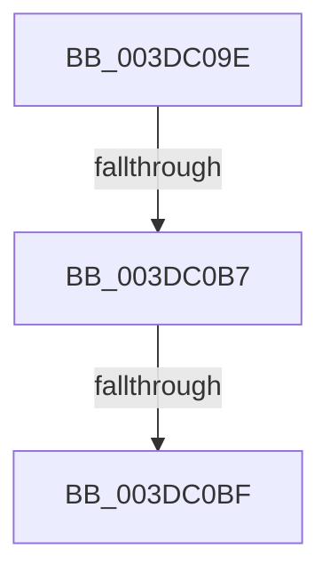

# sub_003DC09E

- RVA: `0x003DC09E`–`0x003DC0C4` (길이 `38` bytes)
- VA: `0x00000001403DC09E`
- 실행 섹션: `.text`
- PDB 이름 있음: `아니요`; PDB Function 태그: `아니요`
- unwind 정보 RVA: `0x00094140`
- 디코드: `10`개 명령, `38/38` bytes 표시
- 미해석 바이트: `0` (있으면 어셈블리에 `.byte`로 보존)

> 이 문서는 커널 이미지의 기계어와 PDB 기호를 분석해 생성했습니다. 4번과 5번은 함수 원형과 자료형을 바이너리 사용 방식에서 추정한 C 해석이며 원본 소스 복구 결과는 아닙니다.

## 1. Dependencies

- 직접 호출 지점: **0**; 고유 호출 대상: **0**
- 직접 호출자로 확인된 함수: **0**
- RIP 상대 이미지 참조: **0**

### Outgoing calls
- 직접 디코드된 call 명령이 없습니다.

### Direct callers
- 이 함수 시작 RVA로 연결되는 직접 call은 확인되지 않았습니다. 간접 호출은 완전히 역산할 수 없습니다.

### Static image references
- 디코드된 RIP-relative 메모리 참조가 없습니다.

## 2. Other-region calls and transfers

- 다른 실행 섹션으로 향하는 call: **0**
- call이 아닌 외부 분기/꼬리 이동: **3**
  - `0x003DC0B1` → [sub_003DBF36 + 0xF7](Unknown_function_003DBF36.md) (`tail-transfer`)
  - `0x003DC0B9` → [sub_003DBF36 + 0x103](Unknown_function_003DBF36.md) (`tail-transfer`)
  - `0x003DC0BF` → [sub_003DBF36 + 0xF7](Unknown_function_003DBF36.md) (`tail-transfer`)

## 3. Assembly (complete function range)

```asm
003DC09E  49 33 D8                        xor rbx, r8
003DC0A1  49 85 DB                        test r11, rbx
003DC0A4  0F 94 C1                        sete cl
003DC0A7  48 0F BA E3 20                  bt rbx, 0x20
003DC0AC  0F 93 C0                        setae al
003DC0AF  84 C8                           test al, cl
003DC0B1  0F 84 76 FF FF FF               je 0x1403dc02d
003DC0B7  84 D2                           test dl, dl
003DC0B9  0F 84 7A FF FF FF               je 0x1403dc039
003DC0BF  E9 69 FF FF FF                  jmp 0x1403dc02d
```

## 4. C-style interpretation (structured pseudocode)

```c
__int64 __fastcall sub_003DC09E(__int64 a1, unsigned __int8 a2, __int64 a3)
{
    __int64 result;
    __int64 v_rbx;

    v_rbx = (v_rbx) ^ (a3);
    a1 = (((v_r11) & (v_rbx)) == 0) ? 1 : 0;
    result = (condition_is_above_or_equal) ? 1 : 0;
}
```

## 5. (Beta) C Style

```c
int64_t sub_003DC09E(int64_t Arg1, uint8_t Arg2, int64_t Arg3)
{
    int64_t result;
    int64_t local_rbx;

    local_rbx = (local_rbx) ^ (Arg3);
    Arg1 = (((local_r11) & (local_rbx)) == 0) ? 1 : 0;
    result = (condition_is_above_or_equal) ? 1 : 0;
}
```

## 6. Execution-region graph

[열기: 2D/3D 그래프와 함수 탐색 컨트롤 패널](../../../control-panel.html?section=text&rva=0x003DC09E&view=graph)

- 2D 그래프는 위에서 아래로 흐르고, 3D 그래프는 빈 공간을 드래그해 회전합니다. Shift+드래그는 이동, 휠은 확대·축소, 함수 노드 선택은 대상 보고서 이동입니다.

### Static fallback


