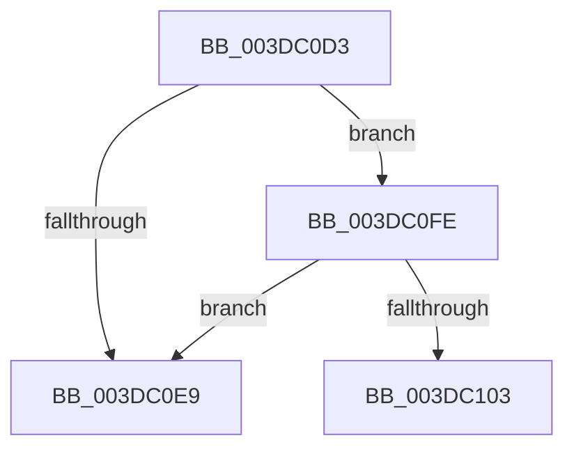

# sub_003DC0D3

- RVA: `0x003DC0D3`–`0x003DC110` (길이 `61` bytes)
- VA: `0x00000001403DC0D3`
- 실행 섹션: `.text`
- PDB 이름 있음: `아니요`; PDB Function 태그: `아니요`
- unwind 정보 RVA: `0x0009416C`
- 디코드: `18`개 명령, `61/61` bytes 표시
- 미해석 바이트: `0` (있으면 어셈블리에 `.byte`로 보존)

> 이 문서는 커널 이미지의 기계어와 PDB 기호를 분석해 생성했습니다. 4번과 5번은 함수 원형과 자료형을 바이너리 사용 방식에서 추정한 C 해석이며 원본 소스 복구 결과는 아닙니다.

## 1. Dependencies

- 직접 호출 지점: **1**; 고유 호출 대상: **1**
- 직접 호출자로 확인된 함수: **0**
- RIP 상대 이미지 참조: **0**

### Outgoing calls
- `0x003DC0D6` → [HalpDmaGetAdapterCacheAlignment](HalpDmaGetAdapterCacheAlignment_function_003DC150.md) (function, `0x003DC150`)

### Direct callers
- 이 함수 시작 RVA로 연결되는 직접 call은 확인되지 않았습니다. 간접 호출은 완전히 역산할 수 없습니다.

### Static image references
- 디코드된 RIP-relative 메모리 참조가 없습니다.

## 2. Other-region calls and transfers

- 다른 실행 섹션으로 향하는 call: **0**
- call이 아닌 외부 분기/꼬리 이동: **2**
  - `0x003DC0F9` → [sub_003DBF36 + 0xFC](Unknown_function_003DBF36.md) (`tail-transfer`)
  - `0x003DC10B` → [sub_003DBF36 + 0xE9](Unknown_function_003DBF36.md) (`tail-transfer`)

## 3. Assembly (complete function range)

```asm
003DC0D3  48 8B CE                        mov rcx, rsi
003DC0D6  E8 75 00 00 00                  call 0x1403dc150
003DC0DB  4B 8D 0C 28                     lea rcx, [r8 + r13]
003DC0DF  8D 50 FF                        lea edx, [rax - 1]
003DC0E2  8B C2                           mov eax, edx
003DC0E4  48 85 C1                        test rcx, rax
003DC0E7  74 15                           je 0x1403dc0fe
003DC0E9  8D 45 01                        lea eax, [rbp + 1]
003DC0EC  41 FF C4                        inc r12d
003DC0EF  45 84 FF                        test r15b, r15b
003DC0F2  B2 01                           mov dl, 1
003DC0F4  0F 44 C5                        cmove eax, ebp
003DC0F7  8B E8                           mov ebp, eax
003DC0F9  E9 34 FF FF FF                  jmp 0x1403dc032
003DC0FE  44 85 D2                        test edx, r10d
003DC101  75 E6                           jne 0x1403dc0e9
003DC103  0F B6 94 24 90 00 00 00         movzx edx, byte ptr [rsp + 0x90]
003DC10B  E9 0F FF FF FF                  jmp 0x1403dc01f
```

## 4. C-style interpretation (structured pseudocode)

```c
__int64 __fastcall sub_003DC0D3(__int64 a1, __int64 a2, __int64 a3, __int64 a4, __int64 a5, __int64 a6, __int64 a7, __int64 a8, __int64 a9, __int64 a10, __int64 a11, __int64 a12, __int64 a13, __int64 a14, __int64 a15, __int64 a16, __int64 a17, unsigned __int8 a18)
{
    __int64 result;
    __int64 v_r12;

    result = HalpDmaGetAdapterCacheAlignment(v_rsi, a2, a3, a4);
    if (((a3 + v_r13 * 1) & ((unsigned int)((unsigned int)(result - 1)))) == 0) goto loc_003DC0FE;
loc_003DC0E9:
    v_r12 = (unsigned int)((v_r12) + 1);
    result = v_rbp + 1;
    if ((unsigned __int8)(v_r15) == 0) { result = (unsigned int)(v_rbp); }
loc_003DC0FE:
    if (((1) & ((unsigned int)(v_r10))) != 0) goto loc_003DC0E9;
}
```

## 5. (Beta) C Style

```c
int64_t sub_003DC0D3(int64_t Arg1, int64_t Arg2, int64_t Arg3, int64_t Arg4, uint64_t Arg5, uint64_t Arg6, uint64_t Arg7, uint64_t Arg8, uint64_t Arg9, uint64_t Arg10, uint64_t Arg11, uint64_t Arg12, uint64_t Arg13, uint64_t Arg14, uint64_t Arg15, uint64_t Arg16, uint64_t Arg17, uint8_t Arg18)
{
    int64_t result;
    int64_t local_r12;

    result = HalpDmaGetAdapterCacheAlignment(local_rsi, Arg2, Arg3, Arg4);
    if (((Arg3 + local_r13 * 1) & ((uint32_t)((uint32_t)(result - 1)))) == 0) goto loc_003DC0FE;
loc_003DC0E9:
    local_r12 = (uint32_t)((local_r12) + 1);
    result = local_rbp + 1;
    if ((uint8_t)(local_r15) == 0) { result = (uint32_t)(local_rbp); }
loc_003DC0FE:
    if (((1) & ((uint32_t)(local_r10))) != 0) goto loc_003DC0E9;
}
```

## 6. Execution-region graph

[열기: 2D/3D 그래프와 함수 탐색 컨트롤 패널](../../../control-panel.html?section=text&rva=0x003DC0D3&view=graph)

- 2D 그래프는 위에서 아래로 흐르고, 3D 그래프는 빈 공간을 드래그해 회전합니다. Shift+드래그는 이동, 휠은 확대·축소, 함수 노드 선택은 대상 보고서 이동입니다.

### Static fallback


