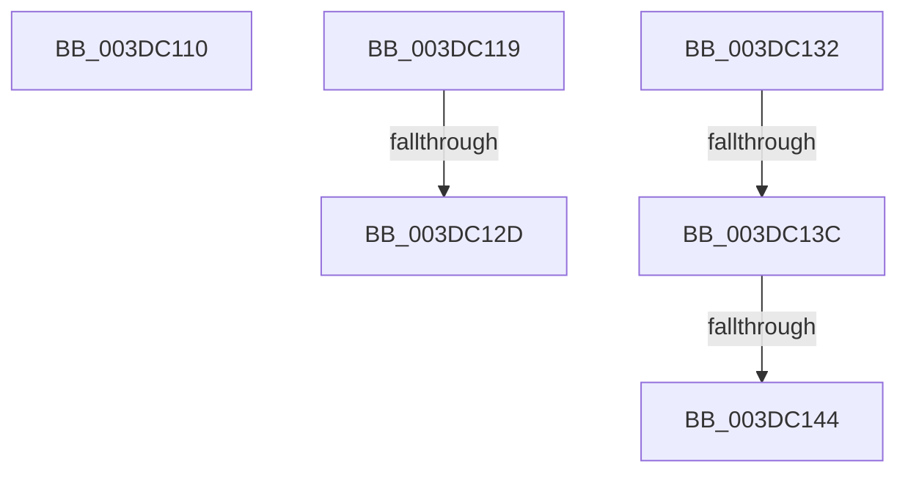

# sub_003DC110

- RVA: `0x003DC110`–`0x003DC149` (길이 `57` bytes)
- VA: `0x00000001403DC110`
- 실행 섹션: `.text`
- PDB 이름 있음: `아니요`; PDB Function 태그: `아니요`
- unwind 정보 RVA: `0x00094188`
- 디코드: `13`개 명령, `57/57` bytes 표시
- 미해석 바이트: `0` (있으면 어셈블리에 `.byte`로 보존)

> 이 문서는 커널 이미지의 기계어와 PDB 기호를 분석해 생성했습니다. 4번과 5번은 함수 원형과 자료형을 바이너리 사용 방식에서 추정한 C 해석이며 원본 소스 복구 결과는 아닙니다.

## 1. Dependencies

- 직접 호출 지점: **0**; 고유 호출 대상: **0**
- 직접 호출자로 확인된 함수: **0**
- RIP 상대 이미지 참조: **0**

### Outgoing calls
- 직접 디코드된 call 명령이 없습니다.

### Direct callers
- 이 함수 시작 RVA로 연결되는 직접 call은 확인되지 않았습니다. 간접 호출은 완전히 역산할 수 없습니다.

### Static image references
- 디코드된 RIP-relative 메모리 참조가 없습니다.

## 2. Other-region calls and transfers

- 다른 실행 섹션으로 향하는 call: **0**
- call이 아닌 외부 분기/꼬리 이동: **6**
  - `0x003DC114` → [HalGetDmaTransferInfoInternal + 0xB2](HalGetDmaTransferInfoInternal_function_003DBE60.md) (`tail-transfer`)
  - `0x003DC127` → [HalGetDmaTransferInfoInternal + 0x50](HalGetDmaTransferInfoInternal_function_003DBE60.md) (`tail-transfer`)
  - `0x003DC12D` → [HalGetDmaTransferInfoInternal + 0x39](HalGetDmaTransferInfoInternal_function_003DBE60.md) (`tail-transfer`)
  - `0x003DC136` → [sub_006EA076](../6E/Unknown_function_006EA076.md) (`tail-transfer`)
  - `0x003DC13E` → [HalGetDmaTransferInfoInternal + 0x94](HalGetDmaTransferInfoInternal_function_003DBE60.md) (`tail-transfer`)
  - `0x003DC144` → [sub_006EA076](../6E/Unknown_function_006EA076.md) (`tail-transfer`)

## 3. Assembly (complete function range)

```asm
003DC110  45 89 6F 10                     mov dword ptr [r15 + 0x10], r13d
003DC114  E9 F9 FD FF FF                  jmp 0x1403dbf12
003DC119  4D 8B 12                        mov r10, qword ptr [r10]
003DC11C  4C 2B C0                        sub r8, rax
003DC11F  4C 89 54 24 78                  mov qword ptr [rsp + 0x78], r10
003DC124  4D 85 D2                        test r10, r10
003DC127  0F 85 83 FD FF FF               jne 0x1403dbeb0
003DC12D  E9 67 FD FF FF                  jmp 0x1403dbe99
003DC132  41 83 FC 01                     cmp r12d, 1
003DC136  0F 85 3A DF 30 00               jne 0x1406ea076
003DC13C  85 ED                           test ebp, ebp
003DC13E  0F 84 B0 FD FF FF               je 0x1403dbef4
003DC144  E9 2D DF 30 00                  jmp 0x1406ea076
```

## 4. C-style interpretation (structured pseudocode)

```c
void __fastcall sub_003DC110(__int64 a1, __int64 a2, __int64 a3)
{
    unsigned __int64 v_stack_p78;

    *(unsigned int *)(v_r15 + 16) = (unsigned int)(v_r13);
}
```

## 5. (Beta) C Style

```c
void sub_003DC110(int64_t Arg1, int64_t Arg2, int64_t Arg3)
{
    uint64_t v_stack_p78;

    *(uint32_t *)(local_r15 + 0x10) = (uint32_t)(local_r13);
}
```

## 6. Execution-region graph

[열기: 2D/3D 그래프와 함수 탐색 컨트롤 패널](../../../control-panel.html?section=text&rva=0x003DC110&view=graph)

- 2D 그래프는 위에서 아래로 흐르고, 3D 그래프는 빈 공간을 드래그해 회전합니다. Shift+드래그는 이동, 휠은 확대·축소, 함수 노드 선택은 대상 보고서 이동입니다.

### Static fallback


