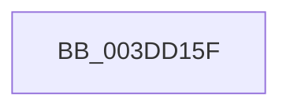

# sub_003DD15F

- RVA: `0x003DD15F`–`0x003DD194` (길이 `53` bytes)
- VA: `0x00000001403DD15F`
- 실행 섹션: `.text`
- PDB 이름 있음: `아니요`; PDB Function 태그: `아니요`
- unwind 정보 RVA: `0x000942CC`
- 디코드: `13`개 명령, `53/53` bytes 표시
- 미해석 바이트: `0` (있으면 어셈블리에 `.byte`로 보존)

> 이 문서는 커널 이미지의 기계어와 PDB 기호를 분석해 생성했습니다. 4번과 5번은 함수 원형과 자료형을 바이너리 사용 방식에서 추정한 C 해석이며 원본 소스 복구 결과는 아닙니다.

## 1. Dependencies

- 직접 호출 지점: **1**; 고유 호출 대상: **1**
- 직접 호출자로 확인된 함수: **0**
- RIP 상대 이미지 참조: **0**

### Outgoing calls
- `0x003DD187` → [HalpCalculateScatterGatherListSize](HalpCalculateScatterGatherListSize_function_003DD6F0.md) (function, `0x003DD6F0`)

### Direct callers
- 이 함수 시작 RVA로 연결되는 직접 call은 확인되지 않았습니다. 간접 호출은 완전히 역산할 수 없습니다.

### Static image references
- 디코드된 RIP-relative 메모리 참조가 없습니다.

## 2. Other-region calls and transfers

- 다른 실행 섹션으로 향하는 call: **0**
- call이 아닌 외부 분기/꼬리 이동: **1**
  - `0x003DD18E` → [sub_003DD34F](Unknown_function_003DD34F.md) (`tail-transfer`)

## 3. Assembly (complete function range)

```asm
003DD15F  49 89 7B D0                     mov qword ptr [r11 - 0x30], rdi
003DD163  8B BC 24 B0 00 00 00            mov edi, dword ptr [rsp + 0xb0]
003DD16A  4C 8B C6                        mov r8, rsi
003DD16D  49 89 43 A8                     mov qword ptr [r11 - 0x58], rax
003DD171  44 8B CF                        mov r9d, edi
003DD174  49 8D 43 C0                     lea rax, [r11 - 0x40]
003DD178  49 8B D5                        mov rdx, r13
003DD17B  49 89 43 A0                     mov qword ptr [r11 - 0x60], rax
003DD17F  49 8D 43 18                     lea rax, [r11 + 0x18]
003DD183  49 89 43 98                     mov qword ptr [r11 - 0x68], rax
003DD187  E8 64 05 00 00                  call 0x1403dd6f0
003DD18C  85 C0                           test eax, eax
003DD18E  0F 88 BB 01 00 00               js 0x1403dd34f
```

## 4. C-style interpretation (structured pseudocode)

```c
__int64 __fastcall sub_003DD15F(__int64 a1, __int64 a2, __int64 a3, __int64 a4, __int64 a5, __int64 a6, __int64 a7, __int64 a8, __int64 a9, __int64 a10, __int64 a11, __int64 a12, __int64 a13, __int64 a14, __int64 a15, __int64 a16, __int64 a17, __int64 a18, __int64 a19, __int64 a20, __int64 a21, unsigned int a22)
{
    __int64 result;

    *(unsigned __int64 *)(v_r11 - 48) = v_rdi;
    *(unsigned __int64 *)(v_r11 - 88) = result;
    *(unsigned __int64 *)(v_r11 - 96) = v_r11 - 64;
    *(unsigned __int64 *)(v_r11 - 104) = v_r11 + 24;
    result = HalpCalculateScatterGatherListSize(a1, v_r13, v_rsi, (unsigned int)((unsigned int)((unsigned int)(a22))));
}
```

## 5. (Beta) C Style

```c
int64_t sub_003DD15F(int64_t Arg1, int64_t Arg2, int64_t Arg3, int64_t Arg4, uint64_t Arg5, uint64_t Arg6, uint64_t Arg7, uint64_t Arg8, uint64_t Arg9, uint64_t Arg10, uint64_t Arg11, uint64_t Arg12, uint64_t Arg13, uint64_t Arg14, uint64_t Arg15, uint64_t Arg16, uint64_t Arg17, uint64_t Arg18, uint64_t Arg19, uint64_t Arg20, uint64_t Arg21, uint32_t Arg22)
{
    int64_t result;

    *(uint64_t *)(local_r11 - 0x30) = local_rdi;
    *(uint64_t *)(local_r11 - 0x58) = result;
    *(uint64_t *)(local_r11 - 0x60) = local_r11 - 64;
    *(uint64_t *)(local_r11 - 0x68) = local_r11 + 24;
    result = HalpCalculateScatterGatherListSize(Arg1, local_r13, local_rsi, (uint32_t)((uint32_t)((uint32_t)(Arg22))));
}
```

## 6. Execution-region graph

[열기: 2D/3D 그래프와 함수 탐색 컨트롤 패널](../../../control-panel.html?section=text&rva=0x003DD15F&view=graph)

- 2D 그래프는 위에서 아래로 흐르고, 3D 그래프는 빈 공간을 드래그해 회전합니다. Shift+드래그는 이동, 휠은 확대·축소, 함수 노드 선택은 대상 보고서 이동입니다.

### Static fallback


