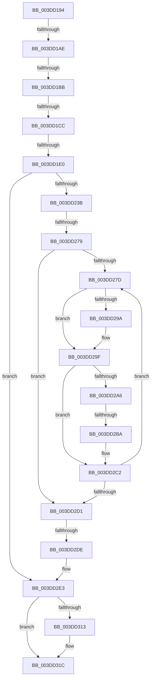

# sub_003DD194

- RVA: `0x003DD194`–`0x003DD34F` (길이 `443` bytes)
- VA: `0x00000001403DD194`
- 실행 섹션: `.text`
- PDB 이름 있음: `아니요`; PDB Function 태그: `아니요`
- unwind 정보 RVA: `0x000942E0`
- 디코드: `103`개 명령, `443/443` bytes 표시
- 미해석 바이트: `0` (있으면 어셈블리에 `.byte`로 보존)

> 이 문서는 커널 이미지의 기계어와 PDB 기호를 분석해 생성했습니다. 4번과 5번은 함수 원형과 자료형을 바이너리 사용 방식에서 추정한 C 해석이며 원본 소스 복구 결과는 아닙니다.

## 1. Dependencies

- 직접 호출 지점: **1**; 고유 호출 대상: **1**
- 직접 호출자로 확인된 함수: **0**
- RIP 상대 이미지 참조: **0**

### Outgoing calls
- `0x003DD33B` → [guard_dispatch_icall](../6B/guard_dispatch_icall_function_006BAAD0.md) (function, `0x006BAAD0`)

### Direct callers
- 이 함수 시작 RVA로 연결되는 직접 call은 확인되지 않았습니다. 간접 호출은 완전히 역산할 수 없습니다.

### Static image references
- 디코드된 RIP-relative 메모리 참조가 없습니다.

## 2. Other-region calls and transfers

- 다른 실행 섹션으로 향하는 call: **0**
- call이 아닌 외부 분기/꼬리 이동: **7**
  - `0x003DD1A8` → [sub_003DD362 + 0x44](Unknown_function_003DD362.md) (`tail-transfer`)
  - `0x003DD1B5` → [sub_003DD598](Unknown_function_003DD598.md) (`tail-transfer`)
  - `0x003DD1C6` → [sub_003DD362 + 0x1CC](Unknown_function_003DD362.md) (`tail-transfer`)
  - `0x003DD1DA` → [sub_003DD362 + 0x1C2](Unknown_function_003DD362.md) (`tail-transfer`)
  - `0x003DD273` → [sub_003DD598 + 0x2B](Unknown_function_003DD598.md) (`tail-transfer`)
  - `0x003DD2B4` → [sub_003DD362](Unknown_function_003DD362.md) (`tail-transfer`)
  - `0x003DD2D8` → [sub_003DD362 + 0x27](Unknown_function_003DD362.md) (`tail-transfer`)

## 3. Assembly (complete function range)

```asm
003DD194  48 89 9C 24 90 00 00 00         mov qword ptr [rsp + 0x90], rbx
003DD19C  4C 89 64 24 50                  mov qword ptr [rsp + 0x50], r12
003DD1A1  45 38 B7 B8 01 00 00            cmp byte ptr [r15 + 0x1b8], r14b
003DD1A8  0F 85 F8 01 00 00               jne 0x1403dd3a6
003DD1AE  45 38 B7 BD 01 00 00            cmp byte ptr [r15 + 0x1bd], r14b
003DD1B5  0F 84 DD 03 00 00               je 0x1403dd598
003DD1BB  48 8B 8C 24 D0 00 00 00         mov rcx, qword ptr [rsp + 0xd0]
003DD1C3  48 85 C9                        test rcx, rcx
003DD1C6  0F 84 62 03 00 00               je 0x1403dd52e
003DD1CC  8B 84 24 A0 00 00 00            mov eax, dword ptr [rsp + 0xa0]
003DD1D3  39 84 24 D8 00 00 00            cmp dword ptr [rsp + 0xd8], eax
003DD1DA  0F 82 44 03 00 00               jb 0x1403dd524
003DD1E0  4C 8B E1                        mov r12, rcx
003DD1E3  48 89 4C 24 48                  mov qword ptr [rsp + 0x48], rcx
003DD1E8  41 8B 4D 2C                     mov ecx, dword ptr [r13 + 0x2c]
003DD1EC  4D 8D 4C 24 10                  lea r9, [r12 + 0x10]
003DD1F1  49 03 4D 20                     add rcx, qword ptr [r13 + 0x20]
003DD1F5  48 8B C6                        mov rax, rsi
003DD1F8  8B EE                           mov ebp, esi
003DD1FA  4D 89 74 24 08                  mov qword ptr [r12 + 8], r14
003DD1FF  45 8B 45 28                     mov r8d, dword ptr [r13 + 0x28]
003DD203  81 E5 FF 0F 00 00               and ebp, 0xfff
003DD209  44 2B C6                        sub r8d, esi
003DD20C  4C 89 8C 24 A0 00 00 00         mov qword ptr [rsp + 0xa0], r9
003DD214  44 03 C1                        add r8d, ecx
003DD217  49 8D 75 30                     lea rsi, [r13 + 0x30]
003DD21B  48 81 E1 00 F0 FF FF            and rcx, 0xfffffffffffff000
003DD222  49 8B D9                        mov rbx, r9
003DD225  48 2B C1                        sub rax, rcx
003DD228  44 8B DF                        mov r11d, edi
003DD22B  48 C1 E8 0C                     shr rax, 0xc
003DD22F  48 8D 34 C6                     lea rsi, [rsi + rax*8]
003DD233  85 FF                           test edi, edi
003DD235  0F 84 A8 00 00 00               je 0x1403dd2e3
003DD23B  4D 8B E5                        mov r12, r13
003DD23E  49 8B 0C 24                     mov rcx, qword ptr [r12]
003DD242  45 3B C3                        cmp r8d, r11d
003DD245  41 8B D3                        mov edx, r11d
003DD248  41 8B FB                        mov edi, r11d
003DD24B  41 0F 46 D0                     cmovbe edx, r8d
003DD24F  41 8B C3                        mov eax, r11d
003DD252  48 85 C9                        test rcx, rcx
003DD255  45 8B DE                        mov r11d, r14d
003DD258  0F 45 FA                        cmovne edi, edx
003DD25B  2B C2                           sub eax, edx
003DD25D  48 85 C9                        test rcx, rcx
003DD260  44 0F 45 D8                     cmovne r11d, eax
003DD264  44 89 9C 24 B0 00 00 00         mov dword ptr [rsp + 0xb0], r11d
003DD26C  45 38 B7 BD 01 00 00            cmp byte ptr [r15 + 0x1bd], r14b
003DD273  0F 84 4A 03 00 00               je 0x1403dd5c3
003DD279  85 FF                           test edi, edi
003DD27B  74 54                           je 0x1403dd2d1
003DD27D  4C 8B 06                        mov r8, qword ptr [rsi]
003DD280  BA 00 10 00 00                  mov edx, 0x1000
003DD285  49 C1 E0 0C                     shl r8, 0xc
003DD289  2B D5                           sub edx, ebp
003DD28B  8B C5                           mov eax, ebp
003DD28D  4C 03 C0                        add r8, rax
003DD290  89 53 08                        mov dword ptr [rbx + 8], edx
003DD293  4C 89 03                        mov qword ptr [rbx], r8
003DD296  3B D7                           cmp edx, edi
003DD298  76 05                           jbe 0x1403dd29f
003DD29A  89 7B 08                        mov dword ptr [rbx + 8], edi
003DD29D  8B D7                           mov edx, edi
003DD29F  2B FA                           sub edi, edx
003DD2A1  49 3B D9                        cmp rbx, r9
003DD2A4  74 1C                           je 0x1403dd2c2
003DD2A6  44 8B 4B F0                     mov r9d, dword ptr [rbx - 0x10]
003DD2AA  41 8B C1                        mov eax, r9d
003DD2AD  48 03 43 E8                     add rax, qword ptr [rbx - 0x18]
003DD2B1  4C 3B C0                        cmp r8, rax
003DD2B4  0F 84 A8 00 00 00               je 0x1403dd362
003DD2BA  4C 8B 8C 24 A0 00 00 00         mov r9, qword ptr [rsp + 0xa0]
003DD2C2  48 83 C3 18                     add rbx, 0x18
003DD2C6  48 83 C6 08                     add rsi, 8
003DD2CA  41 8B EE                        mov ebp, r14d
003DD2CD  85 FF                           test edi, edi
003DD2CF  75 AC                           jne 0x1403dd27d
003DD2D1  4D 8B 24 24                     mov r12, qword ptr [r12]
003DD2D5  4D 85 E4                        test r12, r12
003DD2D8  0F 85 AB 00 00 00               jne 0x1403dd389
003DD2DE  4C 8B 64 24 48                  mov r12, qword ptr [rsp + 0x48]
003DD2E3  49 2B DC                        sub rbx, r12
003DD2E6  48 B8 AB AA AA AA AA AA AA 2A   movabs rax, 0x2aaaaaaaaaaaaaab
003DD2F0  48 83 EB 10                     sub rbx, 0x10
003DD2F4  48 F7 EB                        imul rbx
003DD2F7  48 C1 FA 02                     sar rdx, 2
003DD2FB  48 8B C2                        mov rax, rdx
003DD2FE  48 C1 E8 3F                     shr rax, 0x3f
003DD302  48 03 D0                        add rdx, rax
003DD305  41 89 14 24                     mov dword ptr [r12], edx
003DD309  4C 39 B4 24 D0 00 00 00         cmp qword ptr [rsp + 0xd0], r14
003DD311  74 09                           je 0x1403dd31c
003DD313  49 C7 44 24 08 01 00 00 00      mov qword ptr [r12 + 8], 1
003DD31C  48 8B 8C 24 98 00 00 00         mov rcx, qword ptr [rsp + 0x98]
003DD324  4D 8B C4                        mov r8, r12
003DD327  4C 8B 8C 24 C0 00 00 00         mov r9, qword ptr [rsp + 0xc0]
003DD32F  48 8B 84 24 B8 00 00 00         mov rax, qword ptr [rsp + 0xb8]
003DD337  48 8B 51 20                     mov rdx, qword ptr [rcx + 0x20]
003DD33B  E8 90 D7 2D 00                  call 0x1406baad0
003DD340  33 C0                           xor eax, eax
003DD342  48 8B 9C 24 90 00 00 00         mov rbx, qword ptr [rsp + 0x90]
003DD34A  4C 8B 64 24 50                  mov r12, qword ptr [rsp + 0x50]
```

## 4. C-style interpretation (structured pseudocode)

```c
__int64 __fastcall sub_003DD194(__int64 a1, __int64 a2, __int64 a3, __int64 a4, __int64 a5, __int64 a6, __int64 a7, __int64 a8, __int64 a9, __int64 a10, __int64 a11, __int64 a12, __int64 a13, __int64 a14, __int64 a15, __int64 a16, __int64 a17, __int64 a18, __int64 a19, unsigned int a20, __int64 a21, __int64 a22, __int64 a23, __int64 a24, __int64 a25, __int64 a26, unsigned int a27)
{
    __int64 result;
    __int64 v_r11;
    __int64 v_rbp;
    __int64 v_rbx;
    __int64 v_rdi;
    __int64 v_rsi;
    unsigned __int64 v_stack_p48;
    unsigned __int64 v_stack_p50;
    unsigned __int64 v_stack_p90;
    unsigned __int64 v_stack_pA0;
    unsigned int v_stack_pB0;

    v_stack_p90 = v_rbx;
    v_stack_p50 = v_r12;
    v_stack_p48 = a26;
    a1 = ((unsigned int)(*(unsigned int *)(v_r13 + 44))) + (*(unsigned __int64 *)(v_r13 + 32));
    *(unsigned __int64 *)(a26 + 8) = v_r14;
    v_rbp = (unsigned int)(((unsigned int)((unsigned int)(v_rsi))) & (0xFFFULL));
    a3 = (unsigned int)(((unsigned int)(*(unsigned int *)(v_r13 + 40))) - ((unsigned int)(v_rsi)));
    v_stack_pA0 = a26 + 16;
    a3 = (unsigned int)((a3) + ((unsigned int)(a1)));
    a1 = (a1) & (0xFFFFFFFFFFFFF000ULL);
    result = (v_rsi) - (a1);
    result = (result) >> (12);
    if ((unsigned int)(v_rdi) == 0) goto loc_003DD2E3;
    a2 = (unsigned int)((unsigned int)((unsigned int)((unsigned int)(v_rdi))));
    if (((unsigned int)(a3)) <= ((unsigned int)((unsigned int)((unsigned int)(v_rdi))))) { a2 = (unsigned int)(a3); }
    v_rdi = (unsigned int)((unsigned int)((unsigned int)((unsigned int)(v_rdi))));
    if (*(unsigned __int64 *)(v_r13) != 0) { v_rdi = (unsigned int)(a2); }
    result = (unsigned int)(((unsigned int)((unsigned int)((unsigned int)((unsigned int)(v_rdi))))) - ((unsigned int)(a2)));
    v_r11 = (unsigned int)((unsigned int)(v_r14));
    if (*(unsigned __int64 *)(v_r13) != 0) { v_r11 = (unsigned int)(result); }
    v_stack_pB0 = (unsigned int)(v_r11);
    if ((unsigned int)(v_rdi) == 0) goto loc_003DD2D1;
loc_003DD27D:
    a3 = (*(unsigned __int64 *)(v_r13 + 48 + result * 8)) << (12);
    a2 = (unsigned int)(((unsigned int)(0x1000ULL)) - ((unsigned int)(v_rbp)));
    a3 = (a3) + ((unsigned int)((unsigned int)(v_rbp)));
    *(unsigned int *)(a26 + 16 + 8) = (unsigned int)(a2);
    *(unsigned __int64 *)(a26 + 16) = a3;
    if (((unsigned int)(a2)) >= = ((unsigned int)(v_rdi))) {
        *(unsigned int *)(a26 + 16 + 8) = (unsigned int)(v_rdi);
        a2 = (unsigned int)(v_rdi);
    }
    v_rdi = (unsigned int)((v_rdi) - ((unsigned int)(a2)));
    if ((a26 + 16) == (a26 + 16)) goto loc_003DD2C2;
    result = ((unsigned int)((unsigned int)((unsigned int)(*(unsigned int *)(a26 + 16 - 16))))) + (*(unsigned __int64 *)(a26 + 16 - 24));
loc_003DD2C2:
    v_rbx = (a26 + 16) + (24);
    v_rsi = (v_r13 + 48 + result * 8) + (8);
    if ((unsigned int)(v_rdi) != 0) goto loc_003DD27D;
loc_003DD2D1:
loc_003DD2E3:
    v_rbx = (v_rbx) - (a9);
    v_rbx = (v_rbx) - (16);
    a2 = (a2) >> (2);
    result = (a2) >> (63);
    a2 = (a2) + (result);
    *(unsigned int *)(a9) = (unsigned int)(a2);
    if (a26 != v_r14) {
        *(unsigned __int64 *)(a9 + 8) = 1;
    }
    result = guard_dispatch_icall(a19, *(unsigned __int64 *)(a19 + 32), a9, a24);
    result = 0;
    return result;
}
```

## 5. (Beta) C Style

```c
int64_t sub_003DD194(int64_t Arg1, int64_t Arg2, int64_t Arg3, int64_t Arg4, uint64_t Arg5, uint64_t Arg6, uint64_t Arg7, uint64_t Arg8, int64_t Arg9, int64_t Arg10, uint64_t Arg11, uint64_t Arg12, uint64_t Arg13, uint64_t Arg14, uint64_t Arg15, uint64_t Arg16, uint64_t Arg17, int64_t Arg18, void *Arg19, uint32_t Arg20, uint64_t Arg21, uint64_t Arg22, int64_t Arg23, int64_t Arg24, uint64_t Arg25, int64_t Arg26, uint32_t Arg27)
{
    uint8_t *arg19 = (uint8_t *)Arg19;

    int64_t result;
    int64_t local_r11;
    int64_t local_rbp;
    int64_t local_rbx;
    int64_t local_rdi;
    int64_t local_rsi;
    uint64_t v_stack_p48;
    uint64_t v_stack_p50;
    uint64_t v_stack_p90;
    uint64_t v_stack_pA0;
    uint32_t v_stack_pB0;

    v_stack_p90 = local_rbx;
    v_stack_p50 = local_r12;
    v_stack_p48 = Arg26;
    Arg1 = ((uint32_t)(*(uint32_t *)(local_r13 + 0x2C))) + (*(uint64_t *)(local_r13 + 0x20));
    *(uint64_t *)(Arg26 + 0x8) = local_r14;
    local_rbp = (uint32_t)(((uint32_t)((uint32_t)(local_rsi))) & (0xFFFULL));
    Arg3 = (uint32_t)(((uint32_t)(*(uint32_t *)(local_r13 + 0x28))) - ((uint32_t)(local_rsi)));
    v_stack_pA0 = Arg26 + 16;
    Arg3 = (uint32_t)((Arg3) + ((uint32_t)(Arg1)));
    Arg1 = (Arg1) & (0xFFFFFFFFFFFFF000ULL);
    result = (local_rsi) - (Arg1);
    result = (result) >> (12);
    if ((uint32_t)(local_rdi) == 0) goto loc_003DD2E3;
    Arg2 = (uint32_t)((uint32_t)((uint32_t)((uint32_t)(local_rdi))));
    if (((uint32_t)(Arg3)) <= ((uint32_t)((uint32_t)((uint32_t)(local_rdi))))) { Arg2 = (uint32_t)(Arg3); }
    local_rdi = (uint32_t)((uint32_t)((uint32_t)((uint32_t)(local_rdi))));
    if (*(uint64_t *)(local_r13) != 0) { local_rdi = (uint32_t)(Arg2); }
    result = (uint32_t)(((uint32_t)((uint32_t)((uint32_t)((uint32_t)(local_rdi))))) - ((uint32_t)(Arg2)));
    local_r11 = (uint32_t)((uint32_t)(local_r14));
    if (*(uint64_t *)(local_r13) != 0) { local_r11 = (uint32_t)(result); }
    v_stack_pB0 = (uint32_t)(local_r11);
    if ((uint32_t)(local_rdi) == 0) goto loc_003DD2D1;
loc_003DD27D:
    Arg3 = (*(uint64_t *)(local_r13 + 0x30 + result * 8)) << (12);
    Arg2 = (uint32_t)(((uint32_t)(0x1000ULL)) - ((uint32_t)(local_rbp)));
    Arg3 = (Arg3) + ((uint32_t)((uint32_t)(local_rbp)));
    *(uint32_t *)(Arg26 + 0x10 + 0x8) = (uint32_t)(Arg2);
    *(uint64_t *)(Arg26 + 0x10) = Arg3;
    if (((uint32_t)(Arg2)) >= = ((uint32_t)(local_rdi))) {
        *(uint32_t *)(Arg26 + 0x10 + 0x8) = (uint32_t)(local_rdi);
        Arg2 = (uint32_t)(local_rdi);
    }
    local_rdi = (uint32_t)((local_rdi) - ((uint32_t)(Arg2)));
    if ((Arg26 + 16) == (Arg26 + 16)) goto loc_003DD2C2;
    result = ((uint32_t)((uint32_t)((uint32_t)(*(uint32_t *)(Arg26 + 0x10 - 0x10))))) + (*(uint64_t *)(Arg26 + 0x10 - 0x18));
loc_003DD2C2:
    local_rbx = (Arg26 + 16) + (24);
    local_rsi = (local_r13 + 48 + result * 8) + (8);
    if ((uint32_t)(local_rdi) != 0) goto loc_003DD27D;
loc_003DD2D1:
loc_003DD2E3:
    local_rbx = (local_rbx) - (Arg9);
    local_rbx = (local_rbx) - (16);
    Arg2 = (Arg2) >> (2);
    result = (Arg2) >> (63);
    Arg2 = (Arg2) + (result);
    *(uint32_t *)(Arg9) = (uint32_t)(Arg2);
    if (Arg26 != local_r14) {
        *(uint64_t *)(Arg9 + 0x8) = 1;
    }
    result = guard_dispatch_icall(Arg19, *(uint64_t *)(arg19 + 0x20), Arg9, Arg24);
    result = 0;
    return result;
}
```

### 관측된 메모리 오프셋

구조체 형식이 확인되지 않은 접근은 인자 기준의 오프셋으로만 기록했습니다.

| 기준 인자 | 오프셋 표현 | 폭 (bit) | 접근 |
|---|---:|---:|---|
| `Arg19` | `+ 0x20` | `64` | `R` |

## 6. Execution-region graph

[열기: 2D/3D 그래프와 함수 탐색 컨트롤 패널](../../../control-panel.html?section=text&rva=0x003DD194&view=graph)

- 2D 그래프는 위에서 아래로 흐르고, 3D 그래프는 빈 공간을 드래그해 회전합니다. Shift+드래그는 이동, 휠은 확대·축소, 함수 노드 선택은 대상 보고서 이동입니다.

### Static fallback


