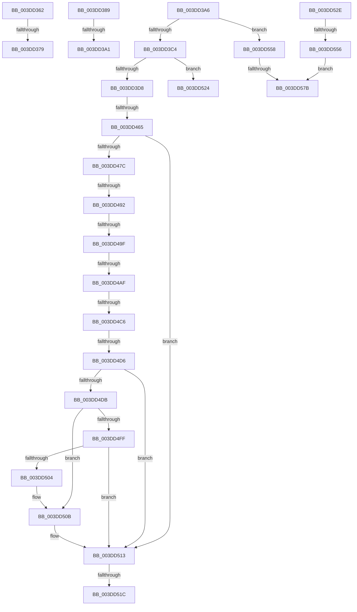

# sub_003DD362

- RVA: `0x003DD362`–`0x003DD585` (길이 `547` bytes)
- VA: `0x00000001403DD362`
- 실행 섹션: `.text`
- PDB 이름 있음: `아니요`; PDB Function 태그: `아니요`
- unwind 정보 RVA: `0x0009431C`
- 디코드: `114`개 명령, `547/547` bytes 표시
- 미해석 바이트: `0` (있으면 어셈블리에 `.byte`로 보존)

> 이 문서는 커널 이미지의 기계어와 PDB 기호를 분석해 생성했습니다. 4번과 5번은 함수 원형과 자료형을 바이너리 사용 방식에서 추정한 C 해석이며 원본 소스 복구 결과는 아닙니다.

## 1. Dependencies

- 직접 호출 지점: **6**; 고유 호출 대상: **5**
- 직접 호출자로 확인된 함수: **0**
- RIP 상대 이미지 참조: **1**

### Outgoing calls
- `0x003DD46F` → [KeInsertDeviceQueue](KeInsertDeviceQueue_function_003DD900.md) (function, `0x003DD900`)
- `0x003DD4B1` → [HalpDmaAllocateMapRegisters](HalpDmaAllocateMapRegisters_function_003DDA0C.md) (function, `0x003DDA0C`)
- `0x003DD4F5` → [HalpAllocateAdapterCallbackV2](HalpAllocateAdapterCallbackV2_function_003DDE20.md) (function, `0x003DDE20`)
- `0x003DD50E` → [IoFreeAdapterChannelV2](IoFreeAdapterChannelV2_function_003DE3B0.md) (function, `0x003DE3B0`)
- `0x003DD540` → [ExAllocatePool2](../../poolcode/B8/ExAllocatePool2_function_00B820F0.md) (function, `0x00B820F0`)
- `0x003DD56A` → [ExAllocatePool2](../../poolcode/B8/ExAllocatePool2_function_00B820F0.md) (function, `0x00B820F0`)

### Direct callers
- 이 함수 시작 RVA로 연결되는 직접 call은 확인되지 않았습니다. 간접 호출은 완전히 역산할 수 없습니다.

### Static image references
- `0x003DD444` → RVA `0x003DDE20` (`HalpAllocateAdapterCallbackV2`; read)

## 2. Other-region calls and transfers

- 다른 실행 섹션으로 향하는 call: **2**
  - `0x003DD540` → [ExAllocatePool2](../../poolcode/B8/ExAllocatePool2_function_00B820F0.md) (`.text` → `POOLCODE`)
  - `0x003DD56A` → [ExAllocatePool2](../../poolcode/B8/ExAllocatePool2_function_00B820F0.md) (`.text` → `POOLCODE`)
- call이 아닌 외부 분기/꼬리 이동: **16**
  - `0x003DD373` → [sub_003DD194 + 0x126](Unknown_function_003DD194.md) (`tail-transfer`)
  - `0x003DD384` → [sub_003DD194 + 0x126](Unknown_function_003DD194.md) (`tail-transfer`)
  - `0x003DD39B` → [sub_003DD194 + 0x14A](Unknown_function_003DD194.md) (`tail-transfer`)
  - `0x003DD3A1` → [sub_003DD194 + 0xAA](Unknown_function_003DD194.md) (`tail-transfer`)
  - `0x003DD45F` → [sub_003DD598 + 0x9B](Unknown_function_003DD598.md) (`tail-transfer`)
  - `0x003DD48C` → [sub_003DD598 + 0x76](Unknown_function_003DD598.md) (`tail-transfer`)
  - `0x003DD499` → [sub_003DD598 + 0x69](Unknown_function_003DD598.md) (`tail-transfer`)
  - `0x003DD4A9` → [sub_003DD598 + 0xC7](Unknown_function_003DD598.md) (`tail-transfer`)
  - `0x003DD4C0` → [sub_003DD598 + 0xFC](Unknown_function_003DD598.md) (`tail-transfer`)
  - `0x003DD4D0` → [sub_003DD598 + 0x116](Unknown_function_003DD598.md) (`tail-transfer`)
  - `0x003DD516` → [sub_003DD598 + 0x12B](Unknown_function_003DD598.md) (`tail-transfer`)
  - `0x003DD51F` → [sub_003DD194 + 0x1AE](Unknown_function_003DD194.md) (`tail-transfer`)
  - `0x003DD529` → [sub_003DD194 + 0x1AE](Unknown_function_003DD194.md) (`tail-transfer`)
  - `0x003DD550` → [sub_003DD194 + 0x54](Unknown_function_003DD194.md) (`tail-transfer`)
  - `0x003DD575` → [sub_003DD598 + 0x89](Unknown_function_003DD598.md) (`tail-transfer`)
  - `0x003DD580` → [sub_003DD194 + 0x1AE](Unknown_function_003DD194.md) (`tail-transfer`)

## 3. Assembly (complete function range)

```asm
003DD362  48 8B 06                        mov rax, qword ptr [rsi]
003DD365  48 8D 48 FF                     lea rcx, [rax - 1]
003DD369  48 33 C8                        xor rcx, rax
003DD36C  48 F7 C1 00 00 F0 FF            test rcx, -0x100000
003DD373  0F 85 41 FF FF FF               jne 0x1403dd2ba
003DD379  41 8D 04 11                     lea eax, [r9 + rdx]
003DD37D  89 43 F0                        mov dword ptr [rbx - 0x10], eax
003DD380  48 83 C3 E8                     add rbx, -0x18
003DD384  E9 31 FF FF FF                  jmp 0x1403dd2ba
003DD389  41 8B 6C 24 2C                  mov ebp, dword ptr [r12 + 0x2c]
003DD38E  49 8D 74 24 30                  lea rsi, [r12 + 0x30]
003DD393  45 8B 44 24 28                  mov r8d, dword ptr [r12 + 0x28]
003DD398  45 85 DB                        test r11d, r11d
003DD39B  0F 84 3D FF FF FF               je 0x1403dd2de
003DD3A1  E9 98 FE FF FF                  jmp 0x1403dd23e
003DD3A6  8B 74 24 40                     mov esi, dword ptr [rsp + 0x40]
003DD3AA  44 0F B6 A4 24 C8 00 00 00      movzx r12d, byte ptr [rsp + 0xc8]
003DD3B3  48 8B 9C 24 D0 00 00 00         mov rbx, qword ptr [rsp + 0xd0]
003DD3BB  48 85 DB                        test rbx, rbx
003DD3BE  0F 84 94 01 00 00               je 0x1403dd558
003DD3C4  8B 84 24 A0 00 00 00            mov eax, dword ptr [rsp + 0xa0]
003DD3CB  39 84 24 D8 00 00 00            cmp dword ptr [rsp + 0xd8], eax
003DD3D2  0F 82 4C 01 00 00               jb 0x1403dd524
003DD3D8  83 0B 01                        or dword ptr [rbx], 1
003DD3DB  48 8B 84 24 A8 00 00 00         mov rax, qword ptr [rsp + 0xa8]
003DD3E3  48 89 43 20                     mov qword ptr [rbx + 0x20], rax
003DD3E7  48 8B 84 24 B8 00 00 00         mov rax, qword ptr [rsp + 0xb8]
003DD3EF  48 89 43 78                     mov qword ptr [rbx + 0x78], rax
003DD3F3  48 8B 84 24 C0 00 00 00         mov rax, qword ptr [rsp + 0xc0]
003DD3FB  48 89 83 80 00 00 00            mov qword ptr [rbx + 0x80], rax
003DD402  4C 89 6B 08                     mov qword ptr [rbx + 8], r13
003DD406  89 7B 28                        mov dword ptr [rbx + 0x28], edi
003DD409  48 8D 7B 30                     lea rdi, [rbx + 0x30]
003DD40D  44 88 A3 98 00 00 00            mov byte ptr [rbx + 0x98], r12b
003DD414  4C 89 73 10                     mov qword ptr [rbx + 0x10], r14
003DD418  4C 89 BB 90 00 00 00            mov qword ptr [rbx + 0x90], r15
003DD41F  45 38 B7 B8 01 00 00            cmp byte ptr [r15 + 0x1b8], r14b
003DD426  48 89 6B 60                     mov qword ptr [rbx + 0x60], rbp
003DD42A  0F 45 74 24 48                  cmovne esi, dword ptr [rsp + 0x48]
003DD42F  45 32 E4                        xor r12b, r12b
003DD432  89 73 2C                        mov dword ptr [rbx + 0x2c], esi
003DD435  48 89 5B 50                     mov qword ptr [rbx + 0x50], rbx
003DD439  48 8B 45 20                     mov rax, qword ptr [rbp + 0x20]
003DD43D  40 32 ED                        xor bpl, bpl
003DD440  48 89 43 68                     mov qword ptr [rbx + 0x68], rax
003DD444  48 8D 05 D5 09 00 00            lea rax, [rip + 0x9d5]
003DD44B  83 67 14 FB                     and dword ptr [rdi + 0x14], 0xfffffffb
003DD44F  48 89 47 18                     mov qword ptr [rdi + 0x18], rax
003DD453  45 32 ED                        xor r13b, r13b
003DD456  89 77 28                        mov dword ptr [rdi + 0x28], esi
003DD459  44 0F 20 C0                     mov rax, cr8
003DD45D  3C 02                           cmp al, 2
003DD45F  0F 82 CE 01 00 00               jb 0x1403dd633
003DD465  49 8D 8F B8 00 00 00            lea rcx, [r15 + 0xb8]
003DD46C  48 8B D7                        mov rdx, rdi
003DD46F  E8 8C 04 00 00                  call 0x1403dd900
003DD474  84 C0                           test al, al
003DD476  0F 85 97 00 00 00               jne 0x1403dd513
003DD47C  41 89 B7 F8 00 00 00            mov dword ptr [r15 + 0xf8], esi
003DD483  49 89 BF 60 01 00 00            mov qword ptr [r15 + 0x160], rdi
003DD48A  85 F6                           test esi, esi
003DD48C  0F 84 7C 01 00 00               je 0x1403dd60e
003DD492  45 38 A7 B8 01 00 00            cmp byte ptr [r15 + 0x1b8], r12b
003DD499  0F 84 62 01 00 00               je 0x1403dd601
003DD49F  49 8B CF                        mov rcx, r15
003DD4A2  41 3B B7 E8 00 00 00            cmp esi, dword ptr [r15 + 0xe8]
003DD4A9  0F 87 B0 01 00 00               ja 0x1403dd65f
003DD4AF  8B D6                           mov edx, esi
003DD4B1  E8 56 05 00 00                  call 0x1403dda0c
003DD4B6  49 89 87 F0 00 00 00            mov qword ptr [r15 + 0xf0], rax
003DD4BD  48 85 C0                        test rax, rax
003DD4C0  0F 84 CE 01 00 00               je 0x1403dd694
003DD4C6  49 8B 8F B0 01 00 00            mov rcx, qword ptr [r15 + 0x1b0]
003DD4CD  48 85 C9                        test rcx, rcx
003DD4D0  0F 85 D8 01 00 00               jne 0x1403dd6ae
003DD4D6  45 84 E4                        test r12b, r12b
003DD4D9  75 38                           jne 0x1403dd513
003DD4DB  4D 8B 87 F0 00 00 00            mov r8, qword ptr [r15 + 0xf0]
003DD4E2  49 89 BF 60 01 00 00            mov qword ptr [r15 + 0x160], rdi
003DD4E9  4C 8B 4F 20                     mov r9, qword ptr [rdi + 0x20]
003DD4ED  48 8B 57 38                     mov rdx, qword ptr [rdi + 0x38]
003DD4F1  48 8B 4F 30                     mov rcx, qword ptr [rdi + 0x30]
003DD4F5  E8 26 09 00 00                  call 0x1403dde20
003DD4FA  83 F8 02                        cmp eax, 2
003DD4FD  74 0C                           je 0x1403dd50b
003DD4FF  83 F8 03                        cmp eax, 3
003DD502  75 0F                           jne 0x1403dd513
003DD504  45 89 B7 F8 00 00 00            mov dword ptr [r15 + 0xf8], r14d
003DD50B  49 8B CF                        mov rcx, r15
003DD50E  E8 9D 0E 00 00                  call 0x1403de3b0
003DD513  40 84 ED                        test bpl, bpl
003DD516  0F 85 A7 01 00 00               jne 0x1403dd6c3
003DD51C  41 8B C6                        mov eax, r14d
003DD51F  E9 1E FE FF FF                  jmp 0x1403dd342
003DD524  B8 23 00 00 C0                  mov eax, 0xc0000023
003DD529  E9 14 FE FF FF                  jmp 0x1403dd342
003DD52E  8B 94 24 A0 00 00 00            mov edx, dword ptr [rsp + 0xa0]
003DD535  B9 42 00 00 00                  mov ecx, 0x42
003DD53A  41 B8 48 61 6C 44               mov r8d, 0x446c6148
003DD540  E8 AB 4B 7A 00                  call 0x140b820f0
003DD545  48 89 44 24 48                  mov qword ptr [rsp + 0x48], rax
003DD54A  4C 8B E0                        mov r12, rax
003DD54D  48 85 C0                        test rax, rax
003DD550  0F 85 92 FC FF FF               jne 0x1403dd1e8
003DD556  EB 23                           jmp 0x1403dd57b
003DD558  8B 94 24 A0 00 00 00            mov edx, dword ptr [rsp + 0xa0]
003DD55F  B9 42 00 00 00                  mov ecx, 0x42
003DD564  41 B8 48 61 6C 44               mov r8d, 0x446c6148
003DD56A  E8 81 4B 7A 00                  call 0x140b820f0
003DD56F  48 8B D8                        mov rbx, rax
003DD572  48 85 C0                        test rax, rax
003DD575  0F 85 A6 00 00 00               jne 0x1403dd621
003DD57B  B8 9A 00 00 C0                  mov eax, 0xc000009a
003DD580  E9 BD FD FF FF                  jmp 0x1403dd342
```

## 4. C-style interpretation (structured pseudocode)

```c
__int64 __fastcall sub_003DD362(__int64 a1, __int64 a2, __int64 a3, __int64 a4)
{
    __int64 v_rbx;
    unsigned int v_stack_p40;
    unsigned int v_stack_p48;
    unsigned int v_stack_pA0;
    unsigned __int64 v_stack_pA8;
    unsigned __int64 v_stack_pB8;
    unsigned __int64 v_stack_pC0;
    unsigned __int8 v_stack_pC8;
    unsigned __int64 v_stack_pD0;
    unsigned int v_stack_pD8;

    a1 = (*(unsigned __int64 *)(v_rsi) - 1) ^ (*(unsigned __int64 *)(v_rsi));
    *(unsigned int *)(v_rbx - 16) = (unsigned int)(a4 + a2 * 1);
    v_rbx = (v_rbx) + (-24);
}
```

## 5. (Beta) C Style

```c
int64_t sub_003DD362(int64_t Arg1, int64_t Arg2, int64_t Arg3, void *Arg4)
{
    uint8_t *arg4 = (uint8_t *)Arg4;

    int64_t local_rbx;
    uint32_t v_stack_p40;
    uint32_t v_stack_p48;
    uint32_t v_stack_pA0;
    uint64_t v_stack_pA8;
    uint64_t v_stack_pB8;
    uint64_t v_stack_pC0;
    uint8_t v_stack_pC8;
    uint64_t v_stack_pD0;
    uint32_t v_stack_pD8;

    Arg1 = (*(uint64_t *)(local_rsi) - 1) ^ (*(uint64_t *)(local_rsi));
    *(uint32_t *)(local_rbx - 0x10) = (uint32_t)(Arg4 + Arg2 * 1);
    local_rbx = (local_rbx) + (-24);
}
```

### 관측된 메모리 오프셋

구조체 형식이 확인되지 않은 접근은 인자 기준의 오프셋으로만 기록했습니다.

| 기준 인자 | 오프셋 표현 | 폭 (bit) | 접근 |
|---|---:|---:|---|
| `Arg4` | `+ 0x0 + rdx*1` | `32` | `R` |

## 6. Execution-region graph

[열기: 2D/3D 그래프와 함수 탐색 컨트롤 패널](../../../control-panel.html?section=text&rva=0x003DD362&view=graph)

- 2D 그래프는 위에서 아래로 흐르고, 3D 그래프는 빈 공간을 드래그해 회전합니다. Shift+드래그는 이동, 휠은 확대·축소, 함수 노드 선택은 대상 보고서 이동입니다.

### Static fallback


