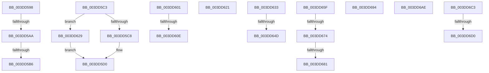

# sub_003DD598

- RVA: `0x003DD598`–`0x003DD6E3` (길이 `331` bytes)
- VA: `0x00000001403DD598`
- 실행 섹션: `.text`
- PDB 이름 있음: `아니요`; PDB Function 태그: `아니요`
- unwind 정보 RVA: `0x0009434C`
- 디코드: `69`개 명령, `331/331` bytes 표시
- 미해석 바이트: `0` (있으면 어셈블리에 `.byte`로 보존)

> 이 문서는 커널 이미지의 기계어와 PDB 기호를 분석해 생성했습니다. 4번과 5번은 함수 원형과 자료형을 바이너리 사용 방식에서 추정한 C 해석이며 원본 소스 복구 결과는 아닙니다.

## 1. Dependencies

- 직접 호출 지점: **8**; 고유 호출 대상: **7**
- 직접 호출자로 확인된 함수: **0**
- RIP 상대 이미지 참조: **2**

### Outgoing calls
- `0x003DD5E7` → [HalpDmaFlushBuffer](HalpDmaFlushBuffer_function_003DC1DC.md) (function, `0x003DC1DC`)
- `0x003DD654` → [KiRaiseIrqlProcessIrqlFlags](../4F/KiRaiseIrqlProcessIrqlFlags_function_004F56FC.md) (function, `0x004F56FC`)
- `0x003DD666` → [IoFreeAdapterChannelV2](IoFreeAdapterChannelV2_function_003DE3B0.md) (function, `0x003DE3B0`)
- `0x003DD689` → [KiLowerIrqlProcessIrqlFlags](../4F/KiLowerIrqlProcessIrqlFlags_function_004F5698.md) (function, `0x004F5698`)
- `0x003DD697` → [HalpDmaQueueAdapter](../4E/HalpDmaQueueAdapter_function_004E2B3C.md) (function, `0x004E2B3C`)
- `0x003DD6A4` → [HalpQueueMapBufferWorker](../4A/HalpQueueMapBufferWorker_function_004A7B38.md) (function, `0x004A7B38`)
- `0x003DD6B9` → [guard_dispatch_icall](../6B/guard_dispatch_icall_function_006BAAD0.md) (function, `0x006BAAD0`)
- `0x003DD6D8` → [KiLowerIrqlProcessIrqlFlags](../4F/KiLowerIrqlProcessIrqlFlags_function_004F5698.md) (function, `0x004F5698`)

### Direct callers
- 이 함수 시작 RVA로 연결되는 직접 call은 확인되지 않았습니다. 간접 호출은 완전히 역산할 수 없습니다.

### Static image references
- `0x003DD640` → RVA `0x00FC6D20` (`ALMOSTRO`; read)
- `0x003DD6AE` → RVA `0x00FC3E58` (`.data`; read)

## 2. Other-region calls and transfers

- 다른 실행 섹션으로 향하는 call: **0**
- call이 아닌 외부 분기/꼬리 이동: **16**
  - `0x003DD5A4` → [sub_003DD194 + 0x27](Unknown_function_003DD194.md) (`tail-transfer`)
  - `0x003DD5B0` → [sub_003DD362 + 0x51](Unknown_function_003DD362.md) (`tail-transfer`)
  - `0x003DD5BE` → [sub_003DD194 + 0x27](Unknown_function_003DD194.md) (`tail-transfer`)
  - `0x003DD5FC` → [sub_003DD194 + 0xE5](Unknown_function_003DD194.md) (`tail-transfer`)
  - `0x003DD608` → [sub_003DD362 + 0x13D](Unknown_function_003DD362.md) (`tail-transfer`)
  - `0x003DD61C` → [sub_003DD362 + 0x164](Unknown_function_003DD362.md) (`tail-transfer`)
  - `0x003DD624` → [sub_003DD362 + 0x79](Unknown_function_003DD362.md) (`tail-transfer`)
  - `0x003DD647` → [sub_006EA1F8](../6E/Unknown_function_006EA1F8.md) (`tail-transfer`)
  - `0x003DD65A` → [sub_006EA1F8](../6E/Unknown_function_006EA1F8.md) (`tail-transfer`)
  - `0x003DD66E` → [sub_006EA1F8 + 0x10](../6E/Unknown_function_006EA1F8.md) (`tail-transfer`)
  - `0x003DD67B` → [sub_006EA1F8 + 0x8](../6E/Unknown_function_006EA1F8.md) (`tail-transfer`)
  - `0x003DD68F` → [sub_006EA1F8 + 0x8](../6E/Unknown_function_006EA1F8.md) (`tail-transfer`)
  - `0x003DD6A9` → [sub_003DD362 + 0x164](Unknown_function_003DD362.md) (`tail-transfer`)
  - `0x003DD6BE` → [sub_003DD362 + 0x174](Unknown_function_003DD362.md) (`tail-transfer`)
  - `0x003DD6CA` → [sub_006EA1F8 + 0x26](../6E/Unknown_function_006EA1F8.md) (`tail-transfer`)
  - `0x003DD6DE` → [sub_006EA1F8 + 0x26](../6E/Unknown_function_006EA1F8.md) (`tail-transfer`)

## 3. Assembly (complete function range)

```asm
003DD598  44 0F B6 A4 24 C8 00 00 00      movzx r12d, byte ptr [rsp + 0xc8]
003DD5A1  45 84 E4                        test r12b, r12b
003DD5A4  0F 85 11 FC FF FF               jne 0x1403dd1bb
003DD5AA  8B 74 24 40                     mov esi, dword ptr [rsp + 0x40]
003DD5AE  85 F6                           test esi, esi
003DD5B0  0F 85 FD FD FF FF               jne 0x1403dd3b3
003DD5B6  48 8B B4 24 A8 00 00 00         mov rsi, qword ptr [rsp + 0xa8]
003DD5BE  E9 F8 FB FF FF                  jmp 0x1403dd1bb
003DD5C3  4D 3B E5                        cmp r12, r13
003DD5C6  74 61                           je 0x1403dd629
003DD5C8  44 8B C5                        mov r8d, ebp
003DD5CB  4D 03 44 24 20                  add r8, qword ptr [r12 + 0x20]
003DD5D0  0F B6 84 24 C8 00 00 00         movzx eax, byte ptr [rsp + 0xc8]
003DD5D8  44 8B CF                        mov r9d, edi
003DD5DB  44 88 74 24 28                  mov byte ptr [rsp + 0x28], r14b
003DD5E0  49 8B D4                        mov rdx, r12
003DD5E3  88 44 24 20                     mov byte ptr [rsp + 0x20], al
003DD5E7  E8 F0 EB FF FF                  call 0x1403dc1dc
003DD5EC  4C 8B 8C 24 A0 00 00 00         mov r9, qword ptr [rsp + 0xa0]
003DD5F4  44 8B 9C 24 B0 00 00 00         mov r11d, dword ptr [rsp + 0xb0]
003DD5FC  E9 78 FC FF FF                  jmp 0x1403dd279
003DD601  45 38 A7 BD 01 00 00            cmp byte ptr [r15 + 0x1bd], r12b
003DD608  0F 84 91 FE FF FF               je 0x1403dd49f
003DD60E  4D 89 B7 F0 00 00 00            mov qword ptr [r15 + 0xf0], r14
003DD615  45 89 B7 F8 00 00 00            mov dword ptr [r15 + 0xf8], r14d
003DD61C  E9 A5 FE FF FF                  jmp 0x1403dd4c6
003DD621  44 89 30                        mov dword ptr [rax], r14d
003DD624  E9 B2 FD FF FF                  jmp 0x1403dd3db
003DD629  4C 8B 84 24 A8 00 00 00         mov r8, qword ptr [rsp + 0xa8]
003DD631  EB 9D                           jmp 0x1403dd5d0
003DD633  45 0F 20 C5                     mov r13, cr8
003DD637  B8 02 00 00 00                  mov eax, 2
003DD63C  44 0F 22 C0                     mov cr8, rax
003DD640  44 39 35 D9 96 BE 00            cmp dword ptr [rip + 0xbe96d9], r14d
003DD647  0F 84 AB CB 30 00               je 0x1406ea1f8
003DD64D  0F B6 D0                        movzx edx, al
003DD650  41 0F B6 CD                     movzx ecx, r13b
003DD654  E8 A3 80 11 00                  call 0x1404f56fc
003DD659  90                              nop
003DD65A  E9 99 CB 30 00                  jmp 0x1406ea1f8
003DD65F  45 89 B7 F8 00 00 00            mov dword ptr [r15 + 0xf8], r14d
003DD666  E8 45 0D 00 00                  call 0x1403de3b0
003DD66B  40 84 ED                        test bpl, bpl
003DD66E  0F 84 94 CB 30 00               je 0x1406ea208
003DD674  44 39 35 A5 96 BE 00            cmp dword ptr [rip + 0xbe96a5], r14d
003DD67B  0F 84 7F CB 30 00               je 0x1406ea200
003DD681  44 0F 20 C1                     mov rcx, cr8
003DD685  41 0F B6 D5                     movzx edx, r13b
003DD689  E8 0A 80 11 00                  call 0x1404f5698
003DD68E  90                              nop
003DD68F  E9 6C CB 30 00                  jmp 0x1406ea200
003DD694  49 8B CF                        mov rcx, r15
003DD697  E8 A0 54 10 00                  call 0x1404e2b3c
003DD69C  8B D6                           mov edx, esi
003DD69E  49 8B CF                        mov rcx, r15
003DD6A1  41 B4 01                        mov r12b, 1
003DD6A4  E8 8F A4 0C 00                  call 0x1404a7b38
003DD6A9  E9 18 FE FF FF                  jmp 0x1403dd4c6
003DD6AE  48 8B 05 A3 67 BE 00            mov rax, qword ptr [rip + 0xbe67a3]
003DD6B5  48 8B 40 20                     mov rax, qword ptr [rax + 0x20]
003DD6B9  E8 12 D4 2D 00                  call 0x1406baad0
003DD6BE  E9 13 FE FF FF                  jmp 0x1403dd4d6
003DD6C3  44 39 35 56 96 BE 00            cmp dword ptr [rip + 0xbe9656], r14d
003DD6CA  0F 84 4E CB 30 00               je 0x1406ea21e
003DD6D0  44 0F 20 C1                     mov rcx, cr8
003DD6D4  41 0F B6 D5                     movzx edx, r13b
003DD6D8  E8 BB 7F 11 00                  call 0x1404f5698
003DD6DD  90                              nop
003DD6DE  E9 3B CB 30 00                  jmp 0x1406ea21e
```

## 4. C-style interpretation (structured pseudocode)

```c
__int64 __fastcall sub_003DD598(__int64 a1, __int64 a2, __int64 a3, __int64 a4, __int64 a5, __int64 a6, __int64 a7, unsigned int a8, __int64 a9, __int64 a10, __int64 a11, __int64 a12, __int64 a13, __int64 a14, __int64 a15, __int64 a16, __int64 a17, __int64 a18, __int64 a19, __int64 a20, __int64 a21, __int64 a22, __int64 a23, __int64 a24, unsigned __int8 a25)
{
    unsigned __int8 v_stack_p20;
    unsigned __int8 v_stack_p28;
    unsigned __int64 v_stack_pA0;
    unsigned __int64 v_stack_pA8;
    unsigned int v_stack_pB0;
    unsigned __int8 v_stack_pC8;
}
```

## 5. (Beta) C Style

```c
int64_t sub_003DD598(int64_t Arg1, int64_t Arg2, int64_t Arg3, int64_t Arg4, uint64_t Arg5, uint64_t Arg6, uint64_t Arg7, uint32_t Arg8, uint64_t Arg9, uint64_t Arg10, uint64_t Arg11, uint64_t Arg12, uint64_t Arg13, uint64_t Arg14, uint64_t Arg15, uint64_t Arg16, uint64_t Arg17, uint64_t Arg18, uint64_t Arg19, uint64_t Arg20, int64_t Arg21, uint64_t Arg22, uint64_t Arg23, uint64_t Arg24, uint8_t Arg25)
{
    uint8_t v_stack_p20;
    uint8_t v_stack_p28;
    uint64_t v_stack_pA0;
    uint64_t v_stack_pA8;
    uint32_t v_stack_pB0;
    uint8_t v_stack_pC8;
}
```

## 6. Execution-region graph

[열기: 2D/3D 그래프와 함수 탐색 컨트롤 패널](../../../control-panel.html?section=text&rva=0x003DD598&view=graph)

- 2D 그래프는 위에서 아래로 흐르고, 3D 그래프는 빈 공간을 드래그해 회전합니다. Shift+드래그는 이동, 휠은 확대·축소, 함수 노드 선택은 대상 보고서 이동입니다.

### Static fallback


