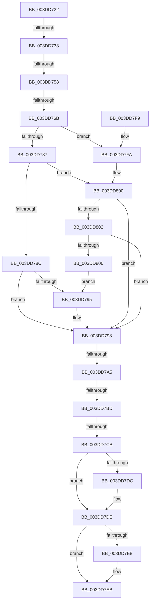

# sub_003DD722

- RVA: `0x003DD722`–`0x003DD808` (길이 `230` bytes)
- VA: `0x00000001403DD722`
- 실행 섹션: `.text`
- PDB 이름 있음: `아니요`; PDB Function 태그: `아니요`
- unwind 정보 RVA: `0x00094390`
- 디코드: `64`개 명령, `230/230` bytes 표시
- 미해석 바이트: `0` (있으면 어셈블리에 `.byte`로 보존)

> 이 문서는 커널 이미지의 기계어와 PDB 기호를 분석해 생성했습니다. 4번과 5번은 함수 원형과 자료형을 바이너리 사용 방식에서 추정한 C 해석이며 원본 소스 복구 결과는 아닙니다.

## 1. Dependencies

- 직접 호출 지점: **0**; 고유 호출 대상: **0**
- 직접 호출자로 확인된 함수: **0**
- RIP 상대 이미지 참조: **0**

### Outgoing calls
- 직접 디코드된 call 명령이 없습니다.

### Direct callers
- 이 함수 시작 RVA로 연결되는 직접 call은 확인되지 않았습니다. 간접 호출은 완전히 역산할 수 없습니다.

### Static image references
- 디코드된 RIP-relative 메모리 참조가 없습니다.

## 2. Other-region calls and transfers

- 다른 실행 섹션으로 향하는 call: **0**
- call이 아닌 외부 분기/꼬리 이동: **6**
  - `0x003DD72D` → [sub_003DD86B + 0x36](Unknown_function_003DD86B.md) (`tail-transfer`)
  - `0x003DD752` → [sub_003DD808](Unknown_function_003DD808.md) (`tail-transfer`)
  - `0x003DD765` → [sub_003DD86B](Unknown_function_003DD86B.md) (`tail-transfer`)
  - `0x003DD79F` → [sub_003DD86B + 0x24](Unknown_function_003DD86B.md) (`tail-transfer`)
  - `0x003DD7B7` → [sub_003DD86B + 0x12](Unknown_function_003DD86B.md) (`tail-transfer`)
  - `0x003DD7C5` → [sub_003DD86B + 0x12](Unknown_function_003DD86B.md) (`tail-transfer`)

## 3. Assembly (complete function range)

```asm
003DD722  48 89 7C 24 18                  mov qword ptr [rsp + 0x18], rdi
003DD727  45 8B C8                        mov r9d, r8d
003DD72A  48 85 D2                        test rdx, rdx
003DD72D  0F 84 6E 01 00 00               je 0x1403dd8a1
003DD733  44 8B 42 2C                     mov r8d, dword ptr [rdx + 0x2c]
003DD737  41 8B C3                        mov eax, r11d
003DD73A  44 03 42 28                     add r8d, dword ptr [rdx + 0x28]
003DD73E  44 03 42 20                     add r8d, dword ptr [rdx + 0x20]
003DD742  45 2B C1                        sub r8d, r9d
003DD745  41 81 E1 FF 0F 00 00            and r9d, 0xfff
003DD74C  41 8B F8                        mov edi, r8d
003DD74F  44 3B C6                        cmp r8d, esi
003DD752  0F 82 B0 00 00 00               jb 0x1403dd808
003DD758  41 8D 14 31                     lea edx, [r9 + rsi]
003DD75C  41 8D 88 00 10 00 00            lea ecx, [r8 + 0x1000]
003DD763  3B CA                           cmp ecx, edx
003DD765  0F 82 00 01 00 00               jb 0x1403dd86b
003DD76B  41 8B D1                        mov edx, r9d
003DD76E  41 2B D0                        sub edx, r8d
003DD771  03 D7                           add edx, edi
003DD773  03 D6                           add edx, esi
003DD775  8D 8A FF 0F 00 00               lea ecx, [rdx + 0xfff]
003DD77B  C1 E9 0C                        shr ecx, 0xc
003DD77E  03 C1                           add eax, ecx
003DD780  FF CB                           dec ebx
003DD782  41 85 D9                        test r9d, ebx
003DD785  75 73                           jne 0x1403dd7fa
003DD787  83 F9 01                        cmp ecx, 1
003DD78A  75 74                           jne 0x1403dd800
003DD78C  41 2B F8                        sub edi, r8d
003DD78F  03 FE                           add edi, esi
003DD791  85 FB                           test ebx, edi
003DD793  74 03                           je 0x1403dd798
003DD795  41 FF C3                        inc r11d
003DD798  41 3B 82 E8 00 00 00            cmp eax, dword ptr [r10 + 0xe8]
003DD79F  0F 87 EA 00 00 00               ja 0x1403dd88f
003DD7A5  41 80 BA B8 01 00 00 00         cmp byte ptr [r10 + 0x1b8], 0
003DD7AD  8D 0C 40                        lea ecx, [rax + rax*2]
003DD7B0  8D 14 CD 10 00 00 00            lea edx, [rcx*8 + 0x10]
003DD7B7  0F 85 C0 00 00 00               jne 0x1403dd87d
003DD7BD  41 80 BA BD 01 00 00 00         cmp byte ptr [r10 + 0x1bd], 0
003DD7C5  0F 84 B2 00 00 00               je 0x1403dd87d
003DD7CB  48 8B 4C 24 30                  mov rcx, qword ptr [rsp + 0x30]
003DD7D0  89 11                           mov dword ptr [rcx], edx
003DD7D2  48 8B 4C 24 38                  mov rcx, qword ptr [rsp + 0x38]
003DD7D7  48 85 C9                        test rcx, rcx
003DD7DA  74 02                           je 0x1403dd7de
003DD7DC  89 01                           mov dword ptr [rcx], eax
003DD7DE  48 8B 44 24 40                  mov rax, qword ptr [rsp + 0x40]
003DD7E3  48 85 C0                        test rax, rax
003DD7E6  74 03                           je 0x1403dd7eb
003DD7E8  44 89 18                        mov dword ptr [rax], r11d
003DD7EB  33 C0                           xor eax, eax
003DD7ED  48 8B 7C 24 18                  mov rdi, qword ptr [rsp + 0x18]
003DD7F2  48 8B 5C 24 28                  mov rbx, qword ptr [rsp + 0x28]
003DD7F7  5E                              pop rsi
003DD7F8  C3                              ret
003DD7F9  CC                              int3
003DD7FA  41 FF C3                        inc r11d
003DD7FD  83 F9 01                        cmp ecx, 1
003DD800  76 96                           jbe 0x1403dd798
003DD802  85 DA                           test edx, ebx
003DD804  74 92                           je 0x1403dd798
003DD806  EB 8D                           jmp 0x1403dd795
```

## 4. C-style interpretation (structured pseudocode)

```c
__int64 __fastcall sub_003DD722(__int64 a1, __int64 a2, int a3, __int64 a4, __int64 a5, __int64 a6, __int64 a7, __int64 a8)
{
    __int64 result;
    __int64 v_r11;
    __int64 v_rbx;
    __int64 v_rdi;
    unsigned __int64 v_stack_p18;

    v_stack_p18 = v_rdi;
    a3 = (unsigned int)(((unsigned int)(*(unsigned int *)(a2 + 44))) + (*(unsigned int *)(a2 + 40)));
    a3 = (unsigned int)((a3) + (*(unsigned int *)(a2 + 32)));
    a3 = (unsigned int)((a3) - ((unsigned int)((unsigned int)(a3))));
    a4 = (unsigned int)(((unsigned int)(a3)) & (0xFFFULL));
    a2 = (unsigned int)(((unsigned int)((unsigned int)(a4))) - (a3));
    a2 = (unsigned int)((a2) + ((unsigned int)((unsigned int)(a3))));
    a2 = (unsigned int)((a2) + ((unsigned int)(v_rsi)));
    a1 = (unsigned int)((a2 + 4095) >> (12));
    result = (unsigned int)(((unsigned int)((unsigned int)(v_r11))) + ((unsigned int)(a1)));
    v_rbx = (unsigned int)((v_rbx) - 1);
    if ((((unsigned int)(a4)) & ((unsigned int)(v_rbx))) != 0) goto loc_003DD7FA;
    if (((unsigned int)(a1)) != 1) goto loc_003DD800;
    v_rdi = (unsigned int)(((unsigned int)(a3)) - (a3));
    v_rdi = (unsigned int)((v_rdi) + ((unsigned int)(v_rsi)));
    if ((((unsigned int)(v_rbx)) & ((unsigned int)(v_rdi))) != 0) {
        v_r11 = (unsigned int)((v_r11) + 1);
    }
    *(unsigned int *)(a6) = (unsigned int)(result + result * 2 * 8 + 16);
    if (a7 != 0) {
        *(unsigned int *)(a7) = (unsigned int)(result);
    }
    if (a8 != 0) {
        *(unsigned int *)(a8) = (unsigned int)(v_r11);
    }
    result = 0;
    return result;
loc_003DD7FA:
    v_r11 = (unsigned int)((v_r11) + 1);
loc_003DD800:
    if (((unsigned int)(a7)) <= 1) goto loc_003DD798;
    if ((((unsigned int)(result + result * 2 * 8 + 16)) & ((unsigned int)(a5))) == 0) goto loc_003DD798;
    goto loc_003DD795;
}
```

## 5. (Beta) C Style

```c
int64_t sub_003DD722(int64_t Arg1, int64_t Arg2, void *Arg3, int64_t Arg4, int64_t Arg5, void *Arg6, int64_t Arg7, int64_t Arg8)
{
    uint8_t *arg3 = (uint8_t *)Arg3;
    uint8_t *arg6 = (uint8_t *)Arg6;

    int64_t result;
    int64_t local_r11;
    int64_t local_rbx;
    int64_t local_rdi;
    uint64_t v_stack_p18;

    v_stack_p18 = local_rdi;
    Arg3 = (uint32_t)(((uint32_t)(*(uint32_t *)(Arg2 + 0x2C))) + (*(uint32_t *)(Arg2 + 0x28)));
    Arg3 = (uint32_t)((Arg3) + (*(uint32_t *)(Arg2 + 0x20)));
    Arg3 = (uint32_t)((Arg3) - ((uint32_t)((uint32_t)(Arg3))));
    Arg4 = (uint32_t)(((uint32_t)(Arg3)) & (0xFFFULL));
    Arg2 = (uint32_t)(((uint32_t)((uint32_t)(Arg4))) - (Arg3));
    Arg2 = (uint32_t)((Arg2) + ((uint32_t)((uint32_t)(Arg3))));
    Arg2 = (uint32_t)((Arg2) + ((uint32_t)(local_rsi)));
    Arg1 = (uint32_t)((Arg2 + 4095) >> (12));
    result = (uint32_t)(((uint32_t)((uint32_t)(local_r11))) + ((uint32_t)(Arg1)));
    local_rbx = (uint32_t)((local_rbx) - 1);
    if ((((uint32_t)(Arg4)) & ((uint32_t)(local_rbx))) != 0) goto loc_003DD7FA;
    if (((uint32_t)(Arg1)) != 1) goto loc_003DD800;
    local_rdi = (uint32_t)(((uint32_t)(Arg3)) - (Arg3));
    local_rdi = (uint32_t)((local_rdi) + ((uint32_t)(local_rsi)));
    if ((((uint32_t)(local_rbx)) & ((uint32_t)(local_rdi))) != 0) {
        local_r11 = (uint32_t)((local_r11) + 1);
    }
    *(uint32_t *)(arg6) = (uint32_t)(result + result * 2 * 8 + 16);
    if (Arg7 != 0) {
        *(uint32_t *)(Arg7) = (uint32_t)(result);
    }
    if (Arg8 != 0) {
        *(uint32_t *)(Arg8) = (uint32_t)(local_r11);
    }
    result = 0;
    return result;
loc_003DD7FA:
    local_r11 = (uint32_t)((local_r11) + 1);
loc_003DD800:
    if (((uint32_t)(Arg7)) <= 1) goto loc_003DD798;
    if ((((uint32_t)(result + result * 2 * 8 + 16)) & ((uint32_t)(Arg5))) == 0) goto loc_003DD798;
    goto loc_003DD795;
}
```

### 관측된 메모리 오프셋

구조체 형식이 확인되지 않은 접근은 인자 기준의 오프셋으로만 기록했습니다.

| 기준 인자 | 오프셋 표현 | 폭 (bit) | 접근 |
|---|---:|---:|---|
| `Arg3` | `+ 0x0 + rsi*1` | `32` | `R` |
| `Arg3` | `+ 0xFFF` | `32` | `R` |
| `Arg6` | `+ 0x0` | `32` | `W` |

## 6. Execution-region graph

[열기: 2D/3D 그래프와 함수 탐색 컨트롤 패널](../../../control-panel.html?section=text&rva=0x003DD722&view=graph)

- 2D 그래프는 위에서 아래로 흐르고, 3D 그래프는 빈 공간을 드래그해 회전합니다. Shift+드래그는 이동, 휠은 확대·축소, 함수 노드 선택은 대상 보고서 이동입니다.

### Static fallback


