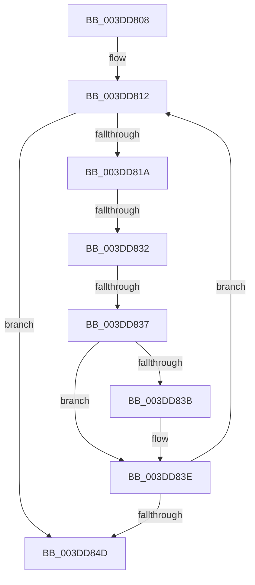

# sub_003DD808

- RVA: `0x003DD808`–`0x003DD85C` (길이 `84` bytes)
- VA: `0x00000001403DD808`
- 실행 섹션: `.text`
- PDB 이름 있음: `아니요`; PDB Function 태그: `아니요`
- unwind 정보 RVA: `0x000943A8`
- 디코드: `25`개 명령, `84/84` bytes 표시
- 미해석 바이트: `0` (있으면 어셈블리에 `.byte`로 보존)

> 이 문서는 커널 이미지의 기계어와 PDB 기호를 분석해 생성했습니다. 4번과 5번은 함수 원형과 자료형을 바이너리 사용 방식에서 추정한 C 해석이며 원본 소스 복구 결과는 아닙니다.

## 1. Dependencies

- 직접 호출 지점: **0**; 고유 호출 대상: **0**
- 직접 호출자로 확인된 함수: **0**
- RIP 상대 이미지 참조: **0**

### Outgoing calls
- 직접 디코드된 call 명령이 없습니다.

### Direct callers
- 이 함수 시작 RVA로 연결되는 직접 call은 확인되지 않았습니다. 간접 호출은 완전히 역산할 수 없습니다.

### Static image references
- 디코드된 RIP-relative 메모리 참조가 없습니다.

## 2. Other-region calls and transfers

- 다른 실행 섹션으로 향하는 call: **0**
- call이 아닌 외부 분기/꼬리 이동: **3**
  - `0x003DD830` → [sub_003DD85C](Unknown_function_003DD85C.md) (`tail-transfer`)
  - `0x003DD835` → [sub_003DD85C + 0x6](Unknown_function_003DD85C.md) (`tail-transfer`)
  - `0x003DD857` → [sub_003DD722 + 0x36](Unknown_function_003DD722.md) (`tail-transfer`)

## 3. Assembly (complete function range)

```asm
003DD808  48 89 6C 24 10                  mov qword ptr [rsp + 0x10], rbp
003DD80D  4C 89 74 24 20                  mov qword ptr [rsp + 0x20], r14
003DD812  48 8B 12                        mov rdx, qword ptr [rdx]
003DD815  48 85 D2                        test rdx, rdx
003DD818  74 33                           je 0x1403dd84d
003DD81A  45 8D 34 39                     lea r14d, [r9 + rdi]
003DD81E  41 8D 8E FF 0F 00 00            lea ecx, [r14 + 0xfff]
003DD825  C1 E9 0C                        shr ecx, 0xc
003DD828  8D 6B FF                        lea ebp, [rbx - 1]
003DD82B  03 C1                           add eax, ecx
003DD82D  41 85 E9                        test r9d, ebp
003DD830  75 2A                           jne 0x1403dd85c
003DD832  83 F9 01                        cmp ecx, 1
003DD835  75 2B                           jne 0x1403dd862
003DD837  85 EF                           test edi, ebp
003DD839  74 03                           je 0x1403dd83e
003DD83B  41 FF C3                        inc r11d
003DD83E  8B 7A 28                        mov edi, dword ptr [rdx + 0x28]
003DD841  44 03 C7                        add r8d, edi
003DD844  44 8B 4A 2C                     mov r9d, dword ptr [rdx + 0x2c]
003DD848  44 3B C6                        cmp r8d, esi
003DD84B  72 C5                           jb 0x1403dd812
003DD84D  48 8B 6C 24 10                  mov rbp, qword ptr [rsp + 0x10]
003DD852  4C 8B 74 24 20                  mov r14, qword ptr [rsp + 0x20]
003DD857  E9 FC FE FF FF                  jmp 0x1403dd758
```

## 4. C-style interpretation (structured pseudocode)

```c
__int64 __fastcall sub_003DD808(__int64 a1, __int64 a2, int a3, __int64 a4)
{
    __int64 result;
    __int64 v_r11;
    unsigned __int64 v_stack_p10;
    unsigned __int64 v_stack_p20;

    v_stack_p10 = v_rbp;
    v_stack_p20 = v_r14;
loc_003DD812:
    if (*(unsigned __int64 *)(a2) == 0) goto loc_003DD84D;
    a1 = (unsigned int)((a4 + v_rdi * 1 + 4095) >> (12));
    result = (unsigned int)((result) + ((unsigned int)(a1)));
    if ((((unsigned int)(v_rdi)) & ((unsigned int)(v_rbx - 1))) != 0) {
        v_r11 = (unsigned int)((v_r11) + 1);
    }
    a3 = (unsigned int)((a3) + ((unsigned int)((unsigned int)(*(unsigned int *)(*(unsigned __int64 *)(a2) + 40)))));
    if (a3 < ((unsigned int)(v_rsi))) goto loc_003DD812;
loc_003DD84D:
}
```

## 5. (Beta) C Style

```c
int64_t sub_003DD808(int64_t Arg1, int64_t Arg2, int32_t Arg3, int64_t Arg4)
{
    int64_t result;
    int64_t local_r11;
    uint64_t v_stack_p10;
    uint64_t v_stack_p20;

    v_stack_p10 = local_rbp;
    v_stack_p20 = local_r14;
loc_003DD812:
    if (*(uint64_t *)(Arg2) == 0) goto loc_003DD84D;
    Arg1 = (uint32_t)((Arg4 + local_rdi * 1 + 4095) >> (12));
    result = (uint32_t)((result) + ((uint32_t)(Arg1)));
    if ((((uint32_t)(local_rdi)) & ((uint32_t)(local_rbx - 1))) != 0) {
        local_r11 = (uint32_t)((local_r11) + 1);
    }
    Arg3 = (uint32_t)((Arg3) + ((uint32_t)((uint32_t)(*(uint32_t *)(*(uint64_t *)(Arg2) + 0x28)))));
    if (Arg3 < ((uint32_t)(local_rsi))) goto loc_003DD812;
loc_003DD84D:
}
```

## 6. Execution-region graph

[열기: 2D/3D 그래프와 함수 탐색 컨트롤 패널](../../../control-panel.html?section=text&rva=0x003DD808&view=graph)

- 2D 그래프는 위에서 아래로 흐르고, 3D 그래프는 빈 공간을 드래그해 회전합니다. Shift+드래그는 이동, 휠은 확대·축소, 함수 노드 선택은 대상 보고서 이동입니다.

### Static fallback


