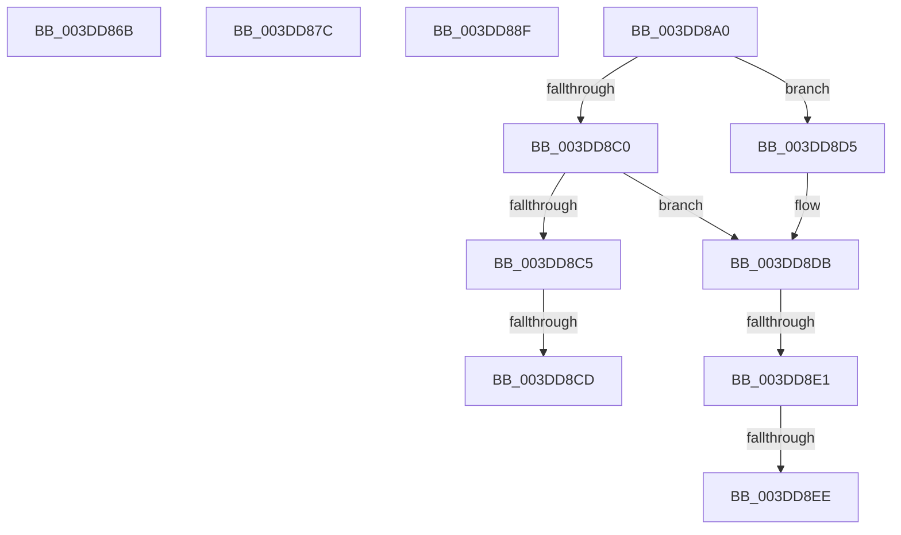

# sub_003DD86B

- RVA: `0x003DD86B`–`0x003DD8F3` (길이 `136` bytes)
- VA: `0x00000001403DD86B`
- 실행 섹션: `.text`
- PDB 이름 있음: `아니요`; PDB Function 태그: `아니요`
- unwind 정보 RVA: `0x000943D8`
- 디코드: `38`개 명령, `136/136` bytes 표시
- 미해석 바이트: `0` (있으면 어셈블리에 `.byte`로 보존)

> 이 문서는 커널 이미지의 기계어와 PDB 기호를 분석해 생성했습니다. 4번과 5번은 함수 원형과 자료형을 바이너리 사용 방식에서 추정한 C 해석이며 원본 소스 복구 결과는 아닙니다.

## 1. Dependencies

- 직접 호출 지점: **0**; 고유 호출 대상: **0**
- 직접 호출자로 확인된 함수: **0**
- RIP 상대 이미지 참조: **0**

### Outgoing calls
- 직접 디코드된 call 명령이 없습니다.

### Direct callers
- 이 함수 시작 RVA로 연결되는 직접 call은 확인되지 않았습니다. 간접 호출은 완전히 역산할 수 없습니다.

### Static image references
- 디코드된 RIP-relative 메모리 참조가 없습니다.

## 2. Other-region calls and transfers

- 다른 실행 섹션으로 향하는 call: **0**
- call이 아닌 외부 분기/꼬리 이동: **6**
  - `0x003DD88A` → [sub_003DD722 + 0xA9](Unknown_function_003DD722.md) (`tail-transfer`)
  - `0x003DD8C7` → [sub_003DD722 + 0x76](Unknown_function_003DD722.md) (`tail-transfer`)
  - `0x003DD8D0` → [sub_003DD722 + 0x76](Unknown_function_003DD722.md) (`tail-transfer`)
  - `0x003DD8DB` → [sub_003DD722 + 0x76](Unknown_function_003DD722.md) (`tail-transfer`)
  - `0x003DD8E8` → [sub_003DD722 + 0x76](Unknown_function_003DD722.md) (`tail-transfer`)
  - `0x003DD8EE` → [sub_003DD722 + 0x73](Unknown_function_003DD722.md) (`tail-transfer`)

## 3. Assembly (complete function range)

```asm
003DD86B  B8 23 00 00 C0                  mov eax, 0xc0000023
003DD870  48 8B 7C 24 18                  mov rdi, qword ptr [rsp + 0x18]
003DD875  48 8B 5C 24 28                  mov rbx, qword ptr [rsp + 0x28]
003DD87A  5E                              pop rsi
003DD87B  C3                              ret
003DD87C  CC                              int3
003DD87D  83 C2 30                        add edx, 0x30
003DD880  B9 A0 00 00 00                  mov ecx, 0xa0
003DD885  3B D1                           cmp edx, ecx
003DD887  0F 42 D1                        cmovb edx, ecx
003DD88A  E9 3C FF FF FF                  jmp 0x1403dd7cb
003DD88F  48 8B 7C 24 18                  mov rdi, qword ptr [rsp + 0x18]
003DD894  B8 9A 00 00 C0                  mov eax, 0xc000009a
003DD899  48 8B 5C 24 28                  mov rbx, qword ptr [rsp + 0x28]
003DD89E  5E                              pop rsi
003DD89F  C3                              ret
003DD8A0  CC                              int3
003DD8A1  41 81 E1 FF 0F 00 00            and r9d, 0xfff
003DD8A8  49 8D 81 FF 0F 00 00            lea rax, [r9 + 0xfff]
003DD8AF  48 03 C6                        add rax, rsi
003DD8B2  48 C1 E8 0C                     shr rax, 0xc
003DD8B6  FF CB                           dec ebx
003DD8B8  44 8B CB                        mov r9d, ebx
003DD8BB  4D 85 C8                        test r8, r9
003DD8BE  75 15                           jne 0x1403dd8d5
003DD8C0  83 F8 01                        cmp eax, 1
003DD8C3  75 16                           jne 0x1403dd8db
003DD8C5  85 DE                           test esi, ebx
003DD8C7  0F 84 CB FE FF FF               je 0x1403dd798
003DD8CD  44 8B D9                        mov r11d, ecx
003DD8D0  E9 C3 FE FF FF                  jmp 0x1403dd798
003DD8D5  44 8B D9                        mov r11d, ecx
003DD8D8  83 F8 01                        cmp eax, 1
003DD8DB  0F 86 B7 FE FF FF               jbe 0x1403dd798
003DD8E1  4A 8D 0C 06                     lea rcx, [rsi + r8]
003DD8E5  49 85 C9                        test r9, rcx
003DD8E8  0F 84 AA FE FF FF               je 0x1403dd798
003DD8EE  E9 A2 FE FF FF                  jmp 0x1403dd795
```

## 4. C-style interpretation (structured pseudocode)

```c
__int64 __fastcall sub_003DD86B(__int64 a1, int a2, __int64 a3, int a4, __int64 a5)
{
    unsigned __int64 v_stack_p18;
    unsigned __int64 v_stack_p20;
    unsigned __int64 v_stack_p30;

    return (unsigned int)(0xC0000023ULL);
}
```

## 5. (Beta) C Style

```c
int64_t sub_003DD86B(int64_t Arg1, int32_t Arg2, int64_t Arg3, int32_t Arg4, int64_t Arg5)
{
    uint64_t v_stack_p18;
    uint64_t v_stack_p20;
    uint64_t v_stack_p30;

    return (uint32_t)(0xC0000023ULL);
}
```

## 6. Execution-region graph

[열기: 2D/3D 그래프와 함수 탐색 컨트롤 패널](../../../control-panel.html?section=text&rva=0x003DD86B&view=graph)

- 2D 그래프는 위에서 아래로 흐르고, 3D 그래프는 빈 공간을 드래그해 회전합니다. Shift+드래그는 이동, 휠은 확대·축소, 함수 노드 선택은 대상 보고서 이동입니다.

### Static fallback


