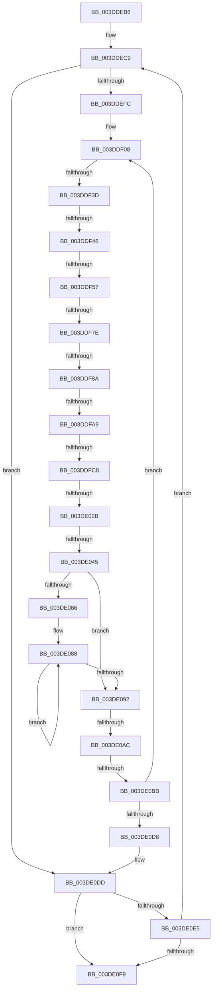

# sub_003DDEB6

- RVA: `0x003DDEB6`–`0x003DE131` (길이 `635` bytes)
- VA: `0x00000001403DDEB6`
- 실행 섹션: `.text`
- PDB 이름 있음: `아니요`; PDB Function 태그: `아니요`
- unwind 정보 RVA: `0x00094458`
- 디코드: `140`개 명령, `635/635` bytes 표시
- 미해석 바이트: `0` (있으면 어셈블리에 `.byte`로 보존)

> 이 문서는 커널 이미지의 기계어와 PDB 기호를 분석해 생성했습니다. 4번과 5번은 함수 원형과 자료형을 바이너리 사용 방식에서 추정한 C 해석이며 원본 소스 복구 결과는 아닙니다.

## 1. Dependencies

- 직접 호출 지점: **4**; 고유 호출 대상: **3**
- 직접 호출자로 확인된 함수: **0**
- RIP 상대 이미지 참조: **0**

### Outgoing calls
- `0x003DDF49` → [HalpDmaGetAdapterVersion](HalpDmaGetAdapterVersion_function_003DEC8C.md) (function, `0x003DEC8C`)
- `0x003DDFA9` → [HalpDmaGetAdapterVersion](HalpDmaGetAdapterVersion_function_003DEC8C.md) (function, `0x003DEC8C`)
- `0x003DDFD4` → [HalpDmaNextContiguousPieceV2](HalpDmaNextContiguousPieceV2_function_003DE530.md) (function, `0x003DE530`)
- `0x003DE061` → [HalpDmaSyncMapBuffers](HalpDmaSyncMapBuffers_function_003DEFD0.md) (function, `0x003DEFD0`)

### Direct callers
- 이 함수 시작 RVA로 연결되는 직접 call은 확인되지 않았습니다. 간접 호출은 완전히 역산할 수 없습니다.

### Static image references
- 디코드된 RIP-relative 메모리 참조가 없습니다.

## 2. Other-region calls and transfers

- 다른 실행 섹션으로 향하는 call: **0**
- call이 아닌 외부 분기/꼬리 이동: **11**
  - `0x003DDF37` → [sub_003DE181 + 0x1AD](Unknown_function_003DE181.md) (`tail-transfer`)
  - `0x003DDF40` → [sub_003DE181 + 0x6B](Unknown_function_003DE181.md) (`tail-transfer`)
  - `0x003DDF51` → [sub_003DE181 + 0x17B](Unknown_function_003DE181.md) (`tail-transfer`)
  - `0x003DDF78` → [sub_003DE181](Unknown_function_003DE181.md) (`tail-transfer`)
  - `0x003DDF84` → [sub_003DE181 + 0x1C4](Unknown_function_003DE181.md) (`tail-transfer`)
  - `0x003DDFA3` → [sub_003DE181 + 0x38](Unknown_function_003DE181.md) (`tail-transfer`)
  - `0x003DDFC2` → [sub_003DE181 + 0x1CD](Unknown_function_003DE181.md) (`tail-transfer`)
  - `0x003DE025` → [sub_003DE181 + 0x7](Unknown_function_003DE181.md) (`tail-transfer`)
  - `0x003DE03F` → [sub_003DE181 + 0x11E](Unknown_function_003DE181.md) (`tail-transfer`)
  - `0x003DE0A6` → [sub_003DE181 + 0x1E6](Unknown_function_003DE181.md) (`tail-transfer`)
  - `0x003DE0B5` → [sub_006EA3B0 + 0x5E](../6E/Unknown_function_006EA3B0.md) (`tail-transfer`)

## 3. Assembly (complete function range)

```asm
003DDEB6  4C 89 B4 24 18 01 00 00         mov qword ptr [rsp + 0x118], r14
003DDEBE  4C 8B EA                        mov r13, rdx
003DDEC1  4C 89 BC 24 D0 00 00 00         mov qword ptr [rsp + 0xd0], r15
003DDEC9  48 8B 0E                        mov rcx, qword ptr [rsi]
003DDECC  41 3B C4                        cmp eax, r12d
003DDECF  41 8B D4                        mov edx, r12d
003DDED2  45 8B F4                        mov r14d, r12d
003DDED5  0F 46 D0                        cmovbe edx, eax
003DDED8  48 85 C9                        test rcx, rcx
003DDEDB  41 8B C4                        mov eax, r12d
003DDEDE  44 0F 45 F2                     cmovne r14d, edx
003DDEE2  2B C2                           sub eax, edx
003DDEE4  45 33 E4                        xor r12d, r12d
003DDEE7  48 85 C9                        test rcx, rcx
003DDEEA  44 0F 45 E0                     cmovne r12d, eax
003DDEEE  44 89 64 24 50                  mov dword ptr [rsp + 0x50], r12d
003DDEF3  45 85 F6                        test r14d, r14d
003DDEF6  0F 8E E1 01 00 00               jle 0x1403de0dd
003DDEFC  4C 8B A4 24 20 01 00 00         mov r12, qword ptr [rsp + 0x120]
003DDF04  4C 8D 7F 08                     lea r15, [rdi + 8]
003DDF08  33 C0                           xor eax, eax
003DDF0A  45 89 37                        mov dword ptr [r15], r14d
003DDF0D  83 BD 08 02 00 00 03            cmp dword ptr [rbp + 0x208], 3
003DDF14  0F 57 C0                        xorps xmm0, xmm0
003DDF17  0F 11 84 24 A0 00 00 00         movups xmmword ptr [rsp + 0xa0], xmm0
003DDF1F  48 89 84 24 B0 00 00 00         mov qword ptr [rsp + 0xb0], rax
003DDF27  0F 11 44 24 68                  movups xmmword ptr [rsp + 0x68], xmm0
003DDF2C  89 44 24 78                     mov dword ptr [rsp + 0x78], eax
003DDF30  C6 85 0C 02 00 00 01            mov byte ptr [rbp + 0x20c], 1
003DDF37  0F 84 F1 03 00 00               je 0x1403de32e
003DDF3D  4D 85 E4                        test r12, r12
003DDF40  0F 84 A6 02 00 00               je 0x1403de1ec
003DDF46  48 8B CD                        mov rcx, rbp
003DDF49  E8 3E 0D 00 00                  call 0x1403dec8c
003DDF4E  83 E8 02                        sub eax, 2
003DDF51  0F 85 A5 03 00 00               jne 0x1403de2fc
003DDF57  45 8B 07                        mov r8d, dword ptr [r15]
003DDF5A  33 C0                           xor eax, eax
003DDF5C  48 C7 44 24 48 00 00 00 00      mov qword ptr [rsp + 0x48], 0
003DDF65  48 89 84 24 C8 00 00 00         mov qword ptr [rsp + 0xc8], rax
003DDF6D  0F 11 84 24 B8 00 00 00         movups xmmword ptr [rsp + 0xb8], xmm0
003DDF75  45 85 C0                        test r8d, r8d
003DDF78  0F 84 03 02 00 00               je 0x1403de181
003DDF7E  38 85 B9 01 00 00               cmp byte ptr [rbp + 0x1b9], al
003DDF84  0F 84 BB 03 00 00               je 0x1403de345
003DDF8A  C6 44 24 40 01                  mov byte ptr [rsp + 0x40], 1
003DDF8F  80 BD BA 01 00 00 00            cmp byte ptr [rbp + 0x1ba], 0
003DDF96  48 8B CD                        mov rcx, rbp
003DDF99  49 8B 44 24 38                  mov rax, qword ptr [r12 + 0x38]
003DDF9E  48 89 44 24 60                  mov qword ptr [rsp + 0x60], rax
003DDFA3  0F 84 10 02 00 00               je 0x1403de1b9
003DDFA9  E8 DE 0C 00 00                  call 0x1403dec8c
003DDFAE  44 89 44 24 28                  mov dword ptr [rsp + 0x28], r8d
003DDFB3  4D 8B CD                        mov r9, r13
003DDFB6  48 8B D6                        mov rdx, rsi
003DDFB9  48 8B CD                        mov rcx, rbp
003DDFBC  4D 8B C4                        mov r8, r12
003DDFBF  83 E8 02                        sub eax, 2
003DDFC2  0F 85 86 03 00 00               jne 0x1403de34e
003DDFC8  0F B6 84 24 28 01 00 00         movzx eax, byte ptr [rsp + 0x128]
003DDFD0  88 44 24 20                     mov byte ptr [rsp + 0x20], al
003DDFD4  E8 57 05 00 00                  call 0x1403de530
003DDFD9  41 89 07                        mov dword ptr [r15], eax
003DDFDC  4D 8B C5                        mov r8, r13
003DDFDF  41 81 E0 FF 0F 00 00            and r8d, 0xfff
003DDFE6  44 8B D0                        mov r10d, eax
003DDFE9  8B C0                           mov eax, eax
003DDFEB  49 8B DD                        mov rbx, r13
003DDFEE  48 2B 5E 20                     sub rbx, qword ptr [rsi + 0x20]
003DDFF2  48 C1 EB 0C                     shr rbx, 0xc
003DDFF6  8B DB                           mov ebx, ebx
003DDFF8  48 89 44 24 58                  mov qword ptr [rsp + 0x58], rax
003DDFFD  4C 89 44 24 48                  mov qword ptr [rsp + 0x48], r8
003DE002  48 8B 5C DE 30                  mov rbx, qword ptr [rsi + rbx*8 + 0x30]
003DE007  48 C1 E3 0C                     shl rbx, 0xc
003DE00B  49 03 D8                        add rbx, r8
003DE00E  4C 8D 0C 18                     lea r9, [rax + rbx]
003DE012  49 8D 41 FF                     lea rax, [r9 - 1]
003DE016  48 39 85 90 00 00 00            cmp qword ptr [rbp + 0x90], rax
003DE01D  0F B6 84 24 28 01 00 00         movzx eax, byte ptr [rsp + 0x128]
003DE025  0F 83 5D 01 00 00               jae 0x1403de188
003DE02B  4D 8B 4C 24 38                  mov r9, qword ptr [r12 + 0x38]
003DE030  48 8D 8D BD 01 00 00            lea rcx, [rbp + 0x1bd]
003DE037  49 8B 19                        mov rbx, qword ptr [r9]
003DE03A  49 03 D8                        add rbx, r8
003DE03D  84 C0                           test al, al
003DE03F  0F 84 5A 02 00 00               je 0x1403de29f
003DE045  C6 44 24 38 00                  mov byte ptr [rsp + 0x38], 0
003DE04A  C6 44 24 30 00                  mov byte ptr [rsp + 0x30], 0
003DE04F  88 44 24 28                     mov byte ptr [rsp + 0x28], al
003DE053  4D 8B C5                        mov r8, r13
003DE056  44 89 54 24 20                  mov dword ptr [rsp + 0x20], r10d
003DE05B  48 8B D6                        mov rdx, rsi
003DE05E  48 8B CD                        mov rcx, rbp
003DE061  E8 6A 0F 00 00                  call 0x1403defd0
003DE066  4C 8B 44 24 48                  mov r8, qword ptr [rsp + 0x48]
003DE06B  48 8B 44 24 58                  mov rax, qword ptr [rsp + 0x58]
003DE070  49 8B 4C 24 38                  mov rcx, qword ptr [r12 + 0x38]
003DE075  48 05 FF 0F 00 00               add rax, 0xfff
003DE07B  49 03 C0                        add rax, r8
003DE07E  48 C1 E8 0C                     shr rax, 0xc
003DE082  85 C0                           test eax, eax
003DE084  74 0C                           je 0x1403de092
003DE086  8B D0                           mov edx, eax
003DE088  48 8B 49 08                     mov rcx, qword ptr [rcx + 8]
003DE08C  48 83 EA 01                     sub rdx, 1
003DE090  75 F6                           jne 0x1403de088
003DE092  49 89 4C 24 38                  mov qword ptr [r12 + 0x38], rcx
003DE097  80 7C 24 40 00                  cmp byte ptr [rsp + 0x40], 0
003DE09C  4D 8B C5                        mov r8, r13
003DE09F  41 8B 07                        mov eax, dword ptr [r15]
003DE0A2  89 44 24 48                     mov dword ptr [rsp + 0x48], eax
003DE0A6  0F 84 BB 02 00 00               je 0x1403de367
003DE0AC  83 BD 08 02 00 00 03            cmp dword ptr [rbp + 0x208], 3
003DE0B3  8B CB                           mov ecx, ebx
003DE0B5  0F 84 53 C3 30 00               je 0x1406ea40e
003DE0BB  41 8B 07                        mov eax, dword ptr [r15]
003DE0BE  49 83 C7 18                     add r15, 0x18
003DE0C2  48 89 1F                        mov qword ptr [rdi], rbx
003DE0C5  44 2B F0                        sub r14d, eax
003DE0C8  4C 03 E8                        add r13, rax
003DE0CB  48 83 C7 18                     add rdi, 0x18
003DE0CF  45 85 F6                        test r14d, r14d
003DE0D2  0F 8F 30 FE FF FF               jg 0x1403ddf08
003DE0D8  44 8B 64 24 50                  mov r12d, dword ptr [rsp + 0x50]
003DE0DD  48 8B 36                        mov rsi, qword ptr [rsi]
003DE0E0  48 85 F6                        test rsi, rsi
003DE0E3  74 14                           je 0x1403de0f9
003DE0E5  44 8B 6E 2C                     mov r13d, dword ptr [rsi + 0x2c]
003DE0E9  4C 03 6E 20                     add r13, qword ptr [rsi + 0x20]
003DE0ED  8B 46 28                        mov eax, dword ptr [rsi + 0x28]
003DE0F0  45 85 E4                        test r12d, r12d
003DE0F3  0F 85 D0 FD FF FF               jne 0x1403ddec9
003DE0F9  4C 8B AC 24 80 00 00 00         mov r13, qword ptr [rsp + 0x80]
003DE101  4C 8B 94 24 10 01 00 00         mov r10, qword ptr [rsp + 0x110]
003DE109  4C 8B 9C 24 88 00 00 00         mov r11, qword ptr [rsp + 0x88]
003DE111  4C 8B 84 24 90 00 00 00         mov r8, qword ptr [rsp + 0x90]
003DE119  48 8B 9C 24 98 00 00 00         mov rbx, qword ptr [rsp + 0x98]
003DE121  4C 8B BC 24 D0 00 00 00         mov r15, qword ptr [rsp + 0xd0]
003DE129  4C 8B B4 24 18 01 00 00         mov r14, qword ptr [rsp + 0x118]
```

## 4. C-style interpretation (structured pseudocode)

```c
__int64 __fastcall sub_003DDEB6(__int64 a1, __int64 a2, __int64 a3, __int64 a4, __int64 a5, __int64 a6, __int64 a7, unsigned __int8 a8, __int64 a9, unsigned int a10, __int64 a11, __int64 a12, __int64 a13, __int64 a14, __int64 a15, __int64 a16, __int64 a17, __int64 a18, __int64 a19, __int64 a20, __int64 a21, __int64 a22, __int64 a23, __int64 a24, __int64 a25, __int64 a26, __int64 a27, __int64 a28, __int64 a29, __int64 a30, __int64 a31, __int64 a32, __int64 a33, __int64 a34, __int64 a35, __int64 a36, unsigned __int8 a37)
{
    __int64 result;
    __int64 v_r12;
    __int64 v_r13;
    __int64 v_r14;
    __int64 v_r15;
    __int64 v_rbx;
    __int64 v_rdi;
    unsigned __int64 v_stack_p118;
    unsigned __int8 v_stack_p20;
    unsigned int v_stack_p28;
    unsigned __int8 v_stack_p30;
    unsigned __int8 v_stack_p38;
    unsigned __int8 v_stack_p40;
    unsigned __int64 v_stack_p48;
    unsigned int v_stack_p50;
    unsigned __int64 v_stack_p58;
    unsigned __int64 v_stack_p60;
    unsigned int v_stack_p78;
    unsigned __int64 v_stack_pB0;
    unsigned __int64 v_stack_pC8;
    unsigned __int64 v_stack_pD0;

    v_stack_p118 = v_r14;
    v_stack_pD0 = v_r15;
loc_003DDEC9:
    a2 = (unsigned int)((unsigned int)(v_r12));
    if (((unsigned int)(result)) <= ((unsigned int)(v_r12))) { a2 = (unsigned int)(result); }
    v_r14 = (unsigned int)((unsigned int)(v_r12));
    if (*(unsigned __int64 *)(v_rsi) != 0) { v_r14 = (unsigned int)(a2); }
    result = (unsigned int)(((unsigned int)((unsigned int)(v_r12))) - ((unsigned int)(a2)));
    v_r12 = 0;
    if (*(unsigned __int64 *)(v_rsi) != 0) { v_r12 = (unsigned int)(result); }
    v_stack_p50 = (unsigned int)(v_r12);
    if (condition_is_less_or_equal) goto loc_003DE0DD;
loc_003DDF08:
    result = 0;
    *(unsigned int *)(v_rdi + 8) = (unsigned int)(v_r14);
    a20 = v_xmm0;
    v_stack_pB0 = 0;
    a13 = v_xmm0;
    v_stack_p78 = 0;
    *(unsigned __int8 *)(v_rbp + 524) = 1;
    result = HalpDmaGetAdapterVersion(v_rbp, a2, a3, a4);
    result = (unsigned int)((result) - (2));
    result = 0;
    v_stack_p48 = 0;
    v_stack_pC8 = 0;
    a23 = v_xmm0;
    v_stack_p40 = 1;
    v_stack_p60 = *(unsigned __int64 *)(a36 + 56);
    result = HalpDmaGetAdapterVersion(v_rbp, a2, (unsigned int)(*(unsigned int *)(v_rdi + 8)), a4);
    v_stack_p28 = (unsigned int)((unsigned int)(*(unsigned int *)(v_rdi + 8)));
    result = (unsigned int)((result) - (2));
    v_stack_p20 = a37;
    result = HalpDmaNextContiguousPieceV2(v_rbp, v_rsi, a36, a2);
    *(unsigned int *)(v_rdi + 8) = (unsigned int)(result);
    a3 = (unsigned int)((a2) & (0xFFFULL));
    v_rbx = (a2) - (*(unsigned __int64 *)(v_rsi + 32));
    v_rbx = (v_rbx) >> (12);
    v_stack_p58 = (unsigned int)((unsigned int)(result));
    v_stack_p48 = a3;
    v_rbx = (*(unsigned __int64 *)(v_rsi + (unsigned int)((unsigned int)(v_rbx)) * 8 + 48)) << (12);
    v_rbx = (v_rbx) + (a3);
    v_rbx = (*(unsigned __int64 *)(*(unsigned __int64 *)(a36 + 56))) + (a3);
    v_stack_p38 = 0;
    v_stack_p30 = 0;
    v_stack_p28 = a37;
    v_stack_p20 = (unsigned int)((unsigned int)((unsigned int)(result)));
    result = HalpDmaSyncMapBuffers(v_rbp, v_rsi, a2, *(unsigned __int64 *)(a36 + 56));
    result = (a11) + (0xFFFULL);
    result = (result) + (a9);
    result = (result) >> (12);
    if ((unsigned int)(result) == 0) goto loc_003DE092;
loc_003DE088:
    a2 = ((unsigned int)((unsigned int)(result))) - (1);
    if (condition_is_not_equal) goto loc_003DE088;
loc_003DE092:
    *(unsigned __int64 *)(a36 + 56) = *(unsigned __int64 *)(*(unsigned __int64 *)(a36 + 56) + 8);
    v_stack_p48 = (unsigned int)((unsigned int)(*(unsigned int *)(v_rdi + 8)));
    v_r15 = (v_rdi + 8) + (24);
    *(unsigned __int64 *)(v_rdi) = v_rbx;
    v_r14 = (unsigned int)((v_r14) - ((unsigned int)((unsigned int)(*(unsigned int *)(v_rdi + 8)))));
    v_r13 = (a2) + ((unsigned int)(*(unsigned int *)(v_rdi + 8)));
    v_rdi = (v_rdi) + (24);
    if (condition_is_greater) goto loc_003DDF08;
loc_003DE0DD:
    if (*(unsigned __int64 *)(v_rsi) == 0) goto loc_003DE0F9;
    v_r13 = ((unsigned int)(*(unsigned int *)(*(unsigned __int64 *)(v_rsi) + 44))) + (*(unsigned __int64 *)(*(unsigned __int64 *)(v_rsi) + 32));
    if ((unsigned int)((unsigned int)(a10)) != 0) goto loc_003DDEC9;
loc_003DE0F9:
    return (unsigned int)(*(unsigned int *)(*(unsigned __int64 *)(v_rsi) + 40));
}
```

## 5. (Beta) C Style

```c
int64_t sub_003DDEB6(int64_t Arg1, int64_t Arg2, int64_t Arg3, int64_t Arg4, uint64_t Arg5, uint64_t Arg6, uint64_t Arg7, uint8_t Arg8, int64_t Arg9, uint32_t Arg10, int64_t Arg11, uint64_t Arg12, int64_t Arg13, uint64_t Arg14, uint64_t Arg15, int64_t Arg16, int64_t Arg17, int64_t Arg18, int64_t Arg19, int64_t Arg20, uint64_t Arg21, uint64_t Arg22, int64_t Arg23, uint64_t Arg24, uint64_t Arg25, int64_t Arg26, uint64_t Arg27, uint64_t Arg28, uint64_t Arg29, uint64_t Arg30, uint64_t Arg31, uint64_t Arg32, uint64_t Arg33, int64_t Arg34, int64_t Arg35, int64_t Arg36, uint8_t Arg37)
{
    int64_t result;
    int64_t local_r12;
    int64_t local_r13;
    int64_t local_r14;
    int64_t local_r15;
    int64_t local_rbx;
    int64_t local_rdi;
    uint64_t v_stack_p118;
    uint8_t v_stack_p20;
    uint32_t v_stack_p28;
    uint8_t v_stack_p30;
    uint8_t v_stack_p38;
    uint8_t v_stack_p40;
    uint64_t v_stack_p48;
    uint32_t v_stack_p50;
    uint64_t v_stack_p58;
    uint64_t v_stack_p60;
    uint32_t v_stack_p78;
    uint64_t v_stack_pB0;
    uint64_t v_stack_pC8;
    uint64_t v_stack_pD0;

    v_stack_p118 = local_r14;
    v_stack_pD0 = local_r15;
loc_003DDEC9:
    Arg2 = (uint32_t)((uint32_t)(local_r12));
    if (((uint32_t)(result)) <= ((uint32_t)(local_r12))) { Arg2 = (uint32_t)(result); }
    local_r14 = (uint32_t)((uint32_t)(local_r12));
    if (*(uint64_t *)(local_rsi) != 0) { local_r14 = (uint32_t)(Arg2); }
    result = (uint32_t)(((uint32_t)((uint32_t)(local_r12))) - ((uint32_t)(Arg2)));
    local_r12 = 0;
    if (*(uint64_t *)(local_rsi) != 0) { local_r12 = (uint32_t)(result); }
    v_stack_p50 = (uint32_t)(local_r12);
    if (condition_is_less_or_equal) goto loc_003DE0DD;
loc_003DDF08:
    result = 0;
    *(uint32_t *)(local_rdi + 0x8) = (uint32_t)(local_r14);
    Arg20 = v_xmm0;
    v_stack_pB0 = 0;
    Arg13 = v_xmm0;
    v_stack_p78 = 0;
    *(uint8_t *)(local_rbp + 0x20C) = 1;
    result = HalpDmaGetAdapterVersion(local_rbp, Arg2, Arg3, Arg4);
    result = (uint32_t)((result) - (2));
    result = 0;
    v_stack_p48 = 0;
    v_stack_pC8 = 0;
    Arg23 = v_xmm0;
    v_stack_p40 = 1;
    v_stack_p60 = *(uint64_t *)(Arg36 + 0x38);
    result = HalpDmaGetAdapterVersion(local_rbp, Arg2, (uint32_t)(*(uint32_t *)(local_rdi + 0x8)), Arg4);
    v_stack_p28 = (uint32_t)((uint32_t)(*(uint32_t *)(local_rdi + 0x8)));
    result = (uint32_t)((result) - (2));
    v_stack_p20 = Arg37;
    result = HalpDmaNextContiguousPieceV2(local_rbp, local_rsi, Arg36, Arg2);
    *(uint32_t *)(local_rdi + 0x8) = (uint32_t)(result);
    Arg3 = (uint32_t)((Arg2) & (0xFFFULL));
    local_rbx = (Arg2) - (*(uint64_t *)(local_rsi + 0x20));
    local_rbx = (local_rbx) >> (12);
    v_stack_p58 = (uint32_t)((uint32_t)(result));
    v_stack_p48 = Arg3;
    local_rbx = (*(uint64_t *)(local_rsi + (uint32_t)((uint32_t)(local_rbx)) * 8 + 0x30)) << (12);
    local_rbx = (local_rbx) + (Arg3);
    local_rbx = (*(uint64_t *)(*(uint64_t *)(Arg36 + 0x38))) + (Arg3);
    v_stack_p38 = 0;
    v_stack_p30 = 0;
    v_stack_p28 = Arg37;
    v_stack_p20 = (uint32_t)((uint32_t)((uint32_t)(result)));
    result = HalpDmaSyncMapBuffers(local_rbp, local_rsi, Arg2, *(uint64_t *)(Arg36 + 0x38));
    result = (Arg11) + (0xFFFULL);
    result = (result) + (Arg9);
    result = (result) >> (12);
    if ((uint32_t)(result) == 0) goto loc_003DE092;
loc_003DE088:
    Arg2 = ((uint32_t)((uint32_t)(result))) - (1);
    if (condition_is_not_equal) goto loc_003DE088;
loc_003DE092:
    *(uint64_t *)(Arg36 + 0x38) = *(uint64_t *)(*(uint64_t *)(Arg36 + 0x38) + 0x8);
    v_stack_p48 = (uint32_t)((uint32_t)(*(uint32_t *)(local_rdi + 0x8)));
    local_r15 = (local_rdi + 8) + (24);
    *(uint64_t *)(local_rdi) = local_rbx;
    local_r14 = (uint32_t)((local_r14) - ((uint32_t)((uint32_t)(*(uint32_t *)(local_rdi + 0x8)))));
    local_r13 = (Arg2) + ((uint32_t)(*(uint32_t *)(local_rdi + 0x8)));
    local_rdi = (local_rdi) + (24);
    if (condition_is_greater) goto loc_003DDF08;
loc_003DE0DD:
    if (*(uint64_t *)(local_rsi) == 0) goto loc_003DE0F9;
    local_r13 = ((uint32_t)(*(uint32_t *)(*(uint64_t *)(local_rsi) + 0x2C))) + (*(uint64_t *)(*(uint64_t *)(local_rsi) + 0x20));
    if ((uint32_t)((uint32_t)(Arg10)) != 0) goto loc_003DDEC9;
loc_003DE0F9:
    return (uint32_t)(*(uint32_t *)(*(uint64_t *)(local_rsi) + 0x28));
}
```

## 6. Execution-region graph

[열기: 2D/3D 그래프와 함수 탐색 컨트롤 패널](../../../control-panel.html?section=text&rva=0x003DDEB6&view=graph)

- 2D 그래프는 위에서 아래로 흐르고, 3D 그래프는 빈 공간을 드래그해 회전합니다. Shift+드래그는 이동, 휠은 확대·축소, 함수 노드 선택은 대상 보고서 이동입니다.

### Static fallback


