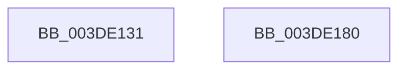

# sub_003DE131

- RVA: `0x003DE131`–`0x003DE181` (길이 `80` bytes)
- VA: `0x00000001403DE131`
- 실행 섹션: `.text`
- PDB 이름 있음: `아니요`; PDB Function 태그: `아니요`
- unwind 정보 RVA: `0x00094470`
- 디코드: `25`개 명령, `80/80` bytes 표시
- 미해석 바이트: `0` (있으면 어셈블리에 `.byte`로 보존)

> 이 문서는 커널 이미지의 기계어와 PDB 기호를 분석해 생성했습니다. 4번과 5번은 함수 원형과 자료형을 바이너리 사용 방식에서 추정한 C 해석이며 원본 소스 복구 결과는 아닙니다.

## 1. Dependencies

- 직접 호출 지점: **1**; 고유 호출 대상: **1**
- 직접 호출자로 확인된 함수: **0**
- RIP 상대 이미지 참조: **0**

### Outgoing calls
- `0x003DE166` → [guard_dispatch_icall](../6B/guard_dispatch_icall_function_006BAAD0.md) (function, `0x006BAAD0`)

### Direct callers
- 이 함수 시작 RVA로 연결되는 직접 call은 확인되지 않았습니다. 간접 호출은 완전히 역산할 수 없습니다.

### Static image references
- 디코드된 RIP-relative 메모리 참조가 없습니다.

## 2. Other-region calls and transfers

- 다른 실행 섹션으로 향하는 call: **0**
- 별도 외부 분기/꼬리 이동을 확인하지 못했습니다.

## 3. Assembly (complete function range)

```asm
003DE131  49 2B FD                        sub rdi, r13
003DE134  4D 8B C8                        mov r9, r8
003DE137  48 83 EF 10                     sub rdi, 0x10
003DE13B  48 B8 AB AA AA AA AA AA AA 2A   movabs rax, 0x2aaaaaaaaaaaaaab
003DE145  48 F7 EF                        imul rdi
003DE148  4D 8B C5                        mov r8, r13
003DE14B  49 8B C3                        mov rax, r11
003DE14E  48 C1 FA 02                     sar rdx, 2
003DE152  48 8B CA                        mov rcx, rdx
003DE155  48 C1 E9 3F                     shr rcx, 0x3f
003DE159  48 03 D1                        add rdx, rcx
003DE15C  49 8B CA                        mov rcx, r10
003DE15F  41 89 55 00                     mov dword ptr [r13], edx
003DE163  48 8B D3                        mov rdx, rbx
003DE166  E8 65 C9 2D 00                  call 0x1406baad0
003DE16B  B8 03 00 00 00                  mov eax, 3
003DE170  48 81 C4 D8 00 00 00            add rsp, 0xd8
003DE177  41 5D                           pop r13
003DE179  41 5C                           pop r12
003DE17B  5F                              pop rdi
003DE17C  5E                              pop rsi
003DE17D  5D                              pop rbp
003DE17E  5B                              pop rbx
003DE17F  C3                              ret
003DE180  CC                              int3
```

## 4. C-style interpretation (structured pseudocode)

```c
__int64 __fastcall sub_003DE131(__int64 a1, __int64 a2, __int64 a3)
{
    __int64 result;
    __int64 v_rdi;
    __int64 v_rsp;

    v_rdi = (v_rdi) - (v_r13);
    v_rdi = (v_rdi) - (16);
    a2 = (a2) >> (2);
    a1 = (a2) >> (63);
    a2 = (a2) + (a1);
    *(unsigned int *)(v_r13) = (unsigned int)(a2);
    result = guard_dispatch_icall(v_r10, v_rbx, v_r13, a3);
    v_rsp = (v_rsp) + (216);
    return 3;
}
```

## 5. (Beta) C Style

```c
int64_t sub_003DE131(int64_t Arg1, int64_t Arg2, int64_t Arg3)
{
    int64_t result;
    int64_t local_rdi;
    int64_t local_rsp;

    local_rdi = (local_rdi) - (local_r13);
    local_rdi = (local_rdi) - (16);
    Arg2 = (Arg2) >> (2);
    Arg1 = (Arg2) >> (63);
    Arg2 = (Arg2) + (Arg1);
    *(uint32_t *)(local_r13) = (uint32_t)(Arg2);
    result = guard_dispatch_icall(local_r10, local_rbx, local_r13, Arg3);
    local_rsp = (local_rsp) + (216);
    return 3;
}
```

## 6. Execution-region graph

[열기: 2D/3D 그래프와 함수 탐색 컨트롤 패널](../../../control-panel.html?section=text&rva=0x003DE131&view=graph)

- 2D 그래프는 위에서 아래로 흐르고, 3D 그래프는 빈 공간을 드래그해 회전합니다. Shift+드래그는 이동, 휠은 확대·축소, 함수 노드 선택은 대상 보고서 이동입니다.

### Static fallback


