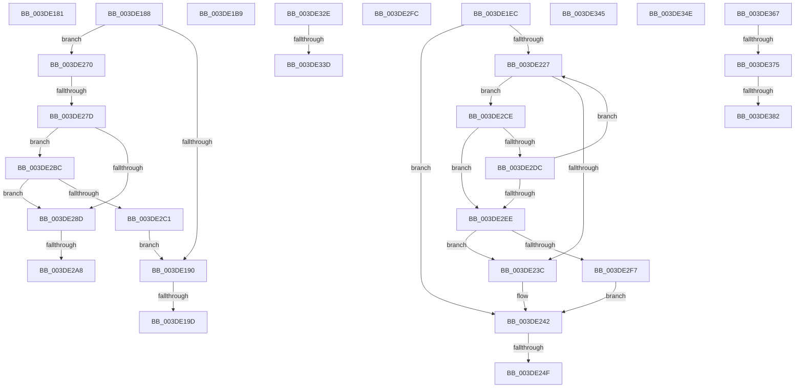

# sub_003DE181

- RVA: `0x003DE181`–`0x003DE39C` (길이 `539` bytes)
- VA: `0x00000001403DE181`
- 실행 섹션: `.text`
- PDB 이름 있음: `아니요`; PDB Function 태그: `아니요`
- unwind 정보 RVA: `0x00094484`
- 디코드: `123`개 명령, `539/539` bytes 표시
- 미해석 바이트: `0` (있으면 어셈블리에 `.byte`로 보존)

> 이 문서는 커널 이미지의 기계어와 PDB 기호를 분석해 생성했습니다. 4번과 5번은 함수 원형과 자료형을 바이너리 사용 방식에서 추정한 C 해석이며 원본 소스 복구 결과는 아닙니다.

## 1. Dependencies

- 직접 호출 지점: **7**; 고유 호출 대상: **6**
- 직접 호출자로 확인된 함수: **0**
- RIP 상대 이미지 참조: **0**

### Outgoing calls
- `0x003DE1AF` → [HalpDmaFlushBuffer](HalpDmaFlushBuffer_function_003DC1DC.md) (function, `0x003DC1DC`)
- `0x003DE1DD` → [HalpDmaMapContiguousTransferV2](HalpDmaMapContiguousTransferV2_function_003DFDF4.md) (function, `0x003DFDF4`)
- `0x003DE266` → [HalpDmaFlushBuffer](HalpDmaFlushBuffer_function_003DC1DC.md) (function, `0x003DC1DC`)
- `0x003DE280` → [HalpDmaGetAdapterCacheAlignment](HalpDmaGetAdapterCacheAlignment_function_003DC150.md) (function, `0x003DC150`)
- `0x003DE321` → [HalpMapTransferV3](HalpMapTransferV3_function_003DCCAC.md) (function, `0x003DCCAC`)
- `0x003DE35D` → [HalpDmaNextContiguousPieceV3](HalpDmaNextContiguousPieceV3_function_003DECFC.md) (function, `0x003DECFC`)
- `0x003DE391` → [HalpDmaZeroMapBuffers](../55/HalpDmaZeroMapBuffers_function_005511EC.md) (function, `0x005511EC`)

### Direct callers
- 이 함수 시작 RVA로 연결되는 직접 call은 확인되지 않았습니다. 간접 호출은 완전히 역산할 수 없습니다.

### Static image references
- 디코드된 RIP-relative 메모리 참조가 없습니다.

## 2. Other-region calls and transfers

- 다른 실행 섹션으로 향하는 call: **0**
- call이 아닌 외부 분기/꼬리 이동: **17**
  - `0x003DE183` → [sub_003DDEB6 + 0x1F6](Unknown_function_003DDEB6.md) (`tail-transfer`)
  - `0x003DE197` → [sub_003DDEB6 + 0x1E1](Unknown_function_003DDEB6.md) (`tail-transfer`)
  - `0x003DE1B4` → [sub_003DDEB6 + 0x1E1](Unknown_function_003DDEB6.md) (`tail-transfer`)
  - `0x003DE1E7` → [sub_003DDEB6 + 0x1E1](Unknown_function_003DDEB6.md) (`tail-transfer`)
  - `0x003DE249` → [sub_003DDEB6 + 0x1F6](Unknown_function_003DDEB6.md) (`tail-transfer`)
  - `0x003DE26B` → [sub_003DDEB6 + 0x1F6](Unknown_function_003DDEB6.md) (`tail-transfer`)
  - `0x003DE277` → [sub_003DDEB6 + 0x1E1](Unknown_function_003DDEB6.md) (`tail-transfer`)
  - `0x003DE2A2` → [sub_003DDEB6 + 0x1B5](Unknown_function_003DDEB6.md) (`tail-transfer`)
  - `0x003DE2B7` → [sub_003DDEB6 + 0x19D](Unknown_function_003DDEB6.md) (`tail-transfer`)
  - `0x003DE329` → [sub_003DDEB6 + 0x1F6](Unknown_function_003DDEB6.md) (`tail-transfer`)
  - `0x003DE337` → [sub_003DDEB6 + 0x87](Unknown_function_003DDEB6.md) (`tail-transfer`)
  - `0x003DE340` → [sub_003DDEB6 + 0x87](Unknown_function_003DDEB6.md) (`tail-transfer`)
  - `0x003DE349` → [sub_003DDEB6 + 0xD9](Unknown_function_003DDEB6.md) (`tail-transfer`)
  - `0x003DE362` → [sub_003DDEB6 + 0x123](Unknown_function_003DDEB6.md) (`tail-transfer`)
  - `0x003DE36F` → [sub_006EA3B0](../6E/Unknown_function_006EA3B0.md) (`tail-transfer`)
  - `0x003DE37C` → [sub_006EA3B0](../6E/Unknown_function_006EA3B0.md) (`tail-transfer`)
  - `0x003DE397` → [sub_006EA3B0](../6E/Unknown_function_006EA3B0.md) (`tail-transfer`)

## 3. Assembly (complete function range)

```asm
003DE181  33 DB                           xor ebx, ebx
003DE183  E9 24 FF FF FF                  jmp 0x1403de0ac
003DE188  84 C0                           test al, al
003DE18A  0F 84 E0 00 00 00               je 0x1403de270
003DE190  80 BD BD 01 00 00 00            cmp byte ptr [rbp + 0x1bd], 0
003DE197  0F 85 FA FE FF FF               jne 0x1403de097
003DE19D  C6 44 24 28 00                  mov byte ptr [rsp + 0x28], 0
003DE1A2  45 8B CA                        mov r9d, r10d
003DE1A5  4D 8B C5                        mov r8, r13
003DE1A8  88 44 24 20                     mov byte ptr [rsp + 0x20], al
003DE1AC  48 8B D6                        mov rdx, rsi
003DE1AF  E8 28 E0 FF FF                  call 0x1403dc1dc
003DE1B4  E9 DE FE FF FF                  jmp 0x1403de097
003DE1B9  48 8D 44 24 48                  lea rax, [rsp + 0x48]
003DE1BE  4D 8B CD                        mov r9, r13
003DE1C1  48 89 44 24 30                  mov qword ptr [rsp + 0x30], rax
003DE1C6  4D 8B C4                        mov r8, r12
003DE1C9  0F B6 84 24 28 01 00 00         movzx eax, byte ptr [rsp + 0x128]
003DE1D1  48 8B D6                        mov rdx, rsi
003DE1D4  88 44 24 28                     mov byte ptr [rsp + 0x28], al
003DE1D8  4C 89 7C 24 20                  mov qword ptr [rsp + 0x20], r15
003DE1DD  E8 12 1C 00 00                  call 0x1403dfdf4
003DE1E2  48 8B 5C 24 48                  mov rbx, qword ptr [rsp + 0x48]
003DE1E7  E9 AB FE FF FF                  jmp 0x1403de097
003DE1EC  45 8B 0F                        mov r9d, dword ptr [r15]
003DE1EF  49 8B C5                        mov rax, r13
003DE1F2  48 2B 46 20                     sub rax, qword ptr [rsi + 0x20]
003DE1F6  41 8B CD                        mov ecx, r13d
003DE1F9  48 C1 E8 0C                     shr rax, 0xc
003DE1FD  81 E1 FF 0F 00 00               and ecx, 0xfff
003DE203  48 83 C0 06                     add rax, 6
003DE207  BA 00 10 00 00                  mov edx, 0x1000
003DE20C  4C 8B 14 C6                     mov r10, qword ptr [rsi + rax*8]
003DE210  4C 8D 04 C6                     lea r8, [rsi + rax*8]
003DE214  49 8B DA                        mov rbx, r10
003DE217  8B C1                           mov eax, ecx
003DE219  48 C1 E3 0C                     shl rbx, 0xc
003DE21D  2B D1                           sub edx, ecx
003DE21F  48 03 D8                        add rbx, rax
003DE222  41 3B D1                        cmp edx, r9d
003DE225  73 1B                           jae 0x1403de242
003DE227  49 8B 48 08                     mov rcx, qword ptr [r8 + 8]
003DE22B  4D 8D 40 08                     lea r8, [r8 + 8]
003DE22F  49 8D 42 01                     lea rax, [r10 + 1]
003DE233  48 3B C1                        cmp rax, rcx
003DE236  0F 84 92 00 00 00               je 0x1403de2ce
003DE23C  41 89 17                        mov dword ptr [r15], edx
003DE23F  44 8B CA                        mov r9d, edx
003DE242  80 BD BD 01 00 00 00            cmp byte ptr [rbp + 0x1bd], 0
003DE249  0F 85 5D FE FF FF               jne 0x1403de0ac
003DE24F  0F B6 84 24 28 01 00 00         movzx eax, byte ptr [rsp + 0x128]
003DE257  4D 8B C5                        mov r8, r13
003DE25A  C6 44 24 28 00                  mov byte ptr [rsp + 0x28], 0
003DE25F  48 8B D6                        mov rdx, rsi
003DE262  88 44 24 20                     mov byte ptr [rsp + 0x20], al
003DE266  E8 71 DF FF FF                  call 0x1403dc1dc
003DE26B  E9 3C FE FF FF                  jmp 0x1403de0ac
003DE270  80 BD BD 01 00 00 00            cmp byte ptr [rbp + 0x1bd], 0
003DE277  0F 85 1A FE FF FF               jne 0x1403de097
003DE27D  48 8B CD                        mov rcx, rbp
003DE280  E8 CB DE FF FF                  call 0x1403dc150
003DE285  8D 48 FF                        lea ecx, [rax - 1]
003DE288  48 85 CB                        test rbx, rcx
003DE28B  74 2F                           je 0x1403de2bc
003DE28D  4D 8B 4C 24 38                  mov r9, qword ptr [r12 + 0x38]
003DE292  48 8D 8D BD 01 00 00            lea rcx, [rbp + 0x1bd]
003DE299  49 8B 19                        mov rbx, qword ptr [r9]
003DE29C  49 03 D8                        add rbx, r8
003DE29F  80 39 00                        cmp byte ptr [rcx], 0
003DE2A2  0F 85 C3 FD FF FF               jne 0x1403de06b
003DE2A8  C6 44 24 38 00                  mov byte ptr [rsp + 0x38], 0
003DE2AD  C6 44 24 30 01                  mov byte ptr [rsp + 0x30], 1
003DE2B2  C6 44 24 28 00                  mov byte ptr [rsp + 0x28], 0
003DE2B7  E9 97 FD FF FF                  jmp 0x1403de053
003DE2BC  49 85 C9                        test r9, rcx
003DE2BF  75 CC                           jne 0x1403de28d
003DE2C1  0F B6 84 24 28 01 00 00         movzx eax, byte ptr [rsp + 0x128]
003DE2C9  E9 C2 FE FF FF                  jmp 0x1403de190
003DE2CE  48 8B C1                        mov rax, rcx
003DE2D1  49 33 C2                        xor rax, r10
003DE2D4  48 A9 00 00 F0 FF               test rax, -0x100000
003DE2DA  75 12                           jne 0x1403de2ee
003DE2DC  81 C2 00 10 00 00               add edx, 0x1000
003DE2E2  4C 8B D1                        mov r10, rcx
003DE2E5  41 3B D1                        cmp edx, r9d
003DE2E8  0F 82 39 FF FF FF               jb 0x1403de227
003DE2EE  41 3B D1                        cmp edx, r9d
003DE2F1  0F 82 45 FF FF FF               jb 0x1403de23c
003DE2F7  E9 46 FF FF FF                  jmp 0x1403de242
003DE2FC  83 F8 01                        cmp eax, 1
003DE2FF  C6 44 24 30 00                  mov byte ptr [rsp + 0x30], 0
003DE304  0F B6 84 24 28 01 00 00         movzx eax, byte ptr [rsp + 0x128]
003DE30C  4D 8B CD                        mov r9, r13
003DE30F  88 44 24 28                     mov byte ptr [rsp + 0x28], al
003DE313  4D 8B C4                        mov r8, r12
003DE316  48 8B D6                        mov rdx, rsi
003DE319  4C 89 7C 24 20                  mov qword ptr [rsp + 0x20], r15
003DE31E  48 8B CD                        mov rcx, rbp
003DE321  E8 86 E9 FF FF                  call 0x1403dccac
003DE326  48 8B D8                        mov rbx, rax
003DE329  E9 7E FD FF FF                  jmp 0x1403de0ac
003DE32E  8B 85 FC 00 00 00               mov eax, dword ptr [rbp + 0xfc]
003DE334  41 39 07                        cmp dword ptr [r15], eax
003DE337  0F 86 00 FC FF FF               jbe 0x1403ddf3d
003DE33D  41 89 07                        mov dword ptr [r15], eax
003DE340  E9 F8 FB FF FF                  jmp 0x1403ddf3d
003DE345  88 44 24 40                     mov byte ptr [rsp + 0x40], al
003DE349  E9 41 FC FF FF                  jmp 0x1403ddf8f
003DE34E  83 F8 01                        cmp eax, 1
003DE351  0F B6 84 24 28 01 00 00         movzx eax, byte ptr [rsp + 0x128]
003DE359  88 44 24 20                     mov byte ptr [rsp + 0x20], al
003DE35D  E8 9A 09 00 00                  call 0x1403decfc
003DE362  E9 72 FC FF FF                  jmp 0x1403ddfd9
003DE367  80 BC 24 28 01 00 00 00         cmp byte ptr [rsp + 0x128], 0
003DE36F  0F 85 3B C0 30 00               jne 0x1406ea3b0
003DE375  80 BD BC 01 00 00 00            cmp byte ptr [rbp + 0x1bc], 0
003DE37C  0F 84 2E C0 30 00               je 0x1406ea3b0
003DE382  48 8B 54 24 60                  mov rdx, qword ptr [rsp + 0x60]
003DE387  41 81 E0 FF 0F 00 00            and r8d, 0xfff
003DE38E  44 8B C8                        mov r9d, eax
003DE391  E8 56 2E 17 00                  call 0x1405511ec
003DE396  90                              nop
003DE397  E9 14 C0 30 00                  jmp 0x1406ea3b0
```

## 4. C-style interpretation (structured pseudocode)

```c
__int64 __fastcall sub_003DE181(void)
{
    __int64 v_rbx;
    unsigned __int8 v_stack_p128;
    unsigned __int8 v_stack_p20;
    unsigned __int8 v_stack_p28;
    unsigned __int64 v_stack_p30;
    unsigned __int8 v_stack_p38;
    unsigned __int8 v_stack_p40;
    unsigned __int64 v_stack_p48;
    unsigned __int64 v_stack_p60;

    v_rbx = 0;
}
```

## 5. (Beta) C Style

```c
void sub_003DE181(void)
{
    int64_t local_rbx;
    uint8_t v_stack_p128;
    uint8_t v_stack_p20;
    uint8_t v_stack_p28;
    uint64_t v_stack_p30;
    uint8_t v_stack_p38;
    uint8_t v_stack_p40;
    uint64_t v_stack_p48;
    uint64_t v_stack_p60;

    local_rbx = 0;
}
```

## 6. Execution-region graph

[열기: 2D/3D 그래프와 함수 탐색 컨트롤 패널](../../../control-panel.html?section=text&rva=0x003DE181&view=graph)

- 2D 그래프는 위에서 아래로 흐르고, 3D 그래프는 빈 공간을 드래그해 회전합니다. Shift+드래그는 이동, 휠은 확대·축소, 함수 노드 선택은 대상 보고서 이동입니다.

### Static fallback


