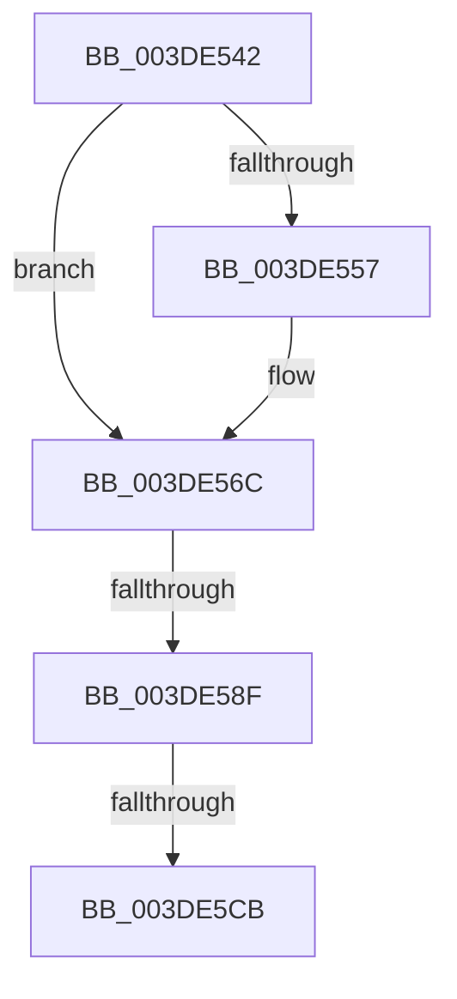

# sub_003DE542

- RVA: `0x003DE542`–`0x003DE5E2` (길이 `160` bytes)
- VA: `0x00000001403DE542`
- 실행 섹션: `.text`
- PDB 이름 있음: `아니요`; PDB Function 태그: `아니요`
- unwind 정보 RVA: `0x000944F0`
- 디코드: `37`개 명령, `160/160` bytes 표시
- 미해석 바이트: `0` (있으면 어셈블리에 `.byte`로 보존)

> 이 문서는 커널 이미지의 기계어와 PDB 기호를 분석해 생성했습니다. 4번과 5번은 함수 원형과 자료형을 바이너리 사용 방식에서 추정한 C 해석이며 원본 소스 복구 결과는 아닙니다.

## 1. Dependencies

- 직접 호출 지점: **0**; 고유 호출 대상: **0**
- 직접 호출자로 확인된 함수: **0**
- RIP 상대 이미지 참조: **1**

### Outgoing calls
- 직접 디코드된 call 명령이 없습니다.

### Direct callers
- 이 함수 시작 RVA로 연결되는 직접 call은 확인되지 않았습니다. 간접 호출은 완전히 역산할 수 없습니다.

### Static image references
- `0x003DE55A` → RVA `0x00E0A778` (`.data`; read)

## 2. Other-region calls and transfers

- 다른 실행 섹션으로 향하는 call: **0**
- call이 아닌 외부 분기/꼬리 이동: **3**
  - `0x003DE589` → [sub_003DE6AD](Unknown_function_003DE6AD.md) (`tail-transfer`)
  - `0x003DE5C5` → [sub_003DE657](Unknown_function_003DE657.md) (`tail-transfer`)
  - `0x003DE5E0` → [sub_003DE5E2 + 0x62](Unknown_function_003DE5E2.md) (`tail-transfer`)

## 3. Assembly (complete function range)

```asm
003DE542  4C 89 74 24 28                  mov qword ptr [rsp + 0x28], r14
003DE547  4C 8B DA                        mov r11, rdx
003DE54A  4C 8B D1                        mov r10, rcx
003DE54D  BF 01 00 00 00                  mov edi, 1
003DE552  83 F8 02                        cmp eax, 2
003DE555  74 15                           je 0x1403de56c
003DE557  83 F8 03                        cmp eax, 3
003DE55A  8B 05 18 C2 A2 00               mov eax, dword ptr [rip + 0xa2c218]
003DE560  80 B9 BD 01 00 00 00            cmp byte ptr [rcx + 0x1bd], 0
003DE567  0F 45 C7                        cmovne eax, edi
003DE56A  8B F8                           mov edi, eax
003DE56C  48 8B 91 90 00 00 00            mov rdx, qword ptr [rcx + 0x90]
003DE573  44 0F B6 A1 99 00 00 00         movzx r12d, byte ptr [rcx + 0x99]
003DE57B  48 C1 EA 0C                     shr rdx, 0xc
003DE57F  80 7C 24 40 00                  cmp byte ptr [rsp + 0x40], 0
003DE584  48 89 5C 24 20                  mov qword ptr [rsp + 0x20], rbx
003DE589  0F 84 1E 01 00 00               je 0x1403de6ad
003DE58F  32 DB                           xor bl, bl
003DE591  41 8B C1                        mov eax, r9d
003DE594  4C 89 7C 24 30                  mov qword ptr [rsp + 0x30], r15
003DE599  25 FF 0F 00 00                  and eax, 0xfff
003DE59E  41 B8 00 10 00 00               mov r8d, 0x1000
003DE5A4  44 2B C0                        sub r8d, eax
003DE5A7  49 8B C1                        mov rax, r9
003DE5AA  49 2B 43 20                     sub rax, qword ptr [r11 + 0x20]
003DE5AE  48 C1 E8 0C                     shr rax, 0xc
003DE5B2  8B C0                           mov eax, eax
003DE5B4  49 8D 34 C3                     lea rsi, [r11 + rax*8]
003DE5B8  44 8B 5C 24 48                  mov r11d, dword ptr [rsp + 0x48]
003DE5BD  4C 8D 76 30                     lea r14, [rsi + 0x30]
003DE5C1  48 39 56 30                     cmp qword ptr [rsi + 0x30], rdx
003DE5C5  0F 86 8C 00 00 00               jbe 0x1403de657
003DE5CB  45 33 C0                        xor r8d, r8d
003DE5CE  41 80 BA BA 01 00 00 00         cmp byte ptr [r10 + 0x1ba], 0
003DE5D6  4C 8B 7C 24 30                  mov r15, qword ptr [rsp + 0x30]
003DE5DB  4C 8B 74 24 28                  mov r14, qword ptr [rsp + 0x28]
003DE5E0  74 62                           je 0x1403de644
```

## 4. C-style interpretation (structured pseudocode)

```c
__int64 __fastcall sub_003DE542(__int64 a1, __int64 a2, __int64 a3, __int64 a4, __int64 a5, __int64 a6, __int64 a7, unsigned __int8 a8, unsigned int a9)
{
    __int64 result;
    __int64 v_rbx;
    __int64 v_rdi;
    unsigned __int64 v_stack_p20;
    unsigned __int64 v_stack_p28;
    unsigned __int64 v_stack_p30;

    v_stack_p28 = v_r14;
    v_rdi = 1;
    if (((unsigned int)(result)) != 2) {
        result = *(unsigned int *)(v_rip + 10666520);
        if ((*(unsigned __int8 *)(a1 + 445)) != 0) { result = 1; }
        v_rdi = (unsigned int)(result);
    }
    a2 = (*(unsigned __int64 *)(a1 + 144)) >> (12);
    v_stack_p20 = v_rbx;
    v_rbx = 0;
    v_stack_p30 = v_r15;
    result = (unsigned int)(((unsigned int)((unsigned int)(a4))) & (0xFFFULL));
    a3 = (unsigned int)(((unsigned int)(0x1000ULL)) - ((unsigned int)(result)));
    result = (a4) - (*(unsigned __int64 *)(a2 + 32));
    result = (result) >> (12);
    a3 = 0;
}
```

## 5. (Beta) C Style

```c
int64_t sub_003DE542(void *Arg1, void *Arg2, int64_t Arg3, int64_t Arg4, int64_t Arg5, int64_t Arg6, uint64_t Arg7, uint8_t Arg8, uint32_t Arg9)
{
    uint8_t *arg1 = (uint8_t *)Arg1;
    uint8_t *arg2 = (uint8_t *)Arg2;

    int64_t result;
    int64_t local_rbx;
    int64_t local_rdi;
    uint64_t v_stack_p20;
    uint64_t v_stack_p28;
    uint64_t v_stack_p30;

    v_stack_p28 = local_r14;
    local_rdi = 1;
    if (((uint32_t)(result)) != 2) {
        result = *(uint32_t *)(v_rip + 0xA2C218);
        if ((*(uint8_t *)(arg1 + 0x1BD)) != 0) { result = 1; }
        local_rdi = (uint32_t)(result);
    }
    Arg2 = (*(uint64_t *)(arg1 + 0x90)) >> (12);
    v_stack_p20 = local_rbx;
    local_rbx = 0;
    v_stack_p30 = local_r15;
    result = (uint32_t)(((uint32_t)((uint32_t)(Arg4))) & (0xFFFULL));
    Arg3 = (uint32_t)(((uint32_t)(0x1000ULL)) - ((uint32_t)(result)));
    result = (Arg4) - (*(uint64_t *)(arg2 + 0x20));
    result = (result) >> (12);
    Arg3 = 0;
}
```

### 관측된 메모리 오프셋

구조체 형식이 확인되지 않은 접근은 인자 기준의 오프셋으로만 기록했습니다.

| 기준 인자 | 오프셋 표현 | 폭 (bit) | 접근 |
|---|---:|---:|---|
| `Arg1` | `+ 0x90` | `64` | `R` |
| `Arg1` | `+ 0x99` | `8` | `R` |
| `Arg1` | `+ 0x1BA` | `8` | `R` |
| `Arg1` | `+ 0x1BD` | `8` | `R` |
| `Arg2` | `+ 0x0 + rax*8` | `64` | `R` |
| `Arg2` | `+ 0x20` | `64` | `R` |
| `Arg2` | `+ 0x30` | `64` | `R` |

## 6. Execution-region graph

[열기: 2D/3D 그래프와 함수 탐색 컨트롤 패널](../../../control-panel.html?section=text&rva=0x003DE542&view=graph)

- 2D 그래프는 위에서 아래로 흐르고, 3D 그래프는 빈 공간을 드래그해 회전합니다. Shift+드래그는 이동, 휠은 확대·축소, 함수 노드 선택은 대상 보고서 이동입니다.

### Static fallback


