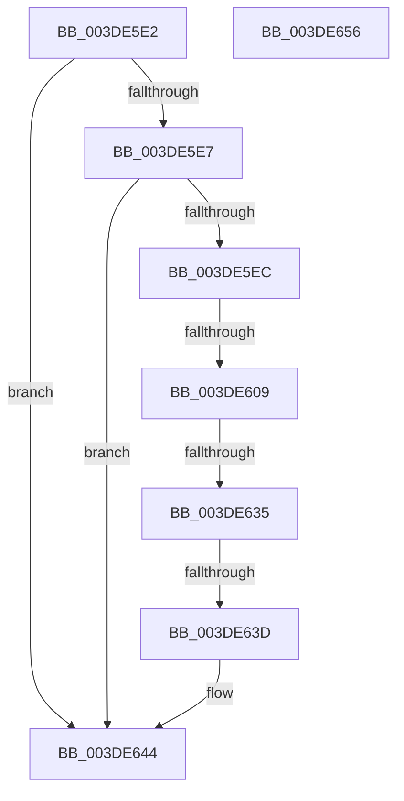

# sub_003DE5E2

- RVA: `0x003DE5E2`–`0x003DE657` (길이 `117` bytes)
- VA: `0x00000001403DE5E2`
- 실행 섹션: `.text`
- PDB 이름 있음: `아니요`; PDB Function 태그: `아니요`
- unwind 정보 RVA: `0x0009450C`
- 디코드: `33`개 명령, `117/117` bytes 표시
- 미해석 바이트: `0` (있으면 어셈블리에 `.byte`로 보존)

> 이 문서는 커널 이미지의 기계어와 PDB 기호를 분석해 생성했습니다. 4번과 5번은 함수 원형과 자료형을 바이너리 사용 방식에서 추정한 C 해석이며 원본 소스 복구 결과는 아닙니다.

## 1. Dependencies

- 직접 호출 지점: **0**; 고유 호출 대상: **0**
- 직접 호출자로 확인된 함수: **0**
- RIP 상대 이미지 참조: **0**

### Outgoing calls
- 직접 디코드된 call 명령이 없습니다.

### Direct callers
- 이 함수 시작 RVA로 연결되는 직접 call은 확인되지 않았습니다. 간접 호출은 완전히 역산할 수 없습니다.

### Static image references
- 디코드된 RIP-relative 메모리 참조가 없습니다.

## 2. Other-region calls and transfers

- 다른 실행 섹션으로 향하는 call: **0**
- call이 아닌 외부 분기/꼬리 이동: **3**
  - `0x003DE603` → [sub_003DE691](Unknown_function_003DE691.md) (`tail-transfer`)
  - `0x003DE62F` → [sub_003DE6C1](Unknown_function_003DE6C1.md) (`tail-transfer`)
  - `0x003DE637` → [sub_003DE777 + 0x18](Unknown_function_003DE777.md) (`tail-transfer`)

## 3. Assembly (complete function range)

```asm
003DE5E2  45 85 DB                        test r11d, r11d
003DE5E5  74 5D                           je 0x1403de644
003DE5E7  45 85 C0                        test r8d, r8d
003DE5EA  75 58                           jne 0x1403de644
003DE5EC  41 8B C9                        mov ecx, r9d
003DE5EF  B8 00 10 00 00                  mov eax, 0x1000
003DE5F4  81 E1 FF 0F 00 00               and ecx, 0xfff
003DE5FA  48 83 C6 38                     add rsi, 0x38
003DE5FE  2B C1                           sub eax, ecx
003DE600  41 3B C3                        cmp eax, r11d
003DE603  0F 82 88 00 00 00               jb 0x1403de691
003DE609  41 0F 47 C3                     cmova eax, r11d
003DE60D  48 8B 4D 38                     mov rcx, qword ptr [rbp + 0x38]
003DE611  41 81 E1 FF 0F 00 00            and r9d, 0xfff
003DE618  41 B8 00 10 00 00               mov r8d, 0x1000
003DE61E  45 2B C1                        sub r8d, r9d
003DE621  48 8B 11                        mov rdx, qword ptr [rcx]
003DE624  4C 8B 49 08                     mov r9, qword ptr [rcx + 8]
003DE628  48 C1 EA 0C                     shr rdx, 0xc
003DE62C  44 3B C0                        cmp r8d, eax
003DE62F  0F 82 8C 00 00 00               jb 0x1403de6c1
003DE635  84 DB                           test bl, bl
003DE637  0F 85 52 01 00 00               jne 0x1403de78f
003DE63D  44 3B C0                        cmp r8d, eax
003DE640  44 0F 47 C0                     cmova r8d, eax
003DE644  41 8B C0                        mov eax, r8d
003DE647  48 8B 5C 24 20                  mov rbx, qword ptr [rsp + 0x20]
003DE64C  48 8B 6C 24 38                  mov rbp, qword ptr [rsp + 0x38]
003DE651  41 5C                           pop r12
003DE653  5F                              pop rdi
003DE654  5E                              pop rsi
003DE655  C3                              ret
003DE656  CC                              int3
```

## 4. C-style interpretation (structured pseudocode)

```c
__int64 __fastcall sub_003DE5E2(__int64 a1, __int64 a2, int a3, int a4, __int64 a5, __int64 a6, __int64 a7)
{
    __int64 result;
    __int64 v_rsi;
    unsigned __int64 v_stack_p20;

    if ((unsigned int)(v_r11) == 0) goto loc_003DE644;
    if (a3 != 0) goto loc_003DE644;
    a1 = (unsigned int)(((unsigned int)(a4)) & (0xFFFULL));
    v_rsi = (v_rsi) + (56);
    result = (unsigned int)(((unsigned int)(0x1000ULL)) - ((unsigned int)(a1)));
    if (((unsigned int)(result)) > ((unsigned int)(v_r11))) { result = (unsigned int)(v_r11); }
    a4 = (unsigned int)((a4) & (0xFFFULL));
    a3 = (unsigned int)(((unsigned int)(0x1000ULL)) - (a4));
    a2 = (*(unsigned __int64 *)(*(unsigned __int64 *)(v_rbp + 56))) >> (12);
    if (a3 > ((unsigned int)(result))) { a3 = (unsigned int)(result); }
loc_003DE644:
    return (unsigned int)(a3);
}
```

## 5. (Beta) C Style

```c
int64_t sub_003DE5E2(int64_t Arg1, int64_t Arg2, int32_t Arg3, int32_t Arg4, uint64_t Arg5, uint64_t Arg6, int64_t Arg7)
{
    int64_t result;
    int64_t local_rsi;
    uint64_t v_stack_p20;

    if ((uint32_t)(local_r11) == 0) goto loc_003DE644;
    if (Arg3 != 0) goto loc_003DE644;
    Arg1 = (uint32_t)(((uint32_t)(Arg4)) & (0xFFFULL));
    local_rsi = (local_rsi) + (56);
    result = (uint32_t)(((uint32_t)(0x1000ULL)) - ((uint32_t)(Arg1)));
    if (((uint32_t)(result)) > ((uint32_t)(local_r11))) { result = (uint32_t)(local_r11); }
    Arg4 = (uint32_t)((Arg4) & (0xFFFULL));
    Arg3 = (uint32_t)(((uint32_t)(0x1000ULL)) - (Arg4));
    Arg2 = (*(uint64_t *)(*(uint64_t *)(local_rbp + 0x38))) >> (12);
    if (Arg3 > ((uint32_t)(result))) { Arg3 = (uint32_t)(result); }
loc_003DE644:
    return (uint32_t)(Arg3);
}
```

## 6. Execution-region graph

[열기: 2D/3D 그래프와 함수 탐색 컨트롤 패널](../../../control-panel.html?section=text&rva=0x003DE5E2&view=graph)

- 2D 그래프는 위에서 아래로 흐르고, 3D 그래프는 빈 공간을 드래그해 회전합니다. Shift+드래그는 이동, 휠은 확대·축소, 함수 노드 선택은 대상 보고서 이동입니다.

### Static fallback


