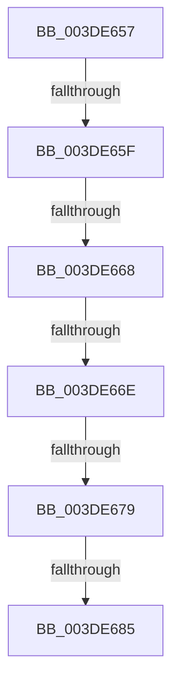

# sub_003DE657

- RVA: `0x003DE657`–`0x003DE691` (길이 `58` bytes)
- VA: `0x00000001403DE657`
- 실행 섹션: `.text`
- PDB 이름 있음: `아니요`; PDB Function 태그: `아니요`
- unwind 정보 RVA: `0x00094524`
- 디코드: `13`개 명령, `58/58` bytes 표시
- 미해석 바이트: `0` (있으면 어셈블리에 `.byte`로 보존)

> 이 문서는 커널 이미지의 기계어와 PDB 기호를 분석해 생성했습니다. 4번과 5번은 함수 원형과 자료형을 바이너리 사용 방식에서 추정한 C 해석이며 원본 소스 복구 결과는 아닙니다.

## 1. Dependencies

- 직접 호출 지점: **0**; 고유 호출 대상: **0**
- 직접 호출자로 확인된 함수: **0**
- RIP 상대 이미지 참조: **0**

### Outgoing calls
- 직접 디코드된 call 명령이 없습니다.

### Direct callers
- 이 함수 시작 RVA로 연결되는 직접 call은 확인되지 않았습니다. 간접 호출은 완전히 역산할 수 없습니다.

### Static image references
- 디코드된 RIP-relative 메모리 참조가 없습니다.

## 2. Other-region calls and transfers

- 다른 실행 섹션으로 향하는 call: **0**
- call이 아닌 외부 분기/꼬리 이동: **6**
  - `0x003DE659` → [sub_003DE710 + 0x25](Unknown_function_003DE710.md) (`tail-transfer`)
  - `0x003DE662` → [sub_003DE710](Unknown_function_003DE710.md) (`tail-transfer`)
  - `0x003DE668` → [sub_003DE542 + 0x8C](Unknown_function_003DE542.md) (`tail-transfer`)
  - `0x003DE673` → [sub_003DE542 + 0x8C](Unknown_function_003DE542.md) (`tail-transfer`)
  - `0x003DE67F` → [sub_003DE542 + 0x8C](Unknown_function_003DE542.md) (`tail-transfer`)
  - `0x003DE68C` → [sub_003DE542 + 0x8C](Unknown_function_003DE542.md) (`tail-transfer`)

## 3. Assembly (complete function range)

```asm
003DE657  84 DB                           test bl, bl
003DE659  0F 85 D6 00 00 00               jne 0x1403de735
003DE65F  45 3B C3                        cmp r8d, r11d
003DE662  0F 82 A8 00 00 00               jb 0x1403de710
003DE668  0F 86 60 FF FF FF               jbe 0x1403de5ce
003DE66E  45 8B C3                        mov r8d, r11d
003DE671  84 DB                           test bl, bl
003DE673  0F 84 55 FF FF FF               je 0x1403de5ce
003DE679  8D 47 FF                        lea eax, [rdi - 1]
003DE67C  41 85 C3                        test r11d, eax
003DE67F  0F 84 49 FF FF FF               je 0x1403de5ce
003DE685  41 81 E0 00 F0 FF FF            and r8d, 0xfffff000
003DE68C  E9 3D FF FF FF                  jmp 0x1403de5ce
```

## 4. C-style interpretation (structured pseudocode)

```c
__int64 __fastcall sub_003DE657(__int64 a1, __int64 a2, int a3)
{
    a3 = (unsigned int)(((unsigned int)((unsigned int)(v_r11))) & (0xFFFFF000ULL));
}
```

## 5. (Beta) C Style

```c
int64_t sub_003DE657(int64_t Arg1, int64_t Arg2, int32_t Arg3)
{
    Arg3 = (uint32_t)(((uint32_t)((uint32_t)(local_r11))) & (0xFFFFF000ULL));
}
```

## 6. Execution-region graph

[열기: 2D/3D 그래프와 함수 탐색 컨트롤 패널](../../../control-panel.html?section=text&rva=0x003DE657&view=graph)

- 2D 그래프는 위에서 아래로 흐르고, 3D 그래프는 빈 공간을 드래그해 회전합니다. Shift+드래그는 이동, 휠은 확대·축소, 함수 노드 선택은 대상 보고서 이동입니다.

### Static fallback


