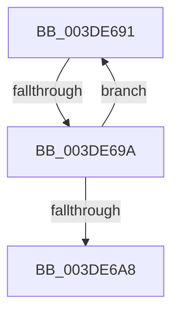

# sub_003DE691

- RVA: `0x003DE691`–`0x003DE6AD` (길이 `28` bytes)
- VA: `0x00000001403DE691`
- 실행 섹션: `.text`
- PDB 이름 있음: `아니요`; PDB Function 태그: `아니요`
- unwind 정보 RVA: `0x00094540`
- 디코드: `7`개 명령, `28/28` bytes 표시
- 미해석 바이트: `0` (있으면 어셈블리에 `.byte`로 보존)

> 이 문서는 커널 이미지의 기계어와 PDB 기호를 분석해 생성했습니다. 4번과 5번은 함수 원형과 자료형을 바이너리 사용 방식에서 추정한 C 해석이며 원본 소스 복구 결과는 아닙니다.

## 1. Dependencies

- 직접 호출 지점: **0**; 고유 호출 대상: **0**
- 직접 호출자로 확인된 함수: **0**
- RIP 상대 이미지 참조: **0**

### Outgoing calls
- 직접 디코드된 call 명령이 없습니다.

### Direct callers
- 이 함수 시작 RVA로 연결되는 직접 call은 확인되지 않았습니다. 간접 호출은 완전히 역산할 수 없습니다.

### Static image references
- 디코드된 RIP-relative 메모리 참조가 없습니다.

## 2. Other-region calls and transfers

- 다른 실행 섹션으로 향하는 call: **0**
- call이 아닌 외부 분기/꼬리 이동: **2**
  - `0x003DE694` → [sub_003DE5E2 + 0x2B](Unknown_function_003DE5E2.md) (`tail-transfer`)
  - `0x003DE6A8` → [sub_003DE5E2 + 0x27](Unknown_function_003DE5E2.md) (`tail-transfer`)

## 3. Assembly (complete function range)

```asm
003DE691  48 39 16                        cmp qword ptr [rsi], rdx
003DE694  0F 86 73 FF FF FF               jbe 0x1403de60d
003DE69A  05 00 10 00 00                  add eax, 0x1000
003DE69F  48 83 C6 08                     add rsi, 8
003DE6A3  41 3B C3                        cmp eax, r11d
003DE6A6  72 E9                           jb 0x1403de691
003DE6A8  E9 5C FF FF FF                  jmp 0x1403de609
```

## 4. C-style interpretation (structured pseudocode)

```c
__int64 __fastcall sub_003DE691(__int64 a1, __int64 a2)
{
    __int64 result;
    __int64 v_rsi;

    result = (unsigned int)((result) + (0x1000ULL));
    v_rsi = (v_rsi) + (8);
    if (((unsigned int)(result)) < ((unsigned int)(v_r11))) goto loc_003DE691;
}
```

## 5. (Beta) C Style

```c
int64_t sub_003DE691(int64_t Arg1, int64_t Arg2)
{
    int64_t result;
    int64_t local_rsi;

    result = (uint32_t)((result) + (0x1000ULL));
    local_rsi = (local_rsi) + (8);
    if (((uint32_t)(result)) < ((uint32_t)(local_r11))) goto loc_003DE691;
}
```

## 6. Execution-region graph

[열기: 2D/3D 그래프와 함수 탐색 컨트롤 패널](../../../control-panel.html?section=text&rva=0x003DE691&view=graph)

- 2D 그래프는 위에서 아래로 흐르고, 3D 그래프는 빈 공간을 드래그해 회전합니다. Shift+드래그는 이동, 휠은 확대·축소, 함수 노드 선택은 대상 보고서 이동입니다.

### Static fallback


