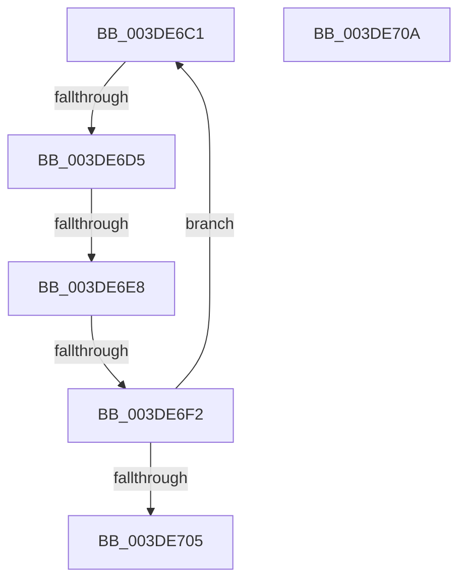

# sub_003DE6C1

- RVA: `0x003DE6C1`–`0x003DE710` (길이 `79` bytes)
- VA: `0x00000001403DE6C1`
- 실행 섹션: `.text`
- PDB 이름 있음: `아니요`; PDB Function 태그: `아니요`
- unwind 정보 RVA: `0x0009456C`
- 디코드: `18`개 명령, `79/79` bytes 표시
- 미해석 바이트: `0` (있으면 어셈블리에 `.byte`로 보존)

> 이 문서는 커널 이미지의 기계어와 PDB 기호를 분석해 생성했습니다. 4번과 5번은 함수 원형과 자료형을 바이너리 사용 방식에서 추정한 C 해석이며 원본 소스 복구 결과는 아닙니다.

## 1. Dependencies

- 직접 호출 지점: **0**; 고유 호출 대상: **0**
- 직접 호출자로 확인된 함수: **0**
- RIP 상대 이미지 참조: **0**

### Outgoing calls
- 직접 디코드된 call 명령이 없습니다.

### Direct callers
- 이 함수 시작 RVA로 연결되는 직접 call은 확인되지 않았습니다. 간접 호출은 완전히 역산할 수 없습니다.

### Static image references
- 디코드된 RIP-relative 메모리 참조가 없습니다.

## 2. Other-region calls and transfers

- 다른 실행 섹션으로 향하는 call: **0**
- call이 아닌 외부 분기/꼬리 이동: **4**
  - `0x003DE6CF` → [sub_003DE5E2 + 0x53](Unknown_function_003DE5E2.md) (`tail-transfer`)
  - `0x003DE6E2` → [sub_003DE5E2 + 0x53](Unknown_function_003DE5E2.md) (`tail-transfer`)
  - `0x003DE6EC` → [sub_003DE777](Unknown_function_003DE777.md) (`tail-transfer`)
  - `0x003DE705` → [sub_003DE5E2 + 0x53](Unknown_function_003DE5E2.md) (`tail-transfer`)

## 3. Assembly (complete function range)

```asm
003DE6C1  4D 8B 11                        mov r10, qword ptr [r9]
003DE6C4  48 8D 4A 01                     lea rcx, [rdx + 1]
003DE6C8  49 C1 EA 0C                     shr r10, 0xc
003DE6CC  4C 3B D1                        cmp r10, rcx
003DE6CF  0F 85 60 FF FF FF               jne 0x1403de635
003DE6D5  49 8B CA                        mov rcx, r10
003DE6D8  48 33 CA                        xor rcx, rdx
003DE6DB  48 F7 C1 00 00 F0 FF            test rcx, -0x100000
003DE6E2  0F 85 4D FF FF FF               jne 0x1403de635
003DE6E8  41 80 FC 01                     cmp r12b, 1
003DE6EC  0F 85 85 00 00 00               jne 0x1403de777
003DE6F2  4D 8B 49 08                     mov r9, qword ptr [r9 + 8]
003DE6F6  41 81 C0 00 10 00 00            add r8d, 0x1000
003DE6FD  49 8B D2                        mov rdx, r10
003DE700  44 3B C0                        cmp r8d, eax
003DE703  72 BC                           jb 0x1403de6c1
003DE705  E9 2B FF FF FF                  jmp 0x1403de635
003DE70A  66 0F 1F 44 00 00               nop word ptr [rax + rax]
```

## 4. C-style interpretation (structured pseudocode)

```c
void __fastcall sub_003DE6C1(__int64 a1, __int64 a2, int a3, __int64 a4)
{
    __int64 v_r10;

    v_r10 = (*(unsigned __int64 *)(a4)) >> (12);
    a1 = (v_r10) ^ (a2);
    a3 = (unsigned int)((a3) + (0x1000ULL));
    if (a3 < ((unsigned int)(result))) goto loc_003DE6C1;
}
```

## 5. (Beta) C Style

```c
void sub_003DE6C1(int64_t Arg1, int64_t Arg2, int32_t Arg3, int64_t Arg4)
{
    int64_t local_r10;

    local_r10 = (*(uint64_t *)(Arg4)) >> (12);
    Arg1 = (local_r10) ^ (Arg2);
    Arg3 = (uint32_t)((Arg3) + (0x1000ULL));
    if (Arg3 < ((uint32_t)(result))) goto loc_003DE6C1;
}
```

## 6. Execution-region graph

[열기: 2D/3D 그래프와 함수 탐색 컨트롤 패널](../../../control-panel.html?section=text&rva=0x003DE6C1&view=graph)

- 2D 그래프는 위에서 아래로 흐르고, 3D 그래프는 빈 공간을 드래그해 회전합니다. Shift+드래그는 이동, 휠은 확대·축소, 함수 노드 선택은 대상 보고서 이동입니다.

### Static fallback


